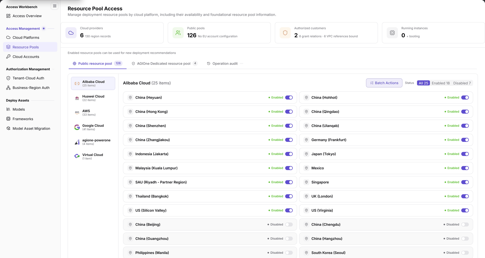
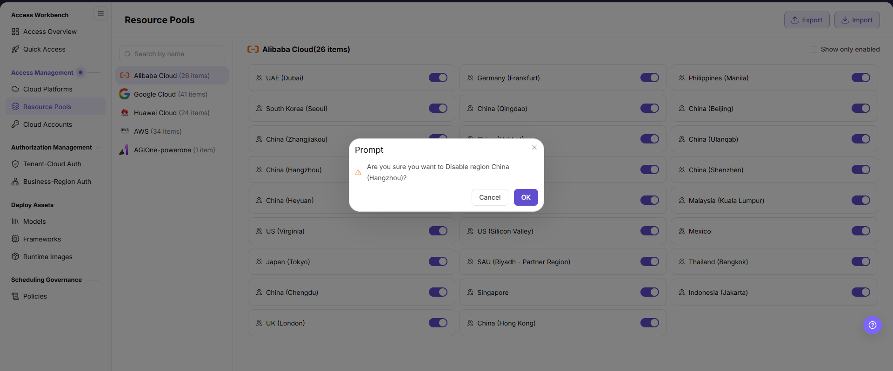

# Resource Pools

::: info Document Information
Version: v2.1
Updated: 2026-11-12
:::

## Feature Overview

| Item | Content |
| --- | --- |
| Applicable Roles | Operators |
| Navigation Path | AI Infra(On-Cloud) > Access Management > Resource Pools |
| Page Route | `/infrahub/op/access/region` |
| Managed Objects | Public and AGIOne dedicated resource pools under cloud platforms and their enabled states |

#### Beginner Explanation

Resource Pools is like a resource directory grouped by cloud platform: select the pool type and platform, then check the region and enabled state.

#### Terms Quick Reference

| Term | Description |
| --- | --- |
| Public resource pool | One pool category on the page, separate from AGIOne Dedicated resource pool. |
| AGIOne Dedicated resource pool | The other pool category on the page. |
| Enabled state | Enabled or Disabled displayed in a resource-pool row, alongside a switch. |
| Operation audit | An entry beside the pool-type controls. |

## Prerequisites

1. The current account has access to Resource Pools.
2. Confirm the target platform, pool type, and region.
3. Before changing state, check the impact on tenant authorization, business authorization, and existing deployments. Do not touch state switches for query-only work.

## Page Description

The menu entry is **Resource Pools**, while the page heading is **Resource Pool Access**. They refer to the same page.

| Area | Description |
| --- | --- |
| Overview cards | Current statistics for cloud providers, public pools, authorized customers, and running instances. |
| Pool types | Public resource pool and AGIOne Dedicated resource pool. |
| Audit entry | Operation audit, beside the pool-type controls. |
| Platform groups | Platforms and current item counts on the left; selecting a platform displays its pools. |
| Pool list | Pool names, enabled states, and switches. |
| Status and batch actions | All, Enabled, and Disabled filters, plus Batch Actions. |

The figure shows Resource Pool Access, with Public resource pool, AGIOne Dedicated resource pool, and Operation audit above the platform groups. Pools for the selected platform appear on the right with status filters, Batch Actions, and individual switches.

## Main Operations

### View Resource Pools

1. Open Resource Pools under Access Management.
2. Select Public resource pool or AGIOne Dedicated resource pool first.
3. Select the target platform on the left, then select All, Enabled, or Disabled as needed.
4. Check the target pool name and state. Use current page counts rather than treating screenshot values as fixed configuration.
5. For operation-record review, locate Operation audit. Before using Batch Actions, check the type, platform, and target scope.

### Review Enable or Disable Actions

1. Locate the target region under the correct pool type and platform, then check its current state and change impact.
2. Operate its switch only when the change is authorized. If a confirmation dialog appears, check the region name and enable or disable action word for word.
3. Use Cancel when no change is intended. For confirmation, follow the button actually displayed in the current dialog.
4. After an operation, review this page's state and the target objects on related authorization and deployment pages separately; closing a confirmation dialog is not a result check.

The figure shows a regional resource-pool disable prompt containing the target region, Cancel, and OK. Check the region and intended disable action before confirming.

## Parameter Quick Reference

| Field Name | Required | Field Type | Example | Description |
| --- | --- | --- | --- | --- |
| Pool type | No | Category selector | `Public resource pool` | AGIOne Dedicated resource pool is the other category; establish query scope first. |
| Cloud platform | No | Group list | Select the target platform | Selects the platform to inspect. |
| Resource pool count | — | Statistic | Current page value | Displayed for the selected platform and scope, not a fixed count. |
| Resource pool name | — | List field | Check the target region | Name of the regional resource pool. |
| Status filter | No | Segmented control | `All` | All, Enabled, and Disabled. |
| Enabled state | — | Status and switch | `Enabled` / `Disabled` | Corresponds to the target pool; check impact before changing it. |
| Operation audit | No | Page entry | `Operation audit` | Entry for operation review. |
| Batch Actions | No | Action entry | `Batch Actions` | Batch-processing entry for the selected scope. |
| Confirmation prompt | — | Dialog | Target region name | Check the region and action; do not assume every operation uses the same prompt. |
| Cancel / OK | No | Dialog buttons | `Cancel` / `OK` | Exit and confirm entries in the pictured disable prompt; follow the actual dialog. |

## Pitfalls

- Pool type, platform, and enabled state are separate filtering levels. Review them together when locating a record.
- A switch beside a region is a state-change entry, not a details entry. Do not toggle it for query-only work.
- Platform item counts and status-filter counts correspond to the current page scope. Screenshot numbers are not fixed acceptance values.

## Result Validation

| Check Item | Success Signal | If Abnormal |
| --- | --- | --- |
| Page location | Resource Pools is highlighted and the heading reads Resource Pool Access | Locate the page using its menu name and route. |
| Type scope | The selected public or AGIOne dedicated pool category is identifiable | Check the pool-type controls first. |
| Platform and region | The selected platform matches the target region, with pool name and state available for review | Check the platform group and current status filter. |
| Action locations | Operation audit, Batch Actions, and individual switches can be located | Distinguish review entries from configuration changes; do not use a switch for queries. |

## FAQ

#### Why Does the List Show Only Part of the Pool Inventory?

**Symptom:**

The list displays pools for a particular platform, type, or state.

**Possible Causes:**

The page provides separate pool-type, platform-group, and status controls; the list corresponds to their selected scope.

**Resolution:**

Check the pool type, target platform, and status filter in order, then locate the pool by name instead of comparing screenshot counts alone.

#### Can I Use a Pool Switch to View Details?

**Symptom:**

A status label and switch appear beside the pool name.

**Possible Causes:**

The switch corresponds to the enabled state; the pictured disable prompt identifies the target region and action.

**Resolution:**

Read the name and state for inspection. Operate a switch only for an authorized change after checking impact, and verify the target region if a prompt appears.

## Notes

- State and batch changes can affect real configuration. Check authorization and deployment impact first and keep necessary audit records.
- An enabled state does not replace tenant or business authorization. Check downstream usage scope on the relevant page.
- Do not record real credentials, internal addresses, or customer data in documentation, tickets, or chat.

## Next Steps

1. Go to [Business-Region Auth](../../auth-management/business-region-auth/) to review resource-pool usage scope.
2. Go to [Tenant-Cloud Auth](../../auth-management/tenant-cloud-auth/) to review the tenant's cloud-platform scope.
3. Go to [Access Overview](../../access-workbench/access-overview/) to review resource-pool status in the access chain.
