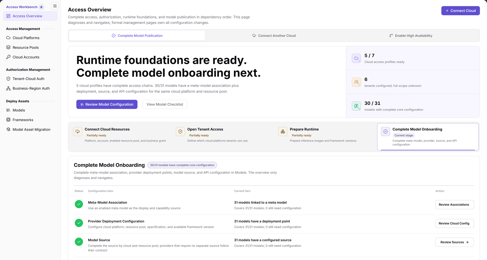
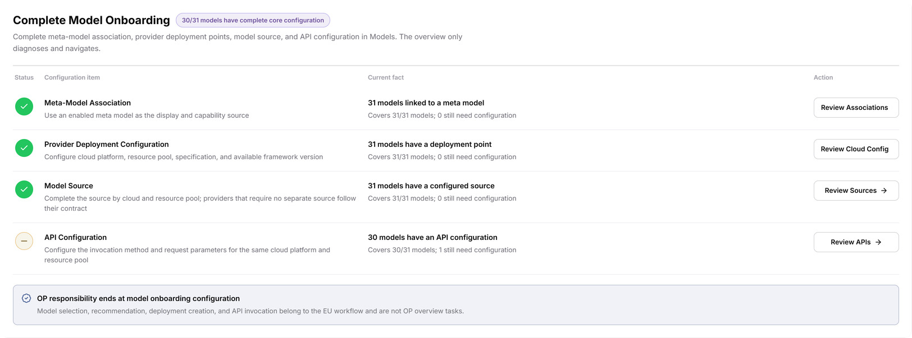

# Access Overview

::: info Document Information
Version: v2.1
Updated: 2026-11-12
:::

## Feature Overview

| Item | Content |
| --- | --- |
| Applicable Roles | Operators |
| Navigation Path | AI Infra(On-Cloud) > Access Workbench > Access Overview |
| Page Route | `/infrahub/op/workbanch/overview` |
| Managed Objects | Readiness of cloud access, tenant access scope, runtime foundations, and model onboarding configuration |

#### Beginner Explanation

Access Overview is a readiness checklist: it identifies configuration gaps in dependency order and directs you to the formal management page responsible for each configuration.

#### Terms Quick Reference

| Term | Description |
| --- | --- |
| Goal | The task selection at the top: Complete Model Publication, Connect Another Cloud, or Enable High Availability. |
| Stage | One of four dependency stages: Connect Cloud Resources, Open Tenant Access, Prepare Runtime, and Complete Model Onboarding. |
| Current fact | Existing coverage and remaining configuration gaps for each item in the stage panel. |
| Model onboarding configuration | Meta-model association, provider deployment configuration, model source, and API configuration—not user deployment creation or API invocation. |

## Prerequisites

1. Enter Access Overview as an operator with access to the relevant formal management pages.
2. Identify whether the task is Complete Model Publication, Connect Another Cloud, or Enable High Availability before reading the goal and stage guidance.
3. Verify upstream dependencies: cloud access includes the platform, account, enabled resource pool, and business grant; tenant access scope and runtime foundations have their own subsequent stages.

## Page Description

This page only diagnoses and navigates; all configuration changes belong to formal management pages. Read the goal and diagnostic summary, review stages in dependency order, and use the configuration-item review entries to locate the responsible management pages.

| Area | Description |
| --- | --- |
| Top entries | Connect Cloud is in the upper right. Goal choices are Complete Model Publication, Connect Another Cloud, and Enable High Availability. Goals and the four stages below are separate controls. |
| Diagnostic summary | Shows current guidance and summaries of cloud access profiles, tenant configuration, and model core configuration. Read counts with their accompanying descriptions; example counts are not fixed requirements. |
| Connect Cloud Resources | Reviews the access chain of platform, account, enabled resource pool, and business grant. |
| Open Tenant Access | Reviews which cloud platforms tenants can use. |
| Prepare Runtime | Reviews readiness of inference images and framework versions. |
| Complete Model Onboarding | Reviews meta-model, provider, source, and API configuration. This stage is selected in the figure. |
| Stage panel | Displays Status, Configuration item, Current fact, and Action to locate gaps and review entries. |

The figure shows goal selection, the diagnostic summary, and the four stages. Complete Model Publication is the top goal, Complete Model Onboarding is the selected stage, and Connect Cloud is a separate entry in the upper right.

## Main Operations

### Read Access Diagnostics

1. Go to `AI Infra(On-Cloud) > Access Workbench > Access Overview`.
2. Check the top goal against your task and read the guidance and statistical descriptions in the diagnostic summary.
3. Review stage names, status, and purpose in this order: Connect Cloud Resources → Open Tenant Access → Prepare Runtime → Complete Model Onboarding. Verify upstream dependencies before addressing the current gap.
4. Locate the stage you need to review. The following example uses Complete Model Onboarding, selected in the figure.

### Review Model Onboarding Configuration

1. In the Complete Model Onboarding panel, review Meta-Model Association, Provider Deployment Configuration, Model Source, and API Configuration row by row.
2. Read coverage and remaining gaps under Current fact; do not rely on the status icon alone.
3. Use Review Associations, Review Cloud Config, Review Sources, or Review APIs for the relevant item. Maintain configuration in formal management pages such as [Models](../../deploy-assets/models/), not in the overview.
4. After addressing configuration, return to the overview and review the relevant current facts again. Overview diagnostics do not replace checking configuration results on the responsible management page.

The figure shows the Complete Model Onboarding panel with review entries for associations, cloud configuration, sources, and APIs. The note at the bottom limits OP responsibility to model onboarding configuration; user model selection, recommendations, deployment creation, and API invocation are not OP tasks.

## Parameter Quick Reference

This is a diagnostic and navigation page. The table lists readable information and action entries, not configuration form fields.

| Field Name | Required | Field Type | Example | Description |
| --- | --- | --- | --- | --- |
| Goal | No | Task selection | `Complete Model Publication` | Top goals include Complete Model Publication, Connect Another Cloud, and Enable High Availability. |
| Connect Cloud | No | Navigation entry | `Connect Cloud` | Cloud access entry in the upper right. |
| Stage | No | Stage selection | `Complete Model Onboarding` | Four stages review access, authorization, runtime foundations, and model onboarding in dependency order. |
| Status | N/A (read-only) | Status icon | As currently displayed | Shows configuration-item status; read with the current facts on that row. |
| Configuration item | N/A (read-only) | Text | `Provider Deployment Configuration` | The item being reviewed in the Complete Model Onboarding panel. |
| Current fact | N/A (read-only) | Text / count | As currently displayed | Shows configuration coverage and remaining gaps. |
| Action | No | Navigation entry | `Review Cloud Config` | Provides Review Associations, Review Cloud Config, Review Sources, and Review APIs entries. |

## Pitfalls

- Current stage identifies the selected diagnostic stage, not completion of every configuration item. The panel still reports current facts and remaining gaps row by row.
- Review provider deployment configuration, model source, and API configuration in the context of the cloud platform and resource pool. The API Configuration description explicitly requires the same cloud platform and resource pool; model totals alone are insufficient.
- When the tenant summary says full scope unknown, do not interpret the configured count as authorization for every tenant.

## Result Validation

| Check Item | Success Signal | If Abnormal |
| --- | --- | --- |
| Page location | The title is Access Overview and its left-menu entry is highlighted | Locate the page again using the navigation path above |
| Goals versus stages | Top goals and the four stages are separately identifiable | Refer to Page Description; do not treat a goal name as a stage name |
| Onboarding checklist | The Complete Model Onboarding panel lists Meta-Model Association, Provider Deployment Configuration, Model Source, and API Configuration | Check the selected stage name |
| Gap location | Each row's current facts can be matched to its review entry | Review items row by row and inspect the corresponding configuration on the formal management page |

## FAQ

#### Why Is There No Configuration Form in the Overview?

**Symptom:**

The panel shows current facts and review entries rather than editable configuration fields.

**Possible Causes:**

The page explicitly states that it only diagnoses and navigates; configuration belongs to formal management pages.

**Resolution:**

Use the corresponding review entry to open the management page responsible for that configuration. Do not treat overview diagnostics as a configuration operation.

#### Why Do the Top Goal and the Stage Have Different Names?

**Symptom:**

The top goal reads Complete Model Publication, while the stage reads Complete Model Onboarding.

**Possible Causes:**

The top control selects a goal; the lower controls provide four stage reviews. They serve different purposes.

**Resolution:**

Confirm the task goal, then locate gaps in stage order. Use the Complete Model Onboarding panel when reviewing onboarding configuration.

## Notes

- OP responsibility ends at model onboarding configuration. User model selection, recommendations, deployment creation, and API invocation belong to the user workflow and must not be listed as operator follow-up tasks on this page.
- Counts and diagnostics reflect the current page. Figure counts are not fixed configuration requirements or proof of deployment success or API availability.
- Before changing a formal management page, confirm the target object, upstream dependencies, and impact scope. Do not record real credentials, keys, or internal addresses in task records.

## Next Steps

1. For cloud access gaps, review [Cloud Platforms](../../access-management/cloud-platforms/), [Cloud Accounts](../../access-management/cloud-accounts/), and [Resource Pools](../../access-management/resource-pools/), together with [Business-Region Auth](../../auth-management/business-region-auth/).
2. For tenant access scope, review [Tenant-Cloud Auth](../../auth-management/tenant-cloud-auth/).
3. For runtime foundations and model onboarding configuration, review [Frameworks](../../deploy-assets/frameworks/) and [Models](../../deploy-assets/models/), and inspect the relevant configuration on those formal pages.
