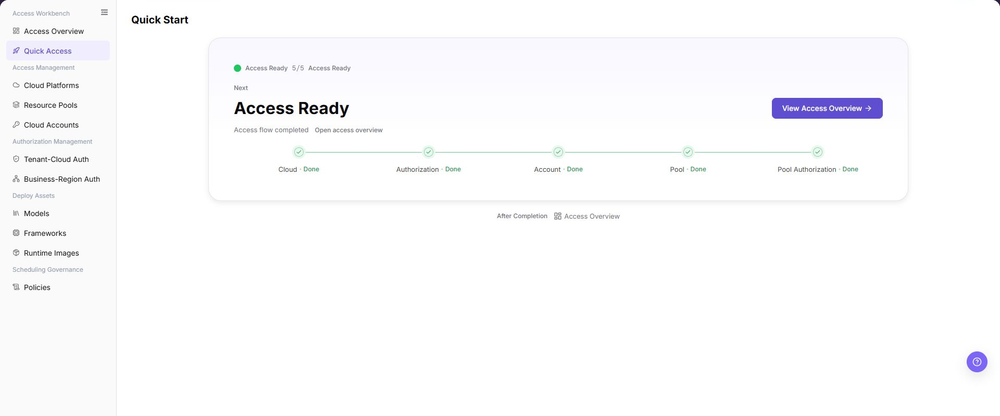

# Quick Access

::: info Document Information
Version: v2.1
Updated: 2026-11-12
:::

## Feature Overview

| Item | Content |
| --- | --- |
| Applicable Roles | Operators |
| Navigation Path | AI Infra(On-Cloud) > Access Workbench > Access Overview |
| Page Route | Legacy entry: `/infrahub/op/workbanch/quick`; redirects to `/infrahub/op/workbanch/overview?stage=cloudAccess` |
| Managed Objects | The legacy Quick Access entry and navigation to cloud access management |

#### Beginner Explanation

In the current Demo operator view, Quick Access is a legacy entry to [Access Overview](../access-overview/), not a separate five-step checklist. The current page diagnoses and navigates; all configuration changes belong to formal management pages.

#### Terms Quick Reference
| Term | Description |
| --- | --- |
| Legacy entry | The former Quick Access route, which now redirects to Access Overview. |
| Stage | One of the four dependency stages on Access Overview. |
| Formal management page | The destination where the corresponding configuration is maintained. |

#### Recommended Operation Order

Open the current Access Overview, locate the relevant stage, then use its navigation entry to reach the responsible management page. See [Access Overview](../access-overview/) for the complete diagnostic workflow.

#### Beginner Checklist

| Scenario | Do First | Do Not Do Directly |
| --- | --- | --- |
| Opening an old link | Confirm that the destination is Access Overview | Wait for a separate five-step wizard |
| Connecting a cloud | Use Connect Cloud and confirm the Cloud Platforms destination | Treat navigation as a saved platform configuration |
| Before a configuration change | Verify dependencies, scope and the target on the formal management page | Change an unknown object or skip impact checks |
| An unexpected destination appears | Record the current route and page title | Submit configuration repeatedly or record real credentials |

## Prerequisites

1. Use an operator account with access to Access Overview and the relevant formal management pages.
2. Confirm the target platform, tenant, business and resource scope before changing configuration on a formal management page.
3. Use the current Access Overview navigation path above; an existing Quick Access link redirects to that page.

## Page Description

The legacy route opens Access Overview at `/infrahub/op/workbanch/overview?stage=cloudAccess`. The current page has four stages: `Connect Cloud Resources`, `Open Tenant Access`, `Prepare Runtime`, and `Complete Model Onboarding`. It diagnoses and navigates rather than saving configuration.

The illustration below is retained as a legacy example:

The figure shows the illustration retained from the earlier Quick Access instructions. The current entry redirects to Access Overview; follow its current navigation rather than relying on this illustration.

## Main Operations

### Open the Legacy Entry

1. Open `/infrahub/op/workbanch/quick` from an existing link.
2. Confirm that the destination is Access Overview and the route is `/infrahub/op/workbanch/overview?stage=cloudAccess`.
3. Use [Access Overview](../access-overview/) for current diagnostic instructions; do not wait for the old five-step checklist.

### Open Cloud Platforms

1. On the current Access Overview page, click **"Connect Cloud"**.
2. Confirm that the destination title is Cloud Platforms. This navigation carries `quickstart=1`, `quickstartStep=platform` and `businessId=inference` query parameters.
3. Follow [Cloud Platforms](../../access-management/cloud-platforms/) for configuration on that management page. Opening it is not proof that a platform has been created or connected.

### Continue Stage Review

1. Return to Access Overview using its current navigation entry.
2. Read the stage guidance in dependency order and locate the responsible management page.
3. Check configuration results on that formal management page; use [Access Overview](../access-overview/) for the full review workflow.

## Parameter Quick Reference

This table lists route information and navigation entries, not configuration form fields.

| Field Name | Required | Field Type | Example | Description |
| --- | --- | --- | --- | --- |
| Legacy entry | N/A | Route | `/infrahub/op/workbanch/quick` | Former Quick Access route; redirects to Access Overview. |
| Current destination | N/A | Route | `/infrahub/op/workbanch/overview?stage=cloudAccess` | Destination observed when opening the legacy entry. |
| Page title | System-generated | Text | `Access Overview` | Title of the current destination. |
| Stage | No | Stage navigation | `Connect Cloud Resources` | One of four dependency stages, not an old five-step completion count. |
| Connect Cloud | No | Navigation entry | `Connect Cloud` | Opens Cloud Platforms with the cloud-access query parameters. |
| Management destination | N/A | Route | `/infrahub/op/access/platform?quickstart=1&quickstartStep=platform&businessId=inference` | The observed Cloud Platforms destination; configuration belongs to that management page. |

## Pitfalls

- The legacy entry redirects to Access Overview; do not wait for `5/5` or require the old View Access Overview button before entering it.
- Overview diagnostics and navigation do not save configuration. Confirm scope and use the formal management page for changes.
- A successful navigation is not proof of cloud access, authorization or model publication readiness.
- Use only `<API_KEY>`, `<PERSONAL_KEY>`, `<ACCESS_KEY_ID>`, `<ACCESS_KEY_SECRET>`, `<BASE_URL>`, and `<ENDPOINT_PATH>` for credential and endpoint examples.

## Result Validation

| Check Item | Success Signal | If Abnormal |
| --- | --- | --- |
| Legacy entry destination | Opening the old route displays Access Overview at `/infrahub/op/workbanch/overview?stage=cloudAccess` | Use the current Access Overview menu and compare the route and title |
| Current stages | The page shows the four stages listed in Page Description | Compare the destination with [Access Overview](../access-overview/) rather than the legacy illustration |
| Connect Cloud destination | Connect Cloud opens Cloud Platforms with the documented query parameters | Record the actual destination route and title; do not submit configuration to troubleshoot navigation |
| Configuration boundary | The responsible formal management page is identified | Do not treat navigation as a saved configuration or completed access workflow |

## FAQ

#### Why Does Quick Access Open Access Overview?

**Symptom:**

An existing Quick Access link opens Access Overview instead of a five-step checklist.

**Possible Causes:**

The legacy route `/infrahub/op/workbanch/quick` redirects to `/infrahub/op/workbanch/overview?stage=cloudAccess`.

**Resolution:**

Use the current Access Overview menu and [Access Overview instructions](../access-overview/).

#### Where Are Configuration Changes Made?

**Symptom:**

Access Overview provides diagnosis and navigation rather than a standalone configuration workflow.

**Possible Causes:**

The page explicitly assigns all configuration changes to formal management pages.

**Resolution:**

For cloud access, use Connect Cloud to open [Cloud Platforms](../../access-management/cloud-platforms/). Follow the responsible page's instructions for configuration; do not treat opening it as a saved change.

#### Why Does the Illustration Still Describe Five Steps?

**Symptom:**

The retained legacy example describes five steps, while the current Access Overview has four stages.

**Possible Causes:**

The illustration belongs to the former Quick Access workflow; the legacy entry now leads to Access Overview.

**Resolution:**

Use the current page and [Access Overview](../access-overview/) for stage review. The legacy `5/5` example is not a current readiness requirement.

## Notes

- Before changing configuration on a formal management page, confirm the target platform, tenant, business and resource scope.
- Do not put real accounts, credentials, internal locations, or customer data in documentation, screenshots, tickets, or chat records.
- Authorization, deployment, deletion, publication, state, or billing changes require an auditable record and recovery plan.

## Next Steps

1. Continue in [Access Overview](../access-overview/) for goals, stage diagnostics and the full configuration-review workflow.
2. For cloud connection, use [Cloud Platforms](../../access-management/cloud-platforms/); maintain configuration on the formal management page.
3. Follow the relevant stage guidance for tenant access, runtime foundations or model onboarding. Returning to the overview does not replace checking results on the responsible management page.
