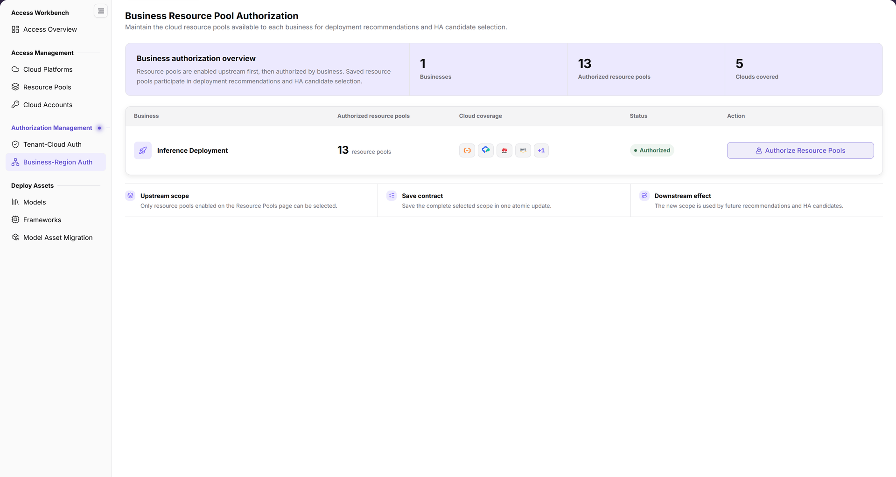
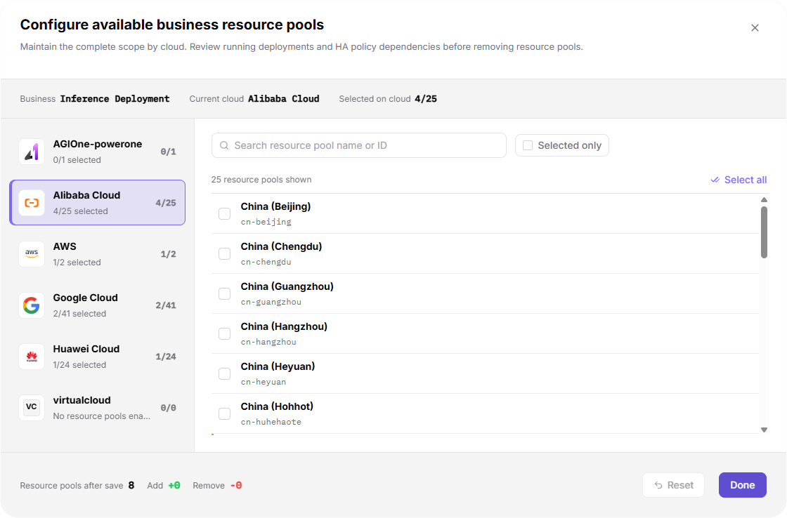

# Business-Region Auth

::: info Document Information
Version: v2.1
Updated: 2026-11-12
:::

## Feature Overview

| Item | Content |
| --- | --- |
| Applicable Roles | Operators |
| Navigation Path | AI Infra(On-Cloud) > Authorization Management > Business-Region Auth |
| Page Route | `/infrahub/op/auth/region-auth` |
| Managed Objects | Cloud resource pool authorization scope maintained by business |

#### Beginner Explanation

Business-Region Auth is like defining a business's resource pool candidate list. The page describes this scope as an input for future deployment recommendations and HA candidate selection, separate from assigning cloud platforms to tenants.

#### Terms Quick Reference

| Term | Description |
| --- | --- |
| Business | The business whose resource pool scope is configured, such as Inference Deployment. |
| Upstream scope | The page states that only resource pools enabled on the Resource Pools page can be selected. |
| Selected on cloud | Selected and available resource pool counts for the current cloud in the dialog. |
| Complete scope | The selection maintained across clouds; the page describes saving the complete selected scope in one atomic update. |

## Prerequisites

1. The current account can access Business-Region Auth.
2. The target business exists and the related clouds and resource pools are connected. The page states that resource pools are enabled upstream first, then authorized by business.
3. Before removing resource pools, follow the dialog prompt to review running deployments and HA policy dependencies, and confirm the intended change scope.

## Page Description

The menu is Business-Region Auth, while the content title is Business Resource Pool Authorization. The page states that pools are enabled upstream before business authorization and that the saved scope is used for future deployment recommendations and HA candidate selection. These are UI descriptions, not evidence that an authorization has been saved or recommendations have been updated.

| Area | Description |
| --- | --- |
| Business authorization overview | Summarizes businesses, authorized resource pools, and clouds covered. |
| Business list | Shows authorized resource pools, cloud coverage, status, and action by business. |
| Authorization entry | Authorize Resource Pools opens Configure available business resource pools. |
| Page rules | Upstream scope, Save contract, and Downstream effect describe selectable sources, complete-scope submission, and subsequent use. |
| Configuration dialog | Shows Business, Current cloud, and Selected on cloud, with per-cloud pool selection and a footer summary. |

The figure shows the Business Resource Pool Authorization overview and business list, including authorized resource pools, cloud coverage, status, and Authorize Resource Pools; the lower area describes upstream enablement, complete-scope submission, and subsequent recommendation use.

## Main Operations

### Review Business Resource Pool Scope

1. Open Business-Region Auth under Authorization Management.
2. Review the target business, authorized resource pools, cloud coverage, and status in the business list.
3. Read Upstream scope, Save contract, and Downstream effect below the list. Distinguish resource pool authorization from tenant-cloud authorization rather than judging scope by summary counts alone.

### Review Resource Pool Authorization Configuration

1. Click Authorize Resource Pools for the target business to open Configure available business resource pools.
2. Review Business, Current cloud, and Selected on cloud at the top; use the cloud list on the left to switch the resource pool list.
3. Use Search resource pool name or ID to locate a pool, and Selected only to review selected items when needed. Select all is above the resource pool list.
4. When a change is intended, review checked items against the approved scope and check the scope on other clouds. The page describes submitting the complete selection, not just newly added items.
5. Review Resource pools after save, Add, and Remove in the footer. These summarize the intended scope before submission; they are not proof of a save or downstream effect.
6. To submit, use Done. Reset is a separate action, not a close button. For inspection only, use the upper-right close button to exit without saving the configuration.

The figure shows Configure available business resource pools: Business, Current cloud, and Selected on cloud at the top, cloud switching on the left, and pool search, Selected only, Select all, and checkboxes on the right; the footer contains Resource pools after save, Add, Remove, Reset, and Done.

## Parameter Quick Reference

| Field Name | Required | Field Type | Example | Description |
| --- | --- | --- | --- | --- |
| Business | — | Read-only information | `Inference Deployment` | Business being configured, not a tenant selector. |
| Current cloud | — | Read-only information | Current selection | Identifies the cloud for the resource pool list on the right. |
| Selected on cloud | — | Count summary | Selected / available | Current cloud's selected scope, not the total across clouds. |
| Cloud list | No | Switch entry | Actual cloud selection | Maintains complete scope by cloud and displays per-cloud selections. |
| Search resource pool name or ID | No | Search field | Sample pool name or ID | Locates a resource pool. |
| Selected only / Select all | No | Filter / selection entry | `Selected only` | Reviews selected items or makes list selections; review the current cloud first. |
| Resource pool checkboxes | Configure within approved scope | Multi-select | Actual resource pools | Business resource pool scope; the page identifies upstream-enabled pools as the source. |
| Resource pools after save / Add / Remove | — | Change summary | Dialog values | Reviews the complete scope and changes before submission, not a saved result. |
| Reset | No | Button | `Reset` | Separate action entry, not an exit control. |
| Done / Upper-right close | No | Submission / exit entry | `Done` | Done submits; use the upper-right close button for inspection only. |

## Pitfalls

- The current configuration object is a resource pool, the entry is Authorize Resource Pools, and the submission button is Done; do not use the earlier Authorize Regions or Confirm names.
- Save contract states: “Save the complete selected scope in one atomic update.” Do not assume that previously authorized items remain included when they are unchecked.
- Selected on cloud is specific to the current cloud. Resource pools after save is a different scope summary; the two are not the same count.
- The dialog asks users to review running deployments and HA policy dependencies before removing pools. Pending addition labels and summary values are not save-success messages.

## Result Validation

| Check Item | Success Signal | If Abnormal |
| --- | --- | --- |
| Page location | Business-Region Auth is selected in the menu and Business Resource Pool Authorization is the content title | Compare the menu and page route; the different title does not identify a different page. |
| Configuration target | The title is Configure available business resource pools and Business matches the target | Identify the target business first; do not submit an unclear scope. |
| Scope review | Selected on cloud and the footer's Resource pools after save, Add, and Remove can be reviewed separately | Review each cloud's selection; a single total does not replace the complete set. |
| Exit after inspection | The upper-right close button returns to the business authorization page | Check whether the dialog has closed; do not treat exit or summary values as a completed save. |

## FAQ

#### What Does No Resource Pools Enabled Upstream Mean?

**Symptom:**

A cloud entry in the dialog displays “No resource pools enabled upstream”.

**Possible Causes:**

Upstream scope states that only resource pools enabled on the Resource Pools page can be selected.

**Resolution:**

Review the target cloud's enabled scope in [Resource Pools](../../access-management/resource-pools/). Do not interpret this message as insufficient tenant authorization or a save failure.

#### Should Submission Use Confirm or Done?

**Symptom:**

The Configure available business resource pools dialog displays Reset and Done at the bottom.

**Possible Causes:**

The current resource pool configuration uses Done for submission, and the page describes submitting the complete selected scope.

**Resolution:**

Follow the actual buttons. Review the business, selections across clouds, and summary before submission; use the upper-right close button for inspection only.

## Notes

- Review running deployments and HA policy dependencies before removing pools, and retain necessary audit records and recovery arrangements.
- Complete-scope submission here differs from Append in tenant authorization; do not mix the strategies or buttons from the two pages.
- Do not record real credentials, internal locations, or customer data in documentation, tickets, or chat. Scope descriptions do not replace deployment availability checks.

## Next Steps

1. Review the upstream enabled scope in [Resource Pools](../../access-management/resource-pools/).
2. Review tenant platform scope separately in [Tenant-Cloud Auth](../tenant-cloud-auth/).
3. See [Access Overview](../../access-workbench/access-overview/) and [Quick Deployment](../../../user/model-services/quick-deployment/) for subsequent entries; the current configuration summary does not establish successful recommendations or deployment.
