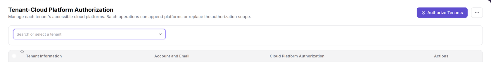
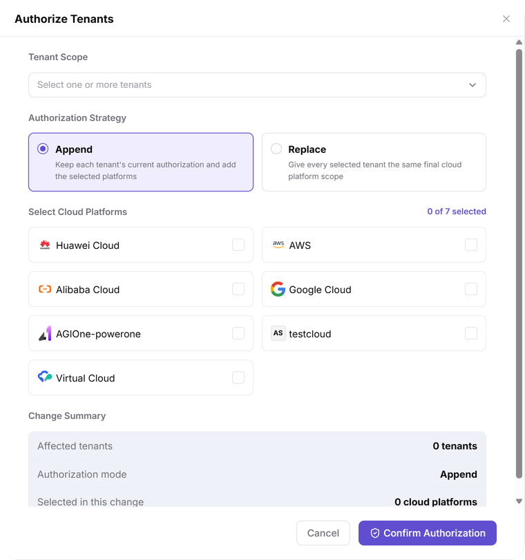
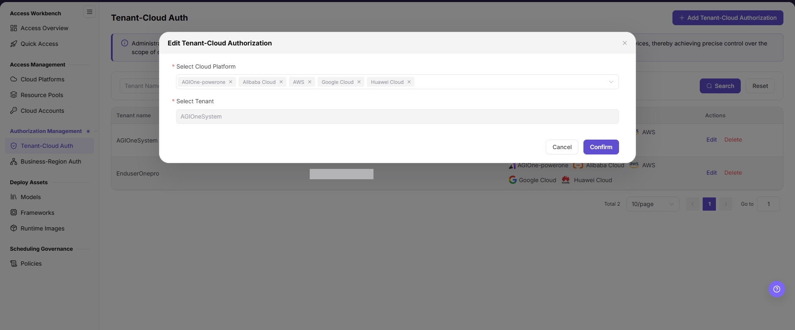
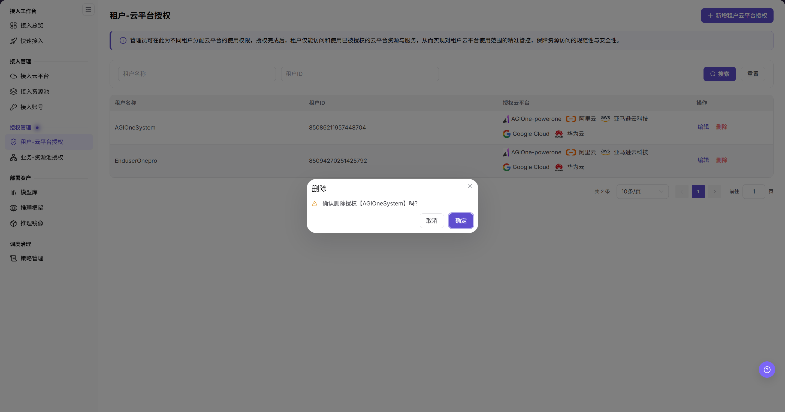

# Tenant-Cloud Auth

::: info Document Information
Version: v2.1
Updated: 2026-11-12
:::

## Feature Overview

| Item | Content |
| --- | --- |
| Applicable Roles | Operators |
| Navigation Path | AI Infra(On-Cloud) > Authorization Management > Tenant-Cloud Auth |
| Page Route | `/infrahub/op/auth/platform-auth` |
| Managed Objects | Cloud platform authorization scope available to tenants |

#### Beginner Explanation

Tenant-Cloud Auth is like defining a tenant's cloud platform access pass: first identify the tenants affected by a batch change, then distinguish adding platforms from replacing the complete scope.

#### Terms Quick Reference

| Term | Description |
| --- | --- |
| Tenant Scope | One or more tenants selected for this authorization. |
| Append | The UI states: “Keep each tenant's current authorization and add the selected platforms”. |
| Replace | The UI states: “Give every selected tenant the same final cloud platform scope”. |
| Change Summary | The pre-submission area showing affected tenants, authorization mode, and platforms selected in this change. |

## Prerequisites

1. The current account can access Tenant-Cloud Auth.
2. The target tenants and cloud platforms exist, and the intended authorization scope is approved.
3. Before making a change, review existing authorizations, tenant deployments, and business dependencies; confirm the impact and revocation arrangements before withdrawing scope.

## Page Description

| Area | Description |
| --- | --- |
| Page title | The content title is “Tenant-Cloud Platform Authorization”; its description introduces batch append and replacement. |
| Tenant filter | Use “Search or select a tenant” to locate a tenant. |
| Authorization list | Contains checkboxes and the Tenant Information, Account and Email, Cloud Platform Authorization, and Actions columns. |
| Authorization entries | The page provides Authorize Tenants; record rows have Configure and Revoke entries. |
| Authorization form | Contains Tenant Scope, Authorization Strategy, Select Cloud Platforms, and Change Summary. |

The figure shows the Tenant-Cloud Platform Authorization title, tenant filter, and table headers; Authorize Tenants is at the upper right, and the headers distinguish tenant information, account and email, platform authorization, and actions.

## Main Operations

### Review Existing Authorization

1. Open Tenant-Cloud Auth under Authorization Management.
2. Use Search or select a tenant to locate the target tenant.
3. Review the tenant information and cloud platform scope on the target record before deciding whether to change it; do not judge the scope by platform counts alone.

### Prepare Tenant Authorization

1. Click Authorize Tenants to open the form.
2. Under Tenant Scope, use Select one or more tenants to specify the targets.
3. Read the Authorization Strategy descriptions and choose Append or Replace according to the approved scope. These strategies distinguish how existing authorization is handled, not whether one tenant or all tenants are targeted.
4. Review the intended platform scope under Select Cloud Platforms.
5. In Change Summary, review Affected tenants, Authorization mode, and Selected in this change separately. The strategy meanings above follow the UI descriptions; selections and summary values are not saved-result evidence.
6. Use Confirm Authorization when submission is intended; for inspection only, click Cancel without submitting the configuration.

The figure shows the empty Authorize Tenants form: Tenant Scope supports one or more tenants, Authorization Strategy offers Append and Replace, and the lower area contains Change Summary, Cancel, and Confirm Authorization.

### Locate the Configuration Entry

1. Locate Configure on the target tenant record and review the tenant and existing platform scope first.
2. Follow the fields and buttons actually displayed when maintaining authorization; do not treat the earlier edit fields as the current batch authorization strategies.

The figure shows an earlier tenant authorization edit view with Select Cloud Platform, Select Tenant, Cancel, and Confirm; it illustrates the tenant-platform association, not the current Append or Replace strategies.

### Locate the Revocation Entry

1. Locate Revoke on the target record and review the tenant, existing scope, and business dependencies first.
2. Before submission, follow the object and message displayed by the current UI; do not use the earlier Delete confirmation view as the current revocation procedure.

The figure shows an earlier Delete confirmation view naming the target tenant and providing Cancel and Confirm; it does not establish the current Revoke confirmation flow or its execution result.

## Parameter Quick Reference

| Field Name | Required | Field Type | Example | Description |
| --- | --- | --- | --- | --- |
| Search or select a tenant | No | Search selector | Sample tenant | List lookup entry, not an authorization strategy. |
| Tenant Information / Account and Email | — | List information | Target record | Distinguishes tenant and account information; review both to identify the target. |
| Cloud Platform Authorization | — | List information | Target record | Shows the record's cloud platform scope. |
| Tenant Scope | Select before submission | Multi-select | One or more tenants | Targets of this change; there is no Authorize All Tenants mode. |
| Authorization Strategy | Review before submission | Strategy selector | `Append` | Offers Append and Replace, each with a description of its scope. |
| Select Cloud Platforms | Select before submission | Multi-select | Approved scope | Platforms selected for this change. |
| Change Summary | — | Read-only summary | Affected tenants / Authorization mode / Selected in this change | Reviews targets, strategy, and platform scope before submission. |
| Configure / Revoke | No | Row action entry | `Configure` | Entries for existing authorization; identify the target first. |
| Cancel / Confirm Authorization | No | Button | `Cancel` | Exit and submission entries for the authorization form. |

## Pitfalls

- Tenant Scope identifies the targets; Authorization Strategy determines how existing authorization is handled. Append and Replace do not mean one tenant versus all tenants.
- The UI describes Append as retaining existing scope and Replace as giving selected tenants the same final scope. Read both descriptions before choosing.
- Change Summary is a pre-submission review, not proof that authorization has been saved or applied downstream.

## Result Validation

| Check Item | Success Signal | If Abnormal |
| --- | --- | --- |
| Page location | The content title is Tenant-Cloud Platform Authorization, with Search or select a tenant and Authorize Tenants visible | Compare the menu and page route to locate the page. |
| Form location | Tenant Scope, Authorization Strategy, Select Cloud Platforms, and Change Summary are displayed | Check that the form was opened through Authorize Tenants; do not confuse it with the earlier edit view. |
| Pre-submission scope | Affected tenants, Authorization mode, and Selected in this change can be reviewed separately | Return to the corresponding selection area; do not submit an unconfirmed scope. |
| Exit after inspection | Cancel closes the form and returns to the authorization page | Check whether the form has closed; do not treat exit as a completed save. |

## FAQ

#### Do Append and Replace Select the Number of Tenants?

**Symptom:**

The form displays Tenant Scope and two Authorization Strategy options.

**Possible Causes:**

The UI separates tenant selection from handling existing authorization: Tenant Scope accepts one or more tenants, while the strategies describe appending platforms or replacing scope.

**Resolution:**

Choose the target tenants first, then read the strategy descriptions. Before submission, review Affected tenants, Authorization mode, and Selected in this change separately.

## Notes

- Replace concerns the complete platform scope of selected tenants. Stay within the approved scope and do not mistake the current selection for additions only.
- Review deployment and business dependencies before configuration or revocation, and retain necessary audit records and recovery arrangements.
- Do not record real credentials, internal locations, or customer data in documentation, tickets, or chat.

## Next Steps

1. Open [Business-Region Auth](../business-region-auth/) to review business resource pool scope; tenant-cloud authorization and business resource pool authorization are separate.
2. Review upstream objects in [Cloud Platforms](../../access-management/cloud-platforms/) and [Resource Pools](../../access-management/resource-pools/).
3. For deployment selection entries, see [Quick Deployment](../../../user/model-services/quick-deployment/); do not infer deployment or authorization results from this page's summary.
