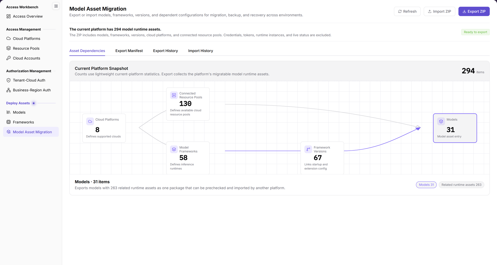
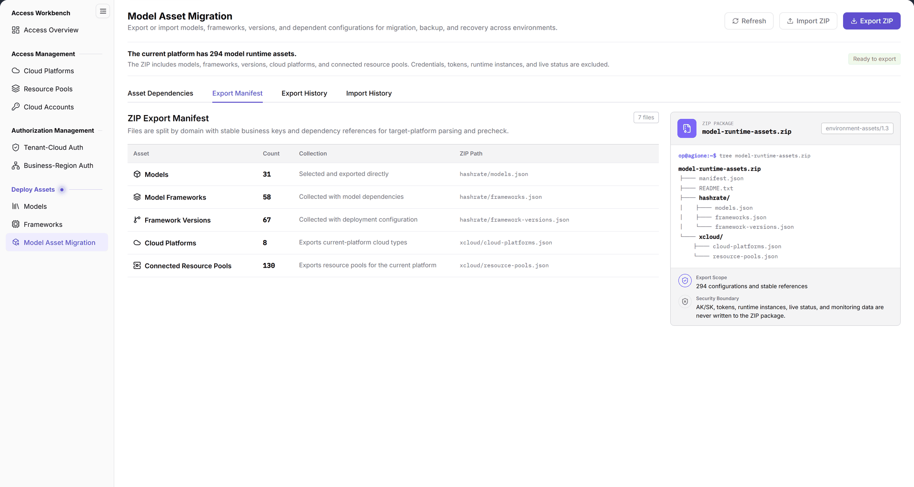
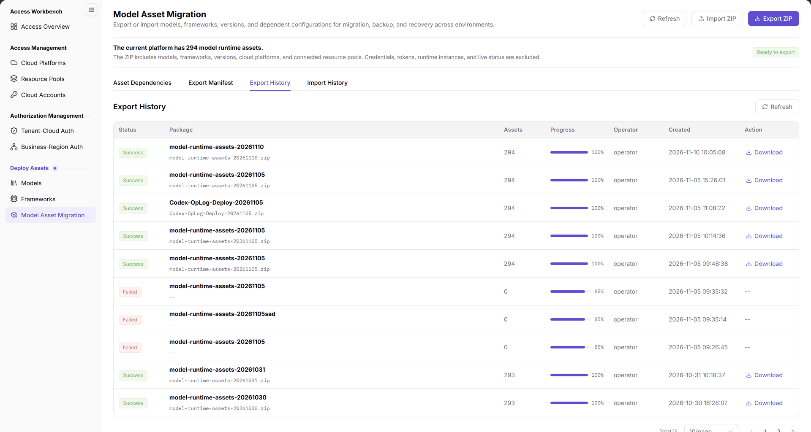
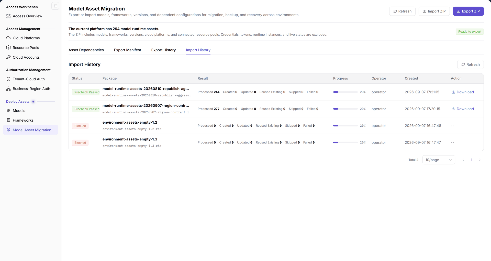

# Model Asset Migration

::: info Document Information
Version: v2.0
Updated: 2026-11-12
:::

## Feature Overview

| Item | Content |
| --- | --- |
| Applicable Role | Operator |
| Navigation Path | On-Cloud > Deploy Assets > Model Asset Migration |
| Page Route | `/infrahub/op/model/asset-migration` |
| Managed Objects | Models, frameworks, versions, and their dependency configuration |

The page describes exporting or importing models, frameworks, versions, and their dependency configuration for migration between environments, backup, and recovery.

This page covers read-only browsing, tab switching, and entry identification only. It does not provide a ZIP execution procedure.

#### Beginner Explanation

Model Asset Migration is like a moving inventory for asset configuration: review the snapshot and dependencies, then distinguish the manifest from the history tabs.

#### Terms Quick Reference

| Term | Description |
| --- | --- |
| Current Platform Snapshot | The area displaying platform asset types. |
| Asset Dependencies | The entry for viewing asset dependency information. |
| Export Manifest | The tab corresponding to ZIP Export Manifest, not Export History. |
| Export History / Import History | Separate tabs for viewing the two kinds of records. |

## Prerequisites

1. Use the Operator role and locate Model Asset Migration under Deploy Assets in On-Cloud. Do not substitute another role's visibility for this check.
2. Identify the models, frameworks, versions, and dependency configuration to review. Distinguish browsing from executing ZIP operations.
3. For browsing only, do not select or upload a file, and do not trigger Export ZIP.

## Page Description

| Area | Description |
| --- | --- |
| Current Platform Snapshot | Displays Cloud Platforms, Connected Resource Pools, Model Frameworks, Framework Versions, and Models. Read counts from the current page. |
| Asset Dependencies | The entry for viewing asset dependency information. |
| Export Manifest | The tab is Export Manifest; the area title is ZIP Export Manifest. The manifest displays Asset, Count, Collection, and ZIP Path, with an illustrative package structure on the right. |
| Export History | Columns: Status, Package, Assets, Progress, Operator, Created, and Action. |
| Import History | Columns: Status, Package, Result, Progress, Operator, Created, and Action. Result is not the Assets column in Export History. |
| Page buttons | Refresh, Import ZIP, and Export ZIP. An entry's presence does not mean an operation is complete. |

The interface states that the ZIP excludes cloud account credentials, Tokens, running instances, and real-time state. This is the interface's scope description, not evidence that an actual ZIP has been inspected or a security guarantee that an export package contains no sensitive information.

## Main Operations

### Browse the Platform Snapshot and Asset Dependencies

1. Open On-Cloud > Deploy Assets > Model Asset Migration and check the page name and route.
2. Locate Current Platform Snapshot and review the five asset types: Cloud Platforms, Connected Resource Pools, Model Frameworks, Framework Versions, and Models. Do not use fixed counts.
3. Switch to Asset Dependencies and read the visible information. Match the asset types being reviewed to the snapshot; do not treat dependency information as proof of completed migration.

The figure shows Current Platform Snapshot in Asset Dependencies, with Cloud Platforms, Connected Resource Pools, Model Frameworks, Framework Versions, and Models displayed as connected nodes. Refresh, Import ZIP, and Export ZIP are at the top.

### View the ZIP Export Manifest

1. Switch to Export Manifest.
2. Check the ZIP Export Manifest title, then read Asset, Count, Collection, and ZIP Path within the same row. Read the structure on the right as the page's illustration, not confirmation of actual package contents.
3. Compare it with the models, frameworks, versions, and dependency configuration under review. Do not click Export ZIP or treat the manifest as a generated ZIP or proof of success.

The figure shows ZIP Export Manifest: the left side lists Count, Collection, and ZIP Path for each Asset, while the right side illustrates the package structure described by the page. This display does not replace an actual package content review.

### View Export History

1. Switch to Export History and check the tab name.
2. Review Status, Package, Assets, Progress, Operator, Created, and Action for the target record. Match the package to its creation time before reading its status and progress.
3. Identify Refresh in the record area and Download on some existing records. Do not click Download when browsing only. Existing task states do not mean that an export has been performed during this review or that the actual package contents have been checked.

The figure shows Export History with Package, Assets, Status, Progress, Operator, and Created displayed separately. Some existing records offer Download in Action; these historical records do not establish that a new export has completed.

### View Import History

1. Switch to Import History and check the tab name.
2. Review Status, Package, Result, Progress, Operator, Created, and Action for the target record. The third column is Result, not the Assets column in Export History.
3. Read the status, result, and progress together within the same row. View records only: do not click Download or Import ZIP, and do not infer a new import outcome or unobserved failure causes from existing records.

The figure shows Import History with Result as the third column, separate from Status and Progress. Check fields within the same row rather than treating Result as the Assets column in Export History.

### Identify Refresh and the ZIP Operation Entries

1. Locate Refresh, Import ZIP, and Export ZIP and distinguish the buttons by their full names.
2. To view records only, use Export History or Import History rather than a ZIP button.
3. Stop at entry identification: do not click a ZIP button or select a file. Refresh is listed only as an observed entry; do not infer package validation or migration results from its name.

## Parameter Quick Reference

A dash means that the item is not a form field to fill in here. It does not define required-field rules for an import form.

| Field Name | Required | Field Type | Example | Description |
| --- | --- | --- | --- | --- |
| Current Platform Snapshot | — | Area title | `Current Platform Snapshot` | Review five asset types without recording fixed counts. |
| Asset Dependencies | — | Tab | `Asset Dependencies` | View asset dependency information. |
| Export Manifest | — | Tab | `Export Manifest` | Corresponds to ZIP Export Manifest. |
| ZIP Export Manifest | — | Area title | `ZIP Export Manifest` | Not an export success message. |
| Export History | — | Tab | `Export History` | View separately from Import History. |
| Import History | — | Tab | `Import History` | View separately from Export History. |
| Refresh | — | Button | `Refresh` | Not evidence of package validation or migration results. |
| Import ZIP | — | Button | `Import ZIP` | Do not click or upload during read-only browsing. |
| Export ZIP | — | Button | `Export ZIP` | Do not click or download during read-only browsing. |
| Status, Package, Progress, Operator, Created, Action | — | Record columns | `Created` | Shared by export and import records; check within the same row. |
| Assets | — | Export record column | `Assets` | Read this column in Export History; do not substitute import results for it. |
| Result | — | Import record column | `Result` | Read together with the same import record's status and progress. |
| Download | — | Row action entry | `Download` | Visible on some existing records. Do not click during read-only browsing or infer package usability or content security from the entry. |

## Pitfalls

- Export Manifest corresponds to ZIP Export Manifest; Export History is a different tab. Viewing the manifest does not mean an export has occurred.
- Import ZIP is a button, while Import History is a tab. Do not use the import button instead of switching tabs to view records.
- Current Platform Snapshot displays asset types. Do not interpret it as the migration result for running instances or real-time state.

## Result Validation

These checks cover page location and read-only browsing only, not successful ZIP generation, upload, import, recovery, or deployment.

| Check Item | Success Signal | If Abnormal |
| --- | --- | --- |
| Page location | The name is Model Asset Migration and the route is `/infrahub/op/model/asset-migration` | Compare the menu and route, record the actual page name, and do not use a ZIP button to locate the page. |
| Snapshot location | Current Platform Snapshot and the five asset types can be checked | Record visible differences; do not fill in old counts. |
| Manifest location | The tab is Export Manifest and the title is ZIP Export Manifest | Check the selected tab; do not treat Export History as the manifest. |
| Export record distinction | Export History includes Assets; the same row's status and progress can be checked against its package and creation time | Record the visible column names; do not substitute the import Result column for Assets. |
| Import record distinction | Import History includes Result, which can be compared with the same row's status and progress | Check the selected tab and column names; do not infer unobserved failure causes or recovery outcomes. |
| Entry identification | Refresh, Import ZIP, and Export ZIP can be distinguished | Record the actual button text without clicking an unclear entry to test subsequent behavior. |

## FAQ

#### Should I Open Export Manifest or Export History?

**Symptom:**

The page has both Export Manifest and Export History tabs.

**Possible Causes:**

The interface provides separate viewing entries for ZIP Export Manifest and export records.

**Resolution:**

To review the manifest, switch to Export Manifest and check the ZIP Export Manifest title. To view records, switch to Export History. Seeing the manifest alone does not confirm export completion.

#### Do I Need to Click Import ZIP to View Import History?

**Symptom:**

The page has an Import ZIP button and an Import History tab.

**Possible Causes:**

The interface names the operation entry Import ZIP and the record-viewing entry Import History.

**Resolution:**

To view records only, switch to Import History. Do not click Import ZIP or upload a file just to view records.

## Notes

- The page's stated purposes are migration between environments, backup, and recovery. Stating a purpose does not mean that migration, backup, or recovery has completed.
- The interface's ZIP exclusion statement does not replace an actual package content review or constitute an export security guarantee.
- Confirm import and export separately as business operations. This page does not define internal file formats, prechecks, overwrite behavior, retries, or rollback rules, and does not guarantee permissions or scope merely because an entry exists.
- Do not put real credentials or sensitive configuration in documentation, screenshots, or communications. Read-only review does not require reading cloud account secrets.

## Next Steps

1. To compare models, open Deploy Assets > Models and review the relevant model, keeping the activity read-only.
2. To compare frameworks and versions, open Deploy Assets > Frameworks and review the relevant objects. Do not infer from the snapshot that they have been restored in another environment.
3. Before an actual import or export, independently confirm authorization and the current interface's specific requirements. Do not use these browsing steps as a ZIP execution procedure.
