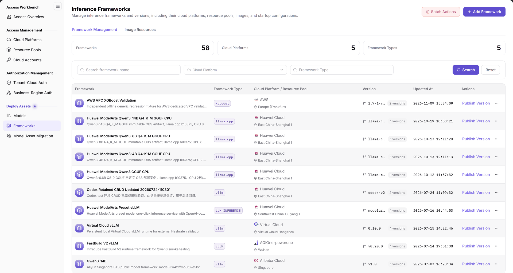
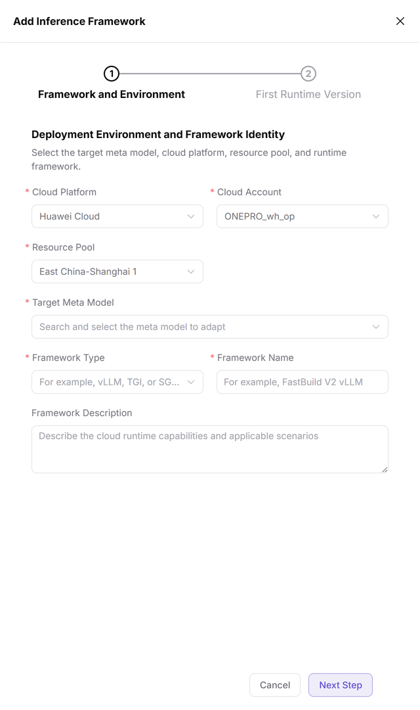
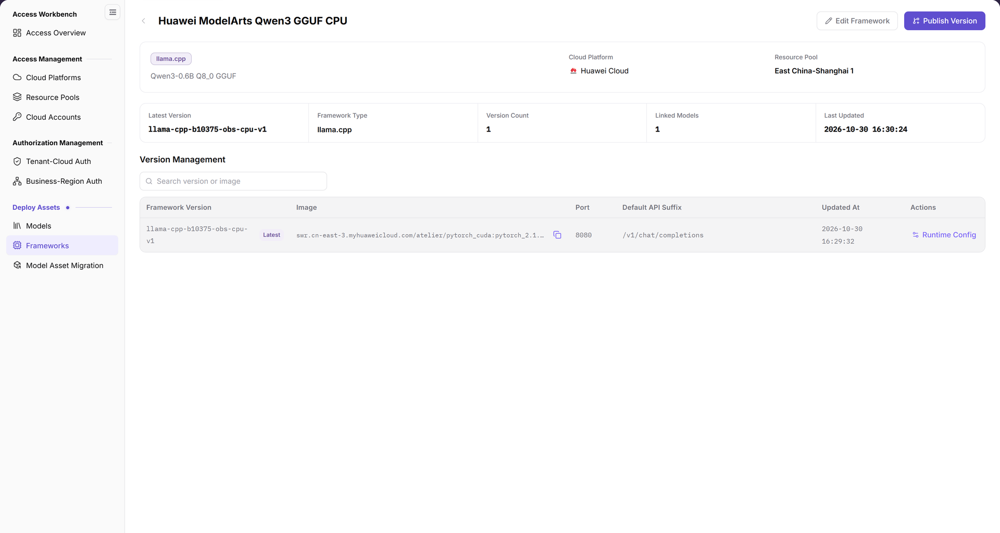
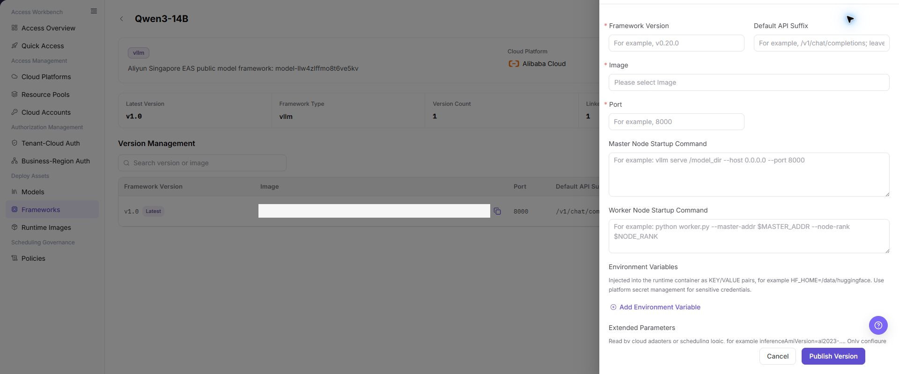

# Frameworks

::: info Document Information
Version: v2.1
Updated: 2026-11-12
:::

## Feature Overview

| Item | Content |
| --- | --- |
| Applicable Roles | Operators |
| Navigation Path | AI Infra(On-Cloud) > Deploy Assets > Frameworks |
| Page Route | `/infrahub/op/model/framework` |
| Managed Objects | Inference frameworks, deployment environments, and framework runtime-version configuration |

#### Beginner Explanation

A framework is like a model's runtime instruction sheet: its identity and environment describe where it runs, while a runtime version describes the image and startup configuration.

#### Terms Quick Reference

| Term | Description |
| --- | --- |
| Target Meta Model | The adaptation target selected in the first Add Framework step. |
| Framework Type | Runtime framework classification; the input hint includes vLLM, TGI, and SGLang. |
| First Runtime Version | The second-step title in the add drawer, separate from Framework and Environment. |

## Prerequisites

1. Use an operator account with access to Frameworks.
2. Prepare the target cloud platform, cloud account, resource pool, meta model, framework name, and type before adding a framework.
3. Confirm the image, port, and startup requirements before maintaining a runtime version; check references and impact before publication.

## Page Description

| Area | Description |
| --- | --- |
| Page tabs | Framework Management and Image Resources are separate tabs; this page covers Framework Management, not a combined list. |
| Statistics | Shows counts for Frameworks, Cloud Platforms, and Framework Types. |
| Query area | Provides framework name, cloud platform, and framework type criteria, plus Search and Reset. |
| Framework list | Columns are Framework, Framework Type, Cloud Platform / Resource Pool, Version, Updated At, and Actions. |
| Actions | Batch Actions and Add Framework are at the top; rows provide Publish Version and a more-actions entry. |
| Add drawer | Step titles are Framework and Environment and First Runtime Version; the initial view shows step 1. |

The figure shows Framework Management: name, cloud platform, and framework type queries appear below the statistics, while the results separate Cloud Platform / Resource Pool from Version; the row-level Publish Version is an entry, not a published status.

## Main Operations

### Query Frameworks

1. Open Frameworks under Deploy Assets and confirm Framework Management is selected.
2. Enter a framework name, select a cloud platform, or enter a framework type as needed, then use Search; use Reset when setting criteria again.
3. Check the target row's name, type, cloud platform/resource pool, version, and update time; statistics do not replace record-level checks.
4. Before a change, distinguish Batch Actions from target-row actions and confirm the object and impact scope.

### Open the Initial Add Framework Configuration

1. Click Add Framework to open the Add Inference Framework drawer.
2. In Framework and Environment, check the currently displayed Cloud Platform, Cloud Account, and Resource Pool values; displayed values do not establish submission.
3. Check Target Meta Model, Framework Type, and Framework Name against the adaptation target, and enter Framework Description as needed. The framework-type hint includes vLLM, TGI, and SGLang.
4. Cancel and Next Step are at the bottom; use Cancel when only inspecting the initial form. First Runtime Version is the second-step title, not an already-expanded runtime-parameter area in step 1.

The figure shows the initial Framework and Environment configuration with seven visible fields: Cloud Platform, Cloud Account, Resource Pool, Target Meta Model, Framework Type, Framework Name, and Framework Description; Cancel and Next Step are below, while step 2 has only a title and no runtime-version form shown.

### Compare Existing Framework Details

1. Locate the target framework and use its name entry to view details. The existing details view below is retained as a static field reference, not a guarantee that every record currently opens this view correctly.
2. If normally opened details provide these areas, check Cloud Platform, Resource Pool, Latest Version, Version Count, Linked Models, and Last Updated, then examine the Version Management list.
3. If Runtime Config is available, follow the actual opened content to check runtime parameters; the existing details figure does not establish current runtime success or health-check results.

The figure shows existing framework details with cloud platform, resource pool, and version summary above Version Management, whose columns include Framework Version, Image, Port, Default API Suffix, Updated At, and Runtime Config; this is a static reference, not a result after adding a framework.

### Compare Existing Runtime-Version Configuration

1. Current list rows provide Publish Version; confirm the target framework and change scope before maintaining a version.
2. The existing version reference below shows Framework Version, Default API Suffix, Image, Port, and startup commands. It is not the first Add Framework step and does not establish that the current second step has been entered.
3. If the currently opened version form contains these fields, follow its actual markers to check the version, image, port, master/worker startup commands, environment variables, and extended parameters. Use the current form's submission entry; closing a form or seeing a button does not establish successful publication.

The figure shows an existing runtime-version configuration drawer with version, API suffix, image, port, startup commands, and environment-variable items, plus Cancel and Publish Version below; it is not a simple confirmation prompt and does not show a post-publication result.

## Parameter Quick Reference

Step-1 fields follow the current visible form. Runtime-version fields refer only to the existing version figure; they are not shown on the initial page and do not establish verification of the current second step.

| Field Name | Required | Field Type | Example | Description |
| --- | --- | --- | --- | --- |
| Framework Name / Cloud Platform / Framework Type query | No | Text / Selection | Sample framework / cloud | Query items in Framework Management. |
| Cloud Platform | Yes | Selection | Follow current options | Step-1 deployment-environment field. |
| Cloud Account | Yes | Selection | Sample cloud account | Step-1 current cloud account, not a secret-value input. |
| Resource Pool | Yes | Selection | Sample resource pool | Step-1 resource pool for the deployment environment, not the legacy Region field name. |
| Target Meta Model | Yes | Search selection | Sample meta model | Step-1 adaptation target. |
| Framework Type | Yes | Selection | `vLLM` | Step-1 runtime type; the hint also includes TGI and SGLang. |
| Framework Name | Yes | Text | `Sample Framework` | Step-1 framework identity. |
| Framework Description | No | Multiline text | `Sample purpose` | Step-1 purpose and scenarios; not runtime acceptance. |
| Cancel / Next Step | — | Buttons | `Cancel` / `Next Step` | Step-1 bottom actions, not a final Confirm button. |
| Framework Version | Follow current form | Text | `v1.0` | Version field in the existing runtime-version figure. |
| Default API Suffix | Follow current form | Text | `/v1/chat/completions` | API path suffix in existing version configuration. |
| Image / Port | Follow current form | Selection / Input | Sample image / `8000` | Runtime image and listening port in existing version configuration. |
| Master Node Startup Command / Worker Node Startup Command | Follow current form | Multiline text | Follow framework requirements | Two startup-command types in existing version configuration. |
| Environment Variables / Extended Parameters | Follow framework requirements | Key-value configuration | `ENV_NAME=value` | Configuration items in the existing version figure; do not enter real secrets. |
| Publish Version | — | Action entry | `Publish Version` | Present in the current list and as a submit button in the existing version figure; distinguish entry from result. |

## Pitfalls

- Cloud Platform / Resource Pool and Version are separate list columns; a framework name does not replace environment or version information.
- The first Add Framework step has seven business fields. First Runtime Version is a second-step title, not evidence that Image, Port, or startup commands are visible in step 1.
- The first-step bottom actions are Cancel and Next Step, not the Confirm button described for the legacy single-page form.
- Publish Version and the existing version form establish controls that can be located, not successful publication or availability in model configuration.

## Result Validation

| Check Item | Success Signal | If Abnormal |
| --- | --- | --- |
| Page location | Frameworks is highlighted and Framework Management is selected | Check the menu and tab; distinguish it from Image Resources. |
| Framework location | The target row provides type, cloud platform/resource pool, version, and update time | Locate it again using the current criteria and target name. |
| Initial add view | The drawer shows two step titles; step 1 has seven fields, Cancel, and Next Step | Check the active step; do not treat the existing runtime-version figure as step 1. |
| Exit after inspection | Cancel returns to the framework list | Check whether the drawer is closed; exiting does not establish addition or publication. |

## FAQ

#### Why Are Image and Port Not Shown Together When Adding a Framework?

**Symptom:**

The initial drawer shows environment and framework identity, not runtime-version fields.

**Possible Causes:**

Framework and Environment is active; First Runtime Version is a separate step title.

**Resolution:**

Check the seven current fields and step titles first; do not treat fields in the existing runtime-version figure as missing initial-page fields.

#### Does the Initial Add Framework Page Use Confirm or Next Step?

**Symptom:**

The drawer shows Cancel and Next Step at the bottom.

**Possible Causes:**

The current add entry uses a two-step drawer, not the legacy single-page submission form.

**Resolution:**

Follow the current form buttons. Use Cancel for inspection only; neither Next Step nor closing the drawer establishes a saved or published result.

## Notes

- Before publishing or changing a runtime version, check model references, image, startup parameters, and impact scope, and retain the necessary audit record.
- Existing details and version figures are static configuration references, not guarantees of current details availability, publication, model selection, or service startup success.
- Framework descriptions are record content; user-entered validation descriptions do not establish platform deployment acceptance.
- Do not enter real secrets, internal addresses, or customer data in documentation, tickets, or chat.

## Next Steps

1. See [Models](../models/) for model profiles and framework configuration references; a version shown in the framework list does not mean a model is deployed.
2. See [Resource Pools](../../access-management/resource-pools/) and [Cloud Accounts](../../access-management/cloud-accounts/) to check deployment-environment objects.
3. For user-side deployment, see [Quick Deployment](../../../user/model-services/quick-deployment/); verify service startup and runtime results separately in an actual deployment.
