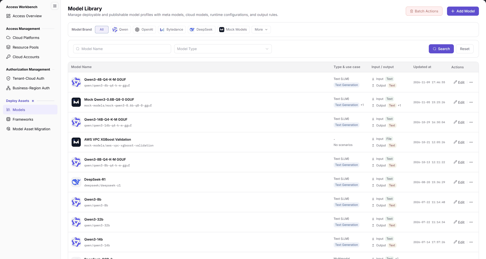
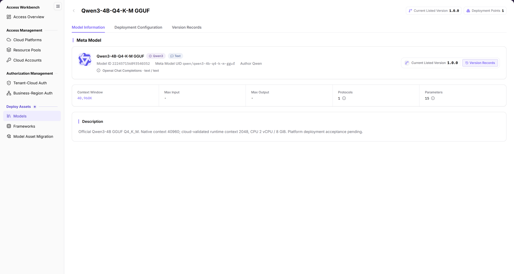
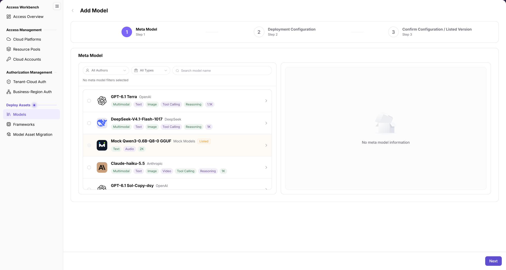
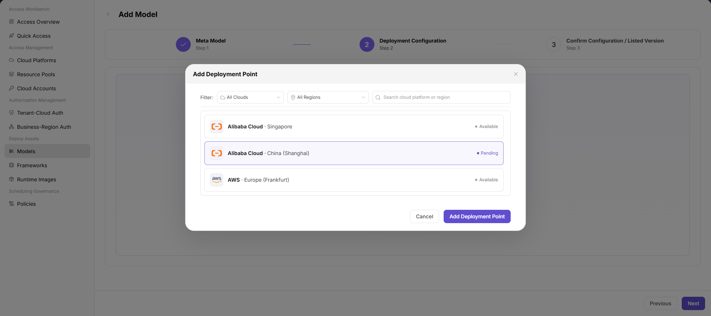
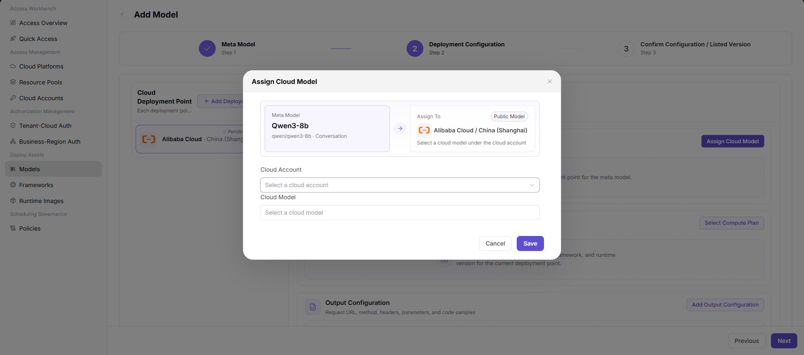
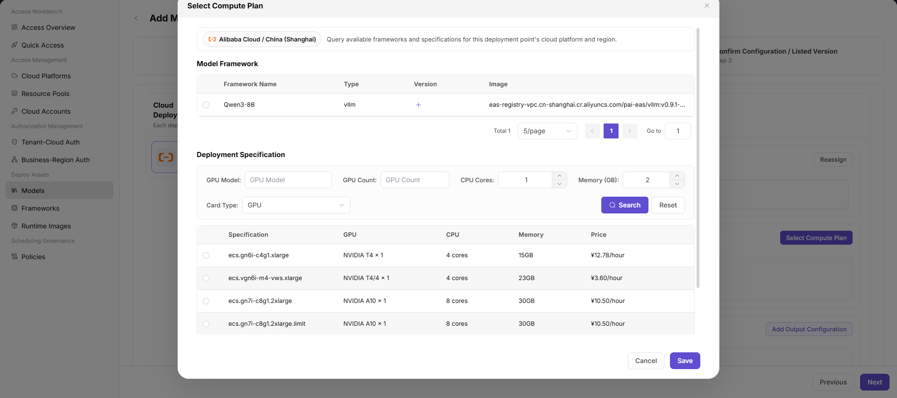
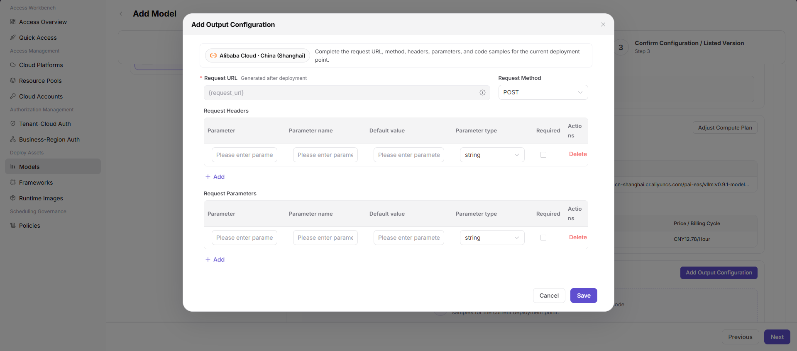
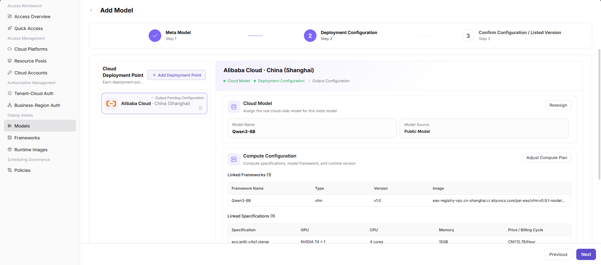

# Models

::: info Document Information
Version: v2.1
Updated: 2026-11-12
:::

## Feature Overview

| Item | Content |
| --- | --- |
| Applicable Roles | Operators |
| Navigation Path | AI Infra(On-Cloud) > Deploy Assets > Models |
| Page Route | `/infrahub/op/model/model` |
| Managed Objects | Model profiles, linked meta models, cloud deployment points, and deployment configuration |

#### Beginner Explanation

Models is a deployment asset catalog: find the model profile first, then distinguish model information from cloud deployment configuration.

#### Terms Quick Reference

| Term | Description |
| --- | --- |
| Meta Model | The base model definition; details show its author, capabilities, protocols, and related information. |
| Cloud Deployment Point | A cloud platform and region linked in the existing deployment configuration. |
| Compute Plan | Configuration combining a model framework, runtime version, and deployment specification in the existing interface. |

## Prerequisites

1. Use an operator account with access to Models.
2. Check existing models before adding one; prepare the target meta model and the required cloud platform, resource pool, and framework information.
3. Before changing deployment configuration, confirm the target region, resource cost, and reference scope.

## Page Description

| Area | Description |
| --- | --- |
| Brand and query area | Provides Model Brand, Model Name, and Model Type criteria, plus Search and Reset. |
| List | Columns are Model Name, Type & use case, Input / output, Updated at, and Actions; a model identifier can appear below the name. |
| Actions | Batch Actions and Add Model are at the top; Edit and a more-actions entry appear in rows. |
| Model details | Clicking a model name opens a separate page. Model Information is selected by default, alongside Deployment Configuration and Version Records. |
| Add wizard | The creation route is `/infrahub/op/model/model/create`; stages are Meta Model, Deployment Configuration, and Confirm Configuration / Listed Version. |

The figure shows the model list with brand criteria above the name and type query; results separate Model Name, Type & use case, Input / output, and Updated at, rather than displaying deployment-point cards.

## Main Operations

### Query Models

1. Open Models under Deploy Assets.
2. Select a model brand, enter a model name or select a model type as needed, then use Search.
3. Check each record's name, identifier, type and use case, and input/output; use Reset when setting criteria again.
4. Confirm the target row before making changes; distinguish the top-level Batch Actions from the row-level Edit action.

### View Model Information

1. Locate the target model and click its name.
2. On the separate details page, check the meta model name, Model ID, Meta Model UID, and Author in the default Model Information tab.
3. Read Context Window, Max Input, Max Output, Protocols, Parameters, and Description; the header also lists Current Listed Version and Deployment Points.
4. Deployment Configuration and Version Records are separate tab entries. Do not treat the default information view as deployment configuration or a service health-check result.

The figure shows Model Information on a separate model details page: the meta model card, capability summary, and description are visible, with Deployment Configuration and Version Records above; this is not a details drawer.

### Open the Add Model Wizard

1. Click Add Model at the upper right of the list to open the creation page.
2. In Meta Model, find catalog entries by author, type, or model name.
3. Check the entry name and capability tags. In the initial unselected state, the right side displays No meta model information. Next is at the bottom; opening the wizard does not mean a model has been added.
4. The header identifies the subsequent Deployment Configuration and Confirm Configuration / Listed Version stages. Existing configuration views below are retained for field comparison; current controls and requirements take precedence, and these examples do not establish save or listing results.

The figure shows the initial catalog without a selected meta model: author, type, and name queries are on the left, No meta model information is on the right, and Next is below; version configuration after selection is not shown.

### Compare Existing Deployment-Point and Cloud-Model Configuration

1. If the current configuration provides deployment-point selection, check the cloud platform and region before confirming a target; the existing interface provides cloud, region, and keyword filters.

The figure shows the existing Add Deployment Point interface with cloud and region filters and Available or Pending deployment points; this static reference does not mean a point has been added in the current wizard.

2. If Assign Cloud Model is provided, check the meta model and target deployment point, then inspect Cloud Account and Cloud Model. A button's presence is not evidence of a saved result.

The figure shows existing Assign Cloud Model configuration: the meta model and target cloud/region are compared above Cloud Account and Cloud Model, with Cancel and Save below; no post-save result is shown.

### Compare Existing Compute and Output Configuration

1. If compute-plan selection is provided, check the framework name, type, version, and image, then compare specification GPU, CPU, memory, and price; example prices are not current quotations.

The figure shows the existing Select Compute Plan interface: Model Framework is above Deployment Specification and its GPU, CPU, and memory filters; framework versions and resource specifications are separate configuration items.

2. If output configuration is provided, check Request URL, Request Method, Request Headers, and Request Parameters against the interface requirements; never enter real secrets in header examples.

The figure shows the existing Add Output Configuration interface with Request URL, Request Method, and request-header/parameter tables; these distinguish Parameter, Parameter name, Default value, Parameter type, and Required, rather than port or timeout fields.

3. Compare the cloud model, linked frameworks, and specifications in the deployment configuration summary, reading each configuration indicator. Review final confirmation only when the current page actually reaches that stage; the following figure is not evidence of a final submission interface.

The figure shows the existing second-stage Deployment Configuration summary with Cloud Model, Model Source, linked frameworks, and specifications; Confirm Configuration / Listed Version is not active and the bottom action is still Next, not a successful listing result.

## Parameter Quick Reference

Current list, details, and initial-catalog items appear first. Subsequent configuration fields correspond only to the existing static references above; required status follows the current form markers.

| Field Name | Required | Field Type | Example | Description |
| --- | --- | --- | --- | --- |
| Model Brand / Model Name / Model Type | No | Query criteria | `Qwen` | Brand, name, and type criteria for the list. |
| Type & use case / Input / output | — | Result columns | `Text Generation` / `Text` | Distinguish the model use case from input/output modalities. |
| Model ID / Meta Model UID / Author | — | Details | Sample model identifier | Identification information in Model Information. |
| Context Window / Max Input / Max Output | — | Details | Refer to the target model | Capability summary, not deployment acceptance. |
| Author / Type / Model Name | No | Catalog query | `All Authors` | Query items in the initial Add Model catalog. |
| Next | — | Button | `Next` | A wizard-stage entry, not a saved-state indicator. |
| Cloud Deployment Point | Follow current form | Selection | Sample cloud and region | Target scope in the existing deployment-point reference. |
| Cloud Account / Cloud Model | Follow current form | Selection | Sample account / model | Selection items in the existing cloud-model assignment reference. |
| Model Framework / Type / Version / Image | Follow current form | Table selection | `vllm` / `v1.0` | Framework information in the existing compute-plan view, not initial catalog fields. |
| GPU Model / GPU Count / CPU Cores / Memory (GB) / Card Type | No | Specification filters | `1` / `4` / `16` / `GPU` | Existing deployment-specification query items. |
| Specification / Price / Billing Cycle | Follow current form | Result columns | `example.spec` / `--` | Existing specification and cost display; check current quotations before use. |
| Request URL / Request Method | Follow current form | Text / Selection | `{request_url}` / `POST` | Existing output fields; Request URL is labeled Generated after deployment in the figure. |
| Request Headers / Request Parameters | Follow interface requirements | Parameter tables | `Authorization` / `temperature` | Two parameter groups in the existing output view; do not use real credentials as examples. |
| Parameter type / Required | Follow interface requirements | Selection / Checkbox | `string` | Per-parameter definitions in the existing tables. |

## Pitfalls

- Type & use case and Input / output are separate columns; a use-case tag is not an input/output modality.
- A model name opens a separate details page with Model Information selected by default; that tab is not deployment configuration and provides no health-probe result that can be confirmed here.
- The unselected initial catalog is different from an existing model's details; No meta model information is not an add-success message.
- The existing configuration summary remains in stage 2. Its filename and the stage-3 heading do not establish final confirmation.

## Result Validation

| Check Item | Success Signal | If Abnormal |
| --- | --- | --- |
| List location | Models is highlighted; columns include Model Name, Type & use case, Input / output, Updated at, and Actions | Check the current menu and query criteria to locate the record. |
| Details location | A separate page shows the target name with Model Information selected by default | Check the name and identifier; distinguish details from the creation catalog. |
| Creation entry | Add Model shows the three stages and meta model catalog | Check the creation page and current stage; opening it does not establish onboarding. |
| Reference scope | The initial catalog, existing second-stage configuration, and third-stage heading are distinguished | Follow the active stage and actual fields; do not infer save or listing success from existing figures. |

## FAQ

#### Why Do Details Open on Model Information Rather Than Deployment Configuration?

**Symptom:**

Clicking a model name shows a meta model card and capability summary.

**Possible Causes:**

The separate details page selects Model Information by default; Deployment Configuration is another tab.

**Resolution:**

Check the target model and active tab first. Use the corresponding entry when deployment configuration is needed, and follow the actual content opened.

#### Why Does the Initial Add Model Page Show No Meta Model Information?

**Symptom:**

The catalog is on the left and No meta model information appears on the right.

**Possible Causes:**

No meta model radio option is selected in this initial view.

**Resolution:**

Check the author, type, name, and selection state in the catalog; do not treat this empty state as an existing model's details or a submission result.

## Notes

- Before adding, listing, or changing configuration, check the target model, region, resource cost, and references, and retain the necessary audit record.
- Existing configuration examples are field references, not guarantees of current creation, save, listing, deployment, or downstream synchronization success.
- Model descriptions are record content, not platform deployment acceptance; a user-entered validation description is not proof that the service is available.
- Do not record real secrets, internal addresses, or customer data in documentation, tickets, or chat.

## Next Steps

1. See [Frameworks](../frameworks/) to check framework types, deployment environments, and runtime-version information.
2. See [Tenant-Cloud Auth](../../auth-management/tenant-cloud-auth/) and [Business-Region Auth](../../auth-management/business-region-auth/) to check usage scope.
3. For user-side deployment, see [Quick Deployment](../../../user/model-services/quick-deployment/); appearing in this list does not mean deployment is complete.
