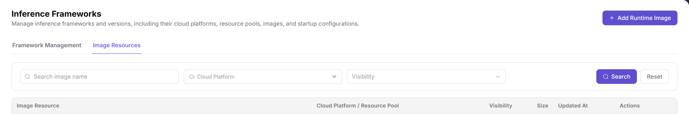
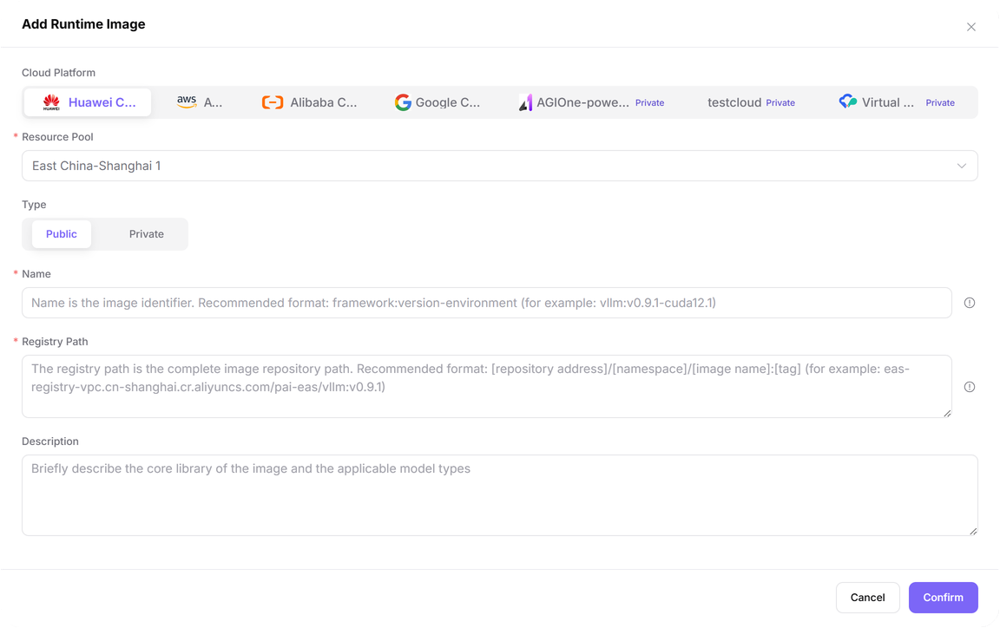
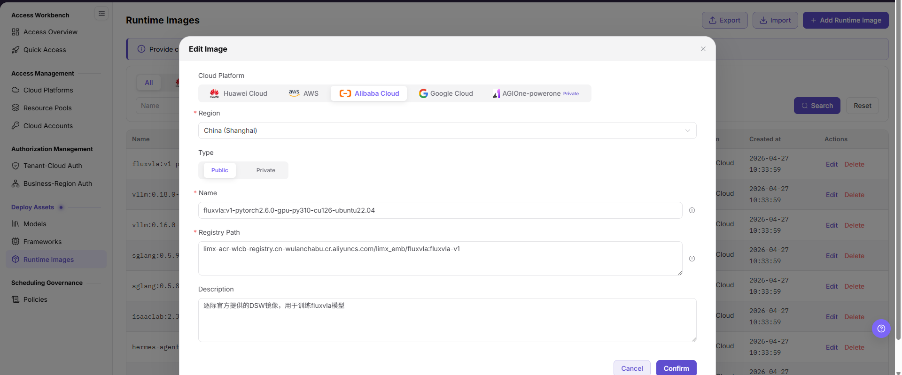

# Runtime Images

::: info Document Information
Version: v2.1
Updated: 2026-11-12
:::

## Feature Overview

| Item | Content |
| --- | --- |
| Applicable Roles | Operators |
| Navigation Path | AI Infra(On-Cloud) > Deploy Assets > Frameworks > in-page Image Resources |
| Page Route | `/infrahub/op/model/image` |
| Managed Objects | Framework-related runtime images, registry paths, cloud platforms, and resource pool scope |

#### Beginner Explanation

A runtime image is like a runtime package used by a framework; open Image Resources within Frameworks to review and maintain these image records.

#### Terms Quick Reference

| Term | Description |
| --- | --- |
| Image Resources | An in-page navigation entry within Frameworks that opens the runtime image list, not a separate sidebar item. |
| Registry Path | A complete image reference in a registry. The input hint uses the repository address/namespace/image name:tag format. |
| Type | The Public and Private image options in the add form, separate from Private badges beside cloud platforms. |
| Resource Pool | The deployment-environment selector below Cloud Platform in the add form. |

## Prerequisites

1. Use an Operator account that can access Deploy Assets > Frameworks.
2. Before adding or maintaining an image, identify its name, registry path, cloud platform, resource pool, and purpose.
3. Before changing an existing image, review associated framework versions and usage scope; a visible form does not prove that the image can be pulled.

## Page Description

This manual retains the Runtime Images name and existing path. In the current system, open Frameworks from the sidebar, then use the in-page Image Resources entry. Framework Management and Image Resources share the Inference Frameworks page heading; the browser title for Image Resources is Runtime Images. Do not look for a separate Runtime Images item in the current system sidebar.

| Area | Description |
| --- | --- |
| In-page navigation | Framework Management and Image Resources open the framework and image lists respectively. |
| Query area | Provides image name, Cloud Platform, and Visibility filters, plus Search and Reset. |
| Image list | Columns are Image Resource, Cloud Platform / Resource Pool, Visibility, Size, Updated At, and Actions. |
| Action entries | Add Runtime Image is at the top; Edit and Delete are visible on current record rows. |
| Add form | Fields are Cloud Platform, Resource Pool, Type, Name, Registry Path, and Description; Cancel and Confirm are at the bottom. |

The figure shows the Image Resources in-page navigation, name/Cloud Platform/Visibility filters, and six column headers beneath the Inference Frameworks heading; it covers only this area, contains no data rows, and does not represent an empty list.

## Main Operations

### Open and Query Image Resources

1. Open Deploy Assets > Frameworks from the sidebar.
2. Click Image Resources in the main content area. Wait for the Image Resource, Cloud Platform / Resource Pool, Visibility, Size, Updated At, and Actions headers before reading the list; do not treat the framework table still displayed during the transition as image records.
3. Set the image name, Cloud Platform, or Visibility criteria as needed and use Search. Use Reset when you need to set the criteria again.
4. Check the target record's image, cloud platform/resource pool, visibility, size, and update time before locating its row actions.

### Open the Initial Add Runtime Image Form

1. Click Add Runtime Image and check the form title.
2. Review the currently displayed Cloud Platform and Resource Pool values; initial displayed values do not mean that an image has been added.
3. Distinguish Public and Private in the Type area. Do not treat a Private badge beside a cloud platform as the selected image type.
4. Review the Name, Registry Path, and Description hints. The name hint uses framework:version-environment, and the registry path hint uses a complete image reference; do not describe architecture as a required field displayed in this initial form.
5. Cancel and Confirm are available at the bottom. Use Cancel when only reviewing the initial form. Before submitting a configuration, review the current form requirements and target object; neither a visible button nor a closed form proves that the configuration was saved.

The figure shows the initial Add Runtime Image form: Resource Pool, Name, and Registry Path have required markers; Type offers Public/Private, Description is below, and Cancel/Confirm are at the bottom. No architecture input is shown.

### Compare the Existing Image Maintenance Form

1. Current image record rows provide Edit. Before maintaining a record, identify the target image and the impact on associated frameworks.
2. The existing Edit Image form below is a static field reference showing Cloud Platform, Region, Type, Name, Registry Path, and Description. Its Region label is not the Resource Pool label used by the current add form.
3. If the current edit form contains these items, check the registry path and purpose against the actual fields, and follow the current submission requirements. Do not treat the reference as a current edit view or as proof that changes were saved or an image was pulled.

The figure shows the existing Edit Image form with Cloud Platform, Region, Public/Private Type, Name, Registry Path, and Description. The separate Runtime Images sidebar item in its background belongs to that reference interface, not the current entry instructions.

### Locate the Delete Entry

1. Identify the target row in Image Resources and distinguish Edit from Delete.
2. Deletion is a change operation. Review associated frameworks and usage scope before proceeding; this section identifies the row entry only and does not presume a confirmation dialog, deletion conditions, or completion result.

## Parameter Quick Reference

Add fields follow the current initial form. Region is retained only as an existing maintenance-form reference and does not replace the current Resource Pool field.

| Field Name | Required | Field Type | Example | Description |
| --- | --- | --- | --- | --- |
| Image name / Cloud Platform / Visibility query | No | Text / Selection | Sample image / Sample cloud platform | Image Resources list filters. |
| Cloud Platform | Follow the current form | Selection | Current options | Cloud platform selection area at the top of the add form; platform-type badges do not specify image Type. |
| Resource Pool | Yes | Selection | Sample resource pool | Marked required in the current add form; the label is Resource Pool, not the former Region label. |
| Type | Follow the current form | Segmented control | `Public` | Visible options are Public and Private. |
| Name | Yes | Text | `framework:v1.0-runtime` | Marked required in the current add form; its hint recommends framework, version, and environment. |
| Registry Path | Yes | Multiline text | `<BASE_URL>/namespace/image:tag` | Marked required in the current add form and requests a complete registry path; documentation uses a placeholder address. |
| Description | No | Multiline text | `Sample runtime image description` | The hint asks for the image's core library and applicable model types. |
| Image Resource / Cloud Platform / Resource Pool | — | List information | Target record | Identifies the image and environment scope; the name does not replace environment information. |
| Visibility / Size / Updated At | — | List information | Target record | Separate columns in the current list; do not carry over the former Created at column label. |
| Region | Follow the current edit form | Selection | Actual displayed value | Appears only in the existing maintenance-form reference, not as a current add field. |
| Search / Reset | — | Buttons | `Search` / `Reset` | List query entries. |
| Edit / Delete | — | Row entries | `Edit` / `Delete` | Currently visible action entries, not evidence of execution or completion. |
| Cancel / Confirm | — | Buttons | `Cancel` / `Confirm` | Bottom entries in the current add form; submission results require a separate check. |

## Pitfalls

- Image Resources is within Frameworks, not a separate sidebar item. The Inference Frameworks heading does not mean that Framework Management is still the current list.
- The current list uses Updated At, not the former Created at label. The add form uses Resource Pool, not Region from the existing maintenance reference.
- A Private badge beside a cloud platform and Private under Type occupy different areas and cannot substitute for each other.
- The navigation and query-area figure has no data rows; do not infer that the current image list is empty.

## Result Validation

| Check Item | Success Signal | If Abnormal |
| --- | --- | --- |
| Entry location | Image Resources is opened from the main content area of Frameworks | Check the in-page entry instead of looking for a separate sidebar item. |
| List location | Headers are Image Resource, Cloud Platform / Resource Pool, Visibility, Size, Updated At, and Actions | Wait for the transition to finish and check the headers; do not read the framework table still displayed. |
| Initial add form | Add Runtime Image title, six fields, and Cancel/Confirm are visible | Check the actual form and distinguish Resource Pool from Region in the existing reference. |
| Type location | Public/Private options appear in the Type area | Do not substitute a cloud platform's Private badge for these options. |

## FAQ

#### Why Is There No Separate Runtime Images Sidebar Entry?

**Symptom:**

The current sidebar provides Frameworks, while the image list has the Runtime Images browser title.

**Possible Causes:**

Image Resources is an entry in the main content area of Frameworks, alongside Framework Management.

**Resolution:**

Open Deploy Assets > Frameworks, click the in-page Image Resources entry, and confirm the location using the image list headers.

#### Does a Cloud Platform's Private Badge Mean Private Image Type?

**Symptom:**

Private badges appear in the add form's cloud platform area, while Public/Private options also appear under Type.

**Possible Causes:**

The cloud platform type label and image Type options belong to different areas.

**Resolution:**

Check the image option in the Type area; do not infer image Type from the platform badge.

## Notes

- The existing maintenance figure is a static field reference. It does not guarantee an identical current edit form or prove saving, synchronization, or framework usability.
- Review the target object and usage scope before adding, editing, or deleting. A list record or configuration button does not prove registry connectivity, image pullability, or service startup.
- Do not put real credentials, internal addresses, or customer data in documentation, tickets, or chat records.

## Next Steps

1. Return to [Frameworks](../frameworks/) for framework management and runtime-version configuration references.
2. Open [Resource Pools](../../access-management/resource-pools/) to review environment objects and [Models](../models/) for model and framework configuration references.
3. For user-side deployment, see [Quick Deployment](../../../user/model-services/quick-deployment/). Image pulls, service startup, and health checks require separate verification during an actual deployment.
