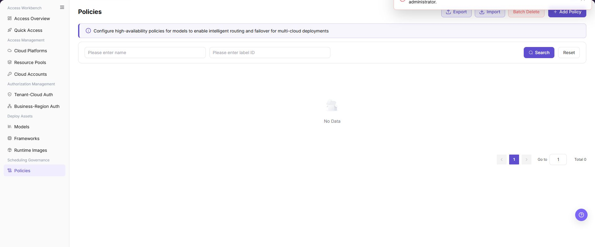
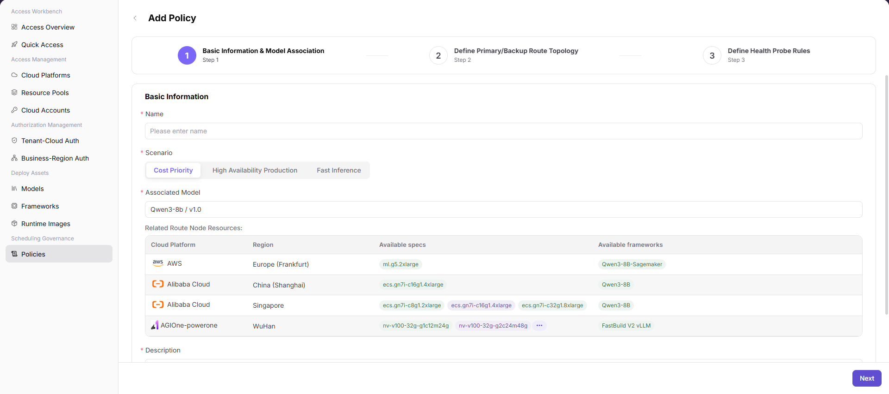
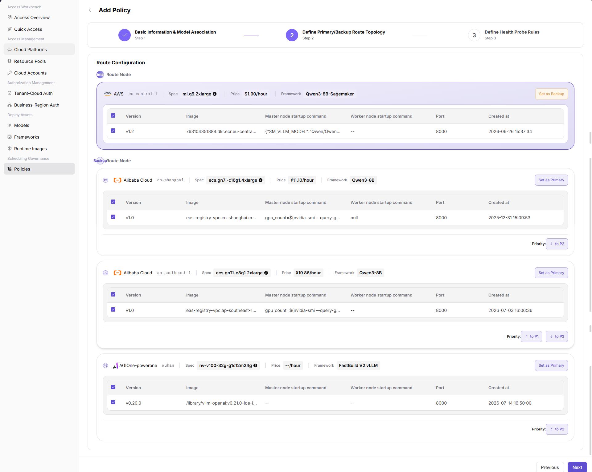
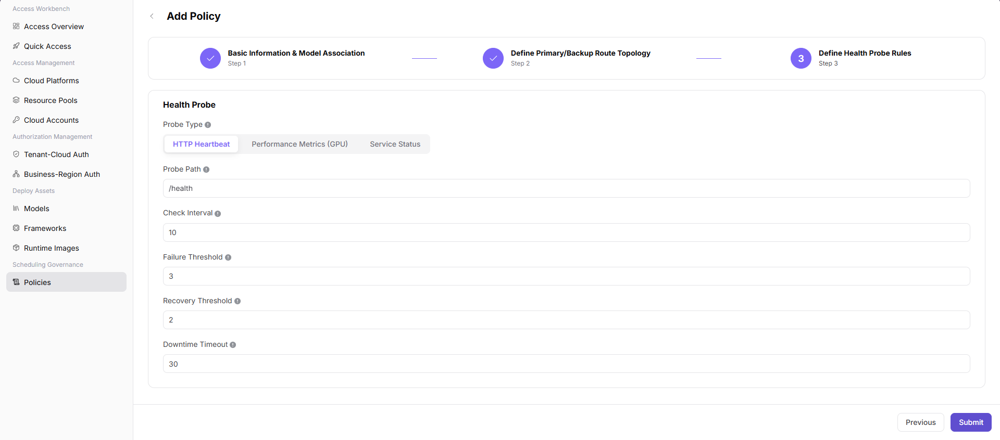

# Policies

::: info Document Information
Version: v2.1
Updated: 2026-11-12
:::

## Feature Overview

This page describes the operator view in Demo (`https://demo.agione.pro/`) on 2026-11-12: `/infrahub/op/schedule/policy` displays `Coming Soon!`, and the sidebar has no policy entry. The policy flow and pictures below are historical references, not executable configuration instructions. This state does not establish what other versions, deployments, or backend scheduling support.

| Item | Content |
| --- | --- |
| Applicable Roles | Operators |
| Navigation Path | Historical path: AI Infra(On-Cloud) > Scheduling Governance > Policies; this entry is not shown in the current sidebar. |
| Page Route | `/infrahub/op/schedule/policy` |
| Managed Objects | The current entry's placeholder; historical descriptions cover application scenarios, associated models, primary/backup routes, and health probes. |

#### Beginner Explanation

Historical policy descriptions compare a policy to traffic rules for model deployment, involving models, primary/backup targets, and health probes. These concepts do not mean that the placeholder provides configuration controls.

#### Terms Quick Reference

These terms explain the historical policy descriptions; they are not current input fields.

| Term | Description |
| --- | --- |
| Application Scenario | A scheduling objective such as cost priority, high availability, or low latency. |
| Primary/Backup Route | The topology between primary and backup deployment targets. |
| Health Probe | A rule that determines whether a target can continue receiving requests. |

#### Recommended Operation Order

Read the development notice first. To leave, use `Back to Home`. Do not create, submit, or modify policies by following the historical pictures.

#### Beginner Checklist

| Scenario | Do First | Do Not Do Directly |
| --- | --- | --- |
| First visit | Read the development notice | Treat the placeholder as a policy list |
| Policy configuration is needed | Separate historical descriptions from the current interface | Fill in or submit the old wizard |
| A return link is visible | Check the `Back to Home` destination | Treat navigation as a successful policy save |
| The page differs from expectations | Record the route, language, and page notice | Infer a backend fault or submit repeatedly |

## Prerequisites

1. Use an authorized operator session to view the route.
2. Before reading the historical flow, confirm that the entry is a placeholder. Do not treat old model, target, or framework pictures as a current form.
3. Do not create, save, import, delete, probe, or switch traffic here. If another environment provides those functions, assess routing, capacity, cost, and failover impact first.

## Page Description

The entry displays `Coming Soon!` and `This page is under development. Please refresh the page or click the button below to return to the homepage.` A `Back to Home` link points to `/`. The main area does not show a policy list, creation entry, wizard, save control, or health-probe controls.

Historical page screenshot:

The figure shows the historical Policies page with name and label-ID filters, an Add Policy entry, No Data, and Total 0. No policy cards or topology are displayed; it is not the current interface.

## Main Operations

### Historical Creation Flow Reference

The next three pictures explain the historical flow, not steps to execute. The current page has no corresponding wizard or submit entry.

### Historical Screen 1: Basic Information and Model Association

The earlier description grouped the policy name, scenario, target model and version, and description into the basic-information stage, followed by a model-linked node list. Do not look for these fields or automatic updates on the current page.

The figure shows historical basic information and model association, involving the policy name, scenario, target model, and cloud nodes. It is not a current creation form.

### Historical Screen 2: Primary and Backup Route Topology

The earlier description covered primary/backup nodes, priorities, cloud providers, resource specs, cost references, and framework versions. This section does not instruct you to select nodes or configure failover, and the old picture does not establish routing behavior.

The figure shows historical primary/backup topology, including priorities and failover paths. It is not a current routing entry.

### Historical Screen 3: Health Probe Rules

The earlier description covered intervals, timeouts, healthy/unhealthy thresholds, endpoint paths, and response codes. The placeholder provides none of these controls and does not establish that node eviction, recovery, or traffic switching has run.

The figure shows historical health-probe rules, including intervals, timeouts, and failover thresholds. It is not a current probe form.

### View the Current Entry

1. Open the page route above.
2. Read the development notice and help text; do not use the historical pictures to locate a policy list or wizard.
3. To leave, use `Back to Home`, whose destination is `/`. Do not treat navigation as evidence of a policy save or routing validation.

## Parameter Quick Reference

There are no policy parameters to enter. This table only describes the visible placeholder and navigation link; historical field requirements, validation, and save rules do not apply to it.

| Field Name | Required | Field Type | Example | Description |
| --- | --- | --- | --- | --- |
| Page notice | Not applicable | Read-only text | `Coming Soon!` | The visible development state, not a policy execution result. |
| Help text | Not applicable | Read-only text | `This page is under development. Please refresh the page or click the button below to return to the homepage.` | The page's instructions do not guarantee that refreshing reveals a policy form. |
| Back to Home | Not applicable | Navigation link | `Back to Home` | The link targets `/`; it does not establish whether a policy was saved. |

## Pitfalls

- Do not follow historical pictures to enter policy parameters or find creation, save, import, or delete controls.
- A missing sidebar entry or list is not enough to diagnose account permissions, upstream models, or backend scheduling faults.
- `Back to Home` is navigation, not a signal that policy creation, persistence, or traffic switching succeeded.
- Use only `<API_KEY>`, `<PERSONAL_KEY>`, `<ACCESS_KEY_ID>`, `<ACCESS_KEY_SECRET>`, `<BASE_URL>`, and `<ENDPOINT_PATH>` for credential and endpoint examples.

## Result Validation

| Check Item | Success Signal | If Abnormal |
| --- | --- | --- |
| Page notice | `Coming Soon!` and the development help text are visible | If the interface differs, check the environment, role, and version first |
| Sidebar state | No policy entry is shown | Use the actual visible menu; do not treat the historical path as a current entry |
| Configuration area | No policy list, three-step wizard, save, or probe controls are shown | Confirm available functions instead of substituting old pictures for a real form |
| Return link | `Back to Home` targets `/` | Check the link destination; navigation does not establish a policy save |

## FAQ

#### Why Is There No Policy List

**Symptom:**

The page displays `Coming Soon!` rather than a policy list.

**Possible Causes:**

The visible content is a development placeholder. This notice alone does not identify backend implementation or a fault cause.

**Resolution:**

Read the notice and recognize the entry's state. Do not clear nonexistent list filters or change models or authorization on that basis.

#### Why Are Create or Submit Buttons Missing

**Symptom:**

Creation, next-step, or submit controls from the historical description cannot be found.

**Possible Causes:**

The main area has no policy form or three-step wizard. Old pictures do not establish that those buttons are available now.

**Resolution:**

Do not try to create or save from an old picture; first confirm which functions the environment actually provides.

#### Can I Configure a Policy from the Old Three Pictures

**Symptom:**

The document retains configuration pictures, but the page has no matching controls.

**Possible Causes:**

The pictures are historical references and differ from the placeholder.

**Resolution:**

Use the pictures only to understand the earlier flow, not to select nodes, set probes, or submit a policy.

#### Does the Placeholder Prove That No Environment Supports Policies

**Symptom:**

You need to determine policy support in another version, deployment, or backend.

**Possible Causes:**

The notice only describes the stated entry's visible condition; it does not establish other environments' or backend capabilities.

**Resolution:**

Check the target environment's actual menu, fields, and reliable feature descriptions separately. Do not generalize this state to every deployment.

#### Does Back to Home Mean That a Policy Was Saved

**Symptom:**

The page has `Back to Home` but no policy-save controls.

**Possible Causes:**

This is a navigation link to `/`, not a save-result notice.

**Resolution:**

Use it if you need to leave; do not treat it as proof of a completed save, synchronization, or failover.

## Notes

- The placeholder does not establish policy persistence, routing, automatic failover, or health-probe execution.
- Do not put real accounts, credentials, internal locations, or customer data in documentation, screenshots, tickets, or chat records.
- Before authorization, deployment, deletion, publication, state, or billing changes in other available functions, assess impact, retain auditable records, and prepare a recovery plan.

## Next Steps

1. For cloud-access readiness, see [Access Overview](../../access-workbench/access-overview/). It is not an alternative policy-configuration entry.
2. If another version or deployment provides policies, confirm its actual menu, fields, and permissions before use; do not execute the old three-picture flow directly.
3. Until a policy entry is confirmed, do not create, import, delete, run health probes, or validate traffic switching.
