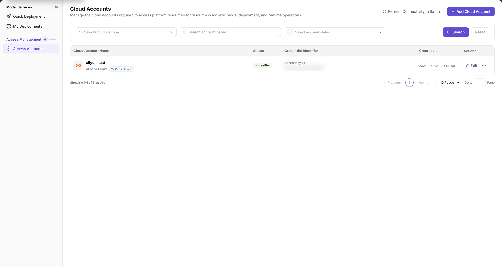
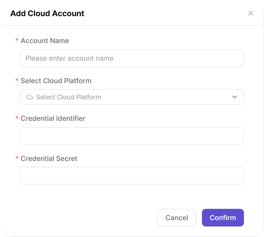

# Access Accounts

::: info Document Information
Version: v2.1
Updated: 2026-11-11
:::

## Feature Overview

| Item | Content |
| --- | --- |
| Applicable Roles | User |
| Navigation Path | AI Infra(On-Cloud) > Access Management > Access Accounts |
| Page Route | `/infrahub/user/access/account` |
| Managed Objects | Cloud accounts and credentials required to access cloud-platform resources |

#### Beginner Explanation

Access Accounts is like a cloud-account directory: it brings account information, credential identifiers, and connectivity status together for resource discovery, model deployment, and runtime management.

#### Terms Quick Reference

| Term | Description |
| --- | --- |
| Cloud Account | A cloud account used to access cloud-platform resources. |
| Credential Identifier | A field identifying the cloud account's access credentials; the list also displays the credential type. |
| Credential Secret | The sensitive credential field in the Add Cloud Account form. |
| Connectivity Status | The account status displayed in the Status column; the page provides a batch refresh entry. |

## Prerequisites

1. The current account has access to the Access Accounts page.
2. Before adding an account, confirm its cloud platform, purpose, and authorization scope. Before using cloud resources afterward, check cloud-platform, resource-pool, and authorization configuration with the Operator.
3. Obtain least-privilege credentials through a secure channel and confirm cost boundaries.

## Page Description

The left-menu entry is **Access Accounts**, while the page heading is **Cloud Accounts**. These are the menu and page names for the same entry, not two separate pages.

| Area | Description |
| --- | --- |
| Filters | A cloud-platform dropdown, an account-name fuzzy search input, and a status dropdown, with Search and Reset. |
| Account list | Columns are Cloud Account Name, Status, Credential Identifier, Created at, and Actions. The cloud platform and public/private cloud type appear beneath the account name. |
| Page actions | Refresh Connectivity in Batch and Add Cloud Account. |
| Row actions | Edit and a more-actions entry (`...`). |
| Add form | The Add Cloud Account dialog contains Account Name, Select Cloud Platform, Credential Identifier, and Credential Secret. |

The figure shows the Cloud Accounts list, with cloud-platform, name, and status filters above the table. The sample status is Healthy; Refresh Connectivity in Batch and Add Cloud Account appear at the top right.

## Main Operations

### View Cloud Accounts

1. Select Access Accounts in the left menu to open the Cloud Accounts page.
2. Select a cloud platform, enter an account name, or select a status as needed, then click Search. Use Reset when you need to reset the query criteria.
3. In the target row, check the cloud account name, platform and type, status, credential identifier, and creation time.
4. To maintain an existing account, locate its row before using Edit. The more-actions entry is to the right of Edit.

### Add Cloud Account

1. Click Add Cloud Account to open the dialog of the same name.
2. Enter Account Name and select the account's platform under Select Cloud Platform.
3. Enter credentials according to the actual form requirements for the selected platform. The blank form uses the generic labels Credential Identifier and Credential Secret; do not assume every cloud platform uses AK/SK.
4. Review the account name, platform, and credential purpose. To submit, click Confirm. To inspect the form without submitting, click Cancel to return to the list.

The figure shows the blank Add Cloud Account form. Account Name, Select Cloud Platform, Credential Identifier, and Credential Secret all have required markers; Cancel and Confirm are at the bottom.

## Parameter Quick Reference

| Field Name | Required | Field Type | Example | Description |
| --- | --- | --- | --- | --- |
| Cloud Platform | No | Dropdown filter | `Select Cloud Platform` | Filters by cloud platform; this is not a set of cloud-platform tabs. |
| Name | No | Input | `demo-cloud-account` | Fuzzy search by account name. |
| Status | No | Dropdown filter | `Select account status` | Filters by account status, corresponding to the Status column. |
| Search | No | Button | `Search` | Query entry. |
| Reset | No | Button | `Reset` | Entry for resetting query criteria. |
| Cloud Account Name | — | List field | `demo-cloud-account` | The account's platform and type appear beneath its name. |
| Status | — | Status label | `Healthy` | Connectivity status of the sample record, not an enumeration of every status. |
| Credential Identifier | — | List field | `AccessKey ID` | Displays credential type and identifier information; this sample type does not represent every cloud platform. |
| Created at | — | Time field | `YYYY-MM-DD HH:mm:ss` | Creation time of the account record. |
| Refresh Connectivity in Batch | No | Action entry | `Refresh Connectivity in Batch` | Connectivity-status refresh entry at the top of the page. |
| Add Cloud Account | No | Button | `Add Cloud Account` | Opens the Add Cloud Account form. |
| Account Name | Yes | Input | `demo-cloud-account` | Display name of the cloud account in the platform. |
| Select Cloud Platform | Yes | Dropdown | `Select Cloud Platform` | Selects the account's cloud platform. |
| Credential Identifier | Yes | Input | `Sample credential identifier` | Generic credential identifier field in the blank form; follow the selected platform's actual requirements. |
| Credential Secret | Yes | Input | `Sample credential secret` | Sensitive credential field; do not put real values in documentation. |
| Edit | No | Row action | `Edit` | Maintenance entry for an existing account; confirm the target and impact scope first. |
| More actions | No | Row action | `...` | To the right of Edit; refer to the actual expanded menu. |
| Cancel | No | Button | `Cancel` | Exits the current add form. |
| Confirm | No | Button | `Confirm` | Form submission entry; review all inputs before clicking. |

## Pitfalls

- Access Accounts in the menu and Cloud Accounts as the page heading refer to the same entry. Do not search the menu only for the page heading.
- The sample credential type in the list is `AccessKey ID`, while the blank add form uses Credential Identifier and Credential Secret. Do not treat the sample type as fixed fields for every cloud platform.
- Status filtering and name search are separate criteria. Check both the filter area and the Status column when reviewing a record.

## Result Validation

| Check Item | Success Signal | If Abnormal |
| --- | --- | --- |
| Page location | Access Accounts is highlighted in the left menu and the page heading is Cloud Accounts | Locate the page again using the menu name and page route. |
| List information | Cloud Account Name, Status, Credential Identifier, Created at, and Actions are available for review | Check the current filters and target account name first. |
| Add form location | Clicking Add Cloud Account opens a dialog with four required fields, Cancel, and Confirm | Verify that this is the Add Cloud Account form before entering credentials for any object. |
| Exit blank form | Cancel returns to the account list | Check whether the list or dialog is still open; do not treat closing the form as submission. |

## FAQ

#### Why Does the Menu Say Access Accounts but the Page Say Cloud Accounts?

**Symptom:**

Access Accounts is highlighted on the left, while the page heading reads Cloud Accounts.

**Possible Causes:**

The current interface uses different names for the menu entry and page heading.

**Resolution:**

Enter through Access Accounts and check the target account against the Cloud Accounts list fields.

#### Should I Enter an Access Key ID or a Credential Identifier When Adding an Account?

**Symptom:**

The sample credential type in the list is `AccessKey ID`, but the blank add form shows Credential Identifier and Credential Secret.

**Possible Causes:**

The list displays the credential type of a specific record, while the blank form displays generic credential field names.

**Resolution:**

Select the cloud platform first, then follow the fields actually displayed. Do not describe every cloud type as using AK/SK.

## Notes

- Use credentials only for authorized business operations through secure channels. Do not put real credentials in documentation, tickets, or chat records.
- Before adding or editing an account, check least privilege, authorization scope, cost boundaries, and change impact. Keep the necessary audit records.
- Status is information displayed on this page; review downstream resource visibility separately on the relevant page.

## Next Steps

1. Go to [Quick Deployment](../../model-services/quick-deployment/) to review cloud-platform, resource-pool, and model-selection entries and check the resources actually available.
2. For existing deployment tasks, go to [My Deployments](../../model-services/my-deployments/). Adding a cloud account does not mean a deployment has been created.
3. Regularly review cloud account permissions, credential validity, and resource visibility.
