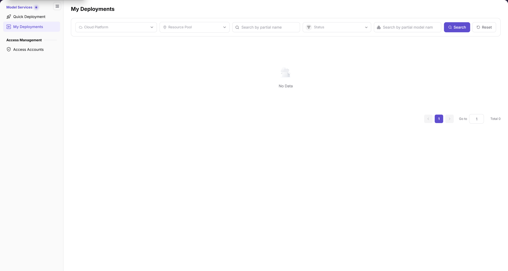
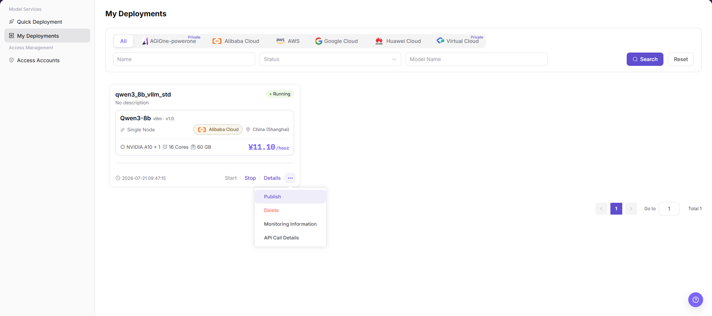
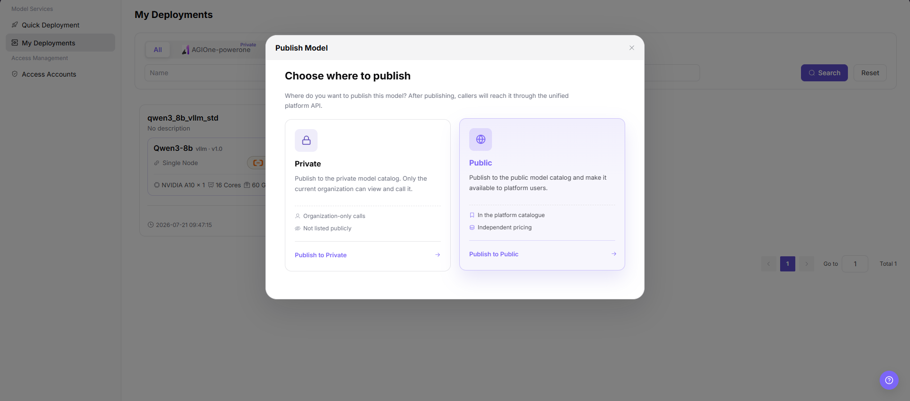
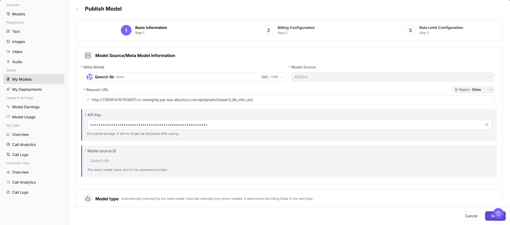

# My Deployments

::: info Document Information
Version: v2.1
Updated: 2026-11-11
:::

## Feature Overview

| Item | Content |
| --- | --- |
| Applicable Roles | User |
| Navigation Path | AI Infra(On-Cloud) > Model Services > My Deployments |
| Page Route | `/infrahub/user/model/deployment` |
| Managed Objects | Deployment queries, deployment cards, and model publishing entry |

#### Beginner Explanation

My Deployments is a directory of model deployment tasks: find a record with filters, then review its card information and available actions.

#### Terms Quick Reference

| Term | Description |
| --- | --- |
| Resource Pool | A resource scope used to query deployments. |
| Deployment Status | The current state shown on a deployment card; use its actual label. |
| Publishing Area | The private or public destination selected when publishing a model. |

## Prerequisites

1. Sign in and ensure My Deployments is accessible from the On-Cloud Model Services menu.
2. The query page does not require existing records. Card review and publishing require a target deployment you can view.
3. Before publishing, starting, stopping, or deleting, confirm the target record, service impact, visibility, and cost boundary.

## Page Description

| Area | Description |
| --- | --- |
| Filters | Cloud Platform, Resource Pool, Name, Status, and Model Name, plus Search and Reset. Name and Model Name support partial matching. |
| Results | Shows matching deployments or No Data, with pagination at the bottom. |
| Deployment cards and publishing | When records exist, review name, model, status, resources, and cost, then use available entries for details or publishing. |

The figure shows Cloud Platform, Resource Pool, partial name search, Status, partial model name search, Search, and Reset; the result area currently displays No Data and Total 0.

## Main Operations

### Query Deployments

1. Open My Deployments and select **Cloud Platform** and **Resource Pool** as needed.
2. Enter keywords for the deployment name or model name and select **Status** as needed.
3. Click **Search** and review results and pagination. Use **Reset** when you need to set criteria again.
4. If **No Data** appears, review the current criteria. An empty list provides no details, running result, or publishing result for a target deployment.

### Review a Deployment Card

1. When records exist, locate the target deployment and verify its name, model, deployment mode, cloud platform, region, and status.
2. Review GPU, CPU, memory, and hourly cost reference on the card. Example amounts are not fixed prices.
3. Use **Details** when available. More actions includes entries for Publish, Delete, Monitoring Information, and API Call Details. An entry's presence does not mean the action has been performed.

### Open Model Publishing

The following publishing flow applies when the target deployment exists in the list and its Publish entry is available.

1. Locate the target running deployment and verify the card name and model.
2. Click the more actions icon (`···`) at the lower right of the card, then select **Publish**.

The figure shows a deployment card's Running label, resource specifications, hourly cost reference, and Details entry; the expanded menu includes Publish, Delete, Monitoring Information, and API Call Details.

### Choose a Publishing Area

1. Read both destinations in the Publish Model dialog under “Choose where to publish”: **Private** publishes to the private model catalog for calls within the current organization and is not listed publicly; **Public** publishes to the public model catalog for platform users, with independent pricing.
2. Click **Publish to Private** or **Publish to Public** according to the intended audience to open model publishing configuration.

The figure shows Private and Public destination cards, distinguishing organization-only calls and no public listing from the platform catalogue and independent pricing.

### Review Model Publishing Information

1. Review **Meta Model**, **Model Source**, **Request URL**, and region on Publish Model against the target deployment. Use `<BASE_URL><ENDPOINT_PATH>` for example addresses.
2. Review **API Key** and **Model source ID** in the secure input area. Do not copy real keys into documentation, tickets, or chat records.
3. Use **Next** to proceed through **Billing Configuration** and **Rate Limit Configuration**, complete the requirements of each stage, and only then submit.
4. After submission, go to **Studio > My Models** to check the actual model status and visibility. Opening configuration does not mean the model is published or callable.

The figure shows Basic Information with Meta Model, Model Source, Request URL, API Key, and Model source ID; the top lists Billing Configuration and Rate Limit Configuration, with Cancel and Next at the bottom.

## Parameter Quick Reference

| Field Name | Required | Field Type | Example | Description |
| --- | --- | --- | --- | --- |
| Cloud Platform | No | Dropdown filter | `Cloud Platform` | Queries by the deployment's cloud platform. |
| Resource Pool | No | Dropdown filter | `Resource Pool` | Queries by the deployment's resource pool. |
| Name | No | Text filter | `demo` | Searches by partial deployment name. |
| Status | No | Dropdown filter | `Status` | Queries by deployment status without assuming all available values. |
| Model Name | No | Text filter | `Qwen` | Searches by partial model name. |
| Search / Reset | No | Button | `Search` | Queries or allows criteria to be set again. |
| Deployment Name / Status | — | Card field | `demo_deployment` | Identifies the target record and its current state. |
| Model / Deployment Mode | — | Card field | `Single Node` | Bound model, engine version, and deployment mode. |
| Cloud Platform / Region | — | Card field | `Sample Cloud / Sample Region` | Resource location displayed on the card. |
| Resources / Cost | — | Card field | `Sample GPU / CPU / Memory` | Resource configuration and hourly cost reference. |
| Publish | No | Action entry | `Publish` | Opens publishing area selection from more actions. |
| Publishing Area | Yes | Destination card | `Private` | See the dialog for Private and Public scope. |
| Meta Model / Model Source | Yes | Selector | `Sample Model / source-a` | Model and source in publishing basic information. |
| Request URL | Yes | URL | `<BASE_URL><ENDPOINT_PATH>` | Review the upstream request address. |
| API Key | Yes | Secret input | `<API_KEY>` | Use real values only in the secure input area. |
| Model source ID | Yes | Text | `demo-model-id` | Exact model name sent to the upstream provider. |
| Region | No | Dropdown | `Sample Region` | Region field in publishing basic information. |

## Pitfalls

- The current list figure is empty. It does not prove that details, publishing, or lifecycle features are absent, nor does it prove successful deployment.
- The destination dialog distinguishes Private from Public. Platform catalogue visibility and organization-only calls are different scopes.
- Publish on a card opens a publishing flow; it is not a sign that the model is already published.

## Result Validation

| Check Item | Success Signal | If Abnormal |
| --- | --- | --- |
| Query scope | Cloud Platform, Resource Pool, Name, Status, and Model Name match the target query | Review filters, reset as needed, and query again |
| Query results | The result area displays deployment records or explicitly displays No Data | Use actual records and pagination; do not infer why the list is empty |
| Target deployment | When a record exists, its name, model, and status can be checked individually | Do not publish, start, stop, or delete without identifying the target |
| Publishing destination | The dialog shows Private and Public with their descriptions | Confirm the audience before selecting the corresponding entry |
| Publishing information | Model, source, URL, and model source ID match the target | Return to review the deployment; configuration is not a successful publishing result |

## FAQ

#### Does an Empty List Mean Publishing Is Unavailable?

**Symptom:**

The result area displays No Data with no deployment card to operate on.

**Possible Causes:**

The page currently shows an empty result without a target card. That message itself does not identify a specific cause or establish feature permissions.

**Resolution:**

Review Cloud Platform, Resource Pool, Name, Status, and Model Name. Continue only after locating the target deployment, using entries actually available on its card.

#### How Do Private and Public Differ?

**Symptom:**

The publishing dialog offers two destinations.

**Possible Causes:**

The dialog distinguishes organization-only calls and no public listing from the platform catalogue and independent pricing.

**Resolution:**

Read the destination descriptions for the intended audience, confirm scope, and choose Publish to Private or Publish to Public.

## Notes

- Publishing, starting, stopping, and deleting involve services or resources. Confirm the target and impact; do not infer results from an empty list.
- Handle real credentials only in secure input areas. Documentation examples use `<API_KEY>`, `<BASE_URL>`, and `<ENDPOINT_PATH>`.
- Query results, card status, and publishing configuration are different stages. They do not guarantee downstream synchronization or successful calls.

## Next Steps

1. If no target deployment exists, review model and plan selection in [Quick Deployment](../quick-deployment/).
2. When Publish Model is open, continue reviewing Basic Information, Billing Configuration, and Rate Limit Configuration in order.
3. After publishing submission, check the target record in [My Models](../../../../model-services/user/studio/my-models/) and use its actual status.
