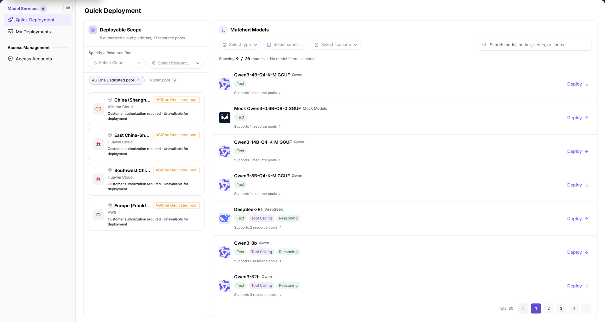
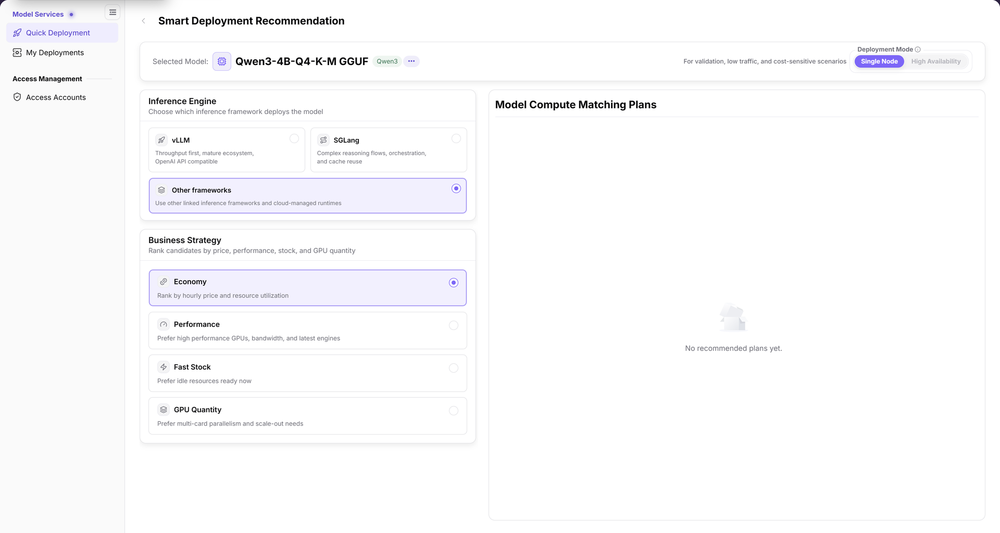
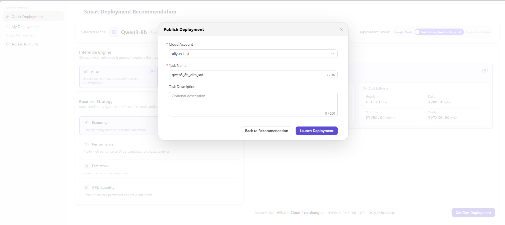

# Quick Deployment

::: info Document Information
Version: v2.1
Updated: 2026-11-11
:::

## Feature Overview

| Item | Content |
| --- | --- |
| Applicable Roles | User |
| Navigation Path | AI Infra(On-Cloud) > Model Services > Quick Deployment |
| Page Route | `/infrahub/user/model/store` |
| Managed Objects | Deployable scope, matched models, inference engines, business strategies, and deployment plans |

#### Beginner Explanation

Quick Deployment is a model-to-compute matching wizard: select a model within a cloud and resource pool, then review deployment plans for that model.

#### Terms Quick Reference

| Term | Description |
| --- | --- |
| Deployable Scope | Resources organized by cloud and resource pool, with authorization or deployment availability messages on each card. |
| Inference Engine | The framework used to deploy the model: vLLM, SGLang, or Other frameworks. |
| Business Strategy | A preference for ranking candidates by price, performance, stock, and GPU quantity. |

## Prerequisites

1. Sign in and ensure Quick Deployment is accessible from the On-Cloud Model Services menu.
2. Check the target cloud, resource pool, and authorization messages before selecting a model.
3. Before launching deployment, confirm the selected resources, cost estimate, cloud account, and task name.

## Page Description

| Area | Description |
| --- | --- |
| Deployable Scope | Locate resources with Select Cloud and Select Resource Pool; switch between AGIOne Dedicated pool and Public pool. |
| Matched Models | Filter by type, series, or scenario, or search by model, author, series, or source. Cards show capability tags, supported resource pools, and Deploy. |
| Smart Deployment Recommendation | The top area shows the selected model and deployment mode. Choose an inference engine and business strategy on the left and review matching plans on the right. |

The figure shows cloud and resource pool selection, dedicated/public pool sections, model filters, search, and Deploy buttons; some pools display “Customer authorization required · Unavailable for deployment”.

## Main Operations

### View Deployable Models

1. Open Quick Deployment and locate resources by cloud and resource pool in Deployable Scope.
2. Review AGIOne Dedicated pool or Public pool and check authorization and deployment availability messages on the cards.
3. Select a type, series, or scenario, or search by model, author, series, or source.
4. Verify the model name, capability tags, and supported pools, then click **Deploy** on the model card to open Smart Deployment Recommendation.

### Review Smart Recommendation

1. Check the selected model at the top. Deployment modes are **Single Node** and **High Availability**; use the options enabled on the current page.
2. Select **vLLM**, **SGLang**, or **Other frameworks** under Inference Engine.
3. Select **Economy**, **Performance**, **Fast Stock**, or **GPU Quantity** under Business Strategy and review Model Compute Matching Plans on the right.
4. If **No recommended plans yet.** appears, there is no selectable plan in the result area. This does not establish resource specifications, cost, or a deployment result.

The figure shows Single Node/High Availability, three inference engine choices, and four business strategies; this example selects Other frameworks and Economy, with High Availability disabled and “No recommended plans yet.” on the right.

### Create Model Deployment

The following flow applies when a recommendation is available and the Publish Deployment dialog can be opened. An empty recommendation does not provide these confirmation details.

1. Verify the selected model, cloud platform, region, resources, and cost estimate, then click **Confirm Deployment**.
2. In Publish Deployment, select **Cloud Account**, enter the required **Task Name**, and optionally enter **Task Description**.
3. Click **Back to Recommendation** to adjust the plan, or **Launch Deployment** after reviewing the task information.
4. After submission, query the target task in [My Deployments](../my-deployments/) and use the actual record and status shown there.

The figure shows Cloud Account, Task Name, optional Task Description, Back to Recommendation, and Launch Deployment in the confirmation dialog; the background cost estimate belongs to the illustrated plan and is not a universal price.

## Parameter Quick Reference

| Field Name | Required | Field Type | Example | Description |
| --- | --- | --- | --- | --- |
| Select Cloud | No | Dropdown filter | `Select Cloud` | Locates deployable scope by cloud platform. |
| Select Resource Pool | No | Dropdown filter | `Select Resource Pool` | Locates deployable scope by resource pool. |
| Pool section | No | Section switch | `Public pool` | Switches between AGIOne Dedicated pool and Public pool. |
| Select type / Select series / Select scenario | No | Dropdown filter | `Select series` | Filters matched models. |
| Search | No | Text | `Qwen` | Searches by model, author, series, or source. |
| Deploy | No | Action entry | `Deploy` | Opens the recommendation page from a model card; not final submission. |
| Selected Model | — | Display field | `Sample Model` | Model for which deployment plans are being matched. |
| Deployment Mode | Yes | Segmented control | `Single Node` | Single Node or High Availability; availability depends on the current model page. |
| Inference Engine | Yes | Radio card | `Other frameworks` | vLLM, SGLang, or Other frameworks. |
| Business Strategy | Yes | Radio card | `Economy` | Economy, Performance, Fast Stock, or GPU Quantity. |
| Model Compute Matching Plans | — | Result area | `No recommended plans yet.` | Shows candidates or an empty state, not a created deployment. |
| Cost Estimate | — | Display field | `Refer to selected plan` | Review estimates when a plan is available; example amounts are not fixed prices. |
| Confirm Deployment | No | Button | `Confirm Deployment` | Opens confirmation when a plan is selectable. |
| Cloud Account | Yes | Dropdown | `example-cloud-account` | Execution account in Publish Deployment. |
| Task Name | Yes | Text | `demo_deploy_task` | Task name in Publish Deployment. |
| Task Description | No | Multiline text | `Sample task description` | Optional notes; do not enter secrets or internal parameters. |
| Back to Recommendation / Launch Deployment | No / Yes | Button | `Back to Recommendation` | Returns to plans or finally submits the task, respectively. |

## Pitfalls

- **Economy** is a business strategy, not a separate deployment mode. The mode area shows Single Node and High Availability.
- Disabled High Availability in the figure applies to this example only, not to all models.
- **No recommended plans yet.** is an empty plan state, not a creation success message. Deploy on a model card only opens the recommendation page.

## Result Validation

| Check Item | Success Signal | If Abnormal |
| --- | --- | --- |
| Model selection | The target model name appears at the top of the recommendation page | Return to Quick Deployment and check the model card |
| Option review | Mode, engine, and strategy match the current choices | Check selected and enabled states in each area |
| Plan reading | The right area shows plans or explicitly shows “No recommended plans yet.” | Follow the actual message; do not invent costs or specifications |
| Final confirmation details | When the dialog is open, Cloud Account, Task Name, and Task Description can be reviewed | Do not treat the recommendation page as submission when the dialog has not been reached |

## FAQ

#### Is Economy a Deployment Mode?

**Symptom:**

You need to distinguish deployment mode from Economy on the recommendation page.

**Possible Causes:**

The UI places Single Node/High Availability in Deployment Mode and Economy in Business Strategy.

**Resolution:**

Review the mode and strategy separately; do not treat a strategy as a third deployment mode.

#### Does “No recommended plans yet.” Mean Deployment Is Complete?

**Symptom:**

Model Compute Matching Plans displays “No recommended plans yet.”.

**Possible Causes:**

This is the plan area's empty state. The message itself provides neither a specific cause nor deployment success information.

**Resolution:**

Review the selected model, mode, inference engine, and strategy. Do not apply the final confirmation steps without a selectable plan.

## Notes

- Launching deployment is a resource operation. Review the account, resources, and cost boundary before submitting.
- Do not put real credentials, internal addresses, or customer data in documentation, screenshots, tickets, or chat records.
- A cost estimate is not a final bill. Opening a recommendation page or confirmation dialog does not mean a task is running successfully.

## Next Steps

1. Query tasks in [My Deployments](../my-deployments/) by cloud platform, resource pool, name, status, or model name.
2. Review available cloud accounts in [Access Accounts](../../access-management/access-accounts/) when needed.
3. Continue reviewing resource specifications and confirmation details only after a concrete plan appears.
