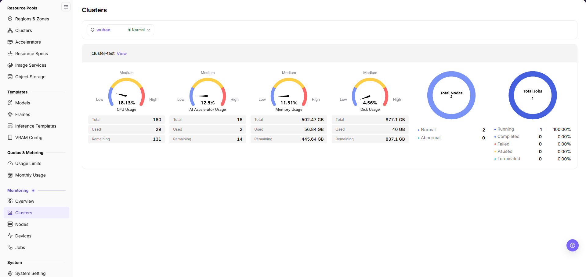
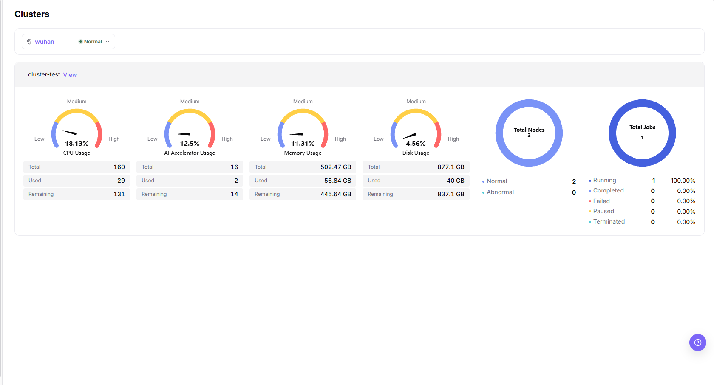

# Clusters

## Feature Overview

| Item | Content |
| --- | --- |
| Applicable Role | Operator |
| Navigation Path | On-Prem > Monitoring > Clusters |
| Managed Object | Configuration, status, and relationships on Clusters |

#### Beginner Explanation

Cluster statistics are like health check reports for each equipment room. They compare capacity, health status, and resource watermarks across clusters to determine whether an issue is a local cluster problem or global resource shortage.

#### Terms

| Term | Description |
| --- | --- |
| Cluster Capacity | Total CPU, memory, GPU/NPU, and other resources the cluster can provide. |
| Resource Watermark | Ratio of used resources to remaining resources. |
| Health Status | Whether cluster components, nodes, and scheduling capability are normal. |

#### Recommended Operation Order

Confirm prerequisites for Cluster status, resource capacity, job count, and region/availability zone ownership, follow Main Operations, run Result Validation, and continue to the next page.

#### First-Time User Notes

Confirm that the task involves Configuration, status, and relationships on Clusters, and then follow the recommended order. If fields or state differ from expectations, check prerequisites before continuing downstream.

## Prerequisites

1. The current account has cluster monitoring view permissions.
2. The target cluster has been registered and is within the monitorable scope.
3. Cluster capacity, node, and accelerator metrics have been collected.
4. The region or cluster scope to compare has been confirmed.

## Page Description

Use this page to compare cluster status, resource capacity, job counts, and region ownership.

Cluster statistics are used to compare cluster capacity, health status, and resource watermarks across different regions. Operators can use the cluster dimension to determine whether there is overall capacity shortage, collection exception, or a hotspot in a single cluster.

## Main Operations

### Filter Cluster Statistics

#### Applicable Scenarios

Use this when you need to narrow the monitoring scope by region or status to quickly locate a target cluster.

#### Steps

1. Go to `On-Prem > Monitoring > Clusters`.
2. In the region selector at the top of the content area, choose the region the target cluster belongs to, for example `wuhan`.
3. The same selector shows the status of the selected region, for example the green `Normal` label next to `wuhan`.
4. Locate the target cluster on the cluster card, and view the card title and the `View` entry.

#### Result Validation

- The page shows only the cluster cards that belong to the selected region.
- The cluster card title matches the selected region.

#### Notes

- The region selector shows the selected region together with its status (`wuhan` with a green `Normal` label).

### View Cluster Resource and Health Overview

#### Applicable Scenarios

Use this when evaluating the capacity watermark and the node and job health status of a single cluster.

#### Steps

1. Open the target cluster card, and review the four gauges — CPU Usage, AI Accelerator Usage, Memory Usage, and Disk Usage — together with the total, used, and remaining values of each gauge.

2. View the node ring chart, and verify the total node count and the normal and abnormal node counts.
3. View the job ring chart, and verify the total job count and the distribution across Running, Completed, Failed, Paused, and Terminated states.
4. Click the `View` link that follows the cluster name in the card header (for example next to `cluster-test`) to open the cluster details.

#### Result Validation

- The four gauges show usage normally, and total equals the sum of used and remaining.
- Each gauge also lists `Total`, `Used`, and `Remaining`, and dividing `Used` by `Total` reproduces the percentage on the gauge (for example 29 / 160 = 18.13%).
- The normal and abnormal counts in the node ring chart match the node list.
- The legend of the job ring chart gives a count and a percentage for each state (for example `100.00%` for Running and `0.00%` for the other states).

#### Notes

- Gauge levels (Low/Medium/High) are used to quickly judge the resource watermark and do not represent overall cluster health.
- Normal cluster watermarks do not mean every node or device is available.

### Investigate Abnormal Cluster Metrics

#### Applicable Scenarios

Use this when cluster resource utilization shows high watermarks or abnormal status and you need to locate the root cause.

#### Steps

1. Note the abnormal cluster name and the specific timestamp.
2. Switch to `Nodes` or `Devices` in the left sidebar to check specific nodes and hardware health.
3. Cross-reference with `Jobs` to determine whether the anomaly is caused by single hardware failure, uneven node load, or sudden high-load training/inference jobs.
4. If scheduling adjustments or node isolation are required, coordinate with platform operations rather than modifying underlying resources directly.

#### Result Validation

- Whether cluster status is available.
- Whether GPU, CPU, memory, and disk usage rates are abnormal.
- Whether jobs are concentrated on a small number of clusters.
- The left sidebar `Monitoring` group lists `Overview`, `Clusters`, `Nodes`, `Devices`, and `Jobs`.

#### Notes

- Cluster statistics may have collection latency. Do not judge faults based only on a single instant metric.
- Align time ranges and metric units when comparing clusters across regions.

## Parameter Quick Reference

| Field Name | Required | Field Type | Example | Description |
| --- | --- | --- | --- | --- |
| Region | Conditionally required | Drop-down | `wuhan` | Limits the region to which the cluster belongs. |
| Status | Conditionally required | Drop-down | `Normal` | Shows the status of the selected region inside the region selector. |
| Cluster Name | System-generated | Text | `cluster-test` | Identifies the monitored cluster object. |
| CPU Usage | System-generated | Percentage | `18.13%` | Shows the CPU resource usage level of the cluster. |
| AI Accelerator Usage | System-generated | Percentage | `12.5%` | Shows the GPU, NPU, or other accelerator resource usage level. |
| Memory Usage | System-generated | Percentage | `11.31%` | Shows the memory resource usage level of the cluster. |
| Disk Usage | System-generated | Percentage | `4.56%` | Shows the disk resource usage level of the cluster. |
| Total / Used / Remaining | System-generated | Value table | `502.47 GB` / `56.84 GB` / `445.64 GB` | The three rows under each gauge; the memory and disk gauges show the `GB` unit, the CPU and AI accelerator gauges show no unit. |
| Total Nodes | System-generated | Number | `2` | Shows the number of nodes included in monitoring statistics for the cluster. |
| Node Status | System-generated | Status | `Normal / Abnormal` | Shows the count distribution of normal and abnormal nodes. |
| Total Jobs | System-generated | Number | `1` | Shows the number of jobs in the cluster. |
| Job Status | System-generated | Status | `Running / Completed / Failed / Paused / Terminated` | Shows the count distribution of jobs across states. |

## Pitfalls

- Proceed to the `Nodes` and `Devices` pages when a cluster is abnormal.
- Abnormal cluster usage should be investigated together with nodes, devices, jobs, and scheduling events.
- Do not write real cluster IDs, node names, device IDs, resource pool IDs, tenant information, internal metric keys, or test data in the document.

#### Configuration Rules and Impact

- **Cluster status is used for capacity judgment**: If the cluster is healthy but watermarks are high, look at expansion or scheduling first. If abnormal, troubleshoot cluster access and collection first.
- **View resource watermarks by type**: CPU, memory, GPU/NPU, and storage bottlenecks mean different things. Do not look only at a single total score.
- **Fix the time range for cross-cluster comparison**: Different time windows affect peak values, averages, and exception statistics.
- **Unavailable clusters affect instance creation**: When users fail to create instances, also check cluster health, specification association, and quotas.

## Result Validation

| Check Item | Success Signal | If Abnormal |
| --- | --- | --- |
| Page load | Clusters charts or lists are visible | Check monitoring permission and whether collection is available in the selected region |
| Scope | Time range, region, and object count match the investigation | Clear filters and restore them one at a time to avoid mixed scopes |
| Freshness | Update time is within the expected collection interval | Check collection interval, connection, and alerts in system or monitoring configuration |
| Correlation | An abnormal metric can be linked to a cluster, node, device, or job | Keep the same time range and cross-check adjacent monitoring pages and object details |

## FAQ

#### No Data on Clusters

**Symptom:**

The page opens, but charts or lists are empty.

**Possible Causes:**

- No job ran in the selected time.
- collection is unavailable in the region.
- the role lacks metric permission.

**Solution:**

1. Expand the time range and reset filters
2. verify regional monitoring capability
3. compare an adjacent monitoring page.

#### Clusters Is Not Updating

**Symptom:**

The data does not change for an extended period.

**Possible Causes:**

- The next collection cycle has not arrived.
- the collector is abnormal.
- the page is cached.

**Solution:**

1. Check update time
2. inspect collector status and alerts
3. refresh with the same time range.

#### Clusters Differs from Adjacent Pages

**Symptom:**

The same object has different values on two monitoring pages.

**Possible Causes:**

- Aggregation granularity differs.
- time range or time zone differs.
- filters target different objects.

**Solution:**

1. Align time range and time zone
2. verify aggregation scope
3. clear and restore filters one at a time.

#### Unable to Locate Target Object in Related Monitoring

**Symptom:**

The metric or details entry does not lead to the expected object.

**Possible Causes:**

- The object ended or was removed.
- the role cannot see it.
- relationship identifiers differ.

**Solution:**

1. Record object and time
2. check its list state
3. ask the Operator to verify visibility.

#### A Spike Cannot Be Reproduced

**Symptom:**

A spike was recorded, but current details are normal.

**Possible Causes:**

- The spike was brief.
- sampling is coarse.
- the job has ended.

**Solution:**

1. Lock the spike interval
2. compare job and node events
3. retain a sanitized screenshot and object identifier.

## Notes

- Cluster health does not mean all services are normal. Combine it with instance and job status.
- Fix the time range when comparing across clusters.
- Do not expose internal cluster names, API Server, or network information.
- Before expansion, migration, or fault judgment, cross-check with node statistics, device monitoring, job monitoring, and scheduling events.
- Documentation examples must not include real cluster IDs, node names, device IDs, resource pool IDs, tenant information, internal metric keys, or test data.

## Next Steps

1. When watermarks are high, enter node statistics to locate hotspot nodes.
2. When accelerators are tight, enter device monitoring to confirm model and VRAM.
3. When a cluster is unavailable, return to resource pool cluster management to check access status.
