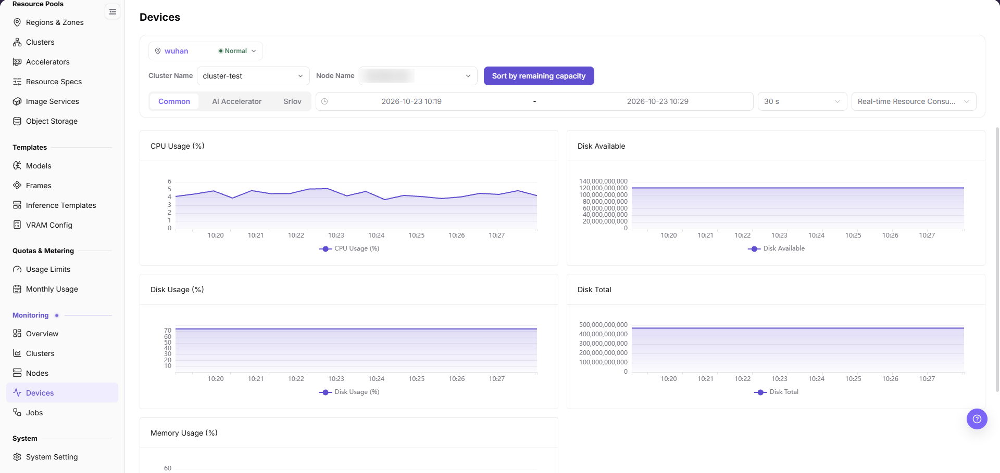
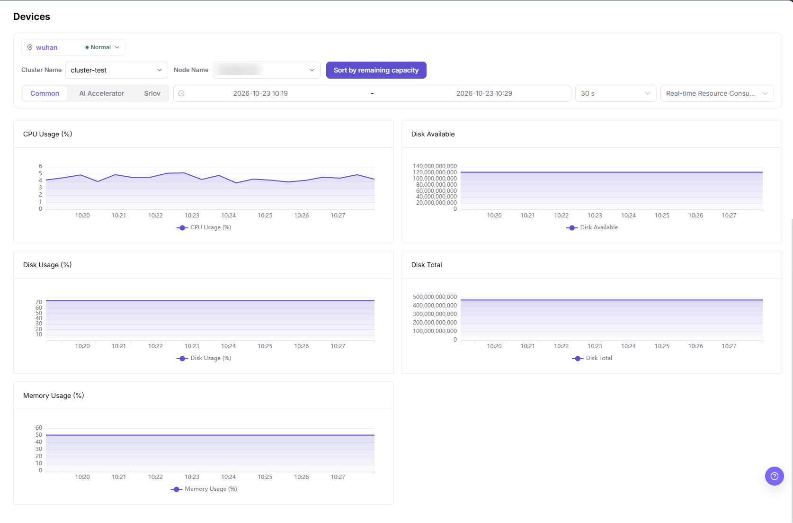

# Devices

## Feature Overview

| Item | Content |
| --- | --- |
| Applicable Role | Operator |
| Navigation Path | On-Prem > Monitoring > Devices |
| Managed Object | Configuration, status, and relationships on Devices |

#### Beginner Explanation

Device monitoring is like an accelerator dashboard. It observes GPU/NPU utilization, VRAM, temperature, and health status to determine whether compute cards can continue hosting tasks.

#### Terms

| Term | Description |
| --- | --- |
| Device Utilization | Current compute utilization of GPU/NPU. |
| VRAM Usage | Accelerator VRAM occupation ratio. |
| Temperature | Device operating temperature. |

#### Recommended Operation Order

Confirm prerequisites for Accelerator devices such as GPU/NPU, VRAM, utilization, temperature, and health status, follow Main Operations, run Result Validation, and continue to the next page.

#### First-Time User Notes

Confirm that the task involves Configuration, status, and relationships on Devices, and then follow the recommended order. If fields or state differ from expectations, check prerequisites before continuing downstream.

## Prerequisites

1. The current account has device monitoring view permissions.
2. The target cluster has deployed device plugins and can report GPU/NPU metrics.
3. Device model, VRAM, temperature, and health status can be collected.
4. The accelerator model or job scope to focus on has been confirmed.

## Page Description

Use this page to view monitoring trends for a selected region, cluster, and node, and to switch metric dimensions with the tabs above the charts.

Device monitoring is used to view GPU/NPU utilization, VRAM, temperature, and health status. Operators can use it to determine whether accelerators are offline, overheating, out of VRAM, or occupied by a single task for a long time.

## Main Operations

### Filter and View Common Metrics

#### Applicable Scenarios

- You need the resource trend of one cluster and one node before judging any accelerator problem.
- You need to tell a host CPU, memory, or disk bottleneck apart from an accelerator-card issue.

#### Steps

1. Go to `On-Prem > Monitoring > Devices`.
2. In the card at the top of the page, confirm the region selector shows the target region and its status (`wuhan` with a green `Normal` marker in this capture).
3. Set `Cluster Name` to the target cluster (`cluster-test` in this capture).
4. Set `Node Name` to the target node.
5. Keep the `Common` tab selected, then set the time range (`2026-10-23 10:19` to `2026-10-23 10:29` in this capture), the sampling interval (`30 s`), and the metric scope drop-down on the right.
6. Click `Sort by remaining capacity` when you need to rank nodes by the capacity that is still free.

The charts below are drawn for the selected cluster, node, and time range.

#### Result Validation

- The `Common` tab renders five charts: `CPU Usage (%)`, `Disk Available`, `Disk Usage (%)`, `Disk Total`, and `Memory Usage (%)`.
- The legend under each chart repeats that chart's title, and the x-axis stays inside the selected time range.
- Switching `Cluster Name` or `Node Name` changes the plotted series instead of leaving the charts unchanged.

#### Notes

- The `Common` tab screen exposes cluster and node filters only, so device-scoped questions go to the accelerator tab.
- `Disk Available` and `Disk Total` plot raw byte values on the vertical axis in this capture. Confirm the unit before comparing them with other monitoring pages.
- The metric scope drop-down label is truncated on screen.

### Switch Monitoring Dimension Tabs

#### Applicable Scenarios

- The metric you need is not among the five charts on the current tab.
- You need to separate a host-resource problem from an accelerator-card or network problem.

#### Steps

1. Use the tab row above the charts. This capture shows three tabs from left to right: `Common` (selected), `AI Accelerator`, and `Srlov`.
2. Click `AI Accelerator` to move from host resources to accelerator-card metrics.
3. Click `Srlov` to switch to the remaining dimension; the tab label is not clearly legible in the English UI.
4. On a non-default tab, read what the tab actually renders before quoting any field name.

#### Result Validation

- The selected tab is highlighted, and the chart area below it changes accordingly.
- The time range, sampling interval, and metric scope drop-downs stay visible after switching tabs.

#### Notes

- Do not copy accelerator field names such as device model or memory usage into a conclusion unless they are visible on your screen; the captures used for this page cover the `Common` tab only.
- Tab names are written exactly as the interface renders them, including the third tab's label.

### Investigate Abnormal Device Metrics

#### Applicable Scenarios

- An accelerator is reported offline, overheated, short of memory, or blocked by a driver error.
- One job keeps a card busy while cluster-level watermarks still look normal.

#### Steps

1. On the `Common` tab, note the affected `Node Name` and the chart that shows the anomaly, then keep the same time range.
2. Switch to `AI Accelerator` on this page to confirm the accelerator dimension of the same node.
3. In the left `Monitoring` group, open `Jobs` to check whether a large model training or high-concurrency inference job occupies the card.
4. Open `Nodes` in the same group to check the host node load, network, and driver service health.
5. If a hardware failure or a missing card is confirmed, coordinate with hardware engineers for isolation and maintenance instead of force-killing workloads without review.

#### Result Validation

- The node identified on this page appears in `Jobs` and `Nodes` under the same time range.
- `Devices` stays selected in the left `Monitoring` group, whose entries are `Overview`, `Clusters`, `Nodes`, `Devices`, and `Jobs`.

#### Notes

- Whether a device is identified and reported continuously decides how far the charts can be trusted.
- Memory and utilization are read together; a single instant metric is not enough to declare a hardware fault.
- Temperature, error counts, and health status belong to the accelerator dimension.

## Parameter Quick Reference

| Field Name | Required | Field Type | Example | Description |
| --- | --- | --- | --- | --- |
| Device ID | System-generated | Text | `GPU-0` | Distinguishes multiple devices on the same node. |
| Device Type | Yes | Text | `NVIDIA A800` | Shows GPU/NPU or other accelerator type and model. |
| Node Name | Conditionally required | Drop-down | `<node name>` | Selects the node whose metrics are plotted. |
| Cluster Name | Conditionally required | Drop-down | `cluster-test` | Selects the cluster to which the node belongs. |
| Region | Conditionally required | Drop-down | `wuhan` | Limits the reporting scope of the whole page, shown together with the region status. |
| Device Status | System-generated | Status | `Normal` | Shows whether the device is available, alerted, or offline. |
| Accelerator Usage | System-generated | Percentage | `92%` | Determines whether compute units are under high load. |
| VRAM Usage | System-generated | Percentage / Capacity | `62 GB / 80 GB` | Determines whether a model or job occupies all VRAM. |
| Temperature | System-generated | Number | `71°C` | Helps judge cooling and hardware health. |
| Health Status | System-generated | Status | `Normal` | Shows whether the device is available, alerted, or offline. |
| Bound Job | System-generated | Text / Number | `Running job` | Shows jobs currently associated with or occupying the device. |
| Time Range | Conditionally required | Date range | `2026-10-23 10:19` - `2026-10-23 10:29` | Controls the query window of the trend charts. |

## Pitfalls

- Full VRAM does not necessarily mean compute is fully loaded, and a high VRAM watermark is not by itself a device fault. Judge both together with utilization and the jobs bound to the device.
- Temperature exceptions should be escalated to operations promptly for hardware and cooling checks.
- When devices are invisible, check drivers, plugins, and node status first.
- Device monitoring may have collection latency. Do not judge hardware faults based only on a single instant metric.
- Device exceptions should be investigated together with node status, job status, scheduling events, device plugins, and node logs.

#### Configuration Rules and Impact

- **VRAM watermark directly affects model startup**: When VRAM is insufficient, instance creation may fail even if total cluster resources look sufficient.
- **View temperature and health together**: High temperature, missing cards, or driver exceptions can all cause job failures.
- **Device dimension is suitable for hotspot location**: When cluster watermarks are normal but jobs are slow, use the device dimension to confirm whether a single-card hotspot exists.
- **Model differences affect schedulability**: The same specification may require a specific GPU/NPU model, driver, or compute capability.

## Result Validation

| Check Item | Success Signal | If Abnormal |
| --- | --- | --- |
| Page load | Devices charts or lists are visible | Check monitoring permission and whether collection is available in the selected region |
| Scope | Time range, region, and object count match the investigation | Clear filters and restore them one at a time to avoid mixed scopes |
| Freshness | Update time is within the expected collection interval | Check collection interval, connection, and alerts in system or monitoring configuration |
| Correlation | An abnormal metric can be linked to a cluster, node, device, or job | Keep the same time range and cross-check adjacent monitoring pages and object details |

## FAQ

#### No Data on Devices

**Symptom:**

The page opens, but charts or lists are empty.

**Possible Causes:**

- No job ran in the selected time.
- collection is unavailable in the region.
- the role lacks metric permission.

**Solution:**

1. Expand the time range and reset filters
2. verify regional monitoring capability
3. compare an adjacent monitoring page.

#### Devices Is Not Updating

**Symptom:**

The data does not change for an extended period.

**Possible Causes:**

- The next collection cycle has not arrived.
- the collector is abnormal.
- the page is cached.

**Solution:**

1. Check update time
2. inspect collector status and alerts
3. refresh with the same time range.

#### Devices Differs from Adjacent Pages

**Symptom:**

The same object has different values on two monitoring pages.

**Possible Causes:**

- Aggregation granularity differs.
- time range or time zone differs.
- filters target different objects.

**Solution:**

1. Align time range and time zone
2. verify aggregation scope
3. clear and restore filters one at a time.

#### Unable to Locate Target Object in Related Monitoring

**Symptom:**

The metric or details entry does not lead to the expected object.

**Possible Causes:**

- The object ended or was removed.
- the role cannot see it.
- relationship identifiers differ.

**Solution:**

1. Record object and time
2. check its list state
3. ask the Operator to verify visibility.

#### A Spike Cannot Be Reproduced

**Symptom:**

A spike was recorded, but current details are normal.

**Possible Causes:**

- The spike was brief.
- sampling is coarse.
- the job has ended.

**Solution:**

1. Lock the spike interval
2. compare job and node events
3. retain a sanitized screenshot and object identifier.

## Notes

- Device serial numbers, node locations, and internal hardware IDs should be sanitized.
- Empty utilization does not necessarily indicate an exception. Combine it with the task time range.
- Device health exceptions should be handled according to hardware procedures first.
- Before device fault judgment, cross-check with node status, job status, scheduling events, device plugins, and node logs.
- Documentation examples must not include real device IDs, node names, node IPs, cluster IDs, resource pool IDs, tenant information, internal metric keys, or test data.

## Next Steps

1. When VRAM is high, enter job monitoring to locate occupying tasks.
2. When temperature or health is abnormal, contact operations to handle hardware or drivers.
3. When model resources are insufficient, review accelerator configuration and specification association.
