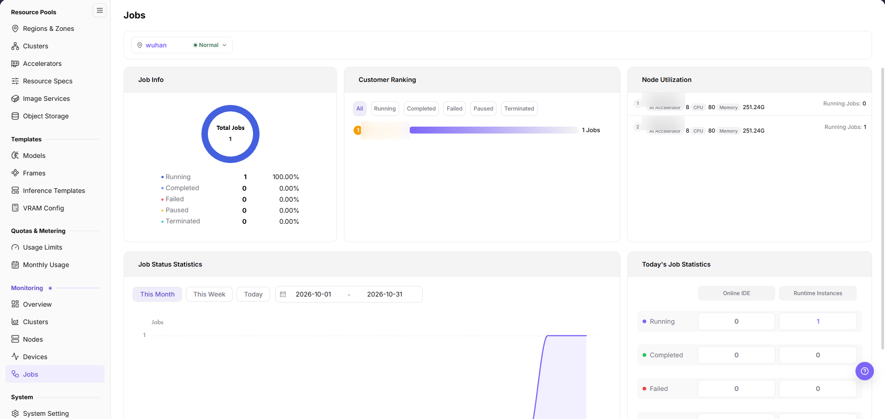
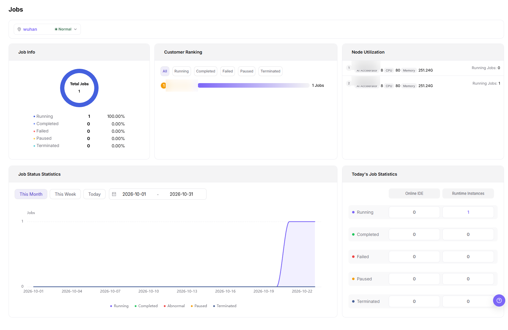

# Jobs

## Feature Overview

| Item | Content |
| --- | --- |
| Applicable Role | Operator |
| Navigation Path | On-Prem > Monitoring > Jobs |
| Managed Object | Configuration, status, and relationships on Jobs |

#### Beginner Explanation

Job monitoring is like a task queue and execution list. It shows training, inference, or development task status, queueing reasons, runtime duration, and resource occupation.

#### Terms

| Term | Description |
| --- | --- |
| Job Status | Queued, running, succeeded, failed, or canceled. |
| Queueing Reason | Reason the job cannot start due to insufficient resources, quota limits, or scheduling constraints. |
| Runtime Duration | Duration from job startup to the current time. |

#### Recommended Operation Order

Confirm prerequisites for Model instances, online IDEs, runtime instances, training tasks, and historical jobs, follow Main Operations, run Result Validation, and continue to the next page.

#### First-Time User Notes

Confirm that the task involves Configuration, status, and relationships on Jobs, and then follow the recommended order. If fields or state differ from expectations, check prerequisites before continuing downstream.

## Prerequisites

1. The current account has job monitoring view permissions.
2. The platform has collected job status, events, queueing, and runtime duration.
3. The target tenant, user, or cluster scope has been clarified.
4. For troubleshooting, job ID or submission time has been prepared.

## Page Description

Use this page to inspect model instances, online IDEs, runtime instances, training tasks, and historical jobs.

Job monitoring is used to view job queueing, running status, failure causes, and resource occupation. Operators can use it to analyze insufficient resources, image pull failures, startup exceptions, or long-running tasks.

## Main Operations

### View the Job Monitoring Overview

#### Applicable Scenarios

- Confirm at a glance how many jobs the platform holds and how they split across the five job statuses.
- Identify which node carries running jobs before opening another monitoring page.

#### Steps

1. Go to `On-Prem > Monitoring > Jobs`.
2. In the region selector below the page title, confirm the region and its status badge, for example `wuhan` with `Normal`.
3. Read `Job Info` for the `Total Jobs` figure at the centre of the ring and for the count and percentage of `Running`, `Completed`, `Failed`, `Paused`, and `Terminated` in the legend below it.
4. Read `Node Utilization` for each node row, which shows the accelerator, `CPU`, and `Memory` amounts and the `Running Jobs: N` value at the right end.
5. Read `Customer Ranking` for the ranked rows and the job count at the right end of each bar.

The page groups five cards: `Job Info`, `Customer Ranking`, `Node Utilization`, `Job Status Statistics`, and `Today's Job Statistics`.

#### Result Validation

- The five status counts add up to the `Total Jobs` figure at the centre of the ring.
- When `Total Jobs` is greater than 0, the five status percentages add up to `100.00%`.
- The `Running Jobs: N` values across the node rows add up to the `Running` count in `Job Info`.

#### Notes

- The node rows carry internal addresses. The stored screenshot is masked in place, and documentation never transcribes the real value.

### Filter Customer Ranking by Job Status

#### Applicable Scenarios

- Locate which customers hold the jobs of one specific status.
- Confirm that a status really has no ranked row before treating it as an empty result.

#### Steps

1. In the `Customer Ranking` card, select one of the six status controls `All`, `Running`, `Completed`, `Failed`, `Paused`, or `Terminated`. The default selection is `All`.
2. Read each ranked row: the rank badge on the left, the customer name, the progress bar, and the job count at the right end, for example `1 Jobs`.
3. Compare that count against the same status row in the `Job Info` legend.

`Customer Ranking` places the six status controls above the ranked rows.

#### Result Validation

- The selected status control is visually distinguished from the other five.
- The job count on a ranked row equals the count shown for the same status in the `Job Info` legend.
- With `All` selected, the job counts of the ranked rows add up to `Total Jobs`.

#### Notes

- The customer name is displayed truncated with an ellipsis inside the card, and the stored screenshot is masked in place; documentation never transcribes it.

### Read the Job Status Trend

#### Applicable Scenarios

- Judge whether job volume rises or falls across a period instead of reading a single instant status.
- Locate the date on which a status first appears in the curve.

#### Steps

1. In the `Job Status Statistics` card, select one of the three quick ranges `This Month`, `This Week`, or `Today`. The default selection is `This Month`.
2. Or set an explicit window in the two date pickers on the right, for example `2026-10-01` to `2026-10-31`.
3. Read the curve against the x-axis dates and the y-axis unit `Jobs`, and identify the five series in the legend below the chart: `Running`, `Completed`, `Abnormal`, `Paused`, and `Terminated`.
4. Compare the value at a given date against the same-status count in `Job Info` for the same window.

#### Result Validation

- The x-axis spans exactly the window shown in the two date pickers.
- The selected quick range is visually distinguished from the other two.
- Dates with no job keep the series on the baseline, and dates with jobs lift it.

#### Notes

- The trend legend names its third series `Abnormal`, while the `Job Info` ring names its third entry `Failed`. Both strings are transcribed from this page exactly as displayed.
- Hover the pointer over a day on the curve to expand that day's per-series values, for example all five series read `0` on `2026-10-11`.

### Read Today's Job Statistics by Instance Type

#### Applicable Scenarios

- Split the job volume of the current day by instance type instead of reading one combined total.
- Confirm whether a job count belongs to an online development environment or to a runtime instance.

#### Steps

1. In the `Today's Job Statistics` card, read the two column headers at the top: `Online IDE` and `Runtime Instances`.
2. Read the five status rows from top to bottom: `Running`, `Completed`, `Failed`, `Paused`, and `Terminated`.
3. Take the value cell where a status row meets an instance-type column as the count of that status for that instance type on the current day.

#### Result Validation

- The `Running` values of the `Online IDE` and `Runtime Instances` columns add up to the `Running` count in `Job Info`.
- Each of the five status rows carries one value cell under each of the two columns.
- The card title `Today's Job Statistics` scopes these values to the current day, not to the window selected in `Job Status Statistics`.

#### Notes

- The card shows no total row and no percentage column in the captured screens.

### Investigate Abnormal Job Metrics

#### Applicable Scenarios

- Jobs queue in batches, stall while running, or fail in a sudden spike.
- An abnormal job must be attributed to resources, images, storage, or the node it landed on.

#### Steps

1. Note the abnormal date in `Job Status Statistics` and the affected status in the legend below the chart.
2. Check `Node Utilization` for the accelerator, `CPU`, and `Memory` amounts and the `Running Jobs: N` value of each node, to see whether the load concentrates on one node.
3. Keeping the same time range, check `Clusters` and `Nodes` to verify whether cluster-wide compute resources are exhausted.
4. Access job details and instance logs to investigate image pull timeouts, startup command errors, storage mount failures, or OOM crashes.

#### Result Validation

- Failed and queued job counts show no abnormal increase.
- No long-running job holds critical resources beyond business expectations.
- Each affected job matches the expected tenant, specification, image, and cluster.

#### Notes

- Job queueing is not necessarily a platform fault. Check resources, quota, and scheduling conditions first.
- If deadlock jobs must be canceled or rescheduled, follow standard platform operational procedures rather than force-killing workloads without authorization.

## Parameter Quick Reference

| Field Name | Required | Field Type | Example | Description |
| --- | --- | --- | --- | --- |
| Job ID | Yes | Text | `job-20260706-001` | Locates a single job or task instance. |
| Job Name | Conditionally required | Text | `inference-job` | Helps locate a job by business name. |
| Job Type | Conditionally required | Enum | `Runtime Instances` | Distinguishes model instances, online IDEs, runtime instances, training tasks, or historical jobs. |
| Job Status | System-generated | Status | `Running` | Shows whether the job is queued, running, succeeded, or failed. |
| Tenant / User | Conditionally required | Text | `tenant-a` | Used to locate job ownership by tenant or user. |
| Cluster | Conditionally required | Text | `cluster-prod-a` | Locates the cluster where the job is running or queued. |
| Node | System-generated | Text | `node-gpu-01` | Shows the node to which the job is scheduled. |
| Resource Specification | System-generated | Text | `2 * A800` | Shows the resource specification requested or occupied by the job. |
| GPU / Accelerator Occupation | System-generated | Number / Text | `2 * A800` | Shows accelerator specification and quantity occupied by the job. |
| Queue Duration | System-generated | Duration | `18 minutes` | Determines whether scheduling is waiting or resources are insufficient. |
| Runtime Duration | System-generated | Duration | `2 hours 15 minutes` | Determines whether the job runs longer than expected. |
| Failure Information | System-generated | Text | `ImagePullBackOff` | Helps locate job failure causes. |
| Time Range | Conditionally required | Date range | `Last 1 hour` | Controls the query window for statistic cards, trend charts, and list data. |

## Pitfalls

- Job queueing is not necessarily a failure. It may be caused by insufficient resources or quotas.
- Failure causes should be judged together with events, logs, and image pull status.
- Long-running jobs should be evaluated for resource occupation and cost.
- Job monitoring may have collection latency. Do not judge faults based only on a single instant status.
- Job exceptions should be investigated together with events, logs, image pull, startup command, storage mount, node status, and device status.
- Long-running or high-resource jobs are not necessarily abnormal. Judge together with business expectations, tenant quotas, and model specifications.

#### Configuration Rules and Impact

- **For queueing, check resources and scheduling conditions first**: Queueing is not necessarily a platform fault. It may be caused by specification, labels, quotas, or cluster capacity limits.
- **Use events with failure information**: Error codes and events can distinguish image, storage, startup command, permission, and insufficient resource issues.
- **Runtime duration helps discover stuck tasks**: Long-running tasks should be judged together with logs, resource utilization, and business expectations.
- **Resource occupation affects other users**: When large jobs are submitted intensively, monitor tenant quotas and cluster watermarks at the same time.

## Result Validation

| Check Item | Success Signal | If Abnormal |
| --- | --- | --- |
| Page load | Jobs charts or lists are visible | Check monitoring permission and whether collection is available in the selected region |
| Scope | Time range, region, and object count match the investigation | Clear filters and restore them one at a time to avoid mixed scopes |
| Freshness | Update time is within the expected collection interval | Check collection interval, connection, and alerts in system or monitoring configuration |
| Correlation | An abnormal metric can be linked to a cluster, node, device, or job | Keep the same time range and cross-check adjacent monitoring pages and object details |

## FAQ

#### No Data on Jobs

**Symptom:**

The page opens, but charts or lists are empty.

**Possible Causes:**

- No job ran in the selected time.
- collection is unavailable in the region.
- the role lacks metric permission.

**Solution:**

1. Expand the time range and reset filters
2. verify regional monitoring capability
3. compare an adjacent monitoring page.

#### Jobs Is Not Updating

**Symptom:**

The data does not change for an extended period.

**Possible Causes:**

- The next collection cycle has not arrived.
- the collector is abnormal.
- the page is cached.

**Solution:**

1. Check update time
2. inspect collector status and alerts
3. refresh with the same time range.

#### Jobs Differs from Adjacent Pages

**Symptom:**

The same object has different values on two monitoring pages.

**Possible Causes:**

- Aggregation granularity differs.
- time range or time zone differs.
- filters target different objects.

**Solution:**

1. Align time range and time zone
2. verify aggregation scope
3. clear and restore filters one at a time.

#### Unable to Locate Target Object in Related Monitoring

**Symptom:**

The metric or details entry does not lead to the expected object.

**Possible Causes:**

- The object ended or was removed.
- the role cannot see it.
- relationship identifiers differ.

**Solution:**

1. Record object and time
2. check its list state
3. ask the Operator to verify visibility.

#### A Spike Cannot Be Reproduced

**Symptom:**

A spike was recorded, but current details are normal.

**Possible Causes:**

- The spike was brief.
- sampling is coarse.
- the job has ended.

**Solution:**

1. Lock the spike interval
2. compare job and node events
3. retain a sanitized screenshot and object identifier.

## Notes

- Job names, image addresses, data paths, and log contents may contain sensitive information.
- Before terminating a job, confirm business impact and output file retention policy.
- High-frequency failed jobs should be reviewed through templates or images.
- `Terminate`, `Restart`, and `Delete` affect real jobs. Confirm the scope and impact before executing the final action.
- Documentation examples must not include real job IDs, instance names, image addresses, data paths, log contents, tenant information, node names, cluster IDs, resource pool IDs, internal metric keys, or test data.

## Next Steps

1. For queueing issues, verify quotas, specifications, and cluster capacity.
2. For failure issues, verify images, startup commands, storage, and events.
3. For long-running tasks, enter usage and monitoring pages to evaluate consumption.
