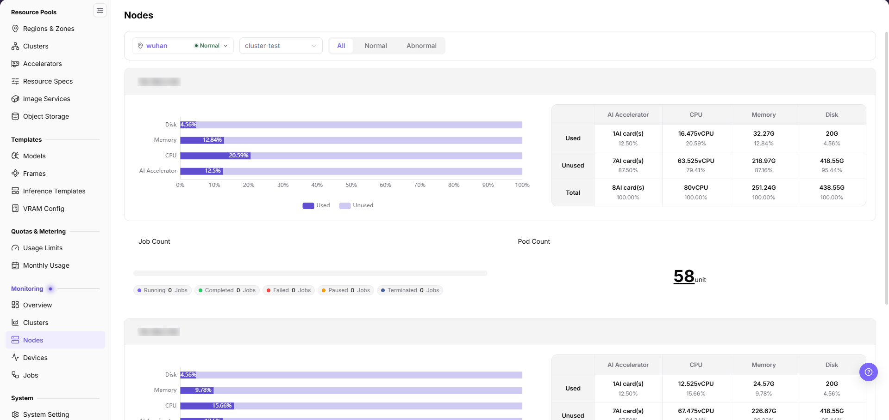
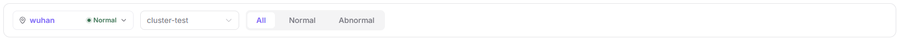
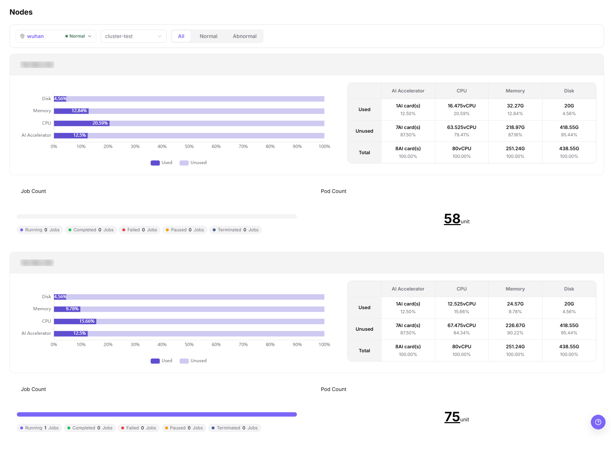
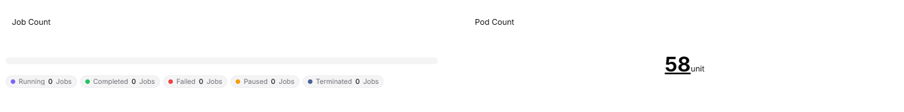
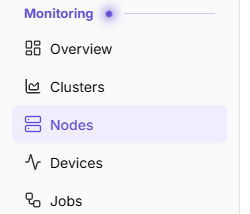

# Nodes

## Feature Overview
| Item | Content |
| --- | --- |
| Applicable Role | Operator |
| Navigation Path | On-Prem > Monitoring > Nodes |
| Managed Object | Node identifier, resource watermarks (disk / memory / CPU / AI accelerator), job count, and Pod count. |

#### Beginner Explanation

Node statistics are like a server inspection checklist. They show the disk, memory, CPU, and AI accelerator watermarks of each node, together with job and Pod counts, helping determine which machine an issue lands on.

#### Terms

| Term | Description |
| --- | --- |
| Node Status | Whether a node is `Normal` or `Abnormal`. |
| CPU Usage | Current CPU load of the node. The screen also shows the absolute amount in `vCPU`. |
| Memory Usage | Node memory occupation. The screen also shows the absolute amount in `G`. |
| AI Accelerator Usage | AI accelerator occupation of the node. The absolute amount is shown as `AI card(s)`. |
| Pod Count | Total Pods currently carried by the node. |

#### Recommended Operation Order

Filter nodes by region and cluster first, then read the resource watermarks and job and Pod counts per node, run Result Validation, and continue to adjacent monitoring pages.

#### First-Time User Notes

Confirm that the filter bar points to the intended region and cluster, and then read the watermark bar chart and the resource table on each node card. If fields or state differ from expectations, check prerequisites in `Clusters` and `Accelerators` before continuing downstream.

## Prerequisites

1. The current account has node monitoring view permissions.
2. The target node belongs to an accessed cluster.
3. Node CPU, memory, disk, and status metrics are reported normally.
4. The troubleshooting time range or affected task has been clarified.

## Page Description
Use this page to inspect the disk, memory, CPU, and AI accelerator watermarks of each node, together with the job count and Pod count on that node.

Node statistics are used to view the disk, memory, CPU, and AI accelerator watermarks of each node and its job and Pod counts. Operators can use it to locate abnormal nodes and high-watermark nodes.

## Main Operations
### Filter Nodes by Region and Cluster

#### Applicable Scenarios

- Narrow node statistics to one cluster in one region.
- Show only abnormal nodes, or return from abnormal to all nodes.

#### Steps

1. Go to `On-Prem > Monitoring > Nodes`.
2. In the filter bar below the page title, open the region selector and choose the target region. The badge to the right of the selector shows the current region status, such as `Normal`.
3. Choose the target cluster in the drop-down to the right of the region selector, such as `cluster-test`.
4. In the three-state segment at the right end of the filter bar, click `All`, `Normal`, or `Abnormal`. The default selection is `All`.

The filter bar holds three controls from left to right: region, cluster, and status segment.

#### Result Validation

- The page title stays `Nodes`, and the number of node cards changes with the selected cluster.
- After you select `Abnormal`, normal node cards no longer appear. The card area is empty when no node is abnormal.
- The region badge matches the selected region.

#### Notes

- The captured screens for this page show no time-range control.
- Use the region selector and the cluster drop-down to narrow the node list.

### Read Per-node Resource Watermarks

#### Applicable Scenarios

- Determine whether disk, memory, CPU, or AI accelerator on a node is close to full load.
- Compare the absolute amount and the percentage of used and unused resources on a node.

#### Steps

1. After filtering, the page lists node cards vertically, one card per node.
2. The gray title row at the top of a card is the node identifier. The screen shows it in IP form, and the real value must not be transcribed into documentation or tickets.
3. Read the horizontal watermark bar chart on the left of the card. The four rows from top to bottom are `Disk`, `Memory`, `CPU`, and `AI Accelerator`. The x-axis runs from `0%` to `100%`, and the legend distinguishes `Used` from `Unused`.
4. Read the resource table on the right of the card. Column headers are `AI Accelerator`, `CPU`, `Memory`, and `Disk`. Row headers are `Used`, `Unused`, and `Total`. In each cell, the bold upper value is the absolute amount and the lower value is the percentage.

The bar chart and the resource table on one card present the same metric set of that node.

#### Result Validation

- The percentage in the bar chart matches the same column in the resource table, for example the `CPU` row `20.59%` against `16.475vCPU` and `20.59%` in the table.
- The percentages of the `Used` and `Unused` rows add up to `100.00%`, consistent with the `Total` row.
- The absolute amounts in the `Total` row stay the same across node cards in one cluster, for example `8AI card(s)` and `80vCPU`.

#### Notes

- The bar chart and the resource table cover disk, memory, CPU, and AI accelerator.
- The accelerator amount is shown as `N AI card(s)`, with the card count and the percentage together.
- The node identifier is an internal address. The stored screenshots are masked in place, and documentation always uses a sanitized placeholder.

### Read Job and Pod Counts

#### Applicable Scenarios

- Determine whether jobs are running on a node, or whether jobs failed or are paused.
- Confirm the total number of Pods currently carried by a node.

#### Steps

1. Below each node card, read the progress bar in the `Job Count` block. The bar is empty with no job and fills by the running share when a job runs.
2. Read the five status tags below the progress bar: `Running`, `Completed`, `Failed`, `Paused`, and `Terminated`, with the unit `Jobs`.
3. Read the large number and its unit in the `Pod Count` block on the right to get the current Pod total of the node.

`Job Count` and `Pod Count` share one row, one pair per node.

#### Result Validation

- The values of the five status tags are consistent with the progress bar fill, for example a full bar when only `Running 1 Jobs` is non-zero.
- The `Pod Count` number is independent of the status tags and is not their sum.

#### Notes

- On the English screen, the unit of a job tag is `Jobs` and the unit of `Pod Count` is `unit`.
- To investigate a specific job, open it from the `Jobs` page.

### Investigate Abnormal Nodes

#### Applicable Scenarios

- A node card shows an abnormal state, or a resource watermark is close to full load.
- Confirm across pages whether abnormalities concentrate in one cluster.

#### Steps

1. Switch the status segment in the filter bar to `Abnormal` to confirm the abnormal node cards.
2. Record the sanitized node identifier and its cluster.
3. Read the resource with the highest share on that node card to determine whether the pressure is compute, memory, or disk.
4. Keeping the same region and cluster, continue in `Devices` and `Jobs` under the `Monitoring` group of the left menu to check device-side and job-side evidence.
5. Judge together with node events and job logs instead of a single instant metric.

The `Monitoring` group of the left menu contains `Overview`, `Clusters`, `Nodes`, `Devices`, and `Jobs`.

#### Result Validation

- After the status segment is switched to `Abnormal`, only abnormal node cards remain.
- Objects on adjacent monitoring pages match this page under the same region and cluster.

#### Notes

- This section covers only the watermark metrics shown on this page.
- Drain and maintenance actions are handled in the node management workflow.
- A single-node exception does not mean the whole cluster is unavailable.

## Parameter Quick Reference
| Field Name | Required | Field Type | Example | Description |
| --- | --- | --- | --- | --- |
| Region | Yes | Drop-down | `wuhan` | Leftmost control of the filter bar. The badge on its right shows the region status, such as `Normal`. |
| Cluster | Conditionally required | Drop-down | `cluster-test` | Limits the cluster to which the nodes belong. |
| Node Status Segment | Yes | Segment | `All` | Three-state segment `All` / `Normal` / `Abnormal`. The default is `All`. |
| Node Identifier | System-generated | Text | Sanitized | Title row at the top of a node card. The screen shows it in IP form, and the real value must not be transcribed. |
| Disk Usage | System-generated | Percentage | `4.56%` | First row of the bar chart and the last column of the resource table. The absolute amount is such as `20G`. |
| Memory Usage | System-generated | Percentage | `12.84%` | Second row of the bar chart and the `Memory` column. The absolute amount is such as `32.27G`. |
| CPU Usage | System-generated | Percentage | `20.59%` | Third row of the bar chart and the `CPU` column. The absolute amount is such as `16.475vCPU`. |
| AI Accelerator Usage | System-generated | Percentage | `12.5%` | Last row of the bar chart and the `AI Accelerator` column. The absolute amount is such as `1AI card(s)`. |
| Resource Absolute Amount | System-generated | Value | `8AI card(s)` / `80vCPU` / `251.24G` / `438.55G` | The four absolute amounts in the `Total` row of the resource table. |
| Job Count | System-generated | Number | `Running 1 Jobs` | Five status tags: `Running` / `Completed` / `Failed` / `Paused` / `Terminated`, with the unit `Jobs`. |
| Pod Count | System-generated | Number | `58 unit` | Large number on the right of a node card. |

## Pitfalls
- Node Ready does not mean the device plugin is definitely normal. Confirm the two separately.
- Node statistics may have collection latency. Do not judge a fault based only on a single instant metric.
- After the status segment is set to `Abnormal`, the card area may be empty. An empty area means no node is abnormal now, not that collection is broken.
- The bar chart and the resource table share one scope. When the two disagree, first confirm whether they belong to the same node card.
- `Pod Count` and `Job Count` use different units (`unit` and `Jobs`). Do not convert one into the other.

#### Configuration Rules and Impact

- **Node status before resource watermarks**: When a node is abnormal or collection is abnormal, handle the status problem first.
- **Disk pressure affects job stability**: A high disk watermark may cause image pull, log write, or temporary file creation failures.
- **Single-node exception can cause local queueing**: Scheduling failure is not necessarily overall cluster capacity shortage. It may be caused by target node labels or taint restrictions.
- **Metric delay requires event judgment**: When node metrics are delayed, also view cluster events and job failure reasons.

## Result Validation
| Check Item | Success Signal | If Abnormal |
| --- | --- | --- |
| Page load | Node cards, watermark bar charts, and resource tables are visible | Check monitoring permission and whether collection is available in the selected region |
| Scope | Region, cluster, and node card count match the investigation | Clear filters and restore them one at a time to avoid mixed scopes |
| Freshness | Node metrics match the latest collection | Check the collection interval, connection, and alerts in system or monitoring configuration |
| Correlation | An abnormal metric can be linked to a cluster, node, or job | Keep the same region and cluster and cross-check `Devices`, `Jobs`, and object details |

## FAQ

#### No Data on Nodes

**Symptom:**

The page opens, but charts or lists are empty.

**Possible Causes:**

- No job ran in the selected time.
- collection is unavailable in the region.
- the role lacks metric permission.

**Solution:**

1. Expand the time range and reset filters
2. verify regional monitoring capability
3. compare an adjacent monitoring page.

#### Nodes Is Not Updating

**Symptom:**

The data does not change for an extended period.

**Possible Causes:**

- The next collection cycle has not arrived.
- the collector is abnormal.
- the page is cached.

**Solution:**

1. Check update time
2. inspect collector status and alerts
3. refresh with the same time range.

#### Nodes Differs from Adjacent Pages

**Symptom:**

The same object has different values on two monitoring pages.

**Possible Causes:**

- Aggregation granularity differs.
- time range or time zone differs.
- filters target different objects.

**Solution:**

1. Align time range and time zone
2. verify aggregation scope
3. clear and restore filters one at a time.

#### Unable to Locate Target Object in Related Monitoring

**Symptom:**

The metric or details entry does not lead to the expected object.

**Possible Causes:**

- The object ended or was removed.
- the role cannot see it.
- relationship identifiers differ.

**Solution:**

1. Record object and time
2. check its list state
3. ask the Operator to verify visibility.

#### A Spike Cannot Be Reproduced

**Symptom:**

A spike was recorded, but current details are normal.

**Possible Causes:**

- The spike was brief.
- sampling is coarse.
- the job has ended.

**Solution:**

1. Lock the spike interval
2. compare job and node events
3. retain a sanitized screenshot and object identifier.

## Notes

- Node names, IPs, labels, and equipment room information should be sanitized.
- A single-node exception does not necessarily mean the whole cluster is unavailable.
- Before node maintenance, confirm impact on running tasks and mounted storage.
- Before fault judgment, cross-check with cluster statistics, device monitoring, job monitoring, scheduling events, and node logs.
- Documentation examples must not include real node names, node IPs, device IDs, cluster IDs, resource pool IDs, tenant information, internal metric keys, or test data.

## Next Steps
1. When a node shows abnormal, check cluster events and device status in `Clusters` and `Devices`.
2. When a resource watermark is close to full load, locate the jobs occupying resources in `Jobs`.
3. When the AI accelerator is involved, continue viewing `Devices`.
