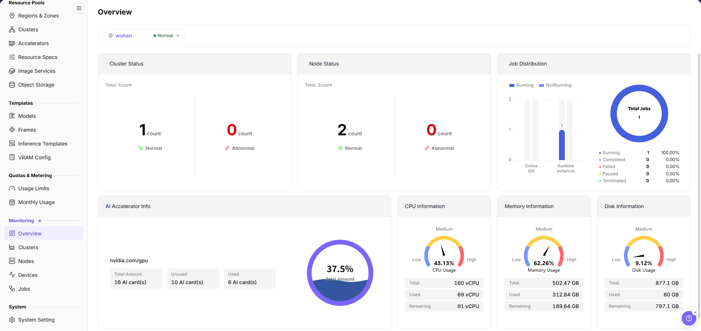
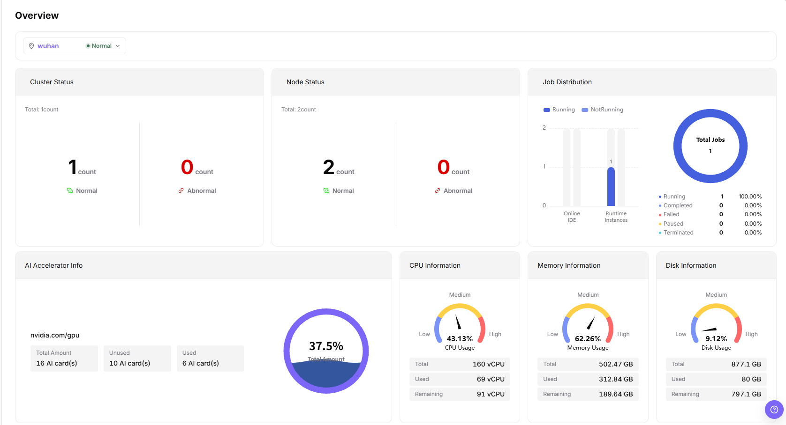

# Overview

## Feature Overview

| Item | Content |
| --- | --- |
| Applicable Role | Operator |
| Navigation Path | On-Prem > Monitoring > Overview |
| Managed Object | Resource status, capacity watermarks, exception summaries, and dedicated monitoring entries |

#### Beginner Explanation

Statistics overview serves as the resource pool cockpit, centrally presenting overall platform resource utilization and health summaries to help operators quickly evaluate system health and decide whether to open cluster, node, device, or job monitoring pages for targeted investigation.

#### Terms

| Term | Description |
| --- | --- |
| Global Watermark | Overall platform resource utilization across GPU, CPU, memory, and disk. |
| Exception Aggregation | Centralized summary of abnormal clusters, abnormal nodes, and failed jobs. |
| Dedicated Monitoring | Sub-monitoring pages under the `Monitoring` group in the left navigation, including `Clusters`, `Nodes`, `Devices`, and `Jobs`. |

#### Recommended Operation Order

First review top cluster, node, and job health summaries, then check GPU, CPU, memory, and disk resource utilization; if anomalies are discovered, switch to the corresponding dedicated monitoring page via the left menu for targeted investigation.

#### First-Time User Notes

This is a read-only global status dashboard, not a resource configuration page. Use it to judge health direction and capacity bottlenecks from a macro perspective; verify specific root causes on dedicated object pages via the left navigation.

## Prerequisites

1. The current account has operator monitoring view permissions.
2. Target regions, availability zones, and clusters have completed resource access.
3. Monitoring collection components normally report cluster, node, device, and job data.
4. The resource pool and affected resource types under investigation have been clarified.

## Page Description

Use this page to understand the current on-prem resource state and decide which dedicated monitoring page to investigate next.

Statistics overview presents global resource status, job distribution, and hardware utilization dashboards. Read the page in the following order:

| Page Area | What to Confirm |
| --- | --- |
| Cluster Status | Total cluster count, along with normal and abnormal cluster distribution. |
| Node Status | Total physical/compute node count, along with normal and abnormal node distribution. |
| Job Distribution | Bar charts comparing Online IDE and Runtime Instance counts, and donut charts showing shares of running, completed, failed, paused, and terminated jobs. |
| AI Accelerator Info | GPU driver model identifier (e.g. `nvidia.com/gpu`), total AI cards, unused count, used count, and the overall usage percentage gauge. |
| Compute & Storage Information | Gauge charts for CPU, memory, and disk utilization, along with total, used, and remaining capacity figures. |
| Dedicated Navigation | Left menu entries under the `Monitoring` group: `Clusters`, `Nodes`, `Devices`, and `Jobs`. |

## Main Operations

### Select the Region Context

#### Applicable Scenarios

- The overview aggregates data per region, so confirm which region the current figures belong to before reading watermarks or drilling into dedicated monitoring.
- Use this step first whenever you need to judge the health and capacity direction of a specific region.

#### Steps

1. Open the page whose title is `Overview`.
2. Below the title there is a region selector: a location icon with the current region name (`wuhan` in this capture) on the left, a status marker `Normal` with a green dot in the middle, and a downward chevron on the right.
3. The chevron shows the control is a switchable dropdown.

#### Result Validation

- The region name and status marker shown in the selector define the scope of every card value on this page.
- A green `Normal` marker indicates that the selected region is currently in a normal state.

#### Notes

- Statistics overview is a read-only dashboard; the region selector only switches the reporting scope and never changes resource configuration.
- When comparing regions, read the card values after switching to each region separately instead of mixing figures.

### Read the Overview and Identify Resource Watermarks

#### Applicable Scenarios

- You need a quick judgment of platform health: whether any cluster or node is abnormal, whether jobs failed, and whether accelerators, CPU, memory, or disk are under pressure.
- You need to locate the capacity bottleneck direction before deciding which dedicated monitoring page to open.

#### Steps

1. Start with the top **Cluster Status** and **Node Status** cards: each shows `Total: 1count` or `Total: 2count` for the managed total, then a `1 count` + `Normal` (green) cell and a `0 count` + `Abnormal` (red) cell side by side.
2. Then read the **Job Distribution** card: the bar chart legend is `Running` and `NotRunning` with `Online IDE` and `Runtime Instances` on the x-axis; the donut center shows `Total Jobs`, and the legend lists `Running`, `Completed`, `Failed`, `Paused`, and `Terminated` with counts and percentages.
3. Then read the **AI Accelerator Info** card: the model identifier `nvidia.com/gpu` appears on the left, followed by the `Total Amount`, `Unused`, and `Used` cells (all in `AI card(s)`), while the water-filled gauge on the right shows a percentage labeled `Total Amount`.
4. Finish with the **CPU Information**, **Memory Information**, and **Disk Information** cards: each gauge is scaled `Low` / `Medium` / `High` with the current tier shown above the dial (`Medium` for all three in this capture), the percentage and `CPU Usage` / `Memory Usage` / `Disk Usage` label below it, and the `Total`, `Used`, and `Remaining` rows underneath.

#### Result Validation

- The normal and abnormal counts match the actual managed scale (in this capture: clusters `1 count` normal / `0 count` abnormal, nodes `2 count` normal / `0 count` abnormal).
- The `Total Jobs` center value equals the sum of the donut legend entries (in this capture: `1`, with `Running` at `1` and `100.00%`).
- `Total Amount` equals `Unused` plus `Used` on the accelerator card (in this capture: `16 AI card(s)` = `10` + `6`, gauge `37.5%`).
- Each capacity card satisfies `Total` approximately equal to `Used` + `Remaining` within display rounding (in this capture: `160 vCPU` = `69` + `91`; `502.47 GB` is `312.84` + `189.64` rounded; `877.1 GB` = `80` + `797.1`).

#### Notes

- When an abnormal cell is non-zero or a gauge reaches the `High` tier, drill down with the next section instead of assigning a root cause from the overview alone.
- Threshold wording such as "GPU utilization above 85%" is not derived from this screen: all three gauges read `Medium`, so the tier boundaries cannot be inferred from the page.
- Metrics are collected periodically, so refresh the page or reopen the overview when values do not appear to follow running workloads.
- Mask tenants, node names, and business identifiers before sharing monitoring screenshots externally.

### Navigate to Dedicated Monitoring by Metric

#### Applicable Scenarios

- The overview already points at an abnormal category (cluster, node, accelerator, or job) and you need the detail page behind it.
- You need to cross-check one resource category to tell a momentary spike from a sustained failure.

#### Steps

1. In the left sidebar, find the `Monitoring` group, where the current page `Overview` is highlighted as selected.
2. The group contains four entries from top to bottom: `Clusters`, `Nodes`, `Devices`, and `Jobs`.
3. Pick the entry that matches the symptom: `Clusters` for abnormal clusters, `Nodes` for abnormal nodes, `Devices` when accelerator usage is high, and `Jobs` when failed jobs increase.
4. Follow what each destination page actually shows for its list columns, filters, and logs.

#### Result Validation

- The four entries under `Monitoring` match the names listed above word for word, which confirms the environment and the document are aligned.
- Overview cards and dedicated pages may disagree briefly because their aggregation caches refresh at different frequencies; see the FAQ for details.

#### Notes

- The overview only narrows the direction and never replaces per-object details.
- Redact internal resource names and sensitive identifiers before sharing screenshots externally.
- The four dedicated pages have their own field, filter, and log layouts; do not infer their interface from this document.

## Parameter Quick Reference

| Field Name | Required | Field Type | Example | Description |
| --- | --- | --- | --- | --- |
| Cluster Status (Total / Normal / Abnormal) | System-generated | Status count | `Total: 1count / 1 count Normal / 0 count Abnormal` | Total managed clusters and normal/abnormal breakdown. |
| Node Status (Total / Normal / Abnormal) | System-generated | Status count | `Total: 2count / 2 count Normal / 0 count Abnormal` | Total compute nodes, where green indicates ready and red indicates abnormal. |
| Job Distribution (Category Bar Chart) | System-generated | Distribution chart | `Running / NotRunning · Runtime Instances: 1` | Task counts categorized by online IDE and runtime instance; the `Online IDE` bar carries no value label in the reference capture. |
| Job Status (Donut Chart) | System-generated | Ratio chart | `Total Jobs: 1 · Running 1 (100.00%)` | Share and percentage of all jobs across lifecycle states. |
| AI Accelerator Info | System-generated | Resource capacity | `Total Amount 16 AI card(s) / Unused 10 AI card(s) / Used 6 AI card(s)` | GPU driver model identifier and AI card total, free, and used counts. |
| Total GPU Usage | System-generated | Percentage gauge | `37.5%` | Overall platform GPU utilization rate. |
| CPU Information | System-generated | Resource capacity | `Total 160 vCPU / Used 69 vCPU / Remaining 91 vCPU` | Total vCPU cores, allocated cores, and remaining available cores. |
| CPU Utilization | System-generated | Semicircular gauge | `43.13% (Low / Medium / High)` | Global CPU load percentage with low/medium/high zone indicators. |
| Memory Information | System-generated | Resource capacity | `Total 502.47 GB / Used 312.84 GB / Remaining 189.64 GB` | Total physical memory, allocated memory, and remaining memory. |
| Memory Utilization | System-generated | Semicircular gauge | `62.26% (Low / Medium / High)` | Global memory resource utilization percentage. |
| Disk Information | System-generated | Resource capacity | `Total 877.1 GB / Used 80 GB / Remaining 797.1 GB` | Local or attached disk storage total, used, and remaining capacity. |
| Disk Utilization | System-generated | Semicircular gauge | `9.12% (Low / Medium / High)` | Platform disk storage capacity utilization percentage. |

## Pitfalls

- The overview can only help locate direction and does not replace specific object details.
- Rising watermarks should be judged together with new jobs, expansion, and queueing.
- Monitoring overview is used to observe global watermarks and should not be the sole basis for expansion, migration, or fault judgment.
- Metrics may have collection latency. Troubleshooting should be combined with cluster, node, device, and job details.
- Mask tenants, node names, and business identifiers before screenshots.
- Do not write real cluster IDs, node names, resource pool IDs, tenant information, internal metric keys, or test data in the document.

#### Reading Rules and Impact

- **Use overview to determine direction first**: Identify the anomalous metric type first, then switch to cluster, node, or job dedicated monitoring via the left menu.
- **Interpret exception count across cycles**: Check whether an anomaly is a temporary spike or continuous failure to prevent false alarms caused by momentary jitter.
- **Metric availability determines trustworthiness**: If card numbers are clearly abnormal or empty, check the monitoring collection pipeline first.
- **Evaluate watermarks comprehensively**: Temporary high utilization is not necessarily a failure; judge it together with new workloads, scaling, and historical trends.

## Result Validation

| Check Item | Success Signal | If Abnormal |
| --- | --- | --- |
| Page load | All 6 overview metric dashboards and cards render properly | Check operator monitoring permissions and monitoring agent service status |
| Status verification | Cluster and node counts match the actual scale of managed resources | Refresh the page; if numbers mismatch, verify cluster onboarding status |
| Freshness | Resource utilization and job counts dynamically reflect running workloads | Check collection cycle, connectivity, and alerts in system or monitoring settings |
| Navigation flow | Smoothly navigates to the corresponding sub-monitoring page upon discovering an issue | Check sub-page menu permissions and visible scope |

## FAQ

#### No Data on Overview

**Symptom:**

The page opens, but charts or cards appear empty or show all zeros.

**Possible Causes:**

- The monitoring collection agent is stopped or network disconnected.
- The current role lacks monitoring metric permissions.
- The underlying cluster has not completed monitoring onboarding.

**Solution:**

1. Check underlying Prometheus / monitoring agent service status.
2. Confirm the logged-in role has On-Prem monitoring operator permissions.
3. Go to Clusters to confirm the cluster is in a healthy managed state.

#### Overview Data Is Not Updating

**Symptom:**

Workloads have started or finished, but utilization and job status do not change for an extended period.

**Possible Causes:**

- Collection interval introduces a periodic delay.
- Browser page cache has not refreshed.
- Metric reporting pipeline is congested.

**Solution:**

1. Refresh the browser page or navigate to Overview again.
2. Check monitoring container logs and collector status.
3. Switch to Jobs under Monitoring to verify real-time job status.

#### Overview Differs from Dedicated Pages

**Symptom:**

The node or job counts on Overview cards differ from the rows displayed in sub-page lists.

**Possible Causes:**

- Overview cards and detail lists have different aggregation cache refresh frequencies.
- Sub-pages have additional active filter conditions applied.

**Solution:**

1. Check if the sub-page has active project, status, or name filters.
2. Clear temporary filters on the sub-page and compare again.

#### Cannot Find the Target Object in Dedicated Monitoring

**Symptom:**

Overview indicates an abnormal node or failed job, but it is not directly visible in the sub-page list.

**Possible Causes:**

- The target object has self-healed or was cleaned up/released.
- The sub-page list defaults to filtering out certain states.

**Solution:**

1. In Nodes or Jobs under Monitoring, switch status filters to "All" or "Abnormal/Failed".
2. Check recent audit logs and cluster events.

#### A Spike Cannot Be Reproduced

**Symptom:**

A high watermark was recorded earlier, but current metrics have returned to normal.

**Possible Causes:**

- The spike was a momentary burst caused by short-lived jobs.
- The workload completed normally and released GPU compute resources.

**Solution:**

1. Filter historical jobs in Jobs under Monitoring during that specific time window.
2. Cross-check job runtime duration with resource quotas.

## Notes

- Overview is used to discover direction and should not be the sole basis for incident responsibility.
- Mask tenants, nodes, IPs, and business identifiers before screenshots.
- Watermark exceptions need to be judged together with historical trends, business windows, and job changes.
- Before expansion, migration, or fault handling, cross-check with cluster statistics, node statistics, device monitoring, and job monitoring.
- Documentation examples must not include real cluster IDs, node names, resource pool IDs, tenant information, internal metric keys, or test data.

## Next Steps

1. If exceptions are concentrated in clusters, click **Clusters** under **Monitoring** in the left menu.
2. If exceptions are concentrated in nodes or hardware, click **Nodes** or **Devices** under **Monitoring** in the left menu.
3. If job failures or queueing increase, click **Jobs** under **Monitoring** in the left menu and troubleshoot with quotas.
