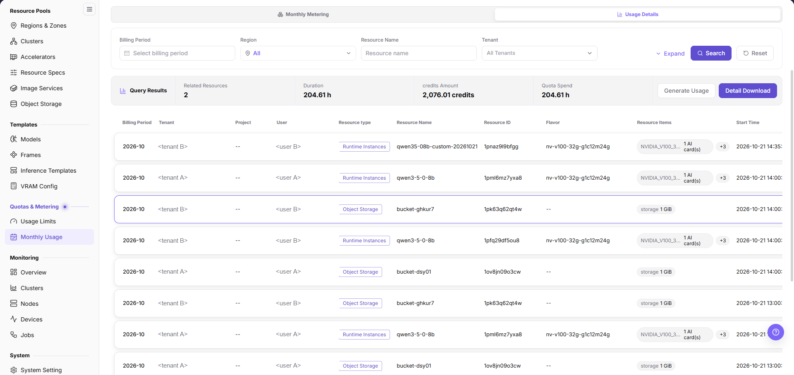
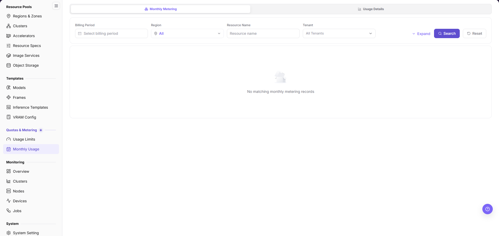
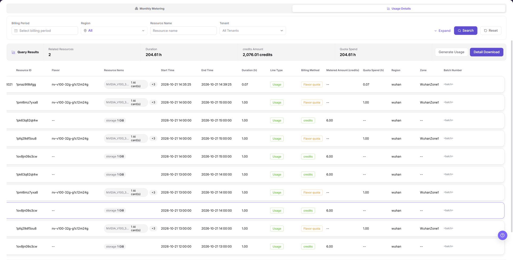
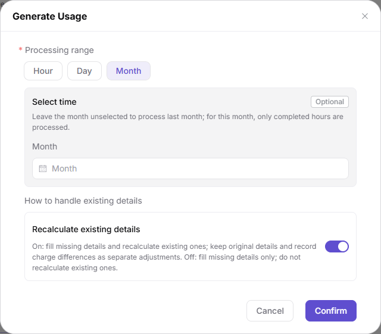
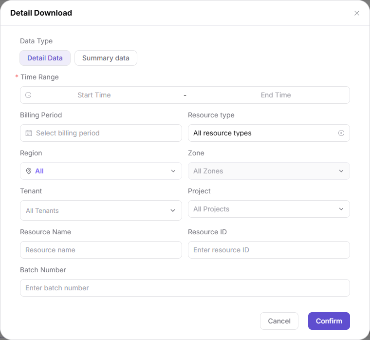

# Monthly Usage

## Feature Overview

| Item | Content |
| --- | --- |
| Applicable Role | Operator |
| Navigation Path | On-Prem > Quotas & Metering > Monthly Usage |
| Managed Object | Billing period, region, resource name, and tenant filters, plus monthly metering records, usage summaries, and exports |

#### Beginner Explanation

Monthly usage is like a monthly resource bill summary. It aggregates scattered compute, storage, and instance consumption into billing period, tenant, and resource type dimensions, and then lists the consumption as hourly metering records.

#### Terms

| Term | Description |
| --- | --- |
| Billing Period | Month to which the metering data belongs, and also a page filter. |
| Line Type | Type label of a metering record. Only `Usage` appears in this evidence batch. |
| Billing Method | Conversion basis of a single record, either `credits` or `Flavor quota`. |
| Batch Number | Identifier of one generation or aggregation task, used to trace records back to the same run. |

#### Recommended Operation Order

Confirm prerequisites for the billing period, region, resource name, and tenant filters, then follow the order of query, summary check, record-by-record check, generate usage, and detail download, run Result Validation, and continue to the next page.

#### First-Time User Notes

Confirm that the task involves the billing period, region, resource name, tenant, and monthly metering records, and then follow the recommended order. If fields or state differ from expectations, check prerequisites before continuing downstream.

## Prerequisites

1. The current account has operator permissions.
2. The target region is selected in the page `Region` filter and its status shows normal.
3. Related resources, jobs, or metering tasks have reported data.
4. When records must be filled or recalculated, the processing range and billing period have been confirmed internally.

## Page Description

Use this page to query tenant resource consumption by billing period, check the usage summary, and trigger usage generation or detail export.

The page header offers the `Monthly Metering` and `Usage Details` tabs; the current page is `Monthly Metering`, and the other tab opens the sibling page `Usage Details`. Under the left menu group `Quotas & Metering`, the entries `Usage Limits` and `Monthly Usage` are visible.

The filter row contains `Billing Period`, `Region`, `Resource Name`, and `Tenant` from left to right, followed by `Expand`, `Search`, and `Reset`. `Billing Period` shows the placeholder `Select billing period` when unset; `Region` shows `All` when unset and displays a status dot next to the selected region; `Resource Name` shows the placeholder `Resource name`; `Tenant` defaults to `All Tenants`.

Below the filter row is the summary bar. Its left `Query Results` block shows `Related Resources`, `Duration` (unit `h`), `credits Amount` (unit `credits`), and `Quota Spend` (unit `h`). Its right side provides the `Generate Usage` and `Detail Download` buttons, where the latter uses the solid emphasis style.

The main table columns are `Billing Period`, `Tenant`, `Project`, `User`, `Resource type`, `Resource Name`, `Resource ID`, `Flavor`, `Resource Items`, `Start Time`, `End Time`, `Duration (h)`, `Line Type`, `Billing Method`, `Metered Amount (credits)`, `Quota Spend (h)`, `Region`, `Zone`, and `Batch Number`. `Project` and `Flavor` show `--` when empty, `Resource Items` renders as a grey chip such as a card model with `1 AI card(s)` or `storage 1 GiB`, and GPU records carry a `+3` collapse marker after the chip.

The same resource produces multiple hourly rows within one billing period, so the row count is not the resource count. Use the summary bar for totals and the table rows to locate a single consumption record.

## Main Operations

### Query Monthly Metering Records

#### Applicable Scenarios

Use this when you must locate monthly metering records within a range by billing period, region, resource name, or tenant. All four filters are optional, so querying without conditions returns every record visible to the current account.

#### Steps

1. Go to `On-Prem > Quotas & Metering > Monthly Usage` and confirm the page stays on the `Monthly Metering` tab.
2. Select a month in the `Billing Period` picker; the input shows the placeholder `Select billing period` when unset.
3. Select the target region in the `Region` drop-down, which shows a status dot next to the selected value; keep `All` when no region limit is needed.
4. Enter a keyword in the `Resource Name` input and select a single tenant in the `Tenant` drop-down; `Tenant` shows `All Tenants` when unset.

5. Click `Expand` when more conditions are needed.
6. Click `Search` to refresh the summary bar and the list, or click `Reset` to clear all filters and query again.

#### Result Validation

1. When records exist, the first column `Billing Period` matches the selected month and the `Region` column matches the selected region.
2. When no record matches, the list area shows the placeholder illustration and the text `No matching monthly metering records`, and the summary values must not be used as a conclusion.
3. After `Reset`, `Billing Period` and `Resource Name` return to placeholder state, `Region` returns to `All`, and `Tenant` returns to `All Tenants`.

#### Notes

- The list is split by hour, so one resource produces multiple rows within one billing period; do not count rows as resources.
- The `Status` and `Creation Time` columns and the `Confirm` action are from the older layout and do not appear on this page.
- Screenshots were sanitized per G3 before ingestion; locate records by `Resource Name` and `Resource ID` when reconciling.

### Check the Query Result Summary

#### Applicable Scenarios

Use this to confirm the resource scale, duration, and total consumption hit by one query before checking individual records, or to compare how the statistics change across different filter ranges.

#### Steps

1. After a query completes, read the `Query Results` block of the summary bar above the list.
2. Check `Related Resources`, `Duration`, `credits Amount`, and `Quota Spend`, noting that `Duration` and `Quota Spend` use the unit `h` while `credits Amount` uses `credits`.
3. Change `Billing Period` or `Region` and click `Search` again, then observe how the four statistics move as the filter range widens or narrows.
4. When splitting by basis, compare `credits Amount` with the `Metered Amount (credits)` column and `Quota Spend` with the `Quota Spend (h)` column.

#### Result Validation

1. `Related Resources` equals the number of distinct `Resource ID` values in the current result.
2. `credits Amount` reconciles with the total of the `Metered Amount (credits)` column, and `Quota Spend` reconciles with the total of the `Quota Spend (h)` column, within the same filter range.
3. `Duration` and `Quota Spend` share the hourly unit on screen.

#### Notes

- The summary bar reflects only the current filter result; it is not the full monthly bill and does not replace the settlement basis.
- When a statistic is empty or zero, first confirm that `Billing Period` and `Region` actually match before concluding that no metering data exists.
- During read-only checks, do not click `Generate Usage` or `Detail Download` on the right of the summary bar, because the former rewrites metering data.

### Check Metering Records One by One

#### Applicable Scenarios

Use this to verify a single metering record by resource, time window, and billing basis, or to locate missing records for a specific period.

#### Steps

1. Locate the target row and read `Billing Period`, `Tenant`, `Project`, and `User` to confirm ownership; `Project` shows `--` when empty.
2. Read `Resource type`, `Resource Name`, `Resource ID`, and `Flavor` to confirm the metered object; object-storage records show `--` in `Flavor`.
3. Check the `Resource Items` chip: GPU records show a card model with `1 AI card(s)` followed by a `+3` collapse marker, and storage records show `storage 1 GiB`.

4. Scroll the list horizontally and read `Start Time`, `End Time`, `Duration (h)`, `Line Type`, `Billing Method`, `Metered Amount (credits)`, `Quota Spend (h)`, `Region`, `Zone`, and `Batch Number`.
5. Group totals by `Billing Method`: records valued `credits` are read from the `Metered Amount (credits)` column, records valued `Flavor quota` from the `Quota Spend (h)` column, and the other column shows `--`.
6. When you find a gap between adjacent periods, record the `Resource ID`, the missing start and end times, and the `Batch Number` of sibling rows, then handle it through `Generate Usage`.

#### Result Validation

1. Each row's `Start Time` and `End Time` connect with neighbouring rows, and `Duration (h)` matches their difference.
2. Multiple rows of the same `Resource ID` keep the same `Resource Name`, `Flavor`, and `Region`.
3. The `Line Type` and `Billing Method` labels stay consistent within one record basis; `Line Type` shows `Usage`.

#### Notes

- Record-by-record checks explain a single consumption only; return to the summary bar and the monthly bill for whole-month conclusions.
- `Batch Number` is masked in the ingested screenshots; use the on-page value when tracing an actual batch.
- Do not edit record values on the page; use `Generate Usage` to fill or recalculate.

### Generate Usage

#### Applicable Scenarios

Use this when monthly metering records are missing, a time window is not covered, or existing details must be recalculated under a new basis. This operation rewrites metering data and is therefore a write action.

#### Steps

1. Click `Generate Usage` on the right of the summary bar to open the dialog of the same name.
2. Select `Hour`, `Day`, or `Month` under `* Processing range`; the dialog defaults to `Month`.
3. To limit the month, choose it in the `Month` input of the `Select time` card. The card is marked `Optional` in its corner and states: Leave the month unselected to process last month; for this month, only completed hours are processed.
4. In the `How to handle existing details` group, confirm the `Recalculate existing details` switch. The card states: On: fill missing details and recalculate existing ones; keep original details and record charge differences as separate adjustments. Off: fill missing details only; do not recalculate existing ones.

5. Click `Confirm` in the dialog footer to submit the generation task, or click `Cancel` or the `×` in the corner to discard the unsaved settings.

#### Result Validation

1. Return to the list and click `Search` again with the same `Billing Period` and `Region` to confirm that the missing periods are filled.
2. Switch to the `Usage Details` tab and confirm that the `Batch Number` of the new records corresponds to this generation run.
3. Use the re-queried list result to confirm the generation completed.

#### Notes

- When `Recalculate existing details` is on, charge differences are recorded as adjustments; confirm the settlement state of the target billing period and internal approval first.
- A narrower processing range is safer; do not run `Month` recalculation on a settled billing period without approval.
- Do not click `Confirm` repeatedly on a real tenant period to probe behavioural differences.

### Detail Download

#### Applicable Scenarios

Use this to export details or summaries within the current filter range to a file for reconciliation, metering review, or troubleshooting.

#### Steps

1. Click `Detail Download` on the right of the summary bar to open the dialog of the same name.
2. Select `Detail Data` or `Summary data` under `Data Type`; the dialog defaults to `Detail Data`.
3. Fill `Start Time` and `End Time` in the `* Time Range` picker; this field is required.
4. Optionally select `Billing Period`, `Resource type`, `Region`, `Zone`, `Tenant`, and `Project`, or enter `Resource Name`, `Resource ID`, and `Batch Number` to narrow the export. `Resource type` shows `All resource types` with a clear icon on the right when unset, and `Zone` is disabled and shows `All Zones` while `Region` is `All`.

5. Click `Confirm` in the dialog footer to start the export, or click `Cancel` to abandon it.
6. After the download completes, verify the file content, then keep the file in a controlled directory and use it only for reconciliation, metering review, or troubleshooting.

#### Result Validation

1. The column names and time range in the downloaded file match the conditions selected in the dialog.
2. The file totals reconcile with `Duration`, `credits Amount`, and `Quota Spend` in the page summary bar within the same filter range.

#### Notes

- Exported files contain tenant, resource, and metering information; share them by permission and never to unauthorized channels.
- Reconfirm `Time Range` and `Data Type` before clicking `Confirm` to avoid exporting an oversized range or another tenant's data.

## Parameter Quick Reference

| Field Name | Required | Field Type | Example | Description |
| --- | --- | --- | --- | --- |
| Billing Period | Optional | Month picker | `2026-07` | Filter that maps to the first column `Billing Period`. |
| Region | Optional | Drop-down | `wuhan` | The selected value shows a status dot next to it. |
| Resource Name | Optional | Text | `<text>` | Filters records by resource name. |
| Tenant | Optional | Drop-down | `All Tenants` | Covers every visible tenant when unset. |
| Related Resources | System-generated | Number | `<number>` | Number of distinct resources in the current result. |
| Duration | System-generated | Duration | hours | Statistic in the summary bar. |
| credits Amount | System-generated | Number | credits | Statistic that maps to the `Metered Amount (credits)` column. |
| Quota Spend | System-generated | Duration | hours | Statistic that maps to the `Quota Spend (h)` column. |
| Line Type | System-generated | Label | `Usage` | Record type. |
| Billing Method | System-generated | Label | `credits` / `Flavor quota` | Decides which column carries the measured value. |
| Batch Number | System-generated | Text | `<text>` | Traces records back to one generation or aggregation task. |
| Processing range | Required | Radio chips | `Hour` / `Day` / `Month` | Field of the `Generate Usage` dialog, default `Month`. |
| Time Range | Required | Time range | start - end | Field of the `Detail Download` dialog. |
| Data Type | Optional | Radio chips | `Detail Data` / `Summary data` | Field of the `Detail Download` dialog, default detail data. |

## Pitfalls

- Monthly usage is an aggregated view; do not judge whether a specific resource is metered correctly from summary values alone.
- The list splits records by hour, so resources running across periods and billing cycles produce multiple rows; do not infer a whole month from one period.
- Metering data may be delayed or need filling, so align `Billing Period`, `Region`, and the statistical basis before reconciling.
- `Generate Usage` rewrites metering data, and turning on `Recalculate existing details` also creates adjustment records; neither is a validation action.
- Files from `Detail Download` contain tenant names, resource identifiers, and usage details, so confirm the filters before exporting.
- The `Status`, `Creation Time`, and export-state columns and the `Confirm` entry are from the older layout and do not appear on this page.

#### Configuration Rules and Impact

- **Summary before details**: Locate the range from the summary bar first, then trace individual records and usage details.
- **Do not mix billing periods**: Fix the boundaries of `Billing Period` and `Time Range` before checking or exporting.
- **Run write actions separately**: Keep `Generate Usage` apart from querying and exporting so data is not rewritten while old values are being compared.

## Result Validation

| Check Item | Success Signal | If Abnormal |
| --- | --- | --- |
| Page entry | Monthly Usage opens with tabs, filters, and the summary bar | Check menu permission, current business identity, and tenant scope |
| Data scope | The list and summary match the selected billing period, region, resource name, and tenant | Click `Reset`, query again, and verify time boundaries and statistical basis |
| Data update | The latest record's `End Time` and `Batch Number` match the expected cycle | Check whether the source job, metering, or quota record has been generated |
| Cross-check | Record time ranges, billing method, and amounts correspond to usage detail records | Switch to the `Usage Details` tab and compare by `Resource ID` and time range |

## FAQ

#### No Records on Monthly Usage

**Symptom:**

The page opens, but the list area shows `No matching monthly metering records`.

**Possible Causes:**

- Filters are too narrow.
- source records are not generated.
- the role cannot see them.

**Solution:**

1. Click `Reset` and query again
2. verify the source job or metering cycle
3. check business identity and tenant scope.

#### Monthly Usage Shows the Wrong Scope

**Symptom:**

Data does not belong to the expected billing period, region, or resource.

**Possible Causes:**

- Time boundaries differ.
- The `Region` filter did not apply.
- ownership changed.

**Solution:**

1. Select `Billing Period` and `Region` again and click `Search`
2. verify `Resource ID` and `Resource Name`
3. confirm ownership in source details.

#### Monthly Usage Is Delayed

**Symptom:**

A source operation completed, but its record is not visible.

**Possible Causes:**

- Aggregation is not complete.
- the page is cached.
- source state is still processing.

**Solution:**

1. Verify source state
2. wait one aggregation cycle and query again
3. inspect the missing periods through the `Generate Usage` flow if delay persists.

#### Details or Download Is Unavailable

**Symptom:**

The `Detail Download`, `Expand`, or tab entry is disabled.

**Possible Causes:**

- The record does not support it.
- role permission is insufficient.
- a required condition is still empty.

**Solution:**

1. Run one query first
2. check role permission
3. complete required fields such as `* Time Range` inside the dialog.

#### Summary and Details Do Not Match

**Symptom:**

The summary differs from the total of individual records.

**Possible Causes:**

- Periods differ.
- `credits` and `Flavor quota` bases were mixed in the total.
- some records are still processing.

**Solution:**

1. Align the billing period and query time
2. compare by `Billing Method` group and by `Resource ID`
3. wait for pending records and check again.

## Notes

- Monthly usage is a reference for business operations and settlement. Confirm statistical definitions and final posting status before publishing.
- Exported reports may contain tenant names, fees, and usage details. Restrict distribution scope.
- Resources running across billing cycles are split into multiple rows. Do not infer full-month fees from a single period.

## Next Steps

1. When monthly records look abnormal, switch to the `Usage Details` tab to reconcile resources and time ranges.
2. After confirming missing periods, select a processing range in `Generate Usage` and fill the records.
3. Before settlement, confirm that statistical cycles, delayed postings, and correction records have been processed.
4. After exporting reports, perform internal reviews by tenant or business line.
