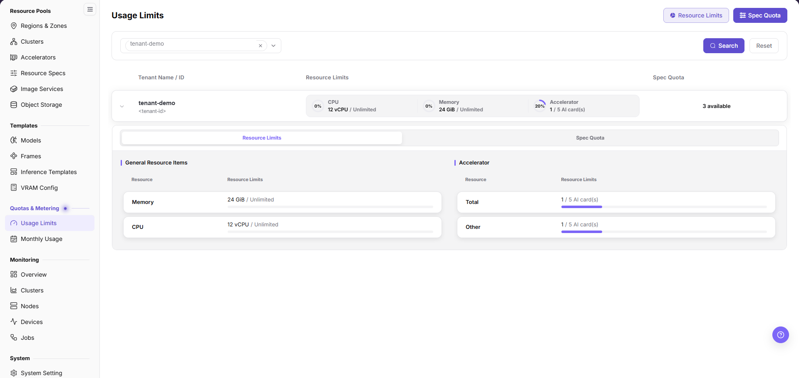
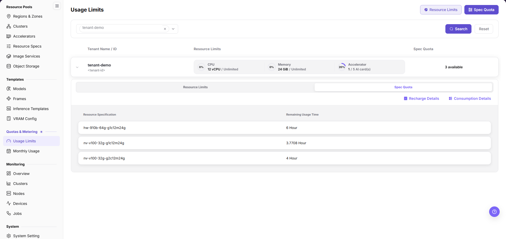
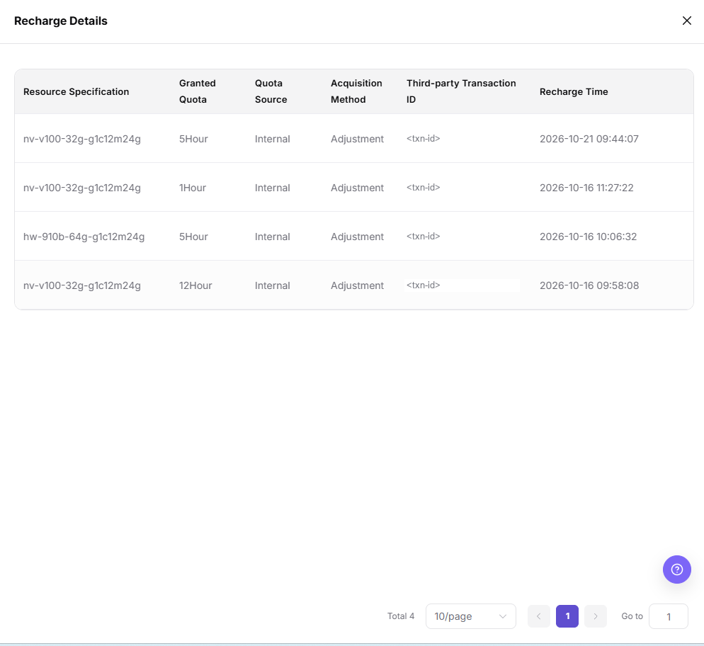
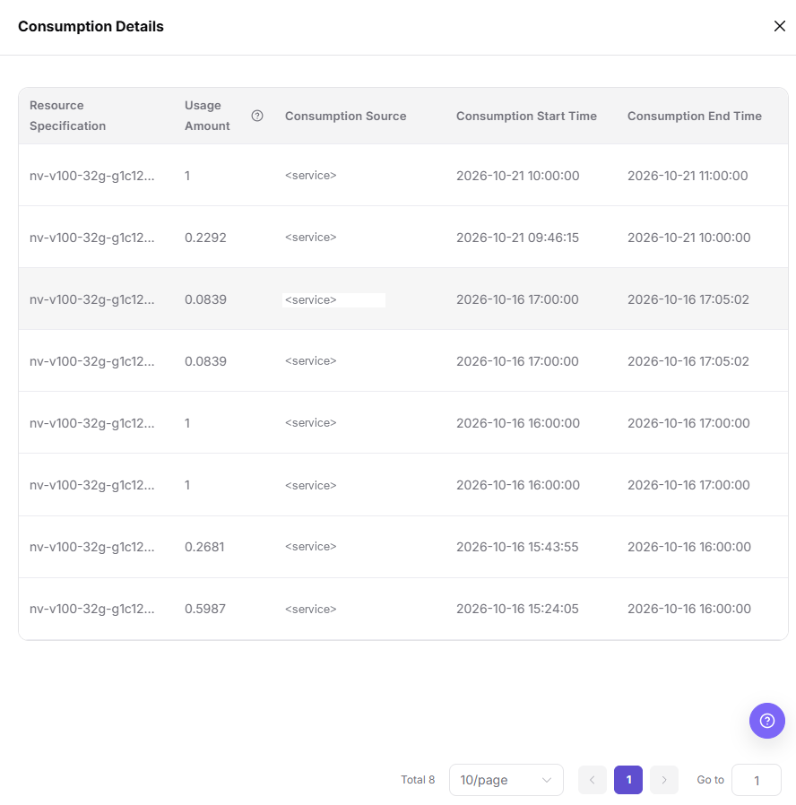
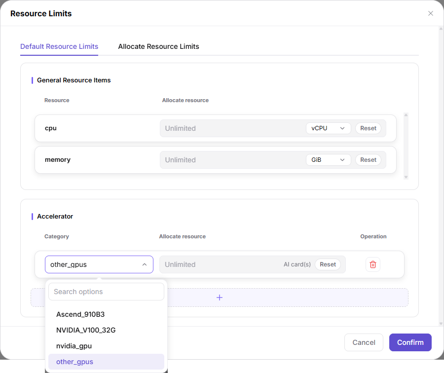
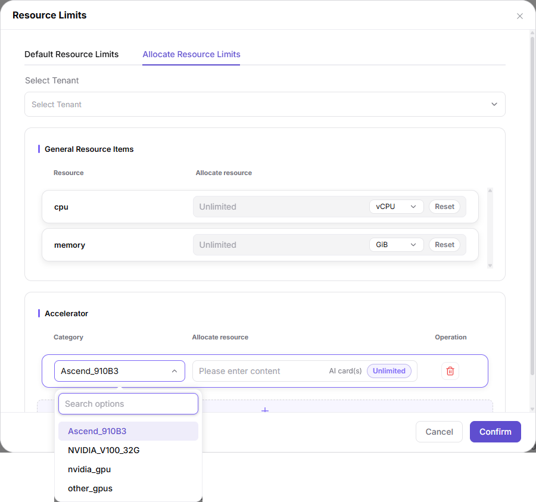
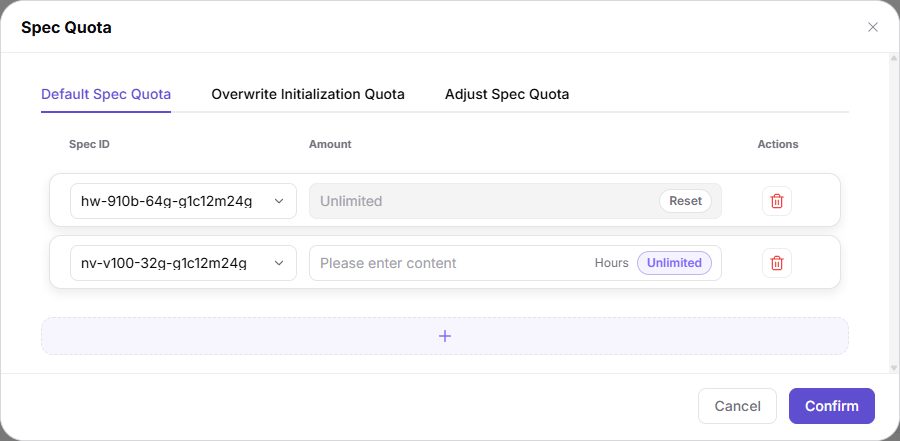
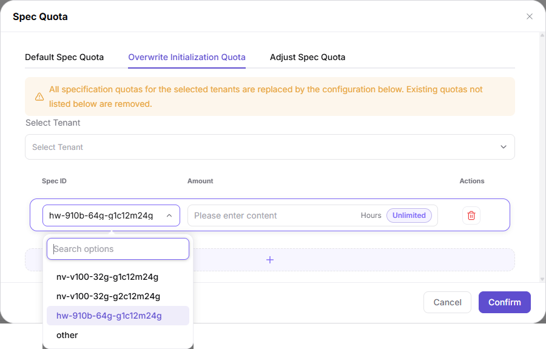
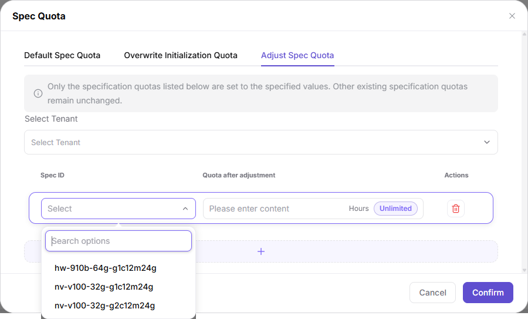

# Usage Limits

## Feature Overview

| Item | Content |
| --- | --- |
| Applicable Role | Operator |
| Navigation Path | On-Prem > Quotas & Metering > Usage Limits |
| Managed Object | Tenant, resource limits, spec quota, spec ID, and quota configuration |

#### Beginner Explanation

Usage limits are like a resource boundary sheet for a tenant. Resource specifications define how much resource a single instance or job uses, and usage limits define how much resource a tenant can use in total and whether specific specifications carry a quota. Quotas have two scopes: the default scope applies to tenants without an individual setting, and the selected-tenant scope applies only to the tenants chosen inside the dialog.

#### Terms

| Term | Description |
| --- | --- |
| Resource Limits | Limits tenant usage by resource category, such as CPU, memory, and accelerator. |
| Spec Quota | Limits tenant usage by spec ID. The amount input is measured in hours. |
| Unlimited | Removes the fixed limit from a resource item or a specification and expands the available scope. |
| Default Resource Limits / Default Spec Quota | Dialog tabs that apply to the default scope. Neither tab has a `Select Tenant` field. |
| Allocate Resource Limits | Dialog tab that sets resource limits separately for the tenants chosen in `Select Tenant`. |
| Overwrite Initialization Quota | Dialog tab that replaces the specification quotas of the selected tenants with the configuration in the tab. Quotas not listed are removed. |
| Adjust Spec Quota | Dialog tab that sets only the specification quotas listed in the tab to the specified values. Other quotas remain unchanged. |

#### Recommended Operation Order

First confirm that the target tenant, the resource category or specification, and the scope used by this change have passed internal approval. Then maintain each item in the order of Main Operations, read the result back from the expanded tabs and the detail drawers, and finally continue to the next pages.

#### First-Time User Notes

Read the page description first and separate the two entries: the two page-header buttons open configuration dialogs, and expanding a tenant row shows that tenant's quota view and usage details. The five dialog tabs `Default Resource Limits`, `Allocate Resource Limits`, `Default Spec Quota`, `Overwrite Initialization Quota`, and `Adjust Spec Quota` have different scopes, so choosing the wrong tab changes a non-target object. Verify the tab name and `Select Tenant` before submitting.

## Prerequisites

1. The current account has operator permissions.
2. The correct region is selected.
3. The target tenant, resource type, and spec scope have been confirmed.
4. The quota adjustment has passed internal approval, and the scope used by this change, default or selected tenants, is explicit.

## Page Description

Use this page to view and maintain tenant resource limits and specification quotas. The two page-header buttons open configuration dialogs, and expanding a tenant row shows that tenant's quota view and usage details.

Go to `On-Prem > Quotas & Metering > Usage Limits`. The page title is `Usage Limits`, and the header provides the `Resource Limits` and `Spec Quota` icon buttons. The two same-named tabs inside an expanded tenant row are another entry for viewing details.

The filter area is a tenant selector rather than a text input. It shows the placeholder `All Tenants` when nothing is selected, and each selected tenant becomes a removable tag with `×` followed by a dropdown arrow. After setting the condition, click `Search` to view matching tenants and `Reset` to restore query conditions.

The main table columns are `Tenant Name / ID`, `Resource Limits`, and `Spec Quota`. Each row consists of an expand arrow, the tenant name and tenant ID, three resource cards with percentage rings, and `3 available` at the far right. The three cards show `CPU 12 vCPU / Unlimited`, `Memory 24 GiB / Unlimited`, and `Accelerator 1 / 5 AI card(s)`, and the rings display 0%, 0%, and 20%.

Expanding a tenant row shows the `Resource Limits` and `Spec Quota` tabs. The `Resource Limits` tab is split into the `General Resource Items` and `Accelerator` groups, both with the columns `Resource` and `Resource Limits`. The rows are `Memory` and `CPU` in the first group and `Total` and `Other` in the second, each with a progress bar below the value, and hovering shows a tooltip such as `12 vCPU / Unlimited`.

The `Spec Quota` tab lists the `Resource Specification` and `Remaining Usage Time` available to the tenant, with the `Recharge Details` and `Consumption Details` icon links at the upper right.

The `Recharge Details` drawer has the columns `Resource Specification`, `Granted Quota`, `Quota Source`, `Acquisition Method`, `Third-party Transaction ID`, and `Recharge Time`, with a pager at the bottom in the form `Total 4`, `10/page`, and `Go to 1`.

The `Consumption Details` drawer has the columns `Resource Specification`, `Usage Amount`, `Consumption Source`, `Consumption Start Time`, and `Consumption End Time`, and the `Usage Amount` header carries a `?` icon. Both drawers are read-only views used to trace where quota came from and how it was consumed, and neither offers an entry to modify quota.

## Main Operations

### Maintain Default Resource Limits

#### Applicable Scenarios

Use this when the default CPU, memory, and accelerator boundaries for tenants without an individual setting must change. The `Default Resource Limits` tab has no `Select Tenant` field, so the change applies to the default scope.

#### Steps

1. Go to `On-Prem > Quotas & Metering > Usage Limits`.
2. Click **"Resource Limits"** in the page header to open the same-named dialog.
3. Confirm that the dialog stays on the **"Default Resource Limits"** tab.
4. In the `General Resource Items` group, confirm that the `Resource` column shows `cpu` and `memory`, enter the amount in the `Allocate resource` input, and select the unit `vCPU` or `GiB` from the dropdown on the right. Click **"Reset"** at the row end to restore the `Unlimited` placeholder.
5. In the `Accelerator` group, click the `Category` dropdown, search in the `Search options` field, and select a category.

6. Enter the quantity in the `Allocate resource` input with the unit `AI card(s)`. For no limit, click the **"Unlimited"** capsule. When the row is already unlimited, it shows the `Unlimited` placeholder and the **"Reset"** button.
7. To add a row, click the full-width dashed `+` below the table. To remove a row, click the red trash icon in the `Operation` column of that row; the icon carries no text.
8. Click **"Confirm"** in the footer to submit this configuration, or **"Cancel"** to discard unsubmitted changes.

#### Result Validation

1. Reopen the `Default Resource Limits` tab of the `Resource Limits` dialog and check the amount, unit, and `Unlimited` state of every row.
2. Expand the `Resource Limits` tab of the target tenant row and check the `Resource Limits` values and progress bars of the `General Resource Items` and `Accelerator` groups.
3. Return to the list and check the three resource cards and `3 available` of that row. Use the read-back result of reopening the dialog as the reference.

#### Notes

- The default scope affects every tenant without an individual setting. Confirm the change range before submitting.
- `Unlimited` expands the available resource scope and must not be used for real tenants without approval.
- Record the `Category` and amount of the row before removing it.
- `Confirm` is the only submit action of this configuration. Recheck `Category`, `Allocate resource`, and the unit row by row before clicking it.

### Allocate Resource Limits to Selected Tenants

#### Applicable Scenarios

Use this when one or several specific tenants need resource limits that deviate from the default. The `Allocate Resource Limits` tab has one more field than the default tab: `Select Tenant`.

#### Steps

1. Go to `On-Prem > Quotas & Metering > Usage Limits` and click **"Resource Limits"** in the page header.
2. Switch to the **"Allocate Resource Limits"** tab.
3. Click the `Select Tenant` dropdown and select the target tenants.
4. Following step 4 of "Maintain Default Resource Limits", set the `Allocate resource` value and unit for `cpu` and `memory` in `General Resource Items`.
5. In the `Accelerator` group, click the `Category` dropdown and pick a category from `Search options`. This batch shows `Ascend_910B3`, `NVIDIA_V100_32G`, `nvidia_gpu`, and `other_gpus`.

6. Enter the quantity in the `Allocate resource` input with the unit `AI card(s)`. In the empty state the input shows the placeholder `Please enter content`, and the **"Unlimited"** capsule is on the right.
7. Use the full-width dashed `+` to add accelerator rows, and the red trash icon at the row end to remove one.
8. Click **"Confirm"** in the footer to submit, or **"Cancel"** to discard changes.

#### Result Validation

1. Expand the `Resource Limits` tab of that tenant row and check whether `Resource` and `Resource Limits` in the `General Resource Items` and `Accelerator` groups equal the values just submitted.
2. Return to the list and check whether the three resource cards and `3 available` of that row reflect the new limits.
3. Reopen the `Allocate Resource Limits` tab and confirm that `Select Tenant` still points to the target tenants and that every row reads back correctly.

#### Notes

- Before submitting, confirm that `Select Tenant` hits the target tenants. Selecting the wrong tenant writes the limits to a non-target object.
- The default tab and the allocate tab have different scopes. Do not submit the same configuration across tabs twice.
- `Category` and `Allocate resource` take effect as a pair on an accelerator row. Selecting only a category leaves the row in its placeholder state.
- The risks of removing a row and of `Unlimited` are the same as in the default scope. Check each item against the Notes of "Maintain Default Resource Limits".

### Maintain Default Spec Quota

#### Applicable Scenarios

Use this when the default quota of each specification must be set for tenants without individual settings, for example when establishing a specification quota baseline during environment delivery. The `Default Spec Quota` tab has no `Select Tenant` field.

#### Steps

1. Go to `On-Prem > Quotas & Metering > Usage Limits` and click **"Spec Quota"** in the page header to open the same-named dialog.
2. Confirm that the dialog stays on the **"Default Spec Quota"** tab.
3. In the `Spec ID` column, click the dropdown and select the target specification. The empty state shows the placeholder `Select`, and the panel provides a `Search options` field.
4. Enter the value in the `Amount` input; the unit suffix is `Hours`. For no limit, click the **"Unlimited"** capsule. When the row is already unlimited, it shows the `Unlimited` placeholder and the **"Reset"** button.

5. To add a row, click the full-width dashed `+` below the table. To remove a row, click the red trash icon in the `Actions` column of that row.
6. Click **"Confirm"** in the footer to submit, or **"Cancel"** to discard unsubmitted changes.

#### Result Validation

1. Reopen the `Default Spec Quota` tab of the `Spec Quota` dialog and check `Spec ID` and `Amount` row by row.
2. Expand the `Spec Quota` tab of the target tenant row and check whether `Resource Specification` and `Remaining Usage Time` reflect this change.
3. To trace where a quota came from, open the `Recharge Details` drawer and check `Granted Quota`, `Quota Source`, `Acquisition Method`, and `Recharge Time`.

#### Notes

- This tab applies to the default scope. Do not mix it with the allocate, overwrite, or adjust tabs.
- The quota unit is hours. Confirm the duration convention on the business side before filling in values.
- The trash icon at the row end carries no text. Deleting by mistake loses the unsubmitted amount of that row, so record it first.
- Before `Confirm`, recheck the mapping between `Spec ID` and `Amount` row by row.

### Overwrite Initialization of Spec Quota

#### Applicable Scenarios

Use this when the specification quotas of the selected tenants must be reset to one target configuration, for example during re-delivery of an environment or a batch correction of historical configuration. This tab removes existing quotas that are not listed, which makes it a high-risk action.

#### Steps

1. Go to `On-Prem > Quotas & Metering > Usage Limits` and click **"Spec Quota"** in the page header.
2. Switch to the **"Overwrite Initialization Quota"** tab.
3. Read the orange warning banner inside the tab: `All specification quotas for the selected tenants are replaced by the configuration below. Existing quotas not listed below are removed.`
4. Click the `Select Tenant` dropdown and select the target tenants.
5. Select a specification in the `Spec ID` column. The panel search placeholder is `Search options`, and this batch shows 4 options, including `other`.
6. Enter the value in the `Amount` input with the unit `Hours`, or click the **"Unlimited"** capsule to set no limit.

7. Use the full-width dashed `+` to complete every specification row that must be kept, so the list matches the target configuration row by row.
8. Click **"Confirm"** in the footer to submit, or **"Cancel"** to discard changes.

#### Result Validation

1. Reopen the tab and check that the row set matches the target configuration row by row, with no specification missing.
2. Expand the `Spec Quota` tab of the target tenant row and check that `Resource Specification` and `Remaining Usage Time` reflect only the configuration just submitted.
3. To compare the state before and after the overwrite, use the `Recharge Details` and `Consumption Details` drawers and align them by their time columns.

#### Notes

- High risk: existing specification quotas that are not listed are removed. Confirm the list is complete row by row before submitting.
- This tab contains `Select Tenant`, so one submission may apply to several tenants. Confirm the selected scope before submitting.
- Record the current row set in the `Default Spec Quota` tab or in the expanded area first, as the fallback reference.
- No undo entry appears in this batch. To roll back, submit the previous target configuration again through the same tab.

### Adjust Spec Quota

#### Applicable Scenarios

Use this when only a few specified specifications need their quotas set to target values while the rest stay unchanged, which fits routine small corrections. This tab does not remove quotas that are not listed.

#### Steps

1. Go to `On-Prem > Quotas & Metering > Usage Limits` and click **"Spec Quota"** in the page header.
2. Switch to the **"Adjust Spec Quota"** tab.
3. Read the grey information banner inside the tab: `Only the specification quotas listed below are set to the specified values. Other existing specification quotas remain unchanged.`
4. Click the `Select Tenant` dropdown and select the target tenants.
5. Select a specification in the `Spec ID` column. The empty state shows the placeholder `Select`, and this batch shows 3 options in the panel.
6. Enter the target value in the `Quota after adjustment` input with the unit `Hours`, or click the **"Unlimited"** capsule.

7. Use the full-width dashed `+` to add rows for other specifications to adjust, and the red trash icon at the row end to remove a row added by mistake.
8. Click **"Confirm"** in the footer to submit, or **"Cancel"** to discard changes.

#### Result Validation

1. Reopen the tab and check that `Spec ID` and `Quota after adjustment` match row by row.
2. Expand the `Spec Quota` tab of the target tenant row and check that `Remaining Usage Time` of the adjusted `Resource Specification` has become the target value.
3. Check that the `Resource Specification` entries not listed still keep their original values, confirming that the adjustment range did not expand.

#### Notes

- `Quota after adjustment` is the target value after adjustment, not an increment. The banner states that the listed quotas are set to the specified values.
- Difference from overwrite initialization: this tab affects only the listed specifications and does not remove quotas that are not listed.
- Before submitting, confirm that both `Select Tenant` and `Spec ID` point to the target objects.

## Parameter Quick Reference

| Field Name | Required | Field Type | Example | Description |
| --- | --- | --- | --- | --- |
| All Tenants | No | Selector placeholder | `All Tenants` | Placeholder of the tenant selector when nothing is selected. Each selection becomes a removable tag with `×`. Area: Filter area. |
| Tenant Name / ID | Depends on operation | Main table column / system-generated | `tenant-demo` | Locates the target tenant. Do not write real tenant names or tenant IDs in documentation or screenshots. Area: Main table. |
| Resource Limits | Depends on operation | Header button / main table column / expanded tab | `CPU 12 vCPU / Unlimited` | Opens the resource limits dialog and shows the tenant resource limits in the main table and the expanded area. Area: Header, main table, expanded area. |
| Spec Quota | Depends on operation | Header button / main table column / expanded tab | `6 Hour` | Opens the spec quota dialog and shows the tenant specification quotas in the main table and the expanded area. Area: Header, main table, expanded area. |
| Search | No | Query action | `Search` | Refreshes the tenant list with the current filter condition. Area: Filter area. |
| Reset (filter area) | No | Query action | `Reset` | Restores the filter condition. Area: Filter area. |
| General Resource Items | — | Group title | `General Resource Items` | Group that holds CPU and memory in the expanded area and in the resource limits dialog. Area: Expanded area, Resource Limits dialog. |
| Accelerator | — | Group title | `Accelerator` | Group that holds accelerator resource items in the expanded area and in the resource limits dialog. Area: Expanded area, Resource Limits dialog. |
| Resource | — | Expanded column | `Memory`, `CPU`, `Total`, `Other` | Resource item names shown in the `Resource Limits` expanded tab. Area: Expanded area. |
| Resource Limits (expanded column) | Depends on operation | Quantity / capacity | `24 GiB / Unlimited` | Current limit and usage shown in the expanded area, with a progress bar below the value. Area: Expanded area. |
| Remaining Usage Time | — | Expanded column | `3.7708 Hour` | Remaining available time per specification in the `Spec Quota` expanded tab. Area: Expanded area. |
| Select Tenant | Yes (selected-tenant tabs) | Dropdown select | `Select Tenant` | Target object field of the `Allocate Resource Limits`, `Overwrite Initialization Quota`, and `Adjust Spec Quota` tabs. Area: Resource Limits dialog, Spec Quota dialog. |
| Category | Yes (accelerator row) | Dropdown select | `<accelerator category>` | Category of an accelerator resource row. The dropdown panel supports `Search options`. Do not write real internal resource keys in documentation. Area: Resource Limits dialog. |
| Allocate resource | Depends on operation | Quantity / capacity | `100` | Amount allowed for the current category or resource item. Area: Resource Limits dialog. |
| Spec ID | Yes (spec quota row) | Dropdown select | `<spec ID>` | Target specification of a spec quota row. The empty state shows the placeholder `Select`. Do not write real spec IDs in documentation. Area: Spec Quota dialog. |
| Amount | Depends on operation | Quantity / duration | `10` | Amount input of the `Default Spec Quota` and `Overwrite Initialization Quota` tabs. Area: Spec Quota dialog. |
| Quota after adjustment | Depends on operation | Quantity / duration | `10` | Target value input of the `Adjust Spec Quota` tab. Enter the adjusted value, not an increment. Area: Spec Quota dialog. |
| Unit | Depends on operation | Dropdown / suffix | `vCPU`, `GiB`, `AI card(s)`, `Hours` | Unit shown with the amount input, which varies by resource item. Area: Resource Limits dialog, Spec Quota dialog. |
| Unlimited | No | Quick action | `Unlimited` | Capsule button that sets the row to unlimited. When the row is already unlimited, the input shows the `Unlimited` placeholder. Area: Resource Limits dialog, Spec Quota dialog. |
| Reset (in-row) | No | Quick action | `Reset` | Restores the amount of the row to the `Unlimited` placeholder. Area: Resource Limits dialog, Spec Quota dialog. |
| `+` | No | Configuration action | `+` | Full-width dashed button that adds a resource or spec quota configuration row. The button carries no text. Area: Resource Limits dialog, Spec Quota dialog. |
| Trash icon | No | High-risk action | — | Delete icon in the `Operation` or `Actions` column at the row end, with no text. Area: Resource Limits dialog, Spec Quota dialog. |
| Cancel | No | Safe exit | `Cancel` | Discards unsubmitted changes inside the dialog. Area: Resource Limits dialog, Spec Quota dialog. |
| Confirm | Yes (final submit) | High-risk final action | `Confirm` | Submits the current configuration in the dialog. Area: Resource Limits dialog, Spec Quota dialog. |
| Recharge Details | No | Read-only entry | `Recharge Details` | Opens the quota source drawer with the columns `Granted Quota`, `Quota Source`, `Acquisition Method`, `Third-party Transaction ID`, and `Recharge Time`. Area: `Spec Quota` expanded tab. |
| Consumption Details | No | Read-only entry | `Consumption Details` | Opens the quota consumption drawer with the columns `Usage Amount`, `Consumption Source`, `Consumption Start Time`, and `Consumption End Time`. Area: `Spec Quota` expanded tab. |

## Pitfalls

- `Confirm` is a high-risk final action and may immediately change the tenant's available resource scope.
- The trash icon at the row end carries no text. A misclick removes the whole configuration row and may leave a resource or specification without the expected limit.
- `Unlimited` expands the available resource scope and must not be used for real tenants without approval.
- `Overwrite Initialization Quota` removes existing specification quotas that are not listed. Submitting with only part of the specifications filled in loses the quota of the rest.
- In `Adjust Spec Quota`, `Quota after adjustment` is a target value, not an increment. Filling in an increment sets the wrong quota.
- Sufficient resource limits do not guarantee that the underlying cluster has idle capacity. Also check resource specifications, cluster capacity, and scheduling status.
- The percentages in the expanded area and the main table only express usage relative to the limit, not the underlying capacity.
- An incorrect spec quota or spec ID may make specifications unavailable to users or expand access beyond expectations.
- The header buttons and the expanded tabs share names but are different entries. When checking configuration, confirm whether you are in a dialog or in the expanded area.
- The two detail drawers are read-only views. When tracing a quota issue, read the drawers first and then return to the dialog; do not look for an edit entry inside a drawer.
- Do not write real tenant IDs, tenant names, spec IDs, internal resource keys, third-party transaction IDs, consumption source service names, accounts, secrets, tokens, or internal test parameters.

## Result Validation

| Check Item | Success Signal | If Abnormal |
| --- | --- | --- |
| Page entry | Usage Limits opens and the header shows the `Resource Limits` and `Spec Quota` buttons | Check the menu permission and the operator permission of the current account |
| Tenant location | The main table shows the target tenant row after a tag is selected in the tenant selector | Click `Reset` to restore the condition, then confirm the tenant name and tenant ID |
| Configuration read-back | After reopening the dialog, the row set, amounts, units, and `Unlimited` states match the submission | Confirm the tab used at submit time and the `Select Tenant` value, and resubmit if needed |
| Usage view | The values in the `Resource Limits` and `Spec Quota` expanded tabs match the resource cards in the main table | Use the dialog read-back as the reference |
| Quota trace | The `Recharge Details` and `Consumption Details` drawers map the change to a specification and a time | Check the time boundaries of `Recharge Time`, `Consumption Start Time`, and `Consumption End Time` |

## FAQ

#### No Records on Usage Limits

**Symptom:**

The page opens, but lists or statistics are empty.

**Possible Causes:**

- Filters are too narrow.
- Source records are not generated.
- The role cannot see them.

**Solution:**

1. Reset filters
2. Verify the source job or metering cycle
3. Check business identity and tenant scope.

#### Usage Limits Shows the Wrong Scope

**Symptom:**

The data shown does not belong to the expected tenant or specification.

**Possible Causes:**

- The tenant selector still points to the previous tag.
- The wrong tab was used in the dialog, so the change applied to the default scope.
- Object ownership changed.

**Solution:**

1. Select the tenant again and click `Search`
2. Check the current tab name and `Select Tenant`
3. Confirm the current ownership in the two expanded tabs.

#### Usage Limits Is Delayed

**Symptom:**

A source operation completed, but its record is not visible.

**Possible Causes:**

- Aggregation is not complete.
- The page is cached.
- Source state is still processing.

**Solution:**

1. Verify source state
2. Wait one aggregation cycle and refresh
3. Inspect the processing task if the delay persists.

#### Details or Download Is Unavailable

**Symptom:**

The details, expand, or download entry is disabled.

**Possible Causes:**

- The record does not support the action.
- Role permission is insufficient.
- The file is not generated.

**Solution:**

1. Select an eligible record
2. Check role permission

#### Summary and Details Do Not Match

**Symptom:**

The resource cards or expanded values differ from the total of the drawer records.

**Possible Causes:**

- Periods differ.
- Values are rounded.
- Some records are still processing.

**Solution:**

1. Align the period and time zone
2. Compare record by record per `Resource Specification`
3. Wait for pending records to settle and check again.

## Notes

- Usage limits directly affect the tenant's available resource scope. Before real changes, confirm the tenant, the resource category or specification, and the scope used by this change.
- `Confirm`, the trash icon at the row end, and `Unlimited` all require explicit risk warnings.
- The five tabs have different scopes: the two default tabs have no `Select Tenant`, and the three selected-tenant tabs require a tenant selection first. Choosing the wrong tab changes a non-target object.
- Do not write real tenant IDs, tenant names, spec IDs, internal resource keys, third-party transaction IDs, consumption source service names, test parameters, accounts, secrets, or tokens in documentation, screenshots, or tickets.
- Sanitize tenant, specification, and transaction identifiers before exporting or copying page information.

## Next Steps

1. After changing real limits, return to the user side and verify whether the target specification is selectable.
2. Use `Metering Details` to check whether subsequent resource usage matches expectations.
3. Use resource pool, monitoring, and job pages to troubleshoot insufficient resources or queued workloads.
4. Include quota change records in internal change or audit processes.
