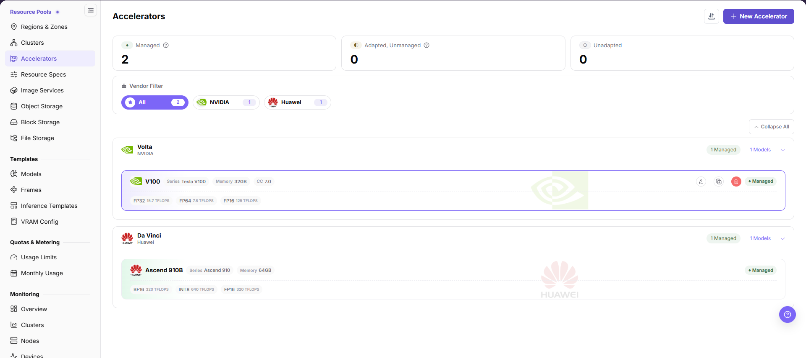
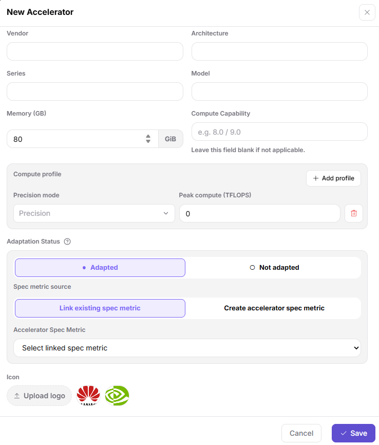
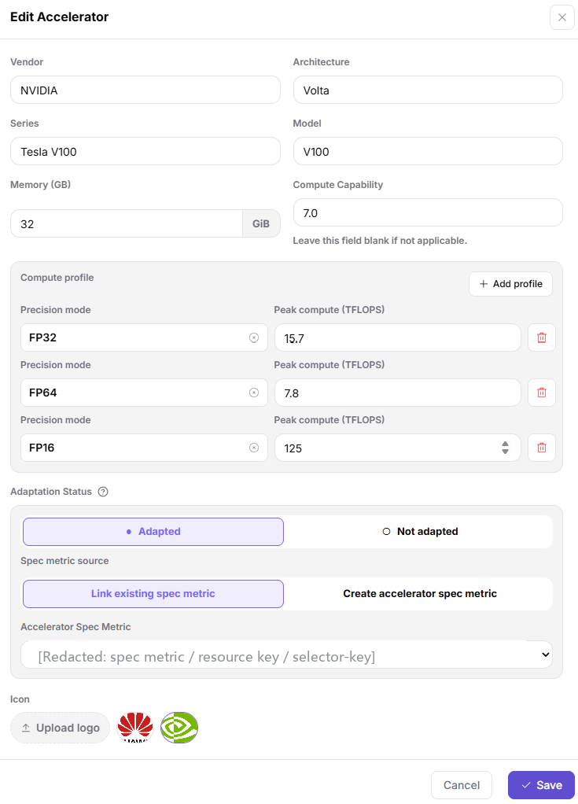
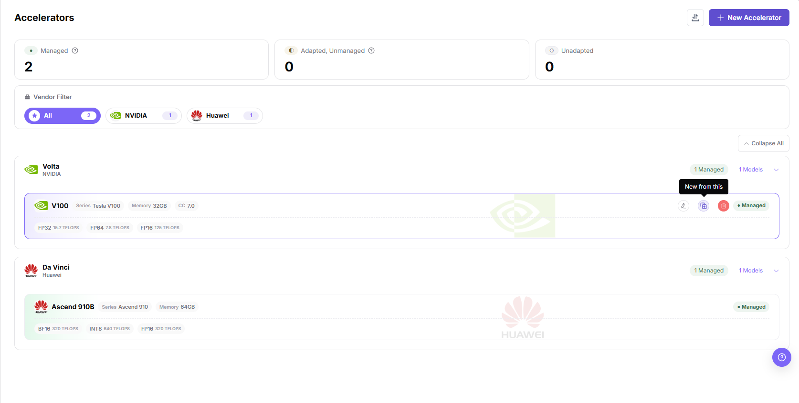
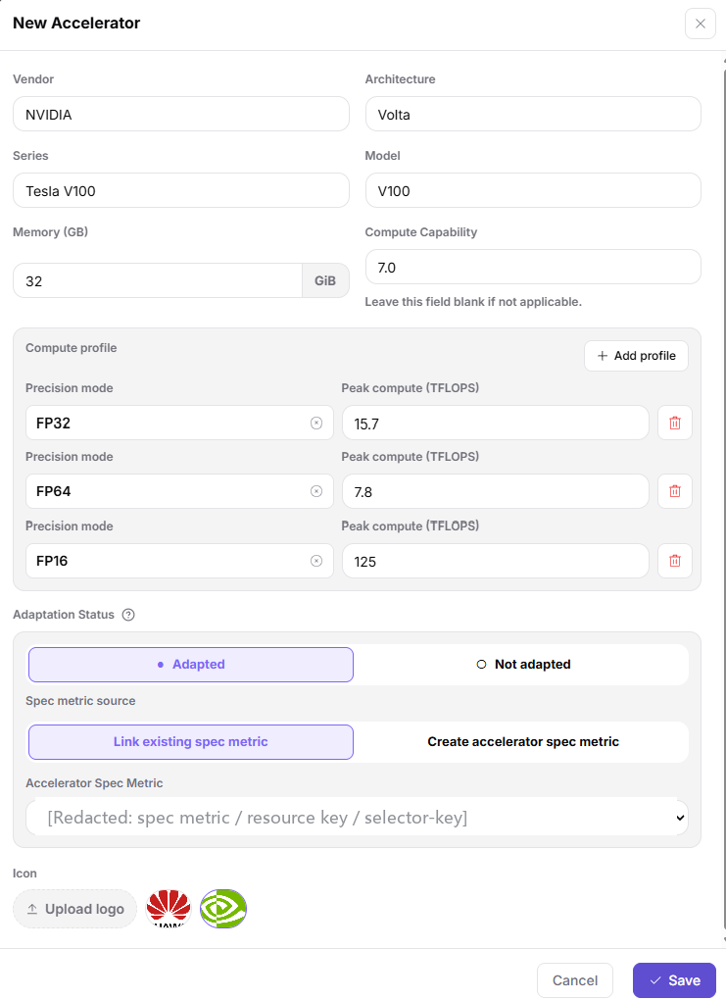

# Accelerators

## Feature Overview

| Item | Content |
| --- | --- |
| Applicable Role | Operator |
| Navigation Path | On-Prem > Resource Pools > Accelerators |
| Page Route | `/powerone/resourcepool/accelerators` |
| Managed Object | Accelerator vendors, architectures, series, models, device memory, compute information, specification metrics, and managed state |

#### Beginner Explanation

- **Accelerator model** is like a hardware identity card. It tells the platform whether this is A100, H100, Ascend 910B, or another model.
- **Specification metric** is like a scheduling label. It determines which resource key Kubernetes uses to request the corresponding accelerator.
- **selector-key** helps identify device types, node labels, or monitoring fields. Incorrect configuration affects scheduling and monitoring matching.
- **Managed** means the platform can include this model in resource specifications and job scheduling.
- **Not adapted** models can be maintained as hardware information first, but cannot be opened as stable scheduling capability directly.

#### Terms

| Term | Description |
| --- | --- |
| Accelerator Vendor | Accelerator manufacturer, such as NVIDIA, Huawei, AMD, or Intel. |
| Model | Specific accelerator model, such as A100, H100, or Ascend 910B. |
| Architecture | Hardware architecture or generation under the same vendor, such as Ampere or Hopper. |

#### Recommended Operation Order

1. Confirm the accelerator vendors, models, memory, and Kubernetes resource keys actually present in the cluster.
2. Prepare the corresponding AI accelerator metric in the `Specification Metrics` list of the `Specification group navigation` panel on `Resource Pools > Resource Specs`.
3. Enter `On-Prem > Resource Pools > Accelerators` to create a model, edit an existing one, or reuse an existing model with **"New from this"**.
4. Associate each accelerator model with the correct specification metric.
5. Reference the metric in resource specifications and verify scheduling, monitoring, and template recommendations with a test job.

#### First-Time User Notes

Confirm that the task involves accelerator vendors, architectures, series, models, device memory, compute information, specification metrics, and managed state, and then follow the recommended order. If fields or state differ from expectations, check prerequisites before continuing downstream.

## Prerequisites

1. The current account has operator permissions and can enter `On-Prem > Resource Pools > Accelerators`.
2. The target accelerator vendor, model, architecture, series, VRAM capacity, and compute capability have been confirmed.
3. Kubernetes resource key, selector-key, or monitoring identification fields have been confirmed to match actual cluster-reported information.
4. If the model needs to be managed for job scheduling, the corresponding metric has been prepared in the `Specification Metrics` list on `Resource Pools > Resource Specs`.
5. Before editing or deleting a model, confirm which resource specifications, cluster specifications, and scheduling configuration reference it.

## Page Description

Use this page to manage accelerator vendors, architectures, series, models, device memory, compute capability, specification metrics, and managed state.

The page groups accelerator models by architecture under each vendor in collapsible sections (use **Collapse All** in the top-right). The top area shows management status statistics and a vendor filter bar narrows the list by vendor, while each model card displays the series, model, memory (shown in GB on the card), compute capability, and per-precision peak compute.

#### Vendor and Status Filters

| Area | Description |
| --- | --- |
| Status Statistics | Displays the counts of managed, adapted but not managed, and not adapted models. |
| Vendor Filter | Narrows the scope by vendors such as NVIDIA, AMD, Intel, and Huawei. |
| Model Card | Displays series, model, VRAM (shown in GB on the card), compute capability, and peak compute power under different precisions. |
| Operation Entry | The top-right **New Accelerator** and **Import/Export** entries open the create dialog and the batch-maintenance entry. Hovering a model card reveals **Edit / Copy / Delete** icons; the Edit icon tooltip reads **"Edit"** and the Copy icon tooltip reads **"New from this"**. Edit, Copy, and Delete are write actions; confirm their scope and impact before use. |

## Main Operations

### Add Accelerator

#### Applicable Scenarios

Before a new hardware model is connected to the platform, accelerator basic information must be maintained. To correct or supplement a model that is already recorded, use the **Edit Accelerator** operation below instead.

#### Steps

1. Go to `On-Prem > Resource Pools > Accelerators`.
2. Click **"New Accelerator"** in the top-right corner to open the **New Accelerator** dialog.
3. Fill in vendor, architecture, series, and model as free text, then enter Memory (GB) (unit shown as GiB on the page) and compute capability (optional) according to the page fields.
4. Under Compute profile, use **Add profile** to enter one or more precision/peak-compute rows (each row pairs a Precision mode from the dropdown with a Peak compute (TFLOPS) value). An **Icon** can be uploaded or chosen from the preset vendor logos.
5. Select or associate the specification metric as required by the page, and verify Kubernetes resource key, selector-key, or monitoring identification fields.
6. Before clicking **Save**, verify that the hardware model, resource metric, and actual cluster-reported information are consistent.

The following figure shows the **New Accelerator** dialog with the hardware basic information and the specification metric association.

#### Result Validation

- The new model card appears inside its architecture group, and the status statistics at the top of the page and the vendor filter counts increase accordingly.
- The card shows the saved series, memory (shown in GB on the card) and precision rows; the specification metric and managed state match what was submitted — reopen **Edit** to confirm them.

#### Notes

- Vendor, architecture, series, and model are free-text fields, so a different spelling of the same hardware creates a separate model record; keep the naming consistent with what the cluster device plug-in reports.
- The accelerator specification metric decides whether resource specifications and monitoring can match the devices actually reported by the cluster; if it is missing or bound to a different resource key, re-bind it before saving.
- The dialog exposes only the fields listed above; if the page offers additional fields or different naming, follow the live page.

### Edit Accelerator

#### Applicable Scenarios

Edit an accelerator model already recorded in the platform to correct or supplement its information, for example the series or model spelling, memory, compute capability, adding or removing one precision row, switching the adaptation status, or re-binding the accelerator specification metric.

#### Steps

1. Go to `On-Prem > Resource Pools > Accelerators` and locate the target model card inside its architecture group.
2. Hover over the card and click the leftmost pencil **Edit** icon in the icon row at its top-right corner; the tooltip reads **"Edit"**, and the **Edit Accelerator** dialog opens.
3. The dialog is pre-filled with the model's current values: Vendor, Architecture, Series, Model, Memory (GB) (unit shown as GiB inside the field), Compute Capability, Compute profile rows, Adaptation Status, Spec metric source, Accelerator Spec Metric, and Icon.
4. Change only the fields that need it: add a row with **Add profile** or remove one with the red icon at the end of a row; to switch the resource metric, pick another value in **Accelerator Spec Metric** or set **Spec metric source** to **Create accelerator spec metric**.
5. Before clicking **Save**, verify that the edited model, memory, and specification metric still match the values reported by the cluster device plug-in. Click **Cancel** to discard the changes.

The following figure shows the **Edit Accelerator** dialog opened by **Edit**, pre-filled with the model's existing values. The **Accelerator Spec Metric** value contains a Kubernetes resource key and selector-key, so it is masked here under the platform redaction rule; use the value shown on the live page.

#### Result Validation

- The model card reflects the saved series, memory (shown in GB on the card), compute capability, and precision rows.
- The model stays in its architecture group; if the adaptation status changed, use the status statistics at the top of the page, and follow what the live page shows.

#### Notes

- **Edit** changes the model itself, unlike **"New from this"**, which creates a new record and leaves the source model untouched.
- The model identifier, memory, and accelerator specification metric determine whether resource specifications and monitoring can match the devices actually reported by the cluster; confirm the impact scope before saving.
- The dialog shows only the fields listed above; if the page exposes additional fields or different naming, follow the live page.

### New From This Accelerator

#### Applicable Scenarios

When a new model differs from an existing one by only a few fields (for example, the same series with different memory, or the same architecture with a different model), use **"New from this"** to bring over the basic information of an existing model and edit only the differences, instead of re-entering vendor, architecture, memory, and every precision/peak-compute row.

#### Steps

1. Go to `On-Prem > Resource Pools > Accelerators` and locate the model card to use as the template inside its architecture group.
2. Hover over that card. Its top-right corner shows the **Edit**, **Copy**, and **Delete** icons in this order; the tooltip on the middle Copy icon reads **"New from this"**.
3. Click **"New from this"** to open the **New Accelerator** dialog. Vendor, architecture, series, model, memory, compute capability, the precision/peak-compute rows, adaptation status, specification-metric source, and icon are all pre-filled from the source model.
4. Edit the differing fields according to the Add Accelerator field rules: change at least the model, and normally re-check series, memory, precision compute rows, and the accelerator specification metric.
5. Before clicking **"Save"**, confirm that every pre-filled value still holds for the new hardware. Click **"Cancel"** to leave the list unchanged.

The following figure shows the hover-state icon row on a model card, with the Copy icon tooltip reading **"New from this"**.

The following figure shows the **New Accelerator** dialog pre-filled by **"New from this"**: Vendor, Architecture, Series, Model, Memory (GB), Compute Capability, every Precision mode / Peak compute row, Adaptation Status, Spec metric source, and Icon are carried over from the source model. The **Accelerator Spec Metric** value contains a Kubernetes resource key and selector-key, so it is masked here under the platform redaction rule; use the value shown on the live page.

#### Result Validation

- The dialog still opens as the create-accelerator form with values equal to the source model, which confirms the pre-fill took effect.
- After saving, the list shows one more model card inside the corresponding architecture group, and the status statistics and vendor filter counts increase accordingly.

#### Notes

- **"New from this"** creates a new record; it does not modify the source model, whose information stays unchanged.
- The specification metric carries over from the source model. If the new hardware reports a different resource key or selector-key, re-bind an existing metric or create a new one; otherwise the cluster cannot identify or schedule that model.

### Delete Accelerator

#### Applicable Scenarios

Delete accelerator basic information when a model recorded in the platform is retired, entered incorrectly, or duplicated, and is not referenced by resource-specification or cluster-specification configuration.

#### Steps

1. Go to `On-Prem > Resource Pools > Accelerators` and locate the target model card inside its architecture group.
2. Hover over the card and click the red **Delete** icon at the far right of the icon row (icon positions are shown in the figure in the previous section).
3. Confirm the vendor, series, and model in the confirmation prompt shown by the page, then confirm. The exact prompt wording follows the live page.
4. After deleting, verify that the model card has disappeared from its architecture group and that the status statistics and vendor filter counts decreased accordingly.

#### Result Validation

- The model card disappears from its architecture group, and the status statistics at the top of the page and the vendor filter counts decrease accordingly.
- Re-check the downstream pages listed under **Next Steps**: if a resource specification or inference template still shows the removed model, review that configuration itself and follow what the live page displays.

#### Notes

- Delete is an irreversible write action. Before running it, confirm the model is not referenced by clusters, resource specifications, or scheduling configuration.
- Deleting a managed model has a larger impact scope; have a platform administrator confirm first. If the model only needs to be paused, change its adaptation or managed state in the **Edit** dialog instead of deleting the basic information, and follow what the live page offers.
- After an accidental delete, re-create the model through **"New Accelerator"**, **"New from this"**, or the **"Import/Export"** entry.

## Parameter Quick Reference

| Field Name | Required | Field Type | Example | Description |
| --- | --- | --- | --- | --- |
| Vendor | Yes | Text | `NVIDIA` | Accelerator vendor. Enter as free text; keep it consistent with the real hardware vendor. |
| Architecture | Yes | Text | `Ampere` | Accelerator architecture. Enter as free text; keep it consistent with the real hardware architecture. |
| Series | Yes | Text | `A100` | Accelerator series. Enter as free text; keep it consistent with vendor and model. The example is illustrative; use the series name shown on the page. |
| Model | Yes | Text | `A100-SXM4-80GB` | Accelerator model. Enter as free text; match the model actually reported by cluster nodes. |
| Memory (GB) | Yes | Number / capacity | `80` | Single-card memory capacity. The field label reads Memory (GB) while the input unit shows GiB on the page, and the model card displays memory in GB. Follow the page unit and avoid mixing GiB and GB. |
| Compute Capability | Optional | Text | `8.0` | CUDA or hardware capability version. Do not invent a value when it is not confirmed. |
| Precision mode | Conditionally required | Dropdown / enum | `FP32` | Precision mode selected from a searchable dropdown (FP32, TF32, FP16, BF16, INT8, FP64). Keep it consistent with supported page options and hardware capability. |
| Peak compute (TFLOPS) | Conditionally required | Number / capacity | `312` | Peak compute value under the selected precision mode. Fill in only confirmed public or hardware-reported data. |
| Spec metric source | Conditionally required | Segmented option | `Link existing spec metric` | The dialog offers **Link existing spec metric** and **Create accelerator spec metric**, which decide whether the Accelerator Spec Metric field selects an existing metric or creates a new one. Default selection follows the live page. |
| Icon | Optional | Image | — | Upload a logo or pick one of the preset vendor logos shown on the page. |
| Accelerator Spec Metric | Conditionally required | Text | `gpu-a100-80g` | Select the accelerator specification metric chosen through the spec-metric source. Verify k8s-key and selector-key against labels actually reported by nodes. |
| Adaptation Status | Yes | Status | `Adapted` | Whether platform resource recognition and scheduling are adapted. Do not expose unadapted devices to users. |
| Actions | System-generated | Action entry | `Edit` | The top-right **New Accelerator** and **Import/Export** entries, plus the per-card **Edit** (tooltip **"Edit"**), **Copy** (tooltip **"New from this"**), and **Delete** icons. `Save`, **Edit**, **"New from this"**, and **Delete** are write actions. Confirm the scope and impact before executing the final action. |

## Pitfalls

- Creating or editing an accelerator affects resource specifications, scheduling identification, monitoring display, and inference template recommendations.
- Incorrect model, VRAM capacity, resource key, or selector-key may cause specifications to be unavailable, scheduling to fail, or monitoring to fail to match devices.
- Do not merge cards with similar display names but different Kubernetes resource keys into the same model.
- VRAM capacity affects inference templates and VRAM estimation results. Verify it against hardware information before submission.
- Deleting an accelerator is irreversible. If the model is already referenced by resource specifications, cluster specifications, or scheduling configuration, the deletion affects downstream behavior; verify the reference scope first.
- When using **"New from this"**, the accelerator specification metric is inherited from the source model. If the new hardware reports a different resource key or selector-key and the metric is not re-bound, scheduling and monitoring will fail to match.
- **Save** is the final high-risk action in this page's dialogs. Confirm the scope and impact before clicking it.

#### Configuration Rules and Impact

- **Resource key consistency**: The Kubernetes resource key in the accelerator metric must be consistent with the resource key actually reported by the cluster.
- **selector-key consistency**: selector-key should remain consistent with node labels, specification metrics, or monitoring identification fields.
- **Naming stability**: Vendor, series, and model should be consistent with hardware procurement, driver identification, and monitoring collection definitions.
- **Pre-management validation**: Before management, use a test job to verify resource requests, scheduling, and monitoring display.
- **Template impact**: VRAM capacity, compute capability, and adaptation status affect inference template recommendations and resource specification selection.

## Result Validation

| Check Item | Success Signal | If Abnormal |
| --- | --- | --- |
| Page entry | Accelerators opens with the target operation entry | Check Operator permission and whether the menu is available |
| Object record | Accelerator vendor, architecture, series, model, memory, compute information, specification metric, and managed state are visible on the model card or in the create / **Edit** / **New from this** dialog | Reset filters and verify name, ownership, and the create / edit / copy result |
| State result | State after create, **New from this**, edit, or delete matches the page message; after a delete the model card disappears from its architecture group, and the status statistics and vendor filter counts decrease accordingly | Check operation feedback, dependency state, and latest update time |
| Downstream use | A downstream page can select or associate the target | Return to prerequisites and check enabled state, ownership, and visibility |

## FAQ

#### An Imported Accelerator Does Not Appear

**Symptom:**

The import reports completion, but the target accelerator is not visible or its state is unchanged.

**Possible Causes:**

- Active filters hide the target record.
- The file identifier, required column, or enum value does not meet page requirements.
- The record conflicts with an existing model or background validation is incomplete.

**Solution:**

1. Reset filters and search again by model or vendor.
2. Check column names, identifiers, and metric values against the page requirements.
3. Check the page prompt and update time, then handle conflicts after validation finishes.
4. This page does not document the fields or flow inside the **Import/Export** dialog; follow what the page displays.

#### The Operation Entry on Accelerators Is Unavailable

**Symptom:**

The **New Accelerator**, **New from this**, edit, delete, or import/export entry is hidden or disabled.

**Possible Causes:**

- Role permission is insufficient.
- the page is read-only.
- dependencies are not ready.

**Solution:**

1. Check Operator permission
2. read the page message
3. complete dependency configuration first.

#### A Required Field on Accelerators Has No Options

**Symptom:**

The form opens, but the **Precision mode** or **Accelerator Spec Metric** list is empty.

**Possible Causes:**

- Candidates are disabled.
- ownership differs.
- the current account cannot see them.

**Solution:**

1. Check candidate state
2. verify ownership
3. confirm visibility and refresh the form.

#### Accelerators Has an Abnormal State After the Operation

**Symptom:**

A record exists after submission, but its state is unexpected.

**Possible Causes:**

- Connectivity or validation failed.
- a dependency is abnormal.
- processing is incomplete.

**Solution:**

1. Check feedback and update time
2. inspect related objects
3. troubleshoot the processing stage.

#### A Downstream Page Cannot Use Accelerators

**Symptom:**

The current page is normal, but a downstream page cannot select or associate the accelerator model, its specification metric, or its managed state.

**Possible Causes:**

- Visibility differs.
- the object is disabled.
- downstream cache is stale.
- After an edit, the model name differs from the value reported by cluster nodes, the single-card VRAM mixes GB with GiB, or the specification metric was rebound to a different resource key.

**Solution:**

1. Check enabled state and ownership
2. verify role visibility
3. refresh and select again.
4. Compare the model name with the value actually reported by the device plugin, confirm the single-card VRAM unit, and rebind the specification metric if needed.

## Notes

- Accelerator model, vendor, architecture, VRAM capacity, and compute capability should remain consistent with hardware inventory, driver identification, and monitoring collection.
- Before managing a model, confirm that the device plugin can report resources, specification metrics can identify the resource key, and monitoring can collect utilization and VRAM.
- Different driver or firmware versions may affect resource identification and stability. Submit a test job for validation before production access.
- Do not write real internal resource key mappings, node labels, cluster IDs, resource pool IDs, internal addresses, accounts, keys, tokens, AK/SK, or internal test parameters.

## Next Steps

1. Go to `Resource Pools > Resource Specs` to maintain or confirm the corresponding metric in its `Specification group navigation` panel.
2. Go to `Resource Pools > Resource Specifications` to create a specification that includes this accelerator.
3. Verify that this model can be selected correctly in an inference template or test job.
4. Return to the Accelerators list and confirm that status statistics, vendor filters, and model card information are as expected.
5. After a delete, verify that no resource specification or inference template still references the removed model.
