# Clusters

## Feature Overview

| Item | Content |
| --- | --- |
| Applicable Role | Operator |
| Navigation Path | On-Prem > Resource Pools > Clusters |
| Page Route | `/powerone/resourcepool/cluster` |
| Managed Object | Kubernetes clusters, regions, availability zones, nodes, specifications, storage, jobs, and resource monitoring |

#### Beginner Explanation

An On-Prem Resource Pool is like a local compute management system:

- **Region/availability zone** indicates the site, machine room, or resource group where compute resources are located.
- **Cluster** is the Kubernetes environment that actually provides compute resources. The platform can schedule jobs only after the cluster is connected.
- **Node** is a specific server in the cluster and provides CPU, GPU, memory, disk, and other resources.
- **Specification** defines the resource package that a user job can request.
- **Storage** provides model, dataset, code repository, or output directories for jobs.

The core purpose of cluster registration is to bring a real Kubernetes cluster into platform scheduling, monitoring, and resource management.

#### Terms

| Term | Description |
| --- | --- |
| Kubernetes | A container orchestration system used to manage compute nodes, containers, service discovery, and job scheduling. |
| kubeconfig | A Kubernetes connection configuration file that usually contains the cluster address, certificates, users, and authentication information. |
| Server Address | The Kubernetes control entry point. The platform uses it to read nodes, resources, jobs, and status. |
| Model Repository | The cluster's built-in storage entry that supplies model files to deployments. One model repository per cluster; editing replaces its values. |
| Cluster Schedulable Resource Limits | The cluster-level ratio that limits how much cluster resource new jobs may be scheduled against, including the one-time threshold overuse rule. |

#### Recommended Operation Order

Confirm prerequisites for Kubernetes clusters, regions, availability zones, nodes, specifications, storage, jobs, and resource monitoring, follow Main Operations, run Result Validation, and continue to the next page.

#### First-Time User Notes

Confirm that the task involves Kubernetes clusters, regions, availability zones, nodes, specifications, storage, jobs, or resource monitoring, and then follow the recommended order. If fields or state differ from expectations, check prerequisites before continuing downstream.

## Prerequisites

Before performing the operations in this chapter, confirm that the following conditions are met:

1. The current account has operator permissions and can access `On-Prem > Resource Pools > Clusters`.
2. The target region and availability zone have been created in `Resource Pools > Regions & Zones`.
3. The Kubernetes server address can be reached from the platform management side.
4. kubeconfig, Authentication Certificate, Server Address, cluster name, and authentication materials have been prepared.
5. Cluster CIDR, Service CIDR, and the user-service port range have been checked against existing network plans.
6. If monitoring or RDMA capabilities are required, related services, ports, hardware, and network plans have been confirmed.
7. For specification association: the target specifications are already created in `Resource Pools > Resource Specifications` and their status is usable.
8. For shared storage or the model repository: the NFS service address or the host physical path is ready and reachable from the cluster nodes.
9. For cluster schedulable resource limits: if the **System Default** thresholds must change, the account can also open `System Settings > Job Scheduling and Resource Governance`; those values are read-only at cluster level.
10. For disabling or enabling a cluster: a maintenance window is agreed and running jobs on the cluster are accounted for.

## Page Description

Use this page to manage Kubernetes clusters, regions, availability zones, nodes, resource specifications, storage, jobs, and resource monitoring.

The Clusters page uses a two-pane layout: the left **Cluster Index** lists clusters as cards, and the right pane shows the selected cluster's details through top tabs. The upper-right corner provides the **Initial Configuration** and **Register Cluster** entries. This chapter does not document the **Initial Configuration** entry; follow what the page displays for its items and flow.

#### Cluster List (Cluster Index)

| Area | Description |
| --- | --- |
| Region filter | The `All` drop-down filters clusters by **region** (for example, a region shown as `Normal` or `Invalid`). It is a region filter, not a cluster-status filter. |
| Search area | Searches clusters by **cluster name**. |
| Cluster index collapse | The **Cluster Index** panel can be collapsed/expanded to give the detail pane more space. |
| Cluster card | Displays cluster name, status (for example `Available`), region/availability zone, node count, and CPU / AI Accelerator / Memory / Disk usage with reserved percentage. |
| Detail header operations | The selected cluster's detail header provides an **Edit** button and an **Available** toggle switch; cluster-level enable/disable is done through this switch. |
| Detail tabs | The detail pane switches between top tabs **Overview**, **Nodes**, **Jobs**, and **Configuration (Specs · Storage)**. |

> Note: The current page does not expose a separate availability-zone list filter, a node-count search, or a grid/list view switch. If your environment shows these, treat the live page as authoritative.

#### Cluster Details

Cluster details are shown in the right pane through top tabs. **Overview** shows resource rings (CPU, AI Accelerator, Memory, Disk) and a **Basic Information** section (Cluster CIDR, Service CIDR, User Service External Access Endpoint, User Service Allocatable Cluster Port Range, Monitoring Port, User Service Forward Proxy Address, Blocked Container CIDRs, Supported Architecture, RDMA Support). **Configuration** contains sub-tabs **Associated Specifications**, **Model Repository**, **Shared Storage**, and **Cluster Schedulable Resource Limits**. Use this area first when troubleshooting cluster status, resource capacity, specification availability, or storage mounting.

> Basic Information values may include internal addresses and network plans. Keep only redacted content in documents, screenshots, and tickets.

#### Cluster Nodes

The **Nodes** tab lists the cluster's nodes and a node detail view. Node details include node name, node age, status, role (master/worker), Kubernetes node status, **Node Labels**, and **Node Conditions**.

> Whether node taints and monitoring charts are shown depends on the page; treat the live page as authoritative.

## Main Operations

### Register Cluster

#### Applicable Scenarios

Register a cluster when a new Kubernetes cluster needs to be included in unified platform scheduling, monitoring, and resource management. Common scenarios include first-time compute onboarding, adding a machine room or resource group, expanding GPU/CPU nodes, and providing schedulable nodes for later jobs.

#### Pre-Operation Check

1. The target region and availability zone have been created and can be used for cluster onboarding.
2. kubeconfig or equivalent authentication materials come from a trusted cluster administrator.
3. Server address, certificates, and authentication method have been verified.
4. Cluster CIDR, Service CIDR, and the user-service port range have been confirmed by network planning.
5. Monitoring port, forward proxy, RDMA, and other network options have been confirmed as required.

#### Steps

Registering a cluster brings a real Kubernetes cluster under platform scheduling — treat it as a high-impact write operation.

1. Go to `On-Prem > Resource Pools > Clusters`.
2. Click **Register Cluster** in the upper-right corner. Registration is a **four-step wizard**:
   1. **Step 1 · Select Cluster Ingestion Mode** — choose **KubeConfig Quick Import** (upload a file or paste text to extract the API Server address, CA certificate, and credentials) or **Manual Connection Setup** (configure the endpoint, CA certificate, and credentials manually).
   2. **Step 2 · Control Plane Connection & Credentials** — fill in **Server Address**, **Cluster Name**, **Authentication Certificate** (certificate-authority-data), and **Username**. **Authentication Type** is a segmented control: **Certificate / Username Password / Identity Token / Program**; provide the matching **Client Certificate** (client-certificate-data) and **Client Key** (client-key-data) as prompted.
   3. **Step 3 · Network Planning & Service Access** — configure **Support RDMA Network** (toggle), **User Service Allocatable Cluster Port Range**, **User Service External Access Endpoint**, **Monitoring Port**, **User Service Forward Proxy Address**, **Cluster CIDR**, **Service CIDR**, and optional **Blocked Container CIDRs**.
   4. **Step 4 · Region, Zone & Cluster Identity** — select **Region** and **Availability Zone** (a new zone can be created here, and then maintained on the Regions & Zones page), and confirm the auto-generated **Registration Name**.
3. Before clicking the final **Submit**, verify sensitive information, region/availability zone, network configuration, and scheduling impact again.

The wizard's first three steps are shown below; Step 4 (Region, Zone & Cluster Identity) is completed on the live page.

**Step 1 · Select Cluster Ingestion Mode** — pick an ingestion card, then upload or paste the kubeconfig and click **Parse**.

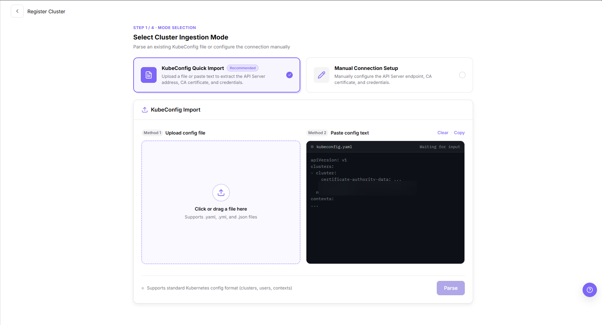

**Step 2 · Control Plane Connection & Credentials** — review the parsed **Server Address**, **Cluster Name**, **Authentication Certificate**, and **Username**, then choose an **Authentication Type** and provide the matching client certificate or key.

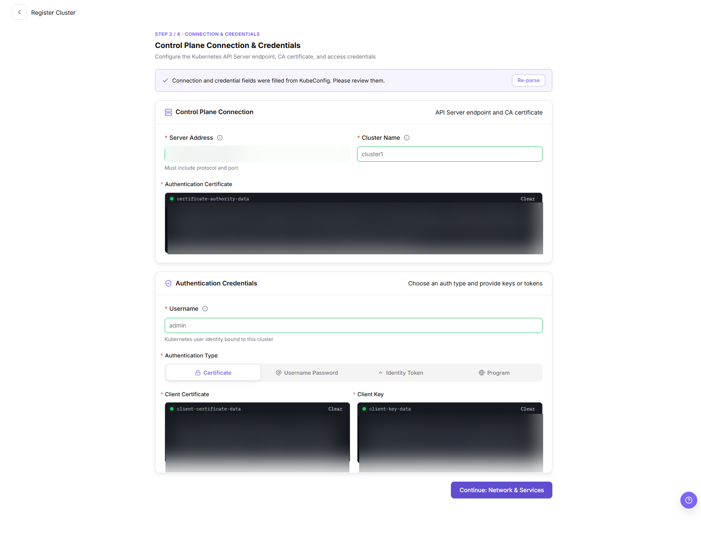

**Step 3 · Network Planning & Service Access** — configure the RDMA toggle, the User Service Allocatable Cluster Port Range, the external access endpoint, monitoring port, forward proxy address, and the cluster/service CIDRs.

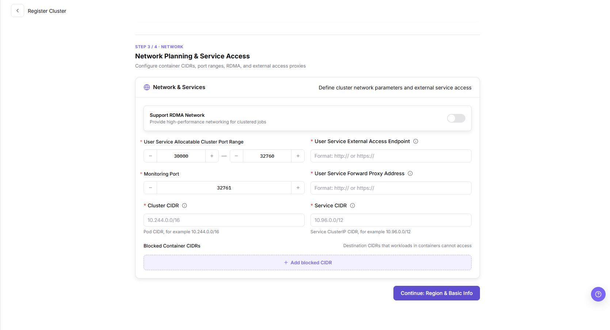

#### Result Validation

- The new cluster appears as a card in the **Cluster Index**, carrying the **Registration Name** confirmed in Step 4 and the region and availability zone selected there.
- Selecting that card loads the detail tabs: **Overview** shows the resource rings and the **Basic Information** values that were submitted, and **Nodes** lists the nodes reported by the cluster.

#### Notes

- Registration writes a real cluster into platform scheduling; before the final **Submit**, re-check the region and availability zone, the cluster and service CIDRs, and the user-service port range, because those values also drive user-service access and scheduling.
- kubeconfig content, certificates, and keys are credentials — keep them out of documents, screenshots, and tickets, and redact any value copied from the page.
- A zone created inside Step 4 is maintained on the Regions & Zones page afterwards; if the card, the detail tabs, or the node list do not appear as expected, check the cluster state and the Operator permission before concluding the registration failed.

### Edit Cluster

#### Applicable Scenarios

Edit a cluster when its user-service access or network parameters must change after registration — for example, adjusting the external access Endpoint, the user-service port range, the monitoring port, the cluster/service CIDRs, the forward proxy address, the RDMA toggle, or the cluster description.

#### Steps

1. Go to `On-Prem > Resource Pools > Clusters` and select the target cluster.
2. In the detail header, click **Edit** to open the **Edit Cluster** dialog.
3. Update the fields provided by the dialog: **Cluster Name**, **User Service External Access Endpoint**, **User Service Allocatable Cluster Port Range**, **Monitoring Port**, **Cluster CIDR**, **Service CIDR**, **User Service Forward Proxy Address**, the **RDMA Support** toggle, and **Description**.
4. Before clicking **Confirm**, verify that the changed Endpoint, port range, CIDRs, and proxy address remain consistent with network planning and do not conflict with running jobs.
5. After saving, refresh the cluster details to confirm the updated values.

The **Edit Cluster** dialog is shown below.

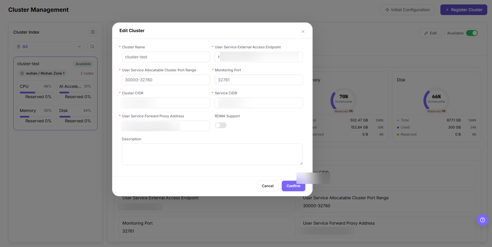

#### Result Validation

- The cluster details show the updated Endpoint, port range, monitoring port, CIDRs, proxy address, RDMA state, and description.
- Existing specification and storage associations remain intact.

#### Notes

- Changing the Endpoint, port range, CIDRs, or proxy address can affect user-service access and scheduling; confirm the impact scope before saving.
- The dialog exposes only the fields shown above; treat the live page as authoritative for any additional or renamed fields.

### Disable / Enable Cluster

#### Applicable Scenarios

Disable a cluster when new job scheduling must be temporarily stopped, or enable it again after maintenance.

#### Steps

1. Go to `On-Prem > Resource Pools > Clusters` and select the target cluster.
2. In the detail header, use the **Available** toggle switch to disable or enable the cluster.
3. Read the confirmation prompt and verify the impact on running jobs, nodes, associated specifications, and storage configuration.
4. After confirming the maintenance window and impact scope, confirm the state change.
5. Refresh the cluster list and the Nodes tab to verify the cluster state and scheduling scope.

#### Result Validation

- The cluster state changes to the disabled or available state shown by the page.
- New job creation or resource selection applies the cluster-state restriction.
- Existing specification and storage relationships remain visible and are not unintentionally deleted.

#### Notes

- Disabling a cluster may prevent new jobs from being scheduled, but does not mean that running jobs are automatically migrated or stopped. Confirm the actual impact first.
- Before enabling, verify node health, monitoring data, specification association, and storage mounts.

### Associate Specifications

#### Applicable Scenarios

Associate specifications when the target cluster needs to run jobs with specific CPU, memory, or accelerator configurations. After association, users may select these specifications when creating jobs in the corresponding region, availability zone, or cluster scope.

#### Steps

1. Go to `On-Prem > Resource Pools > Clusters` and select the target cluster in the Cluster Index.
2. In the detail pane, open the **Configuration** tab and then the **Associated Specifications** sub-tab. This sub-tab shows an **Associated Specifications** count, a **Filter by specification ID** search box, and a table with **Specification ID**, **Resource Config**, and **Status** columns.
3. Click **Associate Specification** in the upper-right corner to open the specification picker dialog.
4. In the dialog, locate the specifications to associate: pick an accelerator metric in the left **Specification Metrics** list (for example `NVIDIA_V100_32G`), or enter a specification ID / metric name in the search box. The right pane lists matching specifications grouped by metric, each with **Specification ID**, **Resource Configuration** (accelerator, vCPU, and card-count tags), and **Status**.
5. Select specifications by checking their rows, or use **Select by kubemore_xpu_type label** to select by label. The footer shows the current selected count.
6. Click **Confirm Association** to save, or **Cancel** to discard.
7. Return to the **Associated Specifications** sub-tab and verify the newly associated rows.

The **Associated Specifications** sub-tab is shown below.

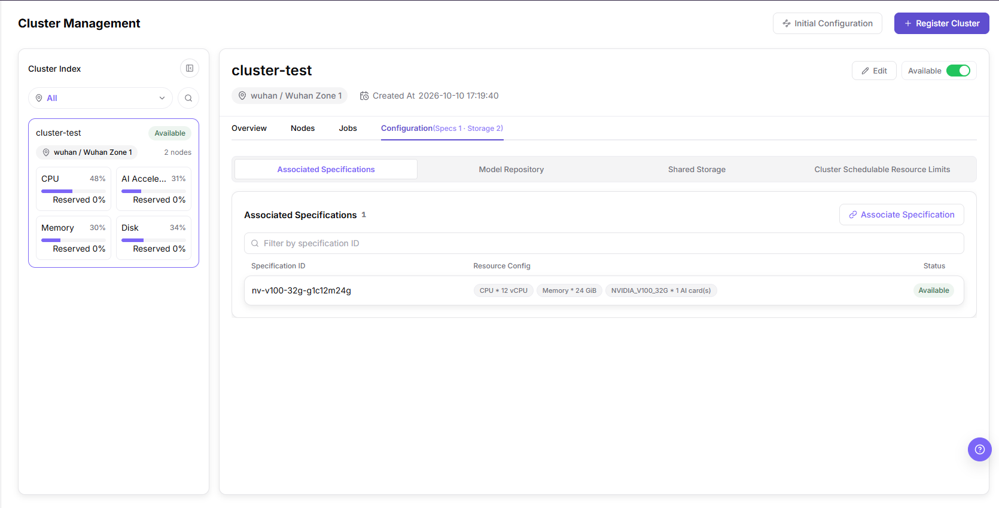

The **Associate Specification** picker dialog is shown below.

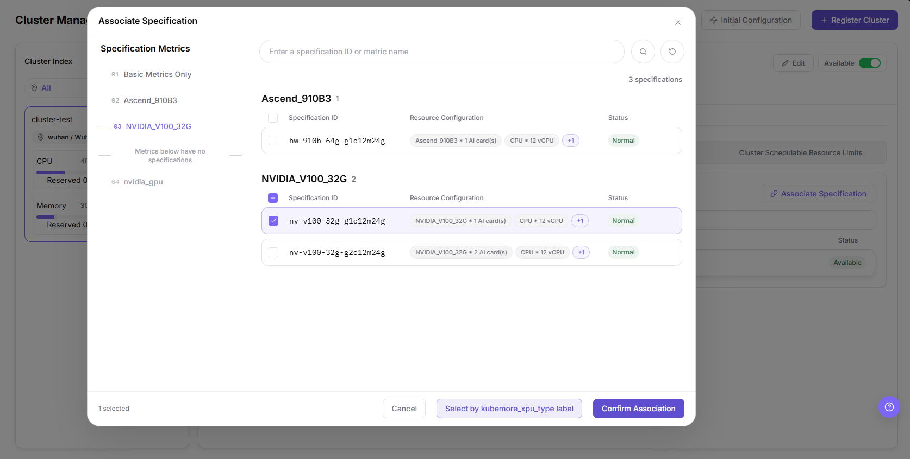

#### Result Validation

- The associated specifications appear in the **Associated Specifications** table with the expected resource configuration and status.
- The **Configuration** tab header reflects the updated specification count.

#### Notes

- Only associate specifications that match the cluster's actual accelerator and capacity; verify the resource configuration before confirming.
- The picker's metric list, columns, and the **Select by kubemore_xpu_type label** action reflect the current page; treat the live page as authoritative for any additional or renamed fields.

### Edit Model Repository

#### Applicable Scenarios

Configure the cluster's built-in model repository when models must be deployed to this cluster. The model repository is limited to one per cluster and provides the storage that model deployment reads from.

#### Steps

1. Go to `On-Prem > Resource Pools > Clusters` and select the target cluster in the Cluster Index.
2. In the detail pane, open the **Configuration** tab and then the **Model Repository** sub-tab. The **Model Repository** card shows **Storage Name**, **Storage Type**, **Access Mode**, **Sharing Scope**, **Service Address**, **Source Path**, and **Mount Path**, with **Edit** and **Delete** actions in the upper-right corner.
3. Click **Edit** to open the **Edit Model Repository** dialog.
4. Select a **Storage Type**: **NFS Network Storage** (network shared storage with multi-node concurrent read/write) or **HostPath Node Storage** (mounts a host physical path with high-performance local I/O).
5. Under **Configuration**, fill in **Storage Name**, the path field for the selected type (**Host Node Physical Path** for HostPath), **Access Mode** (**ReadWrite** or **ReadOnly**), **Container Mount Path**, and **Sharing Scope** (**All Tenants Shared** or **Tenant Isolated Directory**).
6. Before clicking **Save Changes**, verify the path, access mode, and sharing scope so that running model deployments keep valid read/write access. Click **Cancel** to discard.
7. Return to the **Model Repository** sub-tab and verify the saved values.

The **Model Repository** sub-tab is shown below.

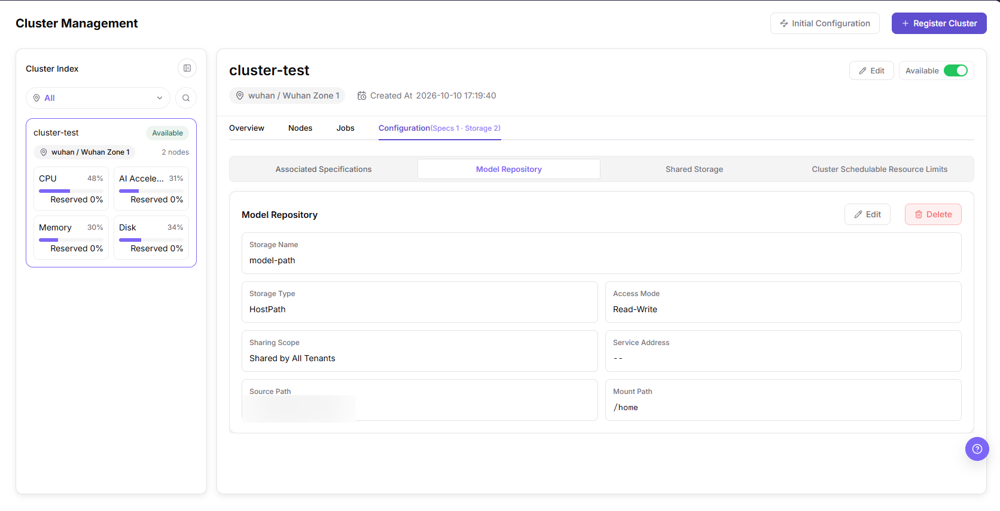

The **Edit Model Repository** dialog is shown below.

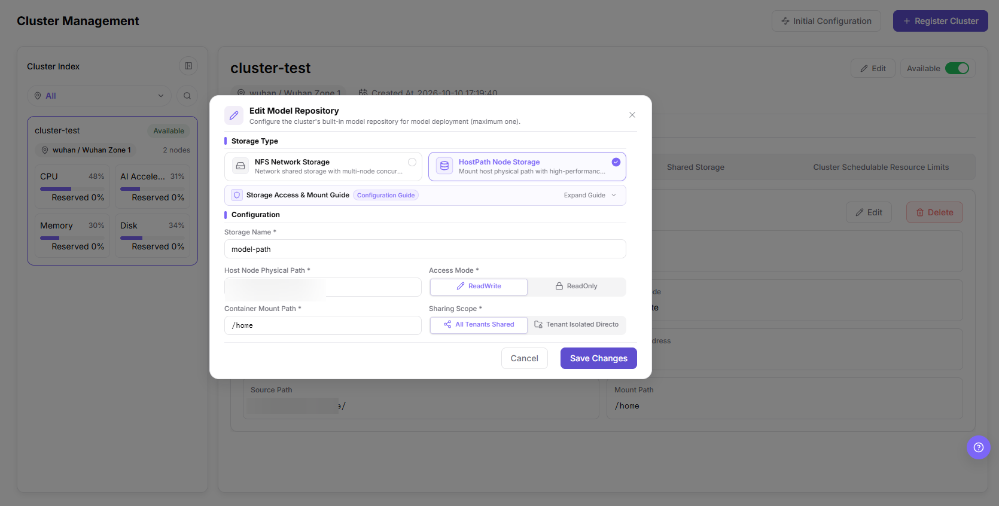

#### Result Validation

- The **Model Repository** card shows the updated storage name, type, access mode, sharing scope, source path, and mount path.
- The cluster keeps at most one model repository entry.

#### Notes

- The model repository is limited to one per cluster; editing replaces the existing configuration rather than adding a second entry.
- The **Model Repository** card also offers **Delete**. This chapter does not document that flow, and its impact follows the prompt the page displays — verify any deployment that reads the repository before using it.
- Changing the source path, mount path, access mode, or sharing scope can affect model loading and running deployments; confirm the impact scope before saving.
- The dialog fields reflect the current page; treat the live page as authoritative for any additional or renamed fields.

### Add Shared Storage

#### Applicable Scenarios

Add shared storage when jobs need a shared network directory (NFS) or a host path mounted for job scheduling. Storage configuration affects job startup, file read/write, model loading, and tenant access scope.

#### Steps

1. Go to `On-Prem > Resource Pools > Clusters` and select the target cluster in the Cluster Index.
2. In the detail pane, open the **Configuration** tab and then the **Shared Storage** sub-tab. This sub-tab shows a **Shared Storage** count and a table with **Storage Name**, **Storage Type**, **Access Mode**, **Sharing Scope**, **Service Address**, **Source Path**, **Mount Path**, and **Operation** columns, each row with edit and delete actions.
3. Click **Add Storage** in the upper-right corner to open the **Add Shared Storage** dialog.
4. Select a **Storage Type**: **NFS Network Storage** (network shared storage with multi-node concurrent read/write) or **HostPath Node Storage** (mounts a host physical path with high-performance local I/O).
5. Under **Configuration**, fill in the fields for the selected type — for NFS: **Storage Name**, **NFS Service Address**, and **NFS Export Source Path** — plus **Access Mode** (**ReadWrite** or **ReadOnly**), **Container Mount Path**, and **Sharing Scope** (**All Tenants Shared** or **Tenant Isolated Directory**).
6. Before clicking **Confirm**, verify the storage path, mount policy, and permission scope so running jobs keep valid data access. Click **Cancel** to discard.
7. Return to the **Shared Storage** sub-tab and verify the new row.

The **Shared Storage** sub-tab is shown below.

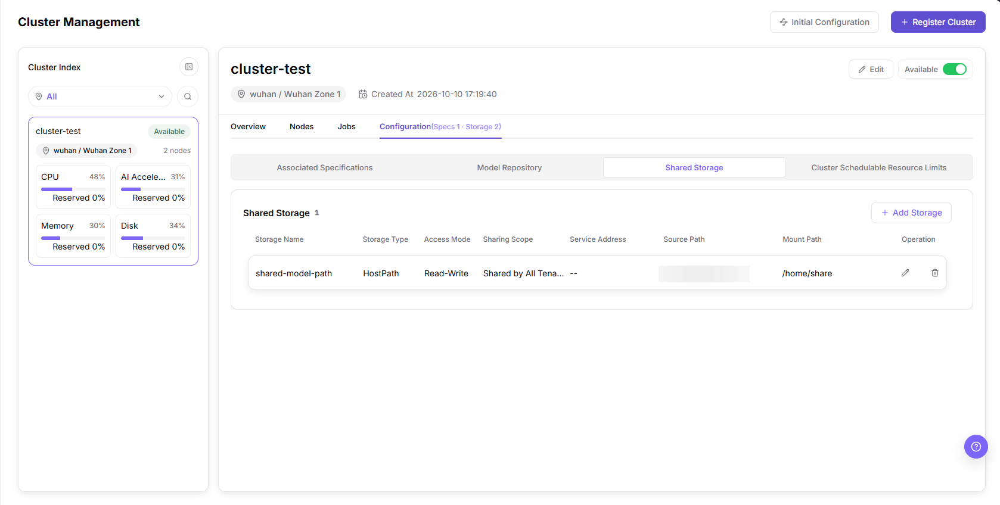

The **Add Shared Storage** dialog is shown below.

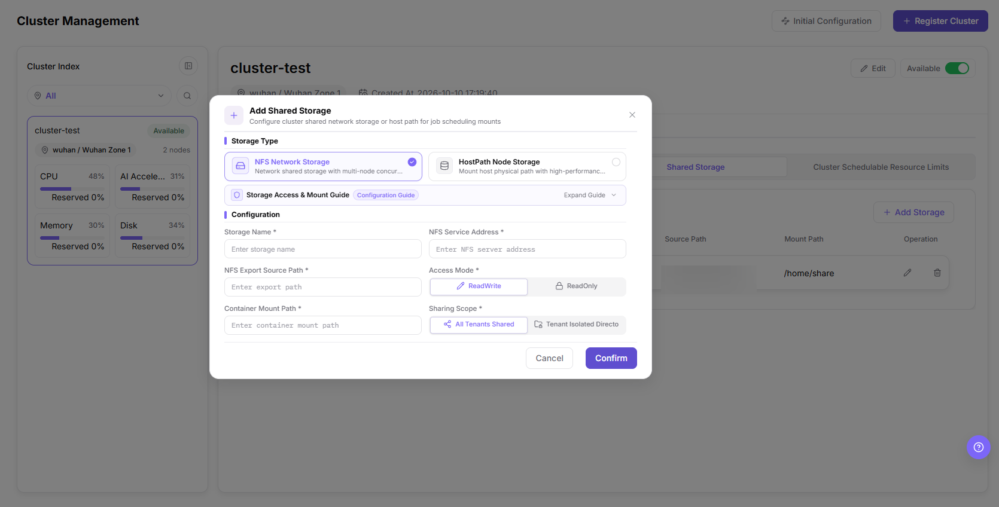

#### Result Validation

- The new storage appears as a row in the **Shared Storage** table with the expected type, access mode, sharing scope, source path, and mount path.
- The **Shared Storage** count and the **Configuration** tab header update accordingly.

#### Notes

- Changing the source path, container mount path, access mode, or sharing scope affects which jobs can read/write data and at what scope; confirm the impact before saving.
- The dialog fields vary by storage type; treat the live page as authoritative for any additional or renamed fields.

### Cluster Schedulable Resource Limits

#### Applicable Scenarios

Configure cluster schedulable resource limits when you need to control how much of a cluster's resources jobs may be scheduled against, or whether a single task may temporarily cross a scheduling threshold. These settings affect job admission and placement, so review them before changing values on a running cluster.

#### Steps

1. Go to `On-Prem > Resource Pools > Clusters` and select the target cluster in the Cluster Index.
2. In the detail pane, open the **Configuration** tab and then the **Cluster Schedulable Resource Limits** sub-tab.
3. Set **One-time Threshold Overuse**: toggle **Allow one-time overuse** and, when enabled, enter a **Maximum overuse ratio**. This controls whether one task may cross a scheduling threshold while current usage is still within it; the ratio is calculated against the target node's total capacity for the corresponding resource, and later tasks remain blocked after the threshold is crossed.
4. Under **Select one dimension to configure schedulable resource ratios**, choose one of five dimension tabs: **System Default**, **Cluster Overall**, **Cluster Resources**, **Node Overall**, or **Node Resources**. Note that **0% is a valid limit**, and **leaving a field blank makes it inherit the corresponding parent rule** (the **Cluster Overall** card states "Leave blank to use the system global setting"). Clicking **Save Configuration** submits the currently selected dimension together with this cluster's one-time overuse policy.
5. **System Default**: the **Resource scheduling threshold** (applies to CPU, memory, and AI accelerators) and the **Ephemeral storage scheduling threshold** (applies only to ephemeral storage) are shown as **System-wide settings** managed globally; they cannot be changed for this cluster here. To update them, go to `System Settings > Job Scheduling and Resource Governance`.
6. **Cluster Overall**: set a single **Cluster Schedulable Resource Ratio** for the whole cluster.
7. **Cluster Resources**: set per-resource schedulable ratios — **CPU**, **Memory**, **AI Accelerator**, and **Ephemeral Storage**.
8. **Node Overall**: set an overall schedulable ratio for each node (one row per node).
9. **Node Resources**: set per-node, per-resource schedulable ratios (**CPU**, **Memory**, **AI Accelerator**, **Ephemeral Storage** for each node).
10. Click **Save Configuration** to apply, or **Cancel Editing** to discard.

The **System Default** dimension is shown below.

The **Cluster Overall** dimension sets a single cluster-wide schedulable ratio.

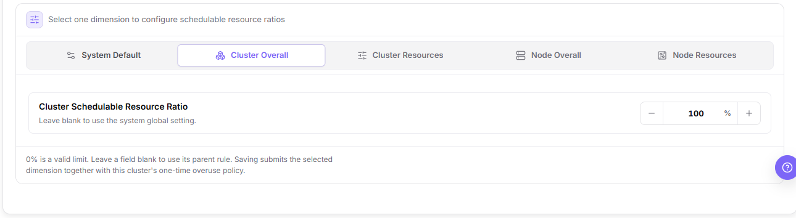

The **Cluster Resources** dimension sets per-resource ratios across the cluster.

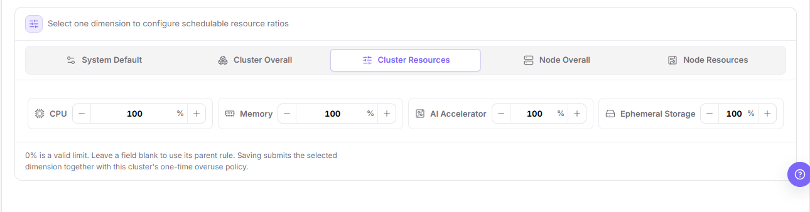

The **Node Overall** dimension sets an overall schedulable ratio for each node; node addresses and identifiers are redacted.

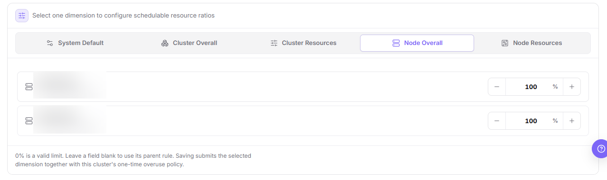

The **Node Resources** dimension sets per-node, per-resource ratios; node addresses and identifiers are redacted.

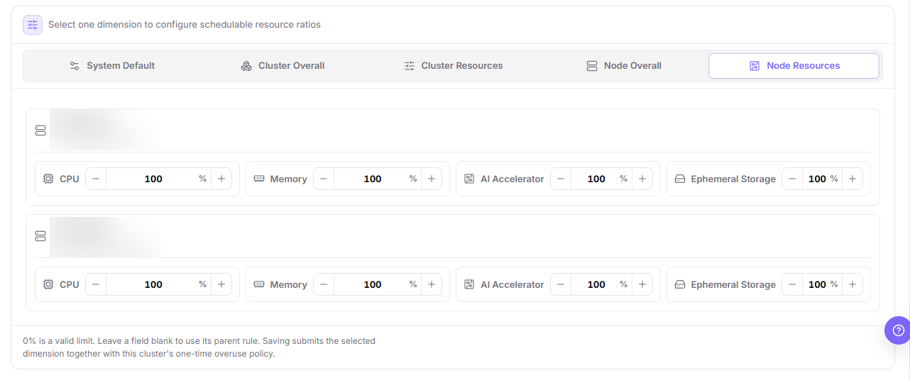

#### Result Validation

- The selected dimension and its threshold values are reflected on the sub-tab after saving.
- In the **System Default** dimension, the resource and ephemeral storage scheduling thresholds remain the system-wide values and are not editable at cluster level.
- Fields left blank fall back to their parent rule; a saved non-empty value overrides it for the current cluster.

#### Notes

- The **System Default** thresholds are governed globally; changing them requires the `System Settings > Job Scheduling and Resource Governance` page and affects other clusters, not only the current one.
- Raising the maximum overuse ratio or lowering scheduling thresholds changes how aggressively jobs are admitted and placed; confirm the impact on running and pending jobs before saving.
- The **Cluster Overall**, **Cluster Resources**, **Node Overall**, and **Node Resources** dimensions override schedulable ratios at progressively finer granularity; treat the live page as authoritative for the fields each dimension exposes.
- The **Node Overall** and **Node Resources** dimensions list nodes by internal address and identifier. These are sensitive — redact them before sharing any screenshot (only blurred copies are kept in this document).

## Parameter Quick Reference

| Field Name | Required | Field Type | Example | Description |
| --- | --- | --- | --- | --- |
| Ingestion Mode | Yes | Choice (Step 1) | `KubeConfig Quick Import` / `Manual Connection Setup` | How connection info is provided. Quick Import parses a pasted/uploaded kubeconfig; Manual sets the fields by hand. |
| Server Address | Yes | URL (Step 2) | `https://<api-host>:<port>` | Kubernetes API access entry. Must be reachable from the platform side. Do not record real addresses. |
| Cluster Name | Yes | Text (Step 2) | `cluster-a` | Kubernetes cluster / page identification name (1–63 characters). |
| Authentication Certificate | Yes | Sensitive text (Step 2) | `certificate-authority-data` | CA certificate that verifies the server. Sensitive; never record it in documents, shared documents, or screenshots. |
| Username | Yes | Text (Step 2) | `cluster-user` | Authentication user name (1–63 characters). |
| Authentication Type | Yes | Segmented control (Step 2) | `Certificate` | One of `Certificate` / `Username Password` / `Identity Token` / `Program`. |
| Client Certificate / Client Key | Conditionally required | Sensitive text (Step 2) | `client-certificate-data` / `client-key-data` | Client credentials for certificate-based authentication. Sensitive. |
| Support RDMA Network | Optional | Toggle (Step 3) | `Off` | Enable RDMA only when hardware, drivers, network, and scheduling support it. |
| User Service Allocatable Cluster Port Range | Yes | Port range (Step 3) | `30000-32760` | NodePort-style port range for user-service access. |
| User Service External Access Endpoint | Yes | URL (Step 3) | `http(s)://<host>:<port>` | External access endpoint for user services. Do not record real addresses. |
| Monitoring Port | Yes | Port (Step 3) | `32761` | Monitoring collection port. |
| User Service Forward Proxy Address | Yes | URL (Step 3) | `http(s)://<host>:<port>` | Forward proxy address for user services. |
| Cluster CIDR | Yes | IPv4 CIDR (Step 3) | `<POD_CIDR>` | Pod network segment. Must not conflict with the platform, nodes, or other clusters. |
| Service CIDR | Yes | IPv4 CIDR (Step 3) | `<SERVICE_CIDR>` | Service ClusterIP network segment. |
| Blocked Container CIDRs | Optional | IPv4 CIDR list (Step 3) | — | Destination CIDRs that container workloads cannot access. |
| Region | Yes | Dropdown (Step 4) | `wuhan` | Region the cluster belongs to; select an existing, available region. |
| Availability Zone | Yes | Dropdown (Step 4) | `Wuhan Zone 1` | Availability zone; a new zone can be created from this step and is maintained later on the Regions & Zones page. |
| Registration Name | Yes | Auto-generated text (Step 4) | `cluster-<random>` | Platform identifier, auto-generated (2–48 characters; lowercase letters, digits, hyphens). |
| Specification ID | Yes | Text (Configuration) | `nv-v100-32g-…` | A specification associated with the cluster; verify its resource configuration and status. |
| Storage Name | Yes | Text (Configuration) | `shared-data` | Cluster storage configuration name. |
| Storage Type | Yes | Enum (Configuration) | `NFS Network Storage` / `HostPath Node Storage` | Storage type as offered by the dialog; the two values above appear verbatim in the Edit Model Repository and Add Shared Storage dialogs. |
| Access Mode | Yes | Enum (Configuration) | `ReadWrite` / `ReadOnly` | Storage read/write access mode. |
| Sharing Scope | Conditionally required | Enum (Configuration) | `All Tenants Shared` / `Tenant Isolated Directory` | Tenant visibility / isolation scope of the storage. |
| Service Address / Source Path / Mount Path | Yes | Address / path (Configuration) | — | Storage service address, host source path, and container mount path. Do not record real internal paths. |
| Editable Fields (Edit Cluster) | Varies | Text / URL / Port / CIDR / Toggle / Multi-line text (Edit Cluster dialog) | — | The **Edit Cluster** dialog provides exactly: **Cluster Name**, **User Service External Access Endpoint**, **User Service Allocatable Cluster Port Range**, **Monitoring Port**, **Cluster CIDR**, **Service CIDR**, **User Service Forward Proxy Address**, **RDMA Support**, **Description**. Connection credentials and authentication type are not editable here. |
| Description | Optional | Multi-line text (Edit Cluster dialog) | — | Free-text cluster description; available in the **Edit Cluster** dialog, not in the registration wizard. |
| One-time Threshold Overuse | Optional | Toggle + percentage (Cluster Limits) | **Allow one-time overuse** + **Maximum overuse ratio** | Whether a single task may temporarily cross a scheduling threshold; the ratio is computed against the target node's total capacity for that resource, and later tasks stay blocked once crossed. |
| Cluster Schedulable Resource Ratio | Optional | Percentage, per dimension (Cluster Limits) | `100%` | Five dimension tabs: **System Default** / **Cluster Overall** / **Cluster Resources** / **Node Overall** / **Node Resources**. **0% is a valid limit**; a blank field inherits the parent rule. **System Default** thresholds are system-wide and read-only at cluster level. |
| Model Repository | Conditional | Storage card (Model Repository sub-tab) | — | One built-in model repository per cluster; **Edit Model Repository** replaces its values, and the dialog's final action is **Save Changes** (**Cancel** discards). |
| Final Actions | System-generated | Button | `Submit` / `Confirm` / `Confirm Association` / `Save Changes` / `Save Configuration` / `Cancel Editing` / **Available** toggle | Registration ends in **Submit**; Edit Cluster and Add Shared Storage in **Confirm**; specification association in **Confirm Association**; the model repository in **Save Changes**; cluster limits in **Save Configuration** (**Cancel Editing** discards); disable/enable uses the **Available** toggle. Each is a real write action. |

> The registration wizard does not surface a JupyterLab address or a separate Context Name field; treat the live page as authoritative. A free-text **Description** does exist in the **Edit Cluster** dialog (see the row above).

## Pitfalls

- Cluster registration connects a real Kubernetes cluster to platform scheduling, monitoring, and resource management. Treat it as a high-impact operation.
- kubeconfig, certificates, private keys, tokens, and passwords are sensitive materials. Do not write them into documents, screenshots, tickets, commit records, or chat messages.
- If the Server Address is unreachable, the platform cannot complete onboarding even when form fields are correctly formatted.
- Incorrect region or availability zone may cause resource ownership, specification association, storage configuration, and job scheduling exceptions.
- Incorrect authentication type, CIDR, or NodePort may cause onboarding failure, network conflicts, or service access exceptions.
- Associating specifications affects which resource specifications users can select when creating jobs. Incorrect association may cause scheduling failure, resource request mismatch, or capacity misjudgment.
- Adding storage affects job mount paths, read/write permissions, data access scope, and runtime stability. Incorrect shared paths, mount paths, or permission scope may cause job startup failure, inaccessible data, or unauthorized access.

#### Configuration Rules and Impact

- **Configuration order**: Create the region and availability zone first, and then register the cluster under the corresponding availability zone.
- **Onboarding dependencies**: Server Address reachability, valid authentication materials, and correct CIDR and port planning are prerequisites for cluster onboarding.
- **Auto parsing**: Pasting kubeconfig can improve form completion efficiency, but the parsing result still requires manual verification.
- **Network impact**: Cluster CIDR, Service CIDR, and NodePort affect Pod, Service, and platform access paths.
- **Scheduling impact**: After creation, the cluster enters the platform scheduling scope, and later specifications, storage, and authorization configuration may reference it.
- **Specification impact**: Associating specifications changes which resource specifications users can select when creating jobs. Incorrect configuration may cause scheduling failure or resource request mismatch.
- **Storage impact**: Adding storage changes job mount paths, read/write permissions, and tenant access scope. Incorrect configuration may cause inaccessible data or unauthorized access.
- **Monitoring impact**: Monitoring data is used for capacity analysis and troubleshooting. If data is missing, check collection components, ports, and time ranges together.
- **Operations impact**: Disabling or enabling a cluster may affect job scheduling and business availability. Confirm the maintenance window and rollback plan in advance.

## Result Validation

| Check Item | Success Signal | If Abnormal |
| --- | --- | --- |
| Page entry | Clusters opens with the target operation entry | Check Operator permission and whether the menu is available |
| Object record | Kubernetes clusters, regions, availability zones, nodes, specifications, storage, jobs, and resource monitoring are visible in the list or details | Reset filters and verify name, ownership, and creation result |
| State result | State after creation or change matches the page message | Check operation feedback, dependency state, and latest update time |
| Downstream use | A downstream page can select or associate the target | Return to prerequisites and check enabled state, ownership, and visibility |

## FAQ

#### The Cluster Detail Pane Does Not Load

**Symptom:**

The target cluster is visible in the Cluster Index, but selecting it does not show its details in the right pane.

**Possible Causes:**

- The current account has list-view permission only.
- The cluster is being processed abnormally and details are temporarily unavailable.
- The Cluster Index panel is collapsed.

**Solution:**

1. Check Operator permission and cluster state.
2. Expand the Cluster Index and select the target cluster card.
3. If the details still do not load, follow the page prompt and contact the permission or cluster maintainer.

#### The Cluster Nodes Page Has No Data

**Symptom:**

After opening the **Nodes** tab, the node list is empty or resource metrics are not updated.

**Possible Causes:**

- Cluster onboarding is incomplete or nodes have not reported.
- Monitoring collection, network, or time-range settings are abnormal.
- The selected cluster scope does not match the target cluster.

**Solution:**

1. Return to cluster details and verify onboarding state and node count.
2. Check monitoring collection state, update time, and network configuration.
3. Select the target cluster again and refresh the node page.

#### The Disabled Cluster Still Appears as Selectable

**Symptom:**

The cluster state is disabled, but a downstream resource selection page still shows it.

**Possible Causes:**

- The downstream page uses stale data or filters.
- The page is showing existing resource relationships rather than the new-job scheduling scope.
- State processing is still in progress.

**Solution:**

1. Refresh the downstream page and reset filters.
2. Distinguish existing resource associations from the selectable scope for new jobs.
3. Check the cluster update time and page prompt to confirm processing has finished.

#### Jobs Cannot Access Data After Storage Editing

**Symptom:**

Storage saves successfully, but new or running jobs cannot read the old path or write to the mounted directory.

**Possible Causes:**

- The shared path or container mount path is incorrect.
- Access mode, tenant scope, or underlying permission changed.
- Nodes cannot reach the storage service.

**Solution:**

1. Verify the path, access mode, and tenant scope in cluster details.
2. Check node network reachability and underlying storage permission.
3. Under the approved change process, restore the last verified configuration and repeat the mount validation.

#### The Storage Is Still Visible After Removal

**Symptom:**

The old storage configuration is still visible in the list or job page after removal.

**Possible Causes:**

- The page cache or detail data has not refreshed.
- Another cluster still has a same-named storage association.
- The removal request is still processing.

**Solution:**

1. Refresh cluster details and verify the target cluster and storage ID.
2. Check associations on other clusters so a same-named record is not mistaken for the target.
3. Check the page prompt and update time for the processing state.

## Notes

- Cluster registration connects a real Kubernetes cluster to platform scheduling, monitoring, and resource management.
- kubeconfig, certificates, private keys, tokens, and passwords are sensitive materials and must not be written into documents, screenshots, tickets, or commit records.
- Incorrect region/availability zone, Server Address, authentication type, CIDR, or NodePort may cause onboarding failure, network conflicts, or scheduling exceptions.
- Associating specifications and adding storage affect real job specifications, mount paths, read/write permissions, and data access scope.
- **Submit**, **Confirm**, **Confirm Association**, **Save Changes**, and **Save Configuration** are the high-risk final actions on this page; disabling or enabling uses the **Available** toggle. Confirm the scope and impact before executing the final action.
- Do not write real kubeconfig, certificates, private keys, tokens, passwords, shared paths, internal addresses, server addresses, accounts, keys, AK/SK, cluster IDs, resource pool IDs, or internal test parameters.

## Next Steps

1. Return to the `Clusters` list and verify cluster status, region/availability zone, and resource usage.
2. Open cluster details and verify resource usage, basic information, associated specifications, and storage configuration.
3. Associate specifications with the cluster as needed so users can select target specifications when creating jobs.
4. Configure shared storage as needed, and use a test job to verify mounting, read/write, and path isolation.
5. View node resource monitoring and confirm that monitoring data, time range, and monitoring type can be switched normally.
6. After saving the model repository, start a model deployment and verify it can read the repository path.
7. After adjusting cluster schedulable resource limits, submit a small job to confirm admission behaves as expected.
