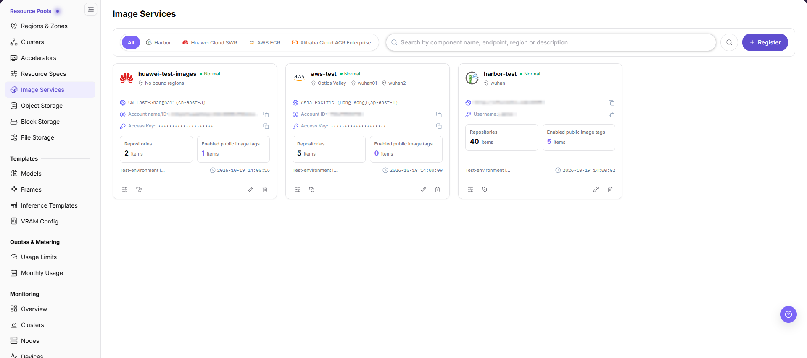
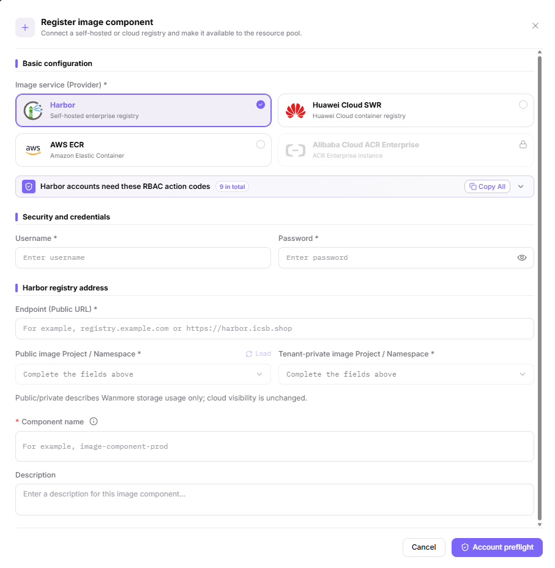
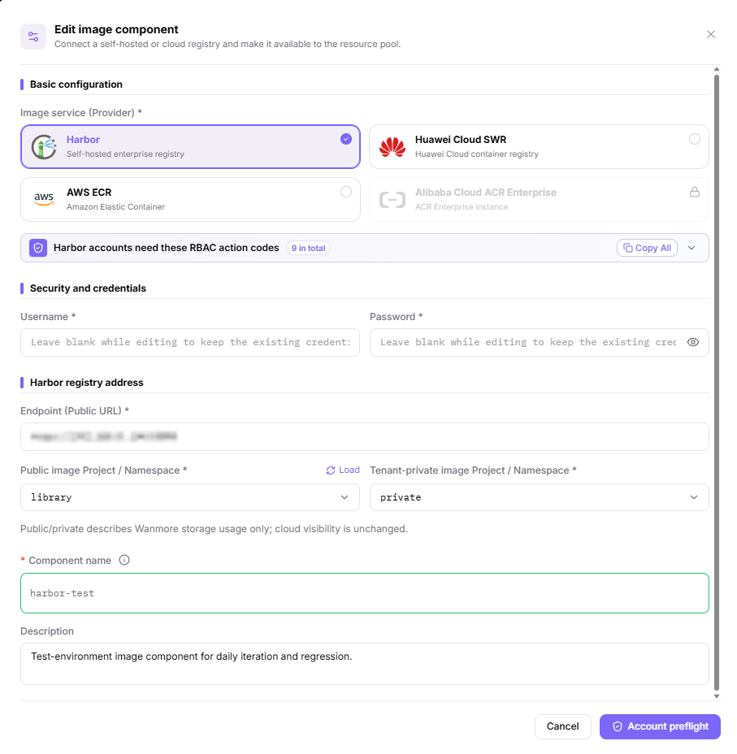
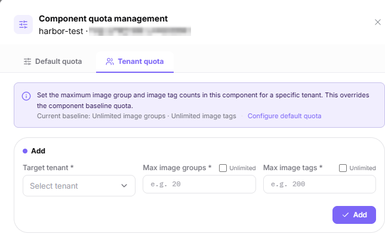
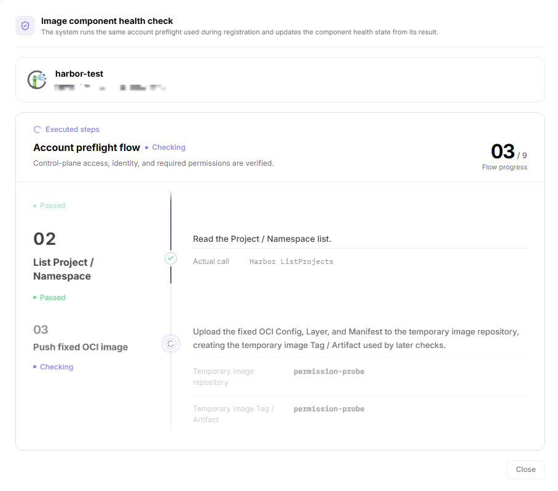
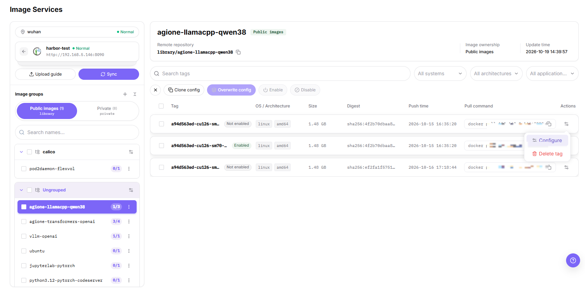
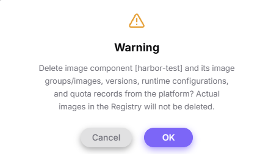

# Image Services

## Feature Overview

| Item | Content |
| --- | --- |
| Applicable Role | Operator |
| Navigation Path | On-Prem > Resource Pools > Image Services |
| Page Route | `/powerone/resourcepool/images` |
| Managed Object | Provider type, credentials, repository endpoint or region, public and tenant-private namespaces, component name and description, health state, quota, and the image groups and tags inside each component |

#### Beginner Explanation

Image Services is like the image repository access card of the platform. It tells the platform where to pull runtime images, which credentials to use, and which regions or clusters can use the repository. When the image component is configured incorrectly, user-side model instances, online IDEs, runtime instances, and jobs usually get stuck during image pull.

#### Terms

| Term | Description |
| --- | --- |
| Harbor | A common enterprise container image repository. |
| Registry | Image repository service used to store and distribute container images. |
| Endpoint | Service address used by the platform or clusters to access the image repository. |

#### Recommended Operation Order

Confirm prerequisites for the provider type, the credentials, the Harbor endpoint or cloud region, the public and tenant-private namespace, the component name, and the description, follow Main Operations, run Result Validation, and continue to the next page.

#### First-Time User Notes

Confirm that the task involves the provider type, the credentials, the repository endpoint or region, the namespaces, the component name and description, the health state, the quota, or a component's image groups and tags, and then follow the recommended order. If fields or state differ from expectations, check prerequisites before continuing downstream.

## Prerequisites

1. The image repository has been deployed and can be accessed from the platform side and target clusters.
2. Repository address, Endpoint, authentication method, access credentials, and certificate policy have been prepared.
3. The target cluster can resolve and access the image repository address.
4. Associated regions, bound clusters, public images, custom images, and tenant project permission boundaries have been confirmed.

## Page Description

Use this page to manage connected image components: their provider type, credentials, repository endpoint or region, public and tenant-private namespace, component name and description, health state, and quota.

Components are shown as cards. Each card shows its health state, `Repositories N items`, `Enabled public image tags N items`, and the bound regions, with a bare timestamp in the lower-right corner; the region line reads `No bound regions` while nothing is bound, and either counter shows `0 items` when empty. A Harbor card shows the registry address with `Copy registry address`, while a cloud card shows the account or Access Key line with a `Copy` action. Filter with the `All` / `Harbor` / `Huawei Cloud SWR` / `AWS ECR` / `Alibaba Cloud ACR Enterprise` tabs, type a component name, endpoint, region, or description into the search box whose placeholder is `Search by component name, endpoint, region or description...`, then click the search icon. The page header offers `Register`, and each card footer carries four icon-only entries whose labels appear on hover.

## Main Operations

### Register Image Component

#### Applicable Scenarios

Register an image component when a self-hosted Harbor registry or a cloud container registry needs to be connected so that the resource pool can pull and store images through it.

#### Steps

1. Go to `On-Prem > Resource Pools > Image Services` and click **"Register"** to open the `Register image component` dialog.
2. Under `Image service (Provider) *`, choose the provider card: `Harbor`, `Huawei Cloud SWR`, `AWS ECR`, or `Alibaba Cloud ACR Enterprise`. Providers that are not available are shown as disabled cards. Each provider lists the permission codes its account needs, with `Copy All` and `Expand permissions`.
3. In `Security and credentials`, fill in the credential pair of the chosen provider: `Username *` and `Password *` for Harbor, or `Access Key *` and `Secret Key *` for Huawei Cloud SWR and AWS ECR. `Show password or Secret Key` reveals the value.
4. Fill in the address or the region: a Harbor component takes `Endpoint (Public URL) *`, while SWR and ECR components take `Cloud region *`, whose options are returned by `Load regions` after the credentials are complete.
5. Set the storage usage and the name: `Public image Project / Namespace *`, `Tenant-private image Project / Namespace *`, `Component name *`, and `Description`. The dialog states that public and private only describe the storage usage on the platform side and do not change cloud visibility.
6. Click the final **"Account preflight"** to submit. Before that, verify the provider, the endpoint or region, the credential source, and both namespace values again.

The following figure shows the `Register image component` dialog. The credential fields and the address or region field change with the provider you choose.

#### Result Validation

- After a successful submit, the component appears as a card on the `Image Services` page, showing its health state, `Repositories N items`, `Enabled public image tags N items`, and the bound regions.
- What the card shows depends on the provider you chose: a Harbor card shows the registry address with `Copy registry address`, while a cloud card shows the account or Access Key line with a `Copy` action.
- The preflight result is what drives the health state. Refer to what the page actually shows for the exact wording of the preflight outcome.

#### Notes

- The register dialog footer offers `Cancel` and `Account preflight`, and `Account preflight` is the action that submits the registration — this dialog has no separate save step.
- The account you enter must already hold the action codes the provider card lists; use `Copy All` or `Expand permissions` in the dialog to check them before you submit.
- `Public image Project / Namespace` and `Tenant-private image Project / Namespace` are separate assignments, and on the edit dialog the two selectors exclude each other's choice.
- Choosing `Alibaba Cloud ACR Enterprise` is shown as a disabled provider card, so a component cannot be registered with it at present.

### Edit Image Component

#### Applicable Scenarios

Edit an image component when its name, description, credentials, or namespace assignment must change.

#### Steps

1. Click **"Edit"** on the target component card to open the `Edit image component` dialog.
2. `Basic configuration` keeps the current provider selected in `Image service (Provider) *`, and an unsupported provider stays a disabled card with a lock icon. The banner below the cards states which RBAC action codes the account needs, with `9 in total`, `Copy All`, and a collapse control.
3. In `Security and credentials`, `Username *` and `Password *` both carry the placeholder `Leave blank while editing to keep the existing credential`: leave them empty to keep the stored credential, or fill both in to replace it.
4. In `Harbor registry address`, review `Endpoint (Public URL) *`, then adjust `Public image Project / Namespace *` or `Tenant-private image Project / Namespace *`; `Load` re-reads the namespace list from the registry. The two selectors exclude each other's choice, so a namespace can only be moved, never left unassigned. The note under them states that public and private describe the storage usage on the platform side only and do not change cloud visibility.
5. Update `Component name` — the label renders its required mark before the name, as `* Component name` — and `Description`.
6. Click the final **"Account preflight"** to submit.

The following figure shows the `Edit image component` dialog in its Harbor form; the credential fields and the address or region field change with the provider you choose.

#### Result Validation

- The card shows the new component name and description, and the health state reflects the preflight result.

#### Notes

- Editing does not change image data in the cloud repository; it only changes the platform-side assignment.
- Confirm the credential source before replacing it, because a failed preflight leaves the component unusable.

### Manage Image Component Quota

Quota has a single entry: **"Quota management"** on the component card opens the `Component quota management` dialog, which separates the two scopes into the `Default quota` and `Tenant quota` tabs.

#### Applicable Scenarios

Use `Default quota` to set the baseline for every tenant that has no dedicated quota, and `Tenant quota` to loosen or tighten the limit for one specific tenant.

#### Steps

1. Go to `On-Prem > Resource Pools > Image Services` and click **"Quota management"** on the target component card.
2. On the `Default quota` tab, check or adjust `Default maximum image groups per tenant *` and `Default maximum image tags per tenant *`. Ticking `No quantity limit` disables the matching input and leaves that dimension unlimited; a number still visible in a disabled input is a placeholder, not the effective value.
3. Switch to the `Tenant quota` tab. Its header shows the `Current baseline: ...` line — when the default quota is unlimited it reads `Current baseline: Unlimited image groups · Unlimited image tags` — and a `Configure default quota` link that jumps back to the `Default quota` tab.
4. In the `Add` block, choose `Target tenant *`, then fill in `Max image groups *` and `Max image tags *`; ticking `Unlimited` beside either field disables that input and leaves the dimension unlimited. Click **"Add"** to submit the new row.
5. To change an existing row, click `Edit` in its `Actions` cell: the block becomes `Edit tenant quota`, the header offers `Cancel Edit / Switch to Add`, and the footer button becomes `Save`. To drop a tenant back to the baseline, click `Remove`.
6. The `Default quota` tab and the tenant edit block submit with **"Save"**; the tenant add block submits with **"Add"**. Besides these buttons, the dialog offers only the close control in the header.

The figure shows the `Tenant quota` tab in its add state, with the baseline line and the two `Unlimited` checks visible.

#### Result Validation

- The `Default quota` tab shows the new baseline, and the `Tenant quota` tab lists the tenant under `Tenant name` with its `Image group limit`, `Image tag limit`, and `Updated at`; the `Actions` cell offers `Edit` and `Remove`.
- A tenant without a dedicated row follows the baseline. Once every dedicated row is gone, the tab shows the empty state `No special quotas configured. All tenants currently follow the default baseline quota.`, which is the visible signal that all tenants are back on the baseline.

#### Notes

- A default quota affects every tenant without a dedicated setting. Confirm capacity and business scope first.
- Lowering a quota may affect image use that is already in progress. Confirm the business window first.
- Do not write real registry addresses, accounts, passwords, or access keys in quota descriptions or screenshots.

### Health Check

**"Health check"** is not a read-only check. It runs the same preflight as registration and creates and deletes temporary objects while doing so.

#### Applicable Scenarios

Run a health check after credentials rotate, after a permission change on the provider side, or when a component reports an unexpected pull failure.

#### Steps

1. Click **"Health check"** on the target component card to open the health check dialog. The run starts immediately.
2. The dialog executes the preflight steps in sequence and marks each one as it completes. While the run is in progress, the dialog provides an entry to stop it.
3. Wait for the run to finish; the final steps clean up the temporary objects the earlier steps created.
4. The dialog is titled `Image component health check` and states that the system runs the same account preflight used during registration and updates the component health state from its result; the flow counts nine steps (`03 / 9 Flow progress`), and the captured step names are `Create temporary Project / Namespace` (actual call `Harbor CreateProject`), `List Project / Namespace` (actual call `Harbor ListProjects`), and `Push fixed OCI image`, which uploads a fixed OCI Config, Layer, and Manifest to a temporary repository such as `permission-probe`.
5. While the run is in progress the footer button reads **"Close"**; on the Chinese interface the same button carries its own label.

The figure shows the health check dialog mid-run with the step timeline.

#### Result Validation

- Every step reports a pass, and the health state of the card is refreshed from the preflight result.
- During the run the dialog header shows the progress counter (for example `03 / 9 Flow progress`), which is the visible signal of how far the preflight has reached.

#### Notes

- The run creates and deletes repositories, namespaces, and tags in the target registry. Do not trigger it repeatedly against a production registry.
- Stopping the run does not roll back objects that were already created. Check the registry side if you need to confirm leftovers.

### Manage Image Groups and Tags

Opening a component card from the list enters the drill-down view: the left panel holds the image group tree with the `Public images (N)` / `Private (N)` segments, and the right side shows the tag table, configuration entry, and batch actions for the selected image.

#### Applicable Scenarios

Inspect the live state of image groups and tags inside a component, maintain the image configuration of a tag, push images with the upload guide, or clean up tags that are no longer used.

#### Steps

1. Open the target component card from the list to enter the drill-down view; the back arrow at the top left returns to the component list.
2. In the left `Image groups` panel, switch between `Public images (N)` and `Private (N)` and filter with `Search names...`; click `+` to open the `Create Image group` dialog, fill in `* Image groups`, and submit with **"Confirm"** after the three validation rules (length must be between 1 and 128 characters; cannot start or end with '.', '_' or '-', and separators cannot be consecutive; only lowercase letters, digits, '.', '_' and '-' are allowed, no spaces).
3. Selecting an image shows its tag table on the right (`Tag` / `OS / Architecture` / `Size` / `Digest` / `Push time` / `Pull command` / `Actions`), each row marked `Not enabled` or `Enabled`; ticking rows reveals a batch bar offering **"Clone config"**, **"Overwrite config"**, **"Enable"**, and **"Disable"**.
4. The row action icon offers `Configure` and `Delete tag`. `Configure` opens the `Image Configuration` panel: `Configuration Version` with its enable switch, the `Application scenes not configured` notice, `Basic Information`, `Supported Specifications`, `Service Open`, `Environment Variables`, `Start Command`, `Extra Parameters` (`Need RDMA Network`), and `Task Log Files`; from the read-only state click **"Edit"** to enter the edit state (`+ Associate Specification` / `+ Add Port` / `+ Add Variable` / `+ Add Log File`) and submit with **"Save"**.
5. **"Sync"** pulls the latest image groups and tags from the registry; **"Upload guide"** opens the three-step guide — `1. Log in to the registry` (with **"Generate temporary login command"**), `2. Tag the local image`, and `3. Push the image to the component registry` — closed with **"Close"**.
6. Deleting a tag raises a confirmation that names the image and the tag and states that its image configuration is deleted as well; click **"OK"** to execute.

The figure shows the drill-down view with the tag table and an open row action menu.

#### Result Validation

- A newly pushed row appears in the tag table and both its `Push time` and the image header `Update time` refresh; the state `Enabled` means the image configuration of that tag is enabled.
- After deletion the row and its image configuration disappear together; after **"Sync"**, image groups newly present in the registry appear in the left tree.

#### Notes

- Deleting a tag **also deletes its image configuration** (stated verbatim in the confirmation); user-side create pages that relied on that version no longer offer it.
- The docker commands in the upload guide contain the component registry address; masks and doc examples must desensitize it.

### Remove Image Component

#### Applicable Scenarios

Remove an image component when it is no longer needed and no region, job, template, or image-management record depends on it.

#### Steps

1. Go to `On-Prem > Resource Pools > Image Services` and locate the target service.
2. Click **"Delete"** for the target service.
3. The confirmation dialog titled `Warning` names the component and states the scope: it removes the image component together with its image groups/images, versions, runtime configurations, and quota records from the platform, while the actual images in the registry are not deleted. Verify the component name, Endpoint, region bindings, and downstream dependencies against that text.
4. After confirming the replacement component, migration handling, and impact scope, click **"OK"** to remove it; `Cancel` closes the dialog without changes.
5. Refresh the list and check downstream choices on Regions & Zones.

The confirmation dialog states the deletion scope before anything is removed:

#### Result Validation

- The target image component is removed from the component list.
- Region bindings and new image synchronization or upload entries no longer reference the service.
- Other components, their tenant quotas, and existing image records are not removed. Only the deleted component's own quota records go with it.

#### Notes

- Removing the service may break image synchronization, upload, job pulls, and region resource creation. Complete dependency migration first.
- Removing the platform service record does not necessarily delete registry data. Handle registry-side content according to its retention policy.

## Parameter Quick Reference

| Field Name | Required | Field Type | Example | Description |
| --- | --- | --- | --- | --- |
| Image service (Provider) | Yes | Card selection | `Harbor` | `Harbor`, `Huawei Cloud SWR`, `AWS ECR`, or `Alibaba Cloud ACR Enterprise`. Unavailable providers appear as disabled cards. |
| Username / Password | Conditionally required | Credential / sensitive text | `<USERNAME>` | Harbor only. Enter them only in the system form. Do not record them in this document, in shared documents, or in screenshots. |
| Access Key / Secret Key | Conditionally required | Credential / sensitive text | `<ACCESS_KEY_ID>` | Huawei Cloud SWR and AWS ECR only. Sensitive credentials. Do not record them in this document, in shared documents, or in screenshots. |
| Endpoint (Public URL) | Conditionally required | Address / path | `<BASE_URL>` | Harbor only. The registry address the platform uses. Enter the real value in the system form. When sharing outside the console, use placeholders and do not publish real addresses. |
| Cloud region | Conditionally required | Dropdown / enum | `<REGION_ID>` | Huawei Cloud SWR and AWS ECR only. Options are returned by `Load regions` after the credentials are complete. |
| Public image Project / Namespace | Yes | Dropdown / enum | `<PUBLIC_NAMESPACE>` | Namespace that stores platform-side public images. |
| Tenant-private image Project / Namespace | Yes | Dropdown / enum | `<PRIVATE_NAMESPACE>` | Namespace that stores tenant images. The two namespace selectors exclude each other's choice. |
| Component name | Yes | Text | `<COMPONENT_NAME>` | Display name of the image component. Use a name that reflects repository purpose, region, or environment. |
| Description | No | Multi-line text | `<description>` | Component purpose, boundary, or maintenance notes. Record non-sensitive notes only. |
| Actions | System-generated | Action entry | `Edit` | The card offers `Quota management`, `Health check`, `Edit`, and `Delete`, and opening the card enters the drill-down view. The register and edit dialogs offer `Cancel` and `Account preflight`. `Account preflight` and `Health check` write to the provider; `Delete` removes the platform-side record only and leaves registry images untouched; all three are high-risk actions. |

## Pitfalls

- Registering an image component affects image pull capability for regions, clusters, jobs, online IDEs, and model instances.
- Incorrect repository address, certificate chain, Robot credentials, or Image Pull Secret may cause `ImagePullBackOff`.
- Binding the image component to the wrong region may cause user-side image projects to be invisible or jobs to fail image pull.
- `Account preflight` (register and edit dialogs), `Add` (tenant quota add block), and `Save` (default quota tab and tenant quota edit block) are high-risk final actions; in `Manage Image Groups and Tags`, `Confirm` (create image group), `Save` (image configuration edit state), `OK` (delete tag confirmation), and `Overwrite config` (batch bar) are high-risk final actions as well.
- Do not record real repository addresses, Robot passwords, Image Pull Secret, tokens, AK/SK, internal addresses, cluster IDs, resource pool IDs, or internal test parameters.

## Result Validation

| Check Item | Success Signal | If Abnormal |
| --- | --- | --- |
| Page entry | Image Services opens with the target operation entry | Check Operator permission and whether the menu is available |
| Object record | The target component card, its quota dialog, or its image groups and tags are visible in the list or the drill-down view | Reset filters and verify name, ownership, and creation result |
| State result | State after creation or change matches the page message | Check operation feedback, dependency state, and latest update time |
| Downstream use | A downstream page can select or associate the target | Return to prerequisites and check enabled state, ownership, and visibility |

## FAQ

#### The Default Quota Does Not Take Effect

**Symptom:**

The save succeeds, but a related tenant still shows the old image quota.

**Possible Causes:**

- The tenant already has an individual quota.
- Page data or quota calculation has not refreshed.
- The edited service is not the service actually being used.

**Solution:**

1. Check the tenant-quota entry for a dedicated configuration.
2. Refresh service details and check the update time.
3. Verify service name, scope, and downstream image relationships.

#### The Target Tenant Is Missing from the Tenant Quota Entry

**Symptom:**

The target tenant is not available on the `Tenant quota` tab after opening **"Quota management"**.

**Possible Causes:**

- The tenant is outside the visible scope of the image service.
- Tenant or image service state is unavailable.
- The current account lacks tenant-quota permission.

**Solution:**

1. Verify image service state and scope.
2. Check tenant visibility and state on the tenant or permission page.
3. Check Operator permission and reopen the quota entry.

#### The Image Service Cannot Be Removed

**Symptom:**

The removal fails or the page reports that associated objects still exist.

**Possible Causes:**

- A region, image, or other resource object still binds the service.
- The current account lacks removal permission.
- Synchronization or another background task is running.

**Solution:**

1. Check relationships on Regions & Zones and quota configuration.
2. Check service task state and update time.
3. Remove dependencies or complete migration, then retry according to approval.

#### The Operation Entry on Image Services Is Unavailable

**Symptom:**

The create, register, or maintain entry is hidden or disabled.

**Possible Causes:**

- Role permission is insufficient.
- The page is read-only.
- Dependencies are not ready.

**Solution:**

1. Check Operator permission.
2. Read the page message.
3. Complete dependency configuration first.

#### A Downstream Page Cannot Use Image Services

**Symptom:**

The current page is normal, but a downstream page cannot select the image component, its namespace assignment, or the quota applied to the target tenant.

**Possible Causes:**

- Visibility differs.
- The object is disabled.
- Downstream cache is stale.

**Solution:**

1. Check enabled state and ownership.
2. Verify role visibility.
3. Refresh and select again.

## Notes

- Registering an image component affects image pull capability for regions, clusters, jobs, online IDEs, and model instances.
- Robot credentials, repository passwords, Image Pull Secret, tokens, and certificate materials are sensitive information.
- Incorrect repository address, certificate chain, Robot credentials, or Image Pull Secret may cause `ImagePullBackOff`.
- Binding the image component to the wrong region may cause user-side image projects to be invisible or jobs to fail image pull.
- Long-term use of the `latest` tag in production templates is not recommended. Use explicit version tags instead.
- `Account preflight` (register and edit dialogs), `Add` (tenant quota add block), and `Save` (default quota tab and tenant quota edit block) are high-risk final actions; in `Manage Image Groups and Tags`, `Confirm` (create image group), `Save` (image configuration edit state), `OK` (delete tag confirmation), and `Overwrite config` (batch bar) are high-risk final actions as well. Confirm the scope and impact before executing one.
- Do not record real repository addresses, Robot passwords, Image Pull Secret, tokens, AK/SK, internal addresses, cluster IDs, resource pool IDs, or internal test parameters.

## Next Steps

1. Go to [Regions & Zones](../regions-zones/) to bind or verify the image component.
2. Guide users to create image groups and push images in [Images](../../../user/extensions/images/).
3. Go to the user-side Images page (`Extensions > Images`) to confirm that projects, images, and tags are visible.
4. Use a test job, online IDE, or model instance to verify image pull and startup.
