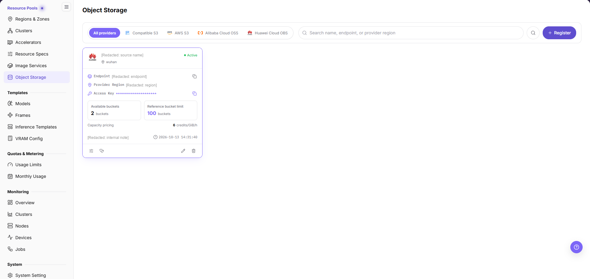
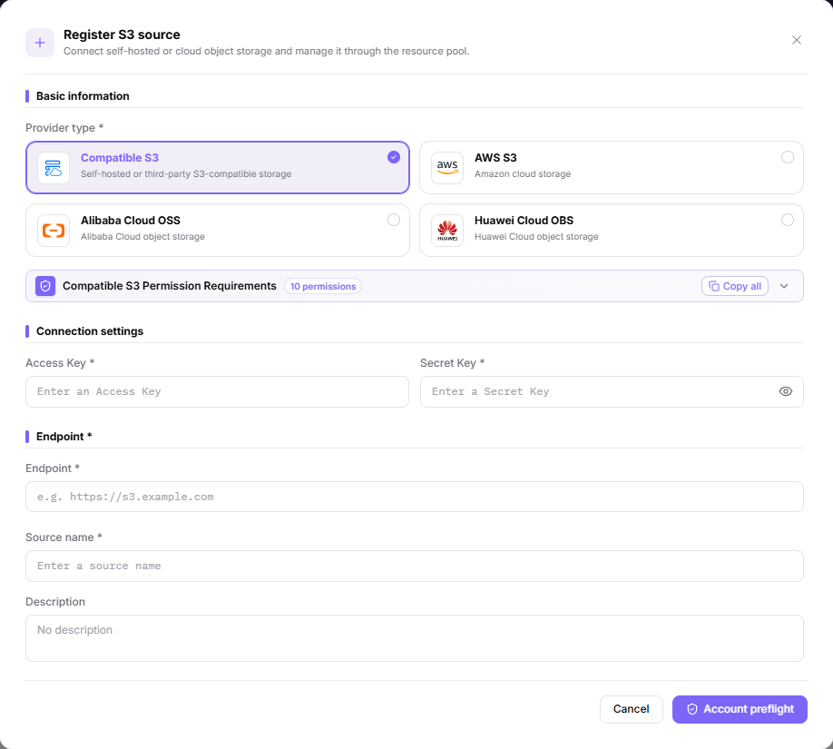
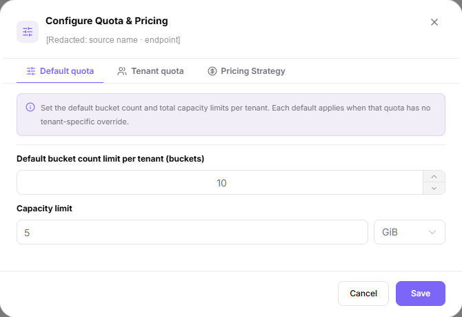
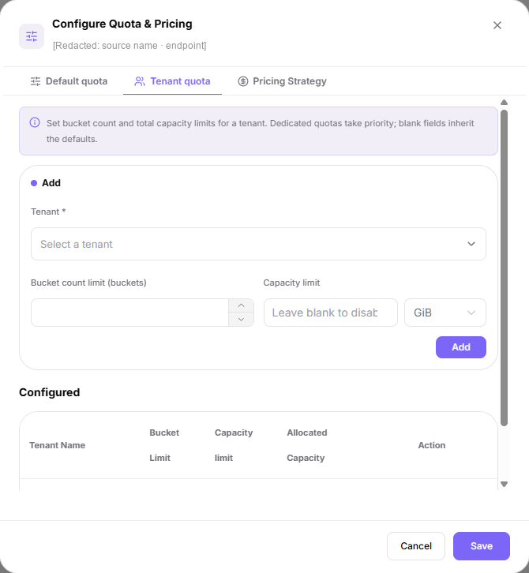
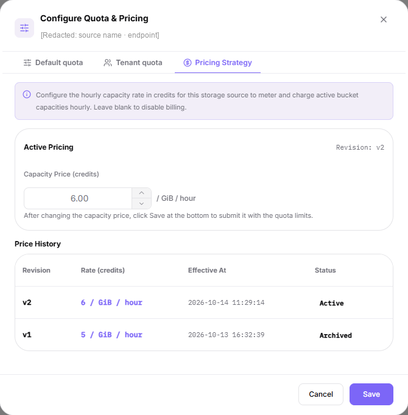
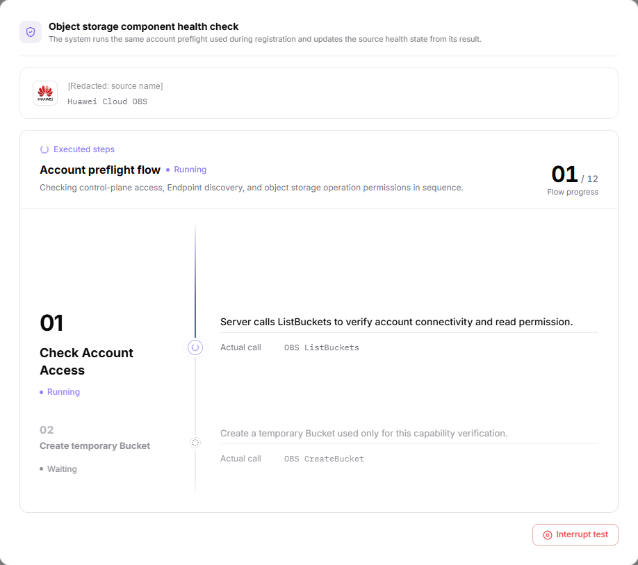
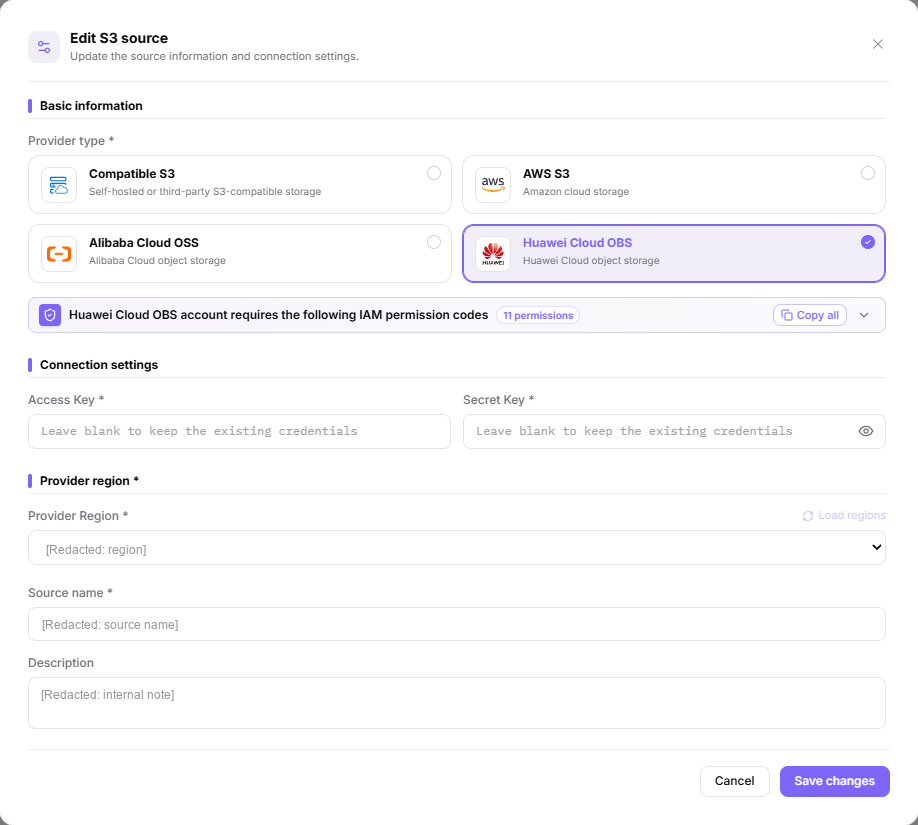

# Object Storage

## Feature Overview

| Item | Content |
| --- | --- |
| Applicable Role | Operator |
| Navigation Path | On-Prem > Resource Pools > Object Storage |
| Page Route | `/powerone/resourcepool/storage` |
| Managed Object | Provider type, source name, endpoint or provider region, access credentials, bucket and capacity quota, capacity pricing, description, and health state |

#### Beginner Explanation

- **Object storage** is like a bucket-organized file repository, suitable for storing model weights, datasets, compressed packages, and runtime artifacts.
- **Bucket** is the top-level container of object storage. Users can organize objects only after creating buckets.
- **Endpoint** is the access entrypoint. The platform, clusters, or jobs need to access object storage through it.
- **AK/SK** are access credentials and sensitive information. They should not appear in screenshots, documentation, or tickets.

#### Terms

| Term | Description |
| --- | --- |
| MinIO | A common S3-compatible object storage implementation. |
| S3 | Object storage API protocol or compatible interface. |
| Bucket | The top-level object storage container used to organize objects. |

#### Recommended Operation Order

Confirm prerequisites for the provider type, the access credentials, the endpoint or region, the source name, and the quota and pricing plan, follow Main Operations, run Result Validation, and continue to the next page.

#### First-Time User Notes

Confirm that the task involves the provider type, the access credentials, the endpoint or provider region, the source name, and the quota and pricing, and then follow the recommended order. If fields or state differ from expectations, check prerequisites before continuing downstream.

## Prerequisites

1. The object storage service has been deployed and can be accessed from the platform management side and target clusters.
2. Endpoint or region, access protocol, authentication method, access credentials, bucket and capacity plan, capacity price, and associated regions have been prepared.
3. Bucket naming, tenant isolation, permission boundaries, and data retention policies have been confirmed.
4. The current account has operator resource pool management permissions.

## Page Description

Use this page to manage connected object storage sources: provider type, display name, endpoint or region, access credentials, bucket and capacity quota, capacity pricing, description, and health state.

Sources are shown as cards. Each card shows `Endpoint`, `Provider Region`, and the masked `Access Key`, with an icon button at the end of the `Endpoint` and `Access Key` lines, and an availability-zone label with a location icon under the name; the card also shows `Available buckets` and `Reference bucket limit` (both counted in `buckets`) and the `Capacity pricing` in credits per GiB per hour, while the last line is the description summary followed by a clock icon and a timestamp. The page header offers the `All providers` / `Compatible S3` / `AWS S3` / `Alibaba Cloud OSS` / `Huawei Cloud OBS` tabs, a search box whose placeholder is `Search name, endpoint, or provider region` with a search icon on its right, and `Register` at the far right.

## Main Operations

### Register Object Storage Component

#### Applicable Scenarios

Register a storage component when a new MinIO, S3-compatible storage, or another object storage service needs to be connected and used by regions, user-side buckets, or job object path read/write. In this page, storage component refers to the object storage entry managed here.

#### Steps

1. Go to `On-Prem > Resource Pools > Object Storage` and click **"Register"** to open the `Register S3 source` dialog.
2. Choose the provider card under `Provider type *`: `Compatible S3`, `AWS S3`, `Alibaba Cloud OSS`, or `Huawei Cloud OBS`. The permission codes of the selected provider are listed in the banner below it, whose title and count follow that provider, for example `Compatible S3 Permission Requirements` with `10 permissions` or `Huawei Cloud OBS account requires the following IAM permission codes` with `11 permissions`; the banner also offers `Copy all` with an expand control on the right.
3. Fill in `Access Key *` and `Secret Key *` under `Connection settings`; the icon on the right of a credential field switches its value between masked and plain text.
4. Fill in the address or the region: only `Compatible S3` takes `Endpoint *`, while `AWS S3`, `Alibaba Cloud OSS`, and `Huawei Cloud OBS` replace it with `Provider region *`, whose options are returned by **"Load regions"**.
5. Fill in `Source name *` and `Description`, then click the final **"Account preflight"** to submit. This dialog contains no quota fields; bucket count, capacity, and pricing are configured on the card afterwards.
6. Before submitting, verify the provider, the endpoint or region, the Access Key, and the source name again.

The following figure shows the Register Storage Component form, used to configure object storage access method and connection parameters.

#### Result Validation

- After a successful submit, the source appears as a card showing its state, the `Endpoint` or `Provider Region` line, `Available buckets`, `Reference bucket limit`, and `Capacity pricing`, with the description and a timestamp on the last line.
- The four tooltips in the card footer read verbatim `Configure limits`, `Health check`, `Edit`, and `Delete`, and they map to the other four sections of this page.
- Quota and pricing are not part of registration. Configure them through `Configure limits` on the card, where the bucket limit, capacity limit, and the capacity price are submitted together.

#### Notes

- The register dialog footer offers only `Cancel` and `Account preflight`; the edit dialog ends with `Save changes`. The two are different entries and behave differently.
- Only `Compatible S3` keeps the `Endpoint *` field; `AWS S3`, `Alibaba Cloud OSS`, and `Huawei Cloud OBS` replace it with `Provider region *`, whose options are returned by `Load regions` after the credentials are complete.
- The account you enter must already hold the permission codes listed in the banner of the selected provider, and the code count differs between providers.

### Configure Quota and Pricing

`Configure limits` on the card opens the `Configure Quota & Pricing` dialog with three tabs: `Default quota`, `Tenant quota`, and `Pricing Strategy`. Quota and price are submitted together.

#### Applicable Scenarios

Use this dialog to set the default bucket count and capacity per tenant, to give one tenant a dedicated quota, or to change the hourly capacity price in credits.

#### Steps

1. Click `Configure limits` on the target card to open the dialog, whose subtitle shows the source name and its endpoint.
2. On `Default quota`, set `Default bucket count limit per tenant (buckets)` and `Capacity limit`, then choose the capacity unit (for example `GiB`). The tab note says each default applies when a tenant has no dedicated quota.
3. On `Tenant quota`, use the `Add` area: choose `Tenant *`, set `Bucket count limit (buckets)` and `Capacity limit` (blank disables the limit), then click **"Add"**. The `Configured` table lists the `Tenant Name`, `Bucket Limit`, `Capacity limit`, `Allocated Capacity`, and `Action` columns; each row offers `Edit` and `Remove (Restore Default)`.
4. On `Pricing Strategy`, set `Capacity Price (credits)`, whose unit is `/ GiB / hour`. The tab shows `Active Pricing` with its `Revision`, and the `Price History` table below lists `Revision`, `Rate (credits)`, `Effective At`, and `Status`, where the status is `Active` or `Archived`. Blank disables billing.
5. Click **"Save"**. The tab note says a changed capacity price is submitted together with the quota limits; click **"Cancel"** to discard.

The `Default quota` tab figure shows the two default limit fields and the `GiB` capacity unit.

The `Tenant quota` tab figure shows the `Add` area and the `Configured` table with its per-row actions.

The `Pricing Strategy` tab figure shows `Active Pricing` and its `Revision` above the `Price History` table.

#### Result Validation

- The card shows the new capacity price, and `Available buckets` and `Reference bucket limit` follow the default quota.
- The `Revision` shown on `Pricing Strategy` increases, and the previous rate moves into the `Price History` table as `Archived`.

#### Notes

- Price and quota share one save action, so any quota field you touched is written even when you only meant to change the price.
- `Allocated Capacity` is the sum of capacity quotas of that tenant's active buckets on this source, not real file usage.
- Lowering a bucket count or capacity limit can affect buckets that already exist. Confirm the business window first.

### Run a Health Check on the Object Storage Component

`Health check` on the card opens the `Object storage component health check` dialog, whose subtitle reads `The system runs the same account preflight used during registration and updates the source health state from its result.`

#### Applicable Scenarios

Run a health check when you need to confirm that a source's credentials, endpoint or provider region, and account permissions still work, or to re-check the component health state after a credential or pricing change.

#### Steps

1. Click `Health check` on the target card; the top of the dialog shows the checked component and its provider.
2. Under `Executed steps` the dialog lists the `Account preflight flow` step by step, shows the progress as `i / 12` beside `Flow progress`, marks each step `● Running` or `● Waiting` while a finished step shows the passed state, and gives the call that step performs beside `Actual call`.
3. Step `01` is `Check Account Access`, whose `Actual call` is `OBS ListBuckets`; step `02` is `Create temporary Bucket`, whose `Actual call` is `OBS CreateBucket` and which creates a temporary bucket used only for the current verification round; the third step checks the bucket that was created.
4. To stop the run, click **"Interrupt test"** at the bottom of the dialog.

The figure shows the health check dialog mid-run: the checked source with its provider at the top, the `Account preflight flow` timeline in the body, and `Interrupt test` in the footer.

#### Result Validation

- Steps advance to the passed state, and the component health state is updated from the single pre-check result.
- The state shown on the card follows that pre-check result.

#### Notes

- The health check is not a read-only probe: the dialog shows that one step calls the provider's bucket-creation action to create a temporary bucket, so it writes into the storage account. Run it outside a business window.
- The dialog footer offers only `Interrupt test` and has no `Cancel` button; do not treat it as a refresh button to click repeatedly.
- How the temporary bucket is cleaned up is not shown in the screenshots for this page; follow what the page states.
- When the account lacks a listed permission code, the run stops at the affected step. Fix the permission first, then check again.

### Edit Object Storage Component

#### Applicable Scenarios

Edit a source when its provider type, endpoint or provider region, source name, description, or access credentials must change.

#### Steps

1. Click `Edit` on the target card to open the `Edit S3 source` dialog, whose subtitle reads `Update the source information and connection settings.`
2. To switch providers, reselect the card under `Provider type *`; the permission banner changes to the code list of the new provider.
3. Leave the credential fields empty to keep the existing credentials, whose placeholder reads `Leave blank to keep the existing credentials`, or enter new values to replace them.
4. Change `Endpoint *` or `Provider region *` (options returned by `Load regions`), `Source name *`, and `Description`.
5. Click **"Save changes"** to submit, or **"Cancel"** to discard.

The figure shows the `Edit S3 source` dialog: the `Provider type *` cards, the credential placeholders, and the `Provider Region *`, `Source name *`, and `Description` fields.

#### Result Validation

- The card shows the new name, endpoint or region, and description.
- The values pre-filled in the edit dialog match the current card values, which confirms whether a change has been stored.

#### Notes

- The final button of the edit dialog is `Save changes`, which differs from the `Account preflight` entry of the register dialog.
- Leaving a credential blank only keeps the existing value; it does not clear the stored Access Key or Secret Key.
- The health check and the quota dialog are separate entries and are not part of this edit.

### Delete Object Storage Component

#### Applicable Scenarios

Delete a source when it is no longer used, when it must be retired, or when another source replaces it.

#### Steps

1. Click `Delete` on the target card to open the delete confirmation dialog.
2. The dialog names the source it will remove, states that the operation cannot be undone, and scopes the confirmation to a source that is not associated with any region. Check the target against that line.
3. Confirm the deletion, or cancel to discard.

#### Result Validation

- After confirming, the source disappears from the card list and is not returned again after you reset the filters and search.
- The confirmation line only covers a source with no region association; the behaviour for an associated source is not shown in the screenshots for this page, so unbind it first.

#### Notes

- The dialog states that the operation cannot be undone. Confirm data migration, backups, region bindings, and dependent jobs before deleting.
- The screenshots for this page do not show whether deleting the entry touches the data inside the storage source. Confirm the backup on the storage side first.
- To reconnect later, register the source again and re-enter its credentials.

## Parameter Quick Reference

| Field Name | Required | Field Type | Example | Description |
| --- | --- | --- | --- | --- |
| Provider type | Yes | Card selection | `Compatible S3` | `Compatible S3`, `AWS S3`, `Alibaba Cloud OSS`, or `Huawei Cloud OBS`. The choice decides whether the dialog asks for an endpoint or a region. |
| Access Key | Yes | Credential / sensitive text | `<ACCESS_KEY_ID>` | Access key for object storage. Enter it only in the system form. Do not record it in this document, in shared documents, or in screenshots. |
| Secret Key | Yes | Credential / sensitive text | `<ACCESS_KEY_SECRET>` | Secret key for object storage. Sensitive credential. Do not record it in this document, in shared documents, or in screenshots. |
| Endpoint | Conditionally required | Address / path | `<BASE_URL>` | Used by `Compatible S3` only. Use placeholders only in documentation; do not record real endpoint values. |
| Provider region | Conditionally required | Dropdown / enum | `<REGION_ID>` | Replaces the `Endpoint *` field for `AWS S3`, `Alibaba Cloud OSS`, and `Huawei Cloud OBS`. Options are returned after the credentials are complete. |
| Source name | Yes | Text | `<SOURCE_NAME>` | Display name of the object storage source. Use a name that reflects storage type, environment, or region. |
| Description | No | Multi-line text | `<description>` | Component purpose, boundary, or maintenance notes. Record non-sensitive notes only. |
| Default bucket count limit per tenant (buckets) / Capacity limit | No | Number / capacity | `10` / `5 GiB` | Configured on the `Default quota` tab of the `Configure Quota & Pricing` dialog, not in the register dialog. |
| Capacity price | No | Number / price | `<PRICE>` | Configured on the `Pricing Strategy` tab and submitted together with the quota limits. Blank disables billing. |
| Actions | System-generated | Action entry | `Edit` | The four tooltips in the card footer read verbatim `Configure limits`, `Health check`, `Edit`, and `Delete`, which map to the other four sections of Main Operations. The health check creates a temporary bucket, so it is high-risk like `Delete`. |

## Pitfalls

- Registering a storage component affects regional object storage capability, user-side bucket creation, job object path read/write, and data access scope.
- An incorrect endpoint, region, certificate, AK/SK, bucket policy, or quota setting may cause jobs to fail to read from or write to object storage.
- AK/SK, tokens, internal connection strings, and production bucket paths are sensitive information and must not be written into documents, screenshots, or tickets.
- `Account preflight` (register dialog), `Save changes` (edit dialog), `Add` (tenant quota add block), and `Save` (quota and pricing dialog) are high-risk final actions.
- Do not record real Endpoint values, internal addresses, AK/SK, tokens, bucket names, production object paths, cluster IDs, resource pool IDs, or internal test parameters.

## Result Validation

| Check Item | Success Signal | If Abnormal |
| --- | --- | --- |
| Page entry | Object Storage opens with the target operation entry | Check Operator permission and whether the menu is available |
| Object record | The provider type, endpoint or provider region, source name, bucket and capacity quota, and capacity pricing are visible on the card | Reset filters and verify name, ownership, and creation result |
| State result | State after creation or change matches the page message | Check operation feedback, dependency state, and latest update time |
| Downstream use | A downstream page can select or associate the target | Return to prerequisites and check enabled state, ownership, and visibility |

## FAQ

#### Target Is Missing from Object Storage

**Symptom:**

The page opens, but the expected object storage source, provider card, endpoint or region, or quota and pricing entry is missing.

**Possible Causes:**

- Filters remain active.
- the object belongs to another scope.
- a prerequisite is incomplete.

**Solution:**

1. Reset filters
2. verify region or tenant ownership
3. confirm prerequisite state.

#### The Operation Entry on Object Storage Is Unavailable

**Symptom:**

The create, register, or maintain entry is hidden or disabled.

**Possible Causes:**

- Role permission is insufficient.
- the page is read-only.
- dependencies are not ready.

**Solution:**

1. Check Operator permission
2. read the page message
3. complete dependency configuration first.

#### A Required Field on Object Storage Has No Options

**Symptom:**

The form opens, but a selection list is empty.

**Possible Causes:**

- Candidates are disabled.
- ownership differs.
- the current account cannot see them.

**Solution:**

1. Check candidate state
2. verify ownership
3. confirm visibility and refresh the form.

#### Object Storage Has an Abnormal State After the Operation

**Symptom:**

A record exists after submission, but its state is unexpected.

**Possible Causes:**

- Connectivity or validation failed.
- a dependency is abnormal.
- processing is incomplete.

**Solution:**

1. Check feedback and update time
2. inspect related objects
3. troubleshoot the processing stage.

#### A Downstream Page Cannot Use Object Storage

**Symptom:**

The current page is normal, but a downstream page cannot select the object storage source, its bucket and capacity quota, or the pricing applied to the target tenant.

**Possible Causes:**

- Visibility differs.
- the object is disabled.
- downstream cache is stale.

**Solution:**

1. Check enabled state and ownership
2. verify role visibility
3. refresh and select again.

## Notes

- Registering a storage component affects regional object storage capability, user-side bucket creation, job object path read/write, and data access scope.
- Do not screenshot or record real Endpoint values, internal addresses, AK/SK, tokens, internal connection strings, production bucket names, or production object paths.
- Before deleting, disabling, or replacing an object storage component, confirm data migration, backups, region bindings, and dependent jobs.
- `Account preflight` (register dialog), `Save changes` (edit dialog), `Add` (tenant quota add block), and `Save` (quota and pricing dialog) are high-risk final actions. Confirm the scope and impact before executing the final action.
- Do not record real Endpoint values, internal addresses, AK/SK, tokens, bucket names, production object paths, cluster IDs, resource pool IDs, or internal test parameters.

## Next Steps

1. Go to [Regions & Zones](../regions-zones/) to bind the object storage component.
2. Guide users to create buckets and upload data in [Object Storage](../../../user/storage/object-storage/).
3. Verify object read/write, permissions, and path configuration with a test job.
4. Regularly check capacity usage, bucket policy, and data retention policy.
