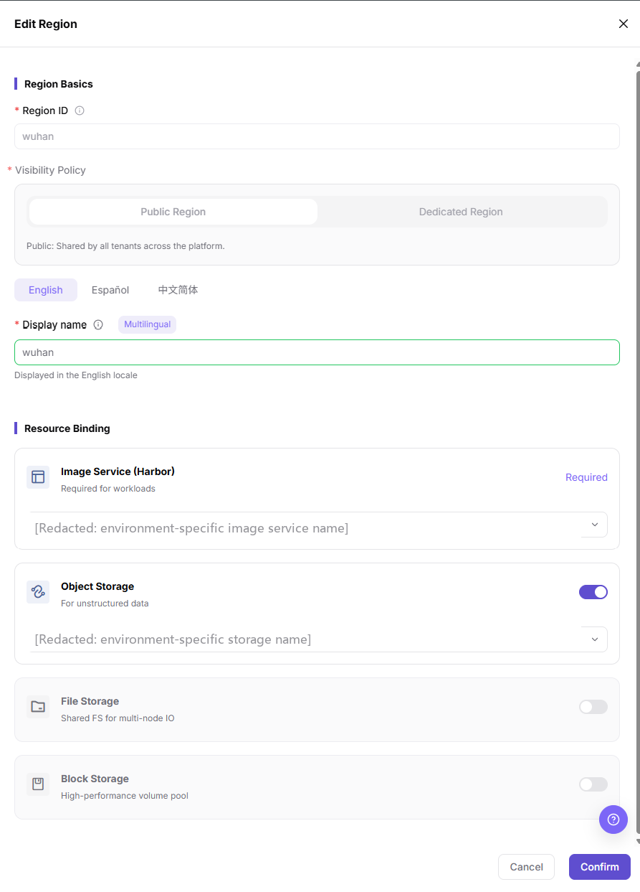
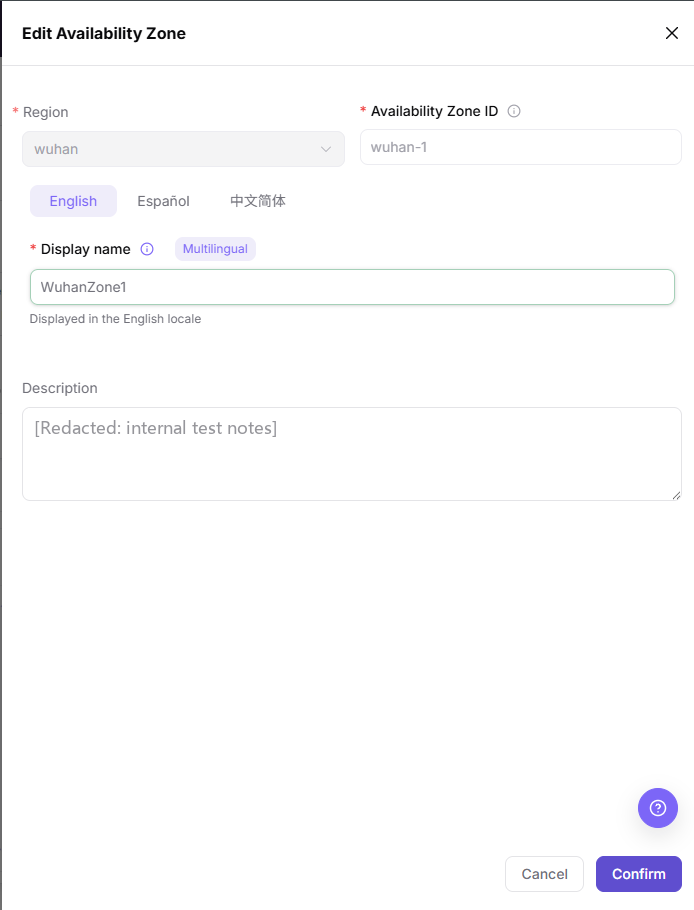

# Regions & Zones

## Feature Overview

| Item | Content |
| --- | --- |
| Applicable Role | Operator |
| Navigation Path | On-Prem > Resource Pools > Regions & Zones |
| Page Route | `/powerone/resourcepool/region` |
| Managed Object | Regions, availability zones, region-associated components (image and storage services, data Gateway endpoints), and the clusters scheduled under each zone |

#### Beginner Explanation

You can think of an On-Prem resource pool as an office system:

- **Region** is like a city, such as Wuhan or Beijing. It distinguishes the broad location or scope of resources.
- **Availability Zone** is like an office area or floor inside a city. It further divides where resources are hosted.
- **Cluster** is like a work area inside an office zone. It provides the actual CPU, GPU, memory, disk, and other compute resources.
- **Job** is like a specific piece of work. It must be scheduled onto a cluster to run.
- **Public Region** is like an open office area that all authorized users can share.
- **Dedicated Region** is like an independent office with access control, available only to specified teams or tenants.

Therefore, the first-time configuration order cannot be reversed: create a region first, then create an availability zone, register clusters into the availability zone, and finally submit a job to verify that the resources are usable.

#### Terms

| Term | Description |
| --- | --- |
| Harbor | A container image registry used to store and distribute images required by jobs. After a region is bound to an image service, later jobs can pull images from the corresponding registry. |
| Endpoint | The service access entry, usually used by the platform or jobs to access components such as image and storage services. |
| IP | The service location address or access address, used to determine whether the component network is reachable. |
| Data Gateway | The per-region access entry used by nodes to pull images and by jobs to reach object storage. Each region's Gateway endpoints are configured on the image component row and centrally managed in System Settings. |

#### Recommended Operation Order

Confirm prerequisites for Region, Availability Zone, region-associated components, and cluster resources under availability zones, follow Main Operations, run Result Validation, and continue to the next page.

#### First-Time User Notes

Confirm that the task involves regions, availability zones, region-associated components, or the cluster resources under an availability zone, and then follow the recommended order. If fields or state differ from expectations, check prerequisites before continuing downstream.

## Prerequisites

Before configuration, confirm that the following conditions are met:

1. The current account has operator permissions and can access `Resource Pools > Regions & Zones`.
2. At least one available image service has been connected. If the image service dropdown is empty, first go to `Resource Pools > Image Services` to check whether the component has been connected, enabled, and whether the current account has view or bind permissions.
3. If object storage is required in the region, complete the object storage component connection in advance (`Resource Pools > Object Storage`). An empty dropdown usually means that the component has not been connected, has not been enabled, or is not accessible to the current account.
4. If clusters will be registered later, plan the region ID, availability zone ID, display names, and cluster ownership relationship in advance.
5. If you need to configure data Gateway endpoints or manage them centrally, confirm that the current account can also open `System > System Setting` and view the `User Service Access` section.

## Page Description

Use this page to manage regions, availability zones, region-level components, and cluster resources assigned to each availability zone.

The page consists of the region type tabs, a region name search box, the region list, and the region detail area. After you enter the page, the system shows the public region list with a count on each tab by default. After you select a region, the right side displays the component bindings, availability zones, and cluster resources of that region.

In the screenshot, the left side is the region list with the `Add Region` button at its bottom, and the right side shows the availability zones and cluster resource cards of the current region.

#### Region Type Tabs and Search

The region type tabs are at the top of the list area and are used to switch between region scopes.

| Item | Description |
| --- | --- |
| Region Type Tabs | Switch between `Public Region` and `Dedicated Region`; each tab shows the number of regions in parentheses. Public regions can be shared by platform tenants. Dedicated regions are used to restrict the usage scope. |
| Name Search | Enter a region name keyword in the `Search by Name` box and press Enter to filter the list; typing alone does not filter. When no region matches, the list area shows `No regions` and the detail area shows `No data`; an empty `Dedicated Region` tab shows the same two messages, and the `Add Region` button stays available. |

#### Region List

The region list on the left displays the region name, a status badge, and an `Actions` icon button (shown as `...`). After you click a region name, the detail area on the right refreshes to show the information of the selected region.

The `Actions` menu provides region-level actions according to the current state: a region in the `Normal` state offers `Edit` and `Disable`; a region in the `Invalid` state offers only `Edit`; a disabled region offers `Enable` to restore it. Regions have no delete action. The detail header also provides the matching `Edit` and `Disable`/`Enable` icon buttons for the selected region, and shows the region name, its state badge, the visibility policy badge (`Public Region` / `Dedicated Region`), the region ID, and its update time.

#### Region Details

Region details display the resource capabilities associated with the current region. Only bound component types are rendered; an unbound storage type does not show a section:

- Image component: displays the `Gateway` row (gateway address, the image gateway configuration guide entry, and `Configure Data Gateway endpoint`), and the bound image service card with the registry address, `Username:`, repository count, enabled public image tag count, description, an unlabelled timestamp, and three icon buttons at the card footer: `Quota management`, `Health check`, and `Edit` (labels appear on hover).
- Storage components: an enabled object storage component card displays the endpoint, provider region, `Access Key` (the value is masked and the `Copy Access Key` icon button sits next to it), available bucket count, reference bucket limit, capacity pricing, the description and `Created at:`, plus three icon buttons at the card footer (hover labels read `Configure limits for <name>`, `Health check <name>`, and `Edit <name>`). The card badge follows the component's own wording and may differ from the region badge (this card shows `Active` in the English UI); follow what the card shows. No file storage or block storage section is rendered on the current page.
- Availability zones: the section title shows the zone count in parentheses. It displays each availability zone's display name, ID, status, and update time. The row action icons depend on the current state: a zone in the `Normal` state shows `Edit` and `Disable`; a disabled zone shows `Enable`; a zone in the `Abnormal` state shows `Edit` and `Delete`. A `Create AZ` button sits at the bottom of the section.

Endpoint is the service access entry, usually used by the platform or jobs to access the corresponding component. IP is the service location address or access address, used to determine whether the component network is reachable.

#### Availability Zones and Cluster Resources

Each availability zone row shows its display name with the zone ID, its status badge, and its update time. The action icons on the right of the row depend on the current state: a zone in the `Normal` state shows `Edit` and `Disable`; a disabled zone shows `Enable`; a zone in the `Abnormal` state shows `Edit` and `Delete`.

An availability zone in the `Abnormal` state means no cluster is available under it yet. The row shows the inline hint `No available cluster under the current resource` (Chinese UI: `当前资源下没有可用集群`), and its expansion area shows the empty-state banner `No cluster available. Availability zone cannot be used, please associate one.` (Chinese UI: `当前没有集群，可用区无法使用，请关联集群`). To resolve it, associate a cluster as described below.

To associate a cluster, expand the availability zone and use the dashed placeholder card `Associate Cluster` (Chinese UI: `关联集群`) on the right of the expansion area. This is a placeholder card, not a row action button. Clicking it does not open a picker of existing clusters: it navigates to the cluster registration wizard with the current region and availability zone preset in the URL (`…/resourcepool/cluster/create?regionId=<region>&zoneId=<zone>`), where you register a new cluster into that zone (KubeConfig quick import or manual connection).

After expanding an availability zone that already has clusters, you can view the cluster resource usage under that availability zone. Cluster cards usually display the following information:

- Cluster name.
- `AI Accelerator`, `CPU`, `MEM`, and `DISK` resource usage.
- The `Nodes:`, `Jobs:`, and `Created:` fields.

Resource usage is labelled `Remaining / Total` (for example `10/16 AI card(s)`), which helps you quickly determine whether a specific availability zone or cluster has a resource bottleneck. The values update in real time; do not treat any snapshot value as a capacity baseline.

#### Management Notes

- The `Actions` menu in the region list is used to edit, disable, or (for a disabled region) enable a region; `Invalid` regions offer only `Edit`. Regions have no delete action. The detail header provides the same `Edit` and `Disable`/`Enable` entries for the selected region.
- The `Availability Zone` section provides state-dependent row icons (`Normal` = `Edit`/`Disable`, disabled = `Enable`, `Abnormal` = `Edit`/`Delete`), lets you associate a cluster through the `Associate Cluster` placeholder card in the expansion area (which opens the cluster registration wizard), and expands to show cluster resources under the availability zone.
- Management actions may affect new resource creation, new cluster registration, or new job scheduling. Confirm region, availability zone, cluster, and job dependencies before applying changes.

## Main Operations

### Add Region

#### Applicable Scenarios

Add a region when the platform needs to connect a new compute resource area, or when resource pools need to be divided by data center, city, or business scope. The following scenarios usually require adding a region:

- During the first deployment of an On-Prem resource pool, at least one region must be created.
- When a new data center is added, new compute resources are purchased, or a new resource supply area is connected, create regions based on resource location.
- When resources need to be isolated by tenant, department, or business line, create a dedicated region.

#### Configuration Basics

Before adding a region, confirm the resource boundary and component selection logic:

- **Region** is used to divide broad resource boundaries. It usually corresponds to a city, data center, resource pool, or tenant boundary.
- **Availability Zone** must belong to a region and is used to further distinguish data center areas, network domains, resource groups, or cluster groups under a region.
- **Image Service** is a key dependency of a region. If no image service is available, later jobs may fail to pull runtime images.
- **Storage Components** are associated based on business needs. Object storage is currently the only storage capability and is suitable for model files and datasets.
- **Public Region** is suitable for shared resource pools, such as shared test resource pools or public training resource pools. **Dedicated Region** is suitable for department-owned or tenant-owned production compute resource pools.
- Object storage is currently the only storage capability; its navigation path is `Resource Pools > Object Storage`.

#### Pre-Operation Check

An available image service must already exist before you add a region. Without an image service, even if the region can be created, later jobs may fail to pull runtime images.

Confirm the following first:

1. An available image service already exists in `Resource Pools > Image Services`.
2. The current account has permission to bind the image service.
3. If object storage needs to be enabled, the object storage component has been connected and is available in `Resource Pools > Object Storage`.
4. The region ID has been determined according to the long-term plan. The region ID is a resource boundary identifier and cannot be modified after creation.

#### Steps

Add Region is a multi-step wizard. The `Creation steps` strip at the top always shows the following seven steps; later steps stay greyed out until the current one is completed:

1. `01 Region details` — Set region attributes and bind image and storage services.
2. `02 Create availability zone` — Configure zone identity and display name.
3. `03 Connect compute cluster` — Provide cluster credentials and verify control plane connectivity.
4. `04 Verify cluster user-service connectivity` — Configure the initial access route and test the cluster user service.
5. `05 Configure accelerators` — Select existing models or onboard new heterogeneous hardware.
6. `06 Configure specs and metrics` — Define compute resource specs, metric catalog, and pricing.
7. `07 Initialize cluster settings` — Associate specs and configure shared storage and scheduling limits.

Step 1 in detail:

1. Go to `On-Prem > Resource Pools > Regions & Zones`.
2. Click **"Add Region"** at the bottom of the region list on the left to open the Add Region wizard.
3. In the `Region basic parameters` section, fill in `Region ID`, select `Visibility Policy`, and maintain multilingual `Display name`; open each field's validation rules with the icon next to its title.
4. In the `Associated Components` section, associate the required `Image Component` and, as needed, `Object Storage Component`. The `Gateway` row can be left empty here and completed later in region details.

The following screenshot shows step 1 of Add Region. Verify the `Region ID` format, the `Public Region` / `Dedicated Region` visibility policy, and the required image component association before submitting; values follow the live page.

5. Before submitting, verify the region ID, visibility policy, display name, and associated components again.
6. Click **"Create region and continue setup"** to submit step 1 and move to step 2, or **"Finish"** to end the wizard (`Finish` was not verified in this round to also persist the region; trust the page result).

#### Add Region Field Notes

| Field Name | Required | Field Type | Example | Description |
| --- | --- | --- | --- | --- |
| Region ID | Yes | Text | `wuhan` | Unique region identifier. Length 2-20; cannot start or end with `-`; only lowercase letters, numbers, and `-` are allowed. It cannot be modified after creation. |
| Visibility Policy | Yes | Single choice | `Public Region` | Controls whether the region is shared by all tenants or visible only to a dedicated scope. The `Public Region` card reads `Public: Shared by all tenants across the platform.`; the `Dedicated Region` card reads `Private: Open only to selected tenants with one owner tenant.`, so a dedicated region requires one owner tenant. |
| Display name | Yes | Multilingual | English `Wuhan` / Simplified Chinese `武汉` | Region name displayed in different language environments. Maintain each tab (English / 中文简体 / Español) separately; all three tabs are required, length 2-20; cannot start or end with `_`, `-`, `@`, or `.`; may only contain letters in any language, numbers, `_`, `(`, `)`, `（`, `）`, `-`, `@`, `.`. The page states which locale the current tab feeds, for example `Displayed in the English locale`. |
| Image Component | Yes | Association card | `image-xxx` | Image service bound to the region. Later jobs depend on it to pull images. When nothing is associated the page shows `No image component available. Region cannot be used, please associate one.` (In the Edit Region dialog this field is named `Image Service (Harbor)` and is a dropdown.) |
| Object Storage Component | No | Association card | Follow the page | Associate only when unstructured data, model files, or datasets are required. When nothing is associated the button reads `Associate Object Storage Component`. (In the Edit Region dialog this field is named `Object Storage` and is a switch plus dropdown.) |

#### Add Region Pitfall Notes

- The region ID cannot be modified after creation. Confirm the naming, regional meaning, and tenant boundary before submitting.
- If the image service is unavailable, jobs may fail to pull images. Confirm that the image component status is normal before adding a region.
- Storage components are not mandatory. Enable a storage component only when the business requires the corresponding storage capability.
- A public region expands the resource visibility scope, while a dedicated region restricts the resource scope. Confirm the tenant or department boundary before configuration.

#### Add Region Submission Checks

After the region is submitted successfully, check whether the configuration has taken effect:

1. Confirm that the new region appears in the region list on the left.
2. Confirm that the region status is `Normal` or the expected status.
3. Select the region and confirm that the image component is displayed in the detail area on the right.
4. If an object storage component is associated, confirm that it appears in the `Associated Components` list.
5. If clusters will be registered later, go to the cluster registration page and confirm that the region can be selected.

### Edit Region

#### Applicable Scenarios

Edit a region when its multilingual display name or resource binding must change while the region ID and resource boundary remain unchanged. The region ID is read-only in the edit form.

#### Steps

1. Go to `On-Prem > Resource Pools > Regions & Zones`.
2. Select the target region in the left list, then open the edit form either from the row's **"Actions"** (`...`) menu by clicking **"Edit"**, or from the **"Edit"** icon button in the detail header.
3. Update the fields provided by the dialog in `Region Basics`: `Region ID` is read-only, `Visibility Policy` shows the current `Public Region` / `Dedicated Region` selection, and `Display name` sits under the `Multilingual` badge and is maintained separately on each language tab (`English` / `Español` / `中文简体`).
4. In `Resource Binding`, adjust the bindings the page leaves editable: the `Image Service (Harbor)` row is marked `Required` (tooltip: `Required for workloads`) and `Object Storage` is a switch plus a bound-component dropdown. The dialog provides only these two bindings.
5. Before clicking **"Confirm"**, verify that the change will not unintentionally unbind an image or storage component in use.
6. To discard the changes, click **"Cancel"** to close the dialog.
7. Return to the list and region details to verify the updated name, bindings, and update time.

The **Edit Region** dialog is shown below. It is a single-page dialog (unlike the multi-step Add Region wizard) and keeps two sections, `Region Basics` and `Resource Binding`, pre-filled with the region's current values; the bound component names are masked in this figure, so use the values shown on the live page.

#### Result Validation

- The region list shows the updated multilingual name while the region ID and hierarchy remain unchanged.
- Region details show the resource bindings submitted in the form.
- The downstream cluster registration page can still select the region as expected.

#### Notes

- The region ID is a resource boundary identifier and cannot be changed by editing. Replacing it requires a separate assessment for creating a new region and migrating downstream resources.
- Removing a component binding may affect image pulls, storage mounts, or later resource creation. Check associated clusters and jobs before submitting.

### Disable / Enable Region

#### Applicable Scenarios

Disable a region when new resource use must be temporarily stopped. Enable restores a previously disabled region to service. When the current state is `Normal`, the row's `Actions` menu and the detail header show **"Disable"**; after a region is disabled, the same entries show **"Enable"**. Regions do not provide a delete action, so disable/enable is the reversible lifecycle control on this page.

#### Disable a Region

1. Go to `On-Prem > Resource Pools > Regions & Zones` and locate the target region with the region type tabs or the name search box.
2. Open the target region row's **"Actions"** menu and select **"Disable"**, or click the **"Disable"** icon button in the detail header.
3. Read the confirmation prompt (for example, `Are you sure to disable [wuhan]?`) and verify the impact on the region, availability zones, clusters, and job scheduling.
4. After confirming the impact scope, click **OK** to change the state.
5. Refresh the list and verify the region state and downstream selectable scope.

#### Enable a Region

1. Locate the disabled region with the region type tabs or the name search box; only a disabled region shows the **"Enable"** action.
2. Open the region row's **"Actions"** menu and select **"Enable"**, or click the **"Enable"** icon button in the detail header.
3. Read any confirmation prompt, then refresh the list and verify the region returns to the `Normal` state.
4. Before enabling, confirm image services, storage components, and downstream clusters are healthy so scheduling resumes correctly.

#### Result Validation

- After disabling, the region state changes as shown on its status badge; after enabling, the region returns to `Normal`.
- The changed region can still be located with the region type tabs and name search.
- Cluster registration, job scheduling, or resource creation applies the corresponding region-state restriction.

#### Notes

- Disabling a region usually affects new cluster registration, new resource creation, and new job scheduling. It does not mean that existing resources are deleted; verify the business window first.
- There is no delete action for regions in the current UI; disable/enable is the reversible lifecycle control on this page.
- The **"Enable"** action appears only when the region is actually in the disabled state, so a `Normal` region shows **"Disable"**, not **"Enable"**.

### Configure Data Gateway Endpoints

#### Applicable Scenarios

Configure the data Gateway endpoints for a region when its image component or object storage component needs a specific access address so that nodes can pull images and jobs can reach object storage through the Gateway. The `Associated Components` area has one `Configure Data Gateway endpoint` button on the image component row and another on the object storage component row; both open the same dialog.

#### Steps

1. Go to `On-Prem > Resource Pools > Regions & Zones` and select the target region.
2. In the `Associated Components` area, open **"Configure Data Gateway endpoint"** (either on the image component row or on the object storage component row; both open the same dialog). The dialog title combines the region name and its ID (for example, `Configure Data Gateway Endpoints - wuhan wuhan`).
3. Fill in `Image Gateway Endpoint` and `Object Storage Gateway Endpoint`. Each accepts a domain, an `IP:port`, or an address with a protocol; when no protocol is provided, `HTTPS` is used by default, and when you enter `http://` or `https://` the value is used exactly as entered.
4. Click **"Save"** to apply, or **"Cancel"** to discard.

#### Image Gateway Configuration Guide

The image component row and the Gateway dialog both provide an `HTTP Image Gateway Configuration Guide` icon entry for connecting nodes to the current image gateway. The panel splits by containerd version into `containerd 1.x` and `containerd 2.x` tabs and contains:

- Applicability: `Applicable to containerd 1.x nodes. The gateway uses HTTP protocol. Add the following mirrors configuration to config.toml on each node.`
- `Node Configuration File Path`: `/etc/containerd/config.toml`, with a copy-path action.
- `Configuration Content (config.toml)`: the mirrors snippet, with a copy-code action.
- Configuration: append or merge the mirrors block into `/etc/containerd/config.toml` on each node.
- Activation: restarting the service is required after the change, `sudo systemctl restart containerd`.

#### Cross-page Entry

The dialog provides a **"Go to System Settings to manage all Gateways"** link. Clicking it navigates to `On-Prem > System > System Setting` (the `User Service Access` section), where the per-region Gateway address table, Gateway signing key, domain-based ingress switch, public Nginx endpoint, and default port access policy are managed centrally.

#### Notes

- Gateway endpoint addresses are environment-specific and may be internal addresses. Do not record real internal IPs, hostnames, or ports in this document or in screenshots.
- Changing a Gateway endpoint affects image pulling and object storage access for jobs under the region; confirm that the new address is reachable before saving.

### Create AZ

#### Applicable Scenarios

Add an availability zone when a region needs to host new clusters, or when resources need to be further divided by data center rack, network domain, or resource group. The following scenarios usually require adding an availability zone:

- Multiple clusters exist under the same region and resources need to be divided by cluster group.
- Different data center areas, floors, network domains, or rack areas exist in the same city or data center.
- Network isolation, fault isolation, or resource grouping is required to avoid mixing all clusters in the same availability zone.

#### Pre-Operation Check

Before adding an availability zone, you must first create and select the target region. An availability zone cannot exist outside a region. Selecting the wrong owner affects later cluster registration and job scheduling.

Confirm the following first:

1. The target region has been created, and its status is `Normal` or the status expected for the current operation.
2. The target region has been selected in the region list on the left.
3. The availability zone ID has been determined according to the region plan. It is recommended to include the region prefix and a sequence number, such as `wuhan-1` or `wuhan-gpu-1`.
4. The availability zone ID cannot be modified after creation.

#### Steps

1. Select the target region in the region list on the left.
2. In the `Availability Zone` section on the right, click **"Create AZ"** to open the `Add Availability Zone` dialog.
3. Confirm that the `Region` field, which is read-only and prefilled with the selected region, is the target region.
4. Fill in `Availability Zone ID`; open the validation rules with the icon next to its title.
5. Fill in `Display name` separately on each multilingual tab (English / 中文简体 / Español); the page states which locale the current tab feeds, for example `Displayed in the English locale`.
6. Fill in the description as needed, such as geographical location, data center number, or business purpose.

The following screenshot shows the Create AZ form. The owning region is prefilled and read-only; fill in the availability zone ID, the multilingual display names, and an optional description before confirming.

7. Before clicking the final **"Confirm"**, verify the parent region, availability zone ID, display name, and description again.

#### Create AZ Field Notes

| Field Name | Required | Field Type | Example | Description |
| --- | --- | --- | --- | --- |
| Region | Yes | Read-only (prefilled) | `wuhan` | The parent region to which the availability zone belongs. It is automatically filled from the currently selected region and cannot be changed in this dialog. Confirm that the ownership is correct before submitting. |
| Availability Zone ID | Yes | Text | `wuhan-1` | The unique identifier of the availability zone. Validation: length 2-20; cannot start or end with `_`, `-`, `@`, or `.`; may only contain uppercase and lowercase letters, numbers, `_`, `(`, `)`, `（`, `）`, `-`, `@`, `.`. Lowercase letters, numbers, and hyphens such as `wuhan-1` or `wuhan-gpu-1` are still recommended. It cannot be modified after creation. |
| Display name (Multilingual) | Yes | Multilingual tabs | Simplified Chinese `武汉可用区1` / English `Wuhan Zone 1` | The availability zone name displayed in different language environments. Keep the regional meaning consistent with the availability zone ID. |
| Description | No | Multi-line text | `Wuhan zone 1` | You can enter the data center location, purpose, network boundary, or maintenance notes to make later operations easier to identify. |

#### Create AZ Pitfall Notes

- Select the target region before adding an availability zone. Do not create the availability zone under the wrong region.
- The availability zone ID cannot be modified after creation. Include the region prefix and sequence number to avoid names that are hard to distinguish across regions.
- After an availability zone is created, it cannot run jobs by itself. You still need to register clusters under the availability zone.

#### Create AZ Submission Checks

After the availability zone is submitted successfully, check whether the configuration has taken effect:

1. Confirm that the new availability zone appears in the target region details.
2. Confirm that the availability zone ID, display name, and description are as expected.
3. Confirm that the availability zone status is `Normal` or the expected status.
4. Go to the cluster registration page and confirm that the new availability zone can be selected under the region.

### Edit Availability Zone

#### Applicable Scenarios

Edit an availability zone when its multilingual display name or description must change while its availability zone ID and parent region remain unchanged. The region and availability zone ID are read-only in the edit form.

#### Steps

1. Go to `On-Prem > Resource Pools > Regions & Zones` and select the target region.
2. In the `Availability Zone` section, find the target zone and click the **"Edit"** button on its row.
3. Update the fields provided by the dialog: the owning `Region` and the `Availability Zone ID` are shown side by side and both read-only, so zone ownership cannot be changed here; `Display name` sits under the `Multilingual` badge and is maintained separately on each language tab (`English` / `Español` / `中文简体`); `Description` is optional and takes a free-text note such as the data center location or purpose.
4. Before clicking **"Confirm"**, verify that the zone still belongs to the correct region and that the name change will not affect identification or operations handover.
5. To discard the changes, click **"Cancel"** to close the dialog.
6. Return to the availability zone list and verify the name, description, state, and update time.

The **Edit Availability Zone** dialog is shown below, pre-filled with the zone's current values; the description content is masked in this figure as an environment-specific test note, so use the value shown on the live page.

#### Result Validation

- The availability zone list shows the updated multilingual name or description while the region and zone ID remain unchanged.
- The cluster count and resource relationships in the zone details are not unintentionally changed.
- The cluster registration page can still select the zone under the correct region.

#### Notes

- The availability zone ID and parent region cannot be changed by editing. Moving ownership requires a separate assessment for resource migration and scheduling impact.
- Changing a display name does not change the actual ownership of clusters, nodes, or jobs. Update operating records to use the new name.

### Disable / Enable Availability Zone

#### Applicable Scenarios

Disable an availability zone when new cluster registration or job use must be temporarily stopped. Enable restores a previously disabled zone. The row icons follow the current state: a zone in the `Normal` state shows `Edit` and `Disable`; after a zone is disabled its row shows `Enable`; a zone in the `Abnormal` state (no cluster available yet) shows `Edit` and `Delete`. Unlike regions, an availability zone therefore also provides a `Delete` action for permanent removal, so use `Disable`/`Enable` to pause and restore a zone, and use `Delete` only when the zone should be removed.

#### Disable a Zone

1. Go to `On-Prem > Resource Pools > Regions & Zones` and select the target region.
2. In the `Availability Zone` section, find the target zone and select **"Disable"** from its row actions.
3. Read the confirmation prompt and verify the impact on clusters, nodes, jobs, and storage under the zone.
4. After confirming the impact scope, click the confirmation button to change the state.
5. Refresh the availability zone list and verify the state and selectable scope in cluster registration and job scheduling.

#### Enable a Zone

1. Select the parent region and locate the disabled zone; only a disabled zone shows the **"Enable"** action.
2. Choose **"Enable"** from the zone row actions.
3. Read any confirmation prompt, then refresh the list and verify the zone returns to the `Normal` state.
4. Before enabling, confirm cluster health, resource reporting, and storage configuration under the zone so scheduling resumes correctly.

#### Result Validation

- After disabling, the zone status badge changes accordingly; after enabling, the zone returns to `Normal`.
- The target zone can still be located under its parent region.
- Cluster registration and job scheduling apply the corresponding availability-zone state restriction.

#### Notes

- Disabling a zone affects new cluster registration or job scheduling under that zone. Confirm the handling of existing jobs, nodes, and storage first.
- The **"Enable"** action appears only when the zone is actually disabled, so a `Normal` zone shows **"Disable"**, not **"Enable"**.
- Unlike regions, an availability zone provides a **"Delete"** action. Deleting permanently removes the zone, so verify no cluster or job still depends on it before choosing Delete; prefer Disable/Enable when you only need to pause and restore the zone temporarily.

## Parameter Quick Reference

| Field Name | Required | Field Type | Example | Description |
| --- | --- | --- | --- | --- |
| Region ID | Yes | Text | `wuhan` | Unique region identifier that affects later availability zone, cluster, and resource pool ownership. |
| Visibility Policy | Yes | Single choice | `Public Region` | Controls whether the region is shared platform-wide or visible only to a dedicated scope. |
| Display name | Yes | Multilingual | English `Wuhan` / Simplified Chinese `武汉` | Name displayed for the region or availability zone in each language tab (English / 中文简体 / Español). |
| Availability Zone ID | Yes | Text | `wuhan-1` | Unique availability zone identifier that affects later cluster registration and scheduling scope. |
| Region | Yes | Read-only (prefilled) | `wuhan` | The owning region shown in the availability zone dialog. It is prefilled from the region you opened and cannot be changed in the form. |
| Image Component / Image Service (Harbor) | Required for region | Association card (Add Region wizard) / Dropdown (Edit Region dialog) | `image-xxx` | Image service bound to the region. It affects job image pulling. |
| Object Storage Component / Object Storage | No | Association card (Add Region wizard) / Switch + Dropdown (Edit Region dialog) | Follow the page | Storage capability bound based on business requirements. Object storage is the only storage capability the page currently provides; file storage and block storage are not offered. |
| Image Gateway Endpoint / Object Storage Gateway Endpoint | Depends on the component | Text | Follow the value shown on the page | Accepts a domain, an `IP:port`, or an address with a protocol; when no protocol is given, HTTPS is used. Values are environment-specific and may be internal; do not record them in this document, in shared documents, or in screenshots. Required-ness follows the live page. |
| Description | No | Multi-line text | `Wuhan zone 1` | Records data center location, purpose, network boundary, or maintenance notes. |
| Actions | Conditionally triggered | Button | `Create region and continue setup` / `Finish` / `Confirm` / `OK` / `Save` / `Cancel` / `Delete` | `Create region and continue setup` submits step 1 of the Add Region wizard and moves on, `Finish` ends the wizard (whether it also persists the region was not verified), `Confirm` submits a new availability zone, `OK` confirms the disable action, `Save` submits the data Gateway dialog, and `Delete` permanently removes an availability zone shown in the `Abnormal` state. All of them are real write actions — confirm the scope and impact before clicking them. |

## Pitfalls

- **Configuration order**: Create a region first, then create an availability zone, and finally register clusters under the corresponding availability zone.
- **Image service**: Bind an available image service when adding a region. Otherwise, later jobs may fail to pull images normally.
- **Storage components**: Associate object storage as needed. Do not force-associate the component in a region before it is connected.
- **Public region**: Suitable for platform-wide shared resource pools, such as shared test resource pools or public training resource pools.
- **Dedicated region**: Suitable for tenant-limited, business-limited, or isolated resource pools, such as department-owned GPU resource pools.
- **Add impact**: Adding a region or availability zone may affect resource pool ownership, cluster management, scheduling scope, and capacity display.
- **Disable / Enable impact**: Disabling a region or availability zone may affect new job scheduling, new cluster registration, or new resource creation; a disabled object can be brought back with the **"Enable"** action on its row, and an `Invalid` region row offers only `Edit`. Regions have no delete action, while an availability zone additionally provides **"Delete"** for permanent removal. Confirm the impact scope and business window before any lifecycle action in a production environment.
- **Resource observation**: Cluster resource usage under an availability zone helps quickly assess capacity, but it does not replace cluster node monitoring. When troubleshooting resource bottlenecks, go to the cluster or node detail page.
- **Multilingual display name**: Display names are maintained separately in each language tab (English / 中文简体 / Español). Fill in every tab the platform offers to avoid empty names or inconsistent meanings in different language environments.
- **Associate cluster**: The `Associate Cluster` card registers a new cluster under the zone; it does not attach an existing cluster to an availability zone. Plan cluster registration before associating.

## Result Validation

| Check Item | Success Signal | If Abnormal |
| --- | --- | --- |
| Page entry | Regions & Zones opens with the target operation entry | Check Operator permission and whether the menu is available |
| Object record | Regions, availability zones, region-associated components, and the cluster resources under an availability zone are visible in the list or details | Clear the `Search by Name` box, switch the region type tab, and verify name, ownership, and creation result |
| State result | State after creation or change matches the page message | Check operation feedback, dependency state, and latest update time |
| Downstream use | A downstream page can select or associate the target | Return to prerequisites and check enabled state, ownership, and visibility |

## FAQ

#### The Region Name or Binding Does Not Change After Editing

**Symptom:**

The old name is still shown after saving, or the new resource binding is missing from region details.

**Possible Causes:**

- The final confirmation was not completed.
- The page state or data update has not refreshed.
- The component is unavailable or not visible to the current account.

**Solution:**

1. Reopen the region edit entry and verify the fields and page message.
2. Refresh the list, select the region again, and check the update time.
3. Open the corresponding component page and verify its status and visibility scope.

#### How Do I Restore a Disabled Region?

**Symptom:**

You disabled a region for maintenance and now need to bring it back into service.

**Possible Causes:**

- A region in the `Normal` state shows **"Disable"**, not **"Enable"**, so the restore action only appears once the region is actually in the disabled state.
- The region is in the `Invalid` state rather than the disabled state, which is a different condition.

**Solution:**

1. Confirm the current state badge of the target region; the **"Enable"** action appears only for a disabled region.
2. Use the **"Enable"** entry in the region row's `Actions` menu or on the detail header to restore it. Regions have no delete action; the row menu follows the state: `Normal` shows `Disable`, disabled shows `Enable`, and `Invalid` shows only `Edit`.
3. If `Enable` still does not appear for a region you expect to be disabled, verify the Operator permission and region visibility scope, and confirm with the platform administrator whether the region is in a different (for example, `Invalid`) state.

#### The Availability Zone Shows the Wrong Parent After Editing

**Symptom:**

The zone is shown under the wrong region after editing, or the cluster registration page cannot find it.

**Possible Causes:**

- The zone was created while a different region was selected, so its owning region is wrong from the start.
- The region name search box or region type tab is hiding the target record.
- The zone state or parent region is not available for registration.

**Solution:**

1. Return to region details and verify the zone's parent region and state.
2. Clear the region name search box, switch the region type tab, and reload the availability zone list.
3. In cluster registration, verify the region, availability zone, and available state.

#### How Do I Restore or Remove a Disabled Availability Zone?

**Symptom:**

You disabled an availability zone and now need to either bring it back or remove it for good.

**Possible Causes:**

- A zone in the `Normal` state shows **"Disable"**, not **"Enable"**, so the restore action only appears once the zone is in the disabled state.
- You are unsure whether to pause a zone (reversible) or delete it (permanent).

**Solution:**

1. Check the current state badge of the availability zone; the **"Enable"** action appears only for a disabled zone.
2. To bring the zone back, use **"Enable"** on the zone row. To remove it permanently, use the **"Delete"** icon — unlike regions, availability zones do provide a delete action, and its icon appears on the row according to the current state (for example, on an `Abnormal` zone that has no cluster yet).
3. Before deleting, verify no cluster or job still depends on the zone; if you only need to pause it temporarily, use `Disable` instead so you can `Enable` it later.

#### Target Is Missing from Regions & Zones

**Symptom:**

The page opens, but the expected regions, availability zones, region-associated components, or cluster resources under an availability zone are missing.

**Possible Causes:**

- A region name keyword remains in the `Search by Name` box, or the wrong region type tab is selected.
- the object belongs to another scope.
- a prerequisite is incomplete.

**Solution:**

1. Clear the `Search by Name` box and switch between the region type tabs
2. verify region or tenant ownership
3. confirm prerequisite state.

## Notes

- Region IDs and availability zone IDs are resource boundary identifiers. Name them according to long-term plans and avoid temporary names.
- Region IDs are 2-20 characters and can contain only lowercase letters, numbers, and `-`. Availability zone IDs share the same 2-20 limit but accept a wider set (uppercase and lowercase letters, numbers, and `_ ( ) （ ） - @ .`); lowercase letters, numbers, and hyphens are still recommended.
- Region IDs and availability zone IDs cannot be modified after creation. Confirm the naming, ownership, and display names before submitting.
- Adding a region or availability zone may affect resource pool ownership, cluster management, scheduling scope, and capacity display. Confirm the impact scope before production configuration.
- Incorrect region or availability zone IDs may cause later resource binding, authorization, or scheduling exceptions.
- The final actions on this page are `Create region and continue setup` (step 1 of the Add Region wizard), `Confirm` (new availability zone), `OK` (disable confirmation), `Save` (data Gateway dialog), and `Delete` (an availability zone in the `Abnormal` state). All of them write real configuration and are high-risk final actions; confirm the scope and impact before executing one.
- Before taking screenshots, check whether real data center codes, internal addresses, cluster IDs, resource pool IDs, accounts, keys, tokens, certificates, private keys, access keys, or internal test parameters are exposed on the page.
- The current account must have permissions to view and bind image services, storage components, regions, and availability zones. If a dropdown is empty, first check component status and account permissions.

## Next Steps

After completing this chapter, continue to check or perform the following:

1. Go to `Resource Pools > Clusters` to register clusters, and confirm that the new region and availability zone can be selected.
2. In the region details, confirm that the image service status is normal and that Endpoint and IP information are as expected.
3. If an object storage component is associated, confirm that it is normal.
4. Associate specifications and required storage with the target cluster.
5. Submit a test job and confirm that images can be pulled, resources can be scheduled, storage can be mounted, and the job can run normally.
