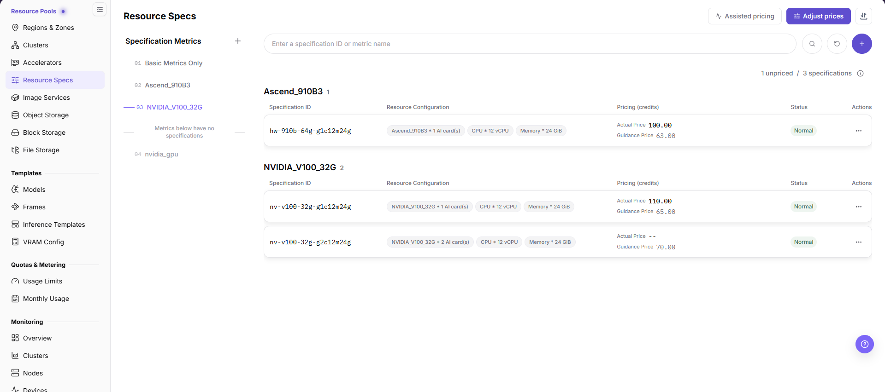
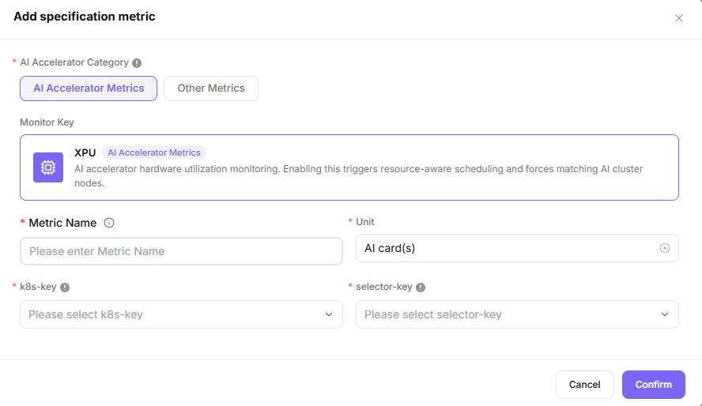
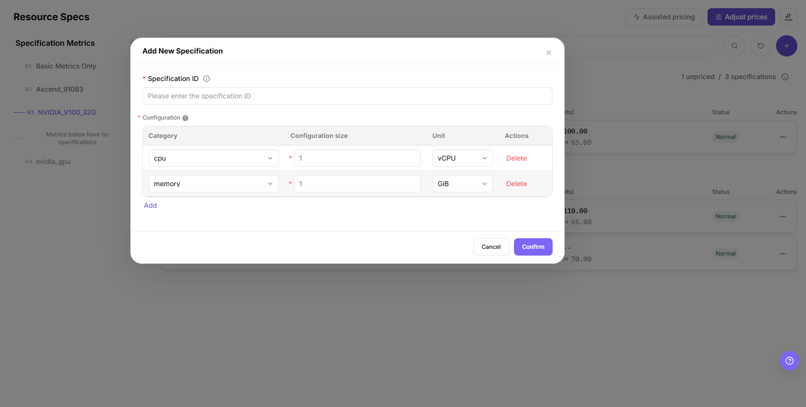
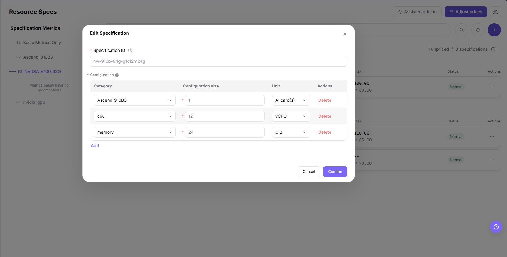
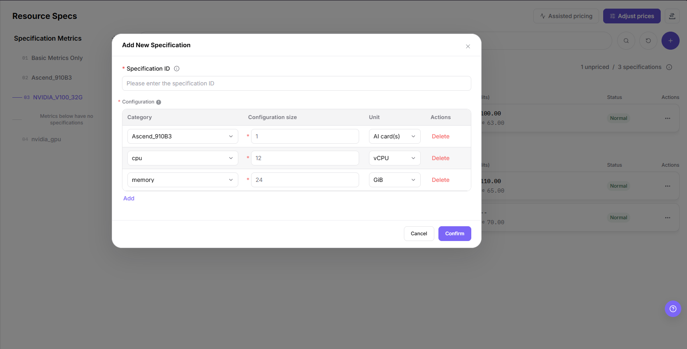
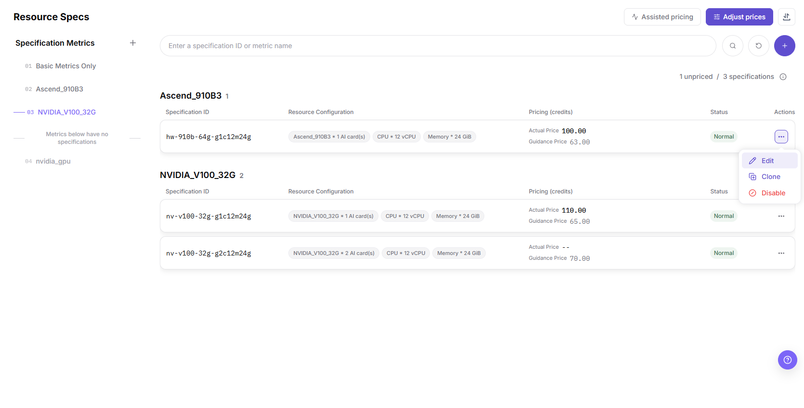
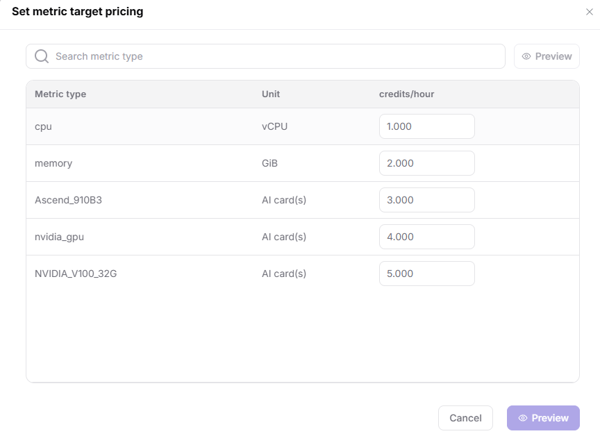
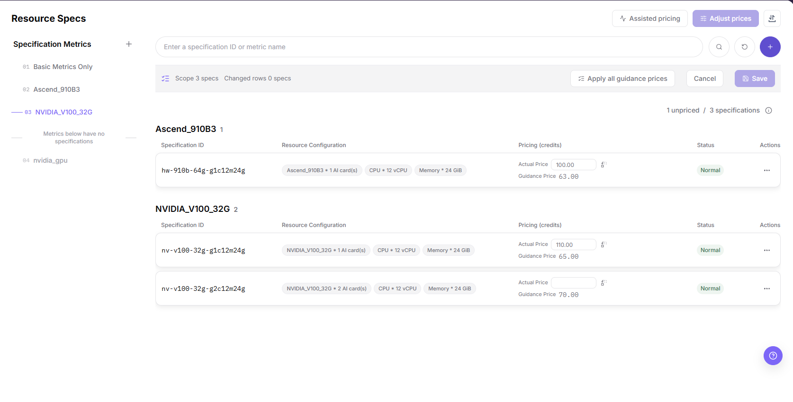

# Resource Specs

## Feature Overview

| Item | Content |
| --- | --- |
| Applicable Role | Operator |
| Navigation Path | On-Prem > Resource Pools > Resource Specs |
| Page Route | `/powerone/resourcepool/flavor/list` |
| Managed Object | Specification ID, the configuration entries of a specification, the price in credits, the enabled state, and the specification metrics that group the list |

#### Beginner Explanation

- **Resource specification** is like a resource package. Users select it to request resources when creating jobs or services.
- **Specification metric** is a resource item in the package. CPU, memory, or accelerator metrics must exist before they can be combined into specifications.
- **Associated cluster** determines where the specification is available. After creation, the specification still needs to match actual cluster capacity.

#### Terms

| Term | Description |
| --- | --- |
| Specification ID | Resource package name displayed on the user side or job creation page. |
| CPU | CPU cores or CPU metric quantity included in the specification. |
| Memory | Memory capacity included in the specification. |

#### Recommended Operation Order

Confirm prerequisites for specification metrics, the specification ID, the configuration entries and their units, the credits price, and the status, follow Main Operations, run Result Validation, and continue to the next page.

#### First-Time User Notes

Confirm that the task involves the specification ID, the configuration entries and their units, the price in credits, the enabled state, or the specification metrics that group the list, and then follow the recommended order. If fields or state differ from expectations, check prerequisites before continuing downstream.

## Prerequisites

1. The current account has operator permissions and can access `On-Prem > Resource Pools > Resource Specs`.
2. Specification metrics have been configured, and CPU, memory, and accelerator metrics are available.
3. If the specification includes accelerators, accelerator model, k8s-key, selector-key, and resources actually reported by cluster nodes have been confirmed.
4. Specification naming, resource tiers, applicable job types, and later cluster association scope have been planned.
5. Before editing, cloning, or disabling a specification that is already opened to users, the business window is agreed and the clusters, templates, tenant quotas, and running instances referencing it are listed.

## Page Description

Use this page to maintain specification IDs and their resource configuration entries, the price in credits, the enabled state, and the specification metrics that group the list.

The list groups specifications by specification metric, and each group header shows the metric name together with the number of specifications it contains. Each row contains `Specification ID`, `Resource Configuration`, `Pricing (credits)`, `Status`, and `Actions`, and the summary line above the list shows how many of them are unpriced, for example `1 unpriced / 3 specifications`. CPU, memory, and accelerator entries appear as chips inside the `Resource Configuration` column, and the `Actual Price` and `Guidance Price` lines share the `Pricing (credits)` column as two lines. Type a specification ID or a metric name in the search box, then use the search and reset icon buttons on its right. The page header carries `Assisted pricing`, `Adjust prices`, and an icon-only import and export entry, and each row's `Actions` menu lists `Edit`, `Clone`, and `Disable`.

## Main Operations

### Manage Specification Metrics

The `Specification group navigation` panel stays on the left of the page under the `Specification Metrics` heading. Because the list groups specifications by these metrics, a metric is a prerequisite object of a specification.

#### Applicable Scenarios

Add or change a specification metric when a specification must reference a new accelerator or another resource item, or when an existing metric needs a new name, unit, k8s-key, or selector-key.

#### Steps

1. Go to `On-Prem > Resource Pools > Resource Specs` and look at the `Specification Metrics` list in the `Specification group navigation` panel, which is split into `Basic Metrics Only`, accelerator metrics, and the items under the `Metrics below have no specifications` divider.
2. Click **"Add specification metric"** to open the metric dialog.
3. Choose `AI Accelerator Metrics` or `Other Metrics` in the `AI Accelerator Category` segmented control.
4. For an accelerator metric, the read-only `Monitor Key` card below names its source; the `XPU` card means AI accelerator hardware utilization monitoring, which triggers resource-aware scheduling and forces matching AI cluster nodes.
5. Fill in `Metric Name` (1-30 characters), `Unit` (prefilled `AI card(s)` for an accelerator metric), `k8s-key`, and `selector-key`; all four are required. The `k8s-key` and `selector-key` options come from resources actually reported by cluster nodes.
6. Click **"Confirm"** to submit.

The following figure shows the metric dialog in the `AI Accelerator Metrics` state, where `Monitor Key`, `Metric Name`, `Unit`, `k8s-key`, and `selector-key` are filled in one form.

#### Result Validation

- The new metric appears in the `Specification Metrics` panel and is available as a `Category` option in the `Configuration` table of the `Add New Specification` dialog.
- A metric that no specification uses yet is listed under the `Metrics below have no specifications` divider.

#### Notes

- Each item in the panel offers `Edit` and `Disable` in its menu. Confirm the impact on specifications and jobs before disabling a metric that is already in use.
- Once a specification uses the metric, changing its name, unit, k8s-key, or selector-key affects the scheduling basis of those specifications.
- In the `Other Metrics` state the `Monitor Key` card becomes a dropdown (for example `xpu`) and the form does not offer a `selector-key` field, so a metric created there is not bound to a node selector.

### Add Resource Specification

#### Applicable Scenarios

Add a specification when resource tiers are required for training, inference, development, or model services, or when different resource combinations need to be provided by CPU, memory, accelerator model, and card count.

#### Steps

1. Go to `On-Prem > Resource Pools > Resource Specs`.
2. Click the round plus button at the right end of the search row to open the `Add New Specification` dialog.
3. Fill in `Specification ID`. Use an ID that reflects the resource tier and the applicable scenario.
4. Maintain the resource entries as rows of the `Configuration` table (`Category`, `Configuration size`, `Unit`, and `Actions`). The dialog starts with a `cpu` row (unit `vCPU`) and a `memory` row (unit `GiB`), both sized `1`; click **"Add"** below the table to append a row, or **"Delete"** at the end of a row to remove it.
5. The `Category` options come from the metrics listed in the `Specification Metrics` panel, so an accelerator option is available only after that metric exists and is enabled.
6. Before clicking the final **"Confirm"**, verify the resource combination and the naming convention again.

The following figure shows the `Add New Specification` dialog before an accelerator row is added: `Specification ID` is empty and the `Configuration` table starts with a `cpu` row (unit `vCPU`) and a `memory` row (unit `GiB`).

#### Result Validation

- After a successful submit, the specification appears in the list under the group of the metric used by its accelerator row, and its `Resource Configuration` cell shows the `cpu`, `memory`, and accelerator entries as chips.
- The `Pricing (credits)` column shows the actual price and the guidance price as two lines. A specification whose pricing has not been set is counted as unpriced and shows `--` on the actual price line.
- The new specification becomes a `Category`-driven option set only through its metrics; the `Specification Metrics` panel is where that dependency is resolved.

#### Notes

- The dialog has no pricing fields. A specification price comes from the metric target prices multiplied by the configured quantities, so maintain it through `Assisted pricing` or `Adjust prices`.
- An accelerator can be selected only after its metric exists and is enabled in the `Specification Metrics` panel.
- Editing an existing specification is a separate entry: choose `Edit` in the `Actions` menu of the row, or choose `Clone` to derive a new specification from it.

### Edit Resource Specification

#### Applicable Scenarios

Edit a specification when its CPU, memory, or accelerator rows must change. `Specification ID` is read-only, so a specification that needs a different ID must be added again instead.

#### Steps

1. Choose `Edit` in the `Actions` menu of the target row to open the `Edit Specification` dialog.
2. `Specification ID` is shown read-only and cannot be changed.
3. Change only the `Configuration` table: add or remove rows, and adjust `Configuration size` and `Unit`. The `Category` options come from the same `Specification Metrics` panel as in the add dialog.
4. Click **"Confirm"** to submit, or **"Cancel"** to discard.

The following figure shows the `Edit Specification` dialog: `Specification ID` is greyed out and read-only, while the three `Configuration` rows stay editable.

#### Result Validation

- After a successful submit, the `Resource Configuration` chips of that row reflect the edited configuration, and the group the specification belongs to follows the metrics it now uses.

#### Notes

- When a different ID is required, use `Clone` in the `Actions` menu to derive a new specification from an existing one, then adjust its configuration; see the Clone Resource Specification section below.
- Changing a specification changes the resource tier that users select when they create online IDEs, runtime instances, training jobs, or model services. Confirm the business window first.

### Clone Resource Specification

#### Applicable Scenarios

Use `Clone` when a new specification differs from an existing one by only a few configuration rows, or when the same resource combination must be published under a different `Specification ID`.

#### Steps

1. Go to `On-Prem > Resource Pools > Resource Specs` and open the `Actions` menu of the source row, which lists `Edit`, `Clone`, and `Disable` in this order.
2. Click **"Clone"**. The `Add New Specification` dialog opens with the `Configuration` rows of the source specification already filled in, while `Specification ID` is empty.
3. Enter the required `Specification ID`.
4. Adjust the `Configuration` rows as needed, then click **"Confirm"**, or **"Cancel"** to leave the source specification unchanged.

The following figure shows the dialog opened by `Clone`: three `Configuration` rows carried over from the source specification and an empty `Specification ID`.

#### Result Validation

- After a successful submit, the list gains one specification grouped by the metric of its accelerator row, and the source specification keeps its own ID, configuration, price, and status.
- The `Pricing (credits)` and `Status` values of the new record follow what the page shows; check them before opening the tier to users.

#### Notes

- `Clone` creates a record instead of modifying the source specification, so the source stays usable.
- Confirm the resource combination against capacity actually reported by cluster nodes before opening the new tier to users.

### Disable Resource Specification

#### Applicable Scenarios

Disable a specification when a resource tier must stop being selectable while its configuration and history are kept, for example during a capacity change or a pricing review.

#### Steps

1. Open the `Actions` menu of the target row, which lists `Edit`, `Clone`, and `Disable` in this order; `Disable` is the red item at the bottom.
2. Click **"Disable"**. If the page shows a confirmation, read it before you confirm; the exact prompt wording follows the live page.
3. Refresh the list and check the `Status` column of that row.

The following figure shows the `Actions` menu of a specification row, with `Edit`, `Clone`, and `Disable` in this order.

#### Result Validation

- The row leaves the enabled state shown in the `Status` column, and the specification is no longer selectable where disabled specifications are filtered out.
- Re-open the `Actions` menu to see what the page offers for that row now; the entry that restores the enabled state follows the live page.

#### Notes

- Disabling a specification changes what users can select when they create online IDEs, runtime instances, training jobs, or model services. Confirm the business window first.
- If the tier only needs a different resource combination, edit the specification instead of disabling it.

### Set Metric Target Pricing

`Assisted pricing` sets the unit price of a **specification metric** in credits per hour, not the total price of one specification. The price of a specification is derived from metric prices multiplied by the configured quantities.

#### Applicable Scenarios

Use `Assisted pricing` when you need to move the pricing baseline of a resource type, or when a newly added metric still has no target unit price.

#### Steps

1. Go to `On-Prem > Resource Pools > Resource Specs` and click **"Assisted pricing"** on the page header to open the `Set metric target pricing` dialog.
2. The dialog lists every metric with the columns `Metric type`, `Unit`, and `credits/hour`, and provides a `Search metric type` box with its own **"Preview"** action on the right.
3. Edit the target unit price row by row (values take three decimals, such as `1.000`), then click **"Preview"** in the dialog footer to review the impact, or **"Cancel"** to discard it; the footer offers only these two actions.

The following figure shows the `Set metric target pricing` dialog with the metric list and the `Preview` action in its footer.

#### Result Validation

- The `credits/hour` value of the metric shows the new target price once the page applies the change; the entry that applies it follows the live page.
- Specifications that use the metric show the recalculated price in the `Pricing (credits)` column.

#### Notes

- A metric price change propagates to every specification that uses the metric. Confirm the affected specifications before you apply the change.

### Adjust Specification Prices

`Adjust prices` is an **inline editing mode inside the list, not a dialog**. Changes take effect only after you click **"Save"**.

#### Applicable Scenarios

Use `Adjust prices` when you need to change the actual price of specifications in bulk, or when you want to adopt the guidance price for one or all rows.

#### Steps

1. Click **"Adjust prices"** on the page header. The list enters editing mode and the banner shows `Scope <N> specs` and `Changed rows <N> specs`.
2. Edit the actual price in the row input, or click **"Apply all guidance prices"** on the banner to adopt the guidance price for every row.
3. Click **"Save"** to submit. **"Save"** stays disabled while nothing has changed; click **"Cancel"** to leave editing mode without writing anything.

The following figure shows the editing mode entered from `Adjust prices`: the scope banner, `Apply all guidance prices`, and the actual-price input of each row.

#### Result Validation

- After editing mode closes, the actual price line of the `Pricing (credits)` column shows the new value and the banner disappears.

#### Notes

- Nothing is written until **"Save"** succeeds, so an accidental entry never reaches the price.
- Confirm the guidance price source before applying it in bulk to every specification.

### Import or Export Resource Specs

#### Applicable Scenarios

Use the import and export entry on the page header to batch-maintain resource specifications, or to export specification combinations for audit, reconciliation, and controlled migration.

#### Steps

1. Go to `On-Prem > Resource Pools > Resource Specs`.
2. On the page header, use the icon-only button at the far right to open the import and export entries, then choose **"Import"** or **"Export"**.
3. For import, the `Import Configuration Data` drawer asks you to select a ZIP package exported from the backend and run a precheck before anything is written. The drawer footer only offers **"Cancel"**.
4. For export, the `Export Configuration Package` drawer lists modules under `Select Modules` (**"Select All"** and **"Clear"** are provided), and its footer shows how many modules are selected before you click **"Export"**.
5. Before importing, verify that the package does not overwrite a specification already used by cluster associations or jobs; store exported packages in a controlled directory.

#### Result Validation

- After import, the Resource Specs list shows the added or updated combinations.
- The exported package contains the modules you selected, and its module list matches what you chose in the drawer.
- Cluster specification association or job creation can correctly identify the imported specifications.

#### Notes

- Specification ID, metric quantities, and accelerator model must match actual cluster capacity; otherwise specification matching or scheduling may fail.
- Import may update fields on a specification with the same identifier. Check cluster associations, job dependencies, and file scope first.

## Parameter Quick Reference

| Field Name | Required | Field Type | Example | Description |
| --- | --- | --- | --- | --- |
| Specification ID | Yes | Text | `gpu-a100-1card` | Specification name selected when users create online IDEs, runtime instances, training jobs, or model services. The dialog field is a text box that prompts `Please enter the specification ID`. Use an ID that reflects CPU, memory, accelerator model, card count, and applicable scenario. The value can only consist of lowercase letters, numbers, dots (.) and hyphens (-), and must start and end with lowercase letters or numbers. |
| Configuration Category | Yes | Dropdown / enum | `cpu` | One resource entry of the `Configuration` table. Options come from the metrics in the `Specification Metrics` panel, so the metric must exist and be enabled first. |
| Configuration Size | Yes | Number / capacity | `16` | Quantity of that entry. Match the resources required by the job and the capacity actually reported by cluster nodes. |
| Unit | Yes | Dropdown / enum | `vCPU` | Unit shown for the entry, such as `vCPU`, `GiB`, or `AI card(s)`, or the unit defined by the metric. Keep units consistent to avoid display and scheduling mismatch. |
| Specification Metric | System-generated | Grouping item | `<METRIC_NAME>` | The metric the list is grouped by, maintained in the `Specification Metrics` panel. Its k8s-key, selector-key, and unit must match resources actually reported by cluster nodes. |
| Resource Configuration | System-generated | Chip group | `cpu 16 · memory 32GiB` | List column that aggregates all configuration entries of the specification. Accelerator types are not separate columns. |
| Pricing (credits) | No | Number / price | `<PRICE>` | List column that holds the actual price and the guidance price as two lines. Unpriced specifications are counted in the summary line and are not shown on the user side. |
| Status | System-generated | Status | Refer to the page | Whether the specification is usable on this page. Complete resource configuration and pricing before opening it to users. A disabled specification stops being selectable on downstream pages that filter out disabled ones. |
| Actions | No | Action entry | `Edit` | The row menu lists `Edit`, `Clone`, and `Disable` in this order; other entries follow what the page actually shows. Confirm impact scope and replacement options before high-risk actions. |

## Pitfalls

- Adding a specification affects resource packages available when users create online IDEs, runtime instances, training jobs, or model services.
- Oversized specifications may increase queue time; undersized specifications may cause insufficient resources after task startup.
- Incorrect specification metrics, k8s-key, or selector-key may make the specification unavailable or cause scheduling failures.
- `Clone` carries over the source specification's `Configuration` rows, including their metrics and quantities; the new record needs its own `Specification ID`, and its price and status must be re-checked before the tier is opened to users.
- `Confirm` (the specification-metric, Add New Specification, Edit Specification, and Clone dialogs) and `Save` (Adjust prices editing mode) are high-risk final actions; `Disable` writes as soon as its own confirmation is accepted, and `Set metric target pricing` exposes only `Preview` and `Cancel` in its footer.
- Do not record real cluster IDs, resource pool IDs, node labels, internal resource key mappings, tenant information, accounts, keys, tokens, or internal test parameters.

### Configuration Rules and Impact

- **Metrics before specifications**: Specifications depend on specification metrics. Without metrics, CPU, memory, or accelerators cannot be configured accurately.
- **Then associate clusters**: After a specification is created, it must still be associated with clusters before users can select it.
- **Consistent resource combination**: CPU, memory, and accelerator quantity in the specification should match cluster schedulable resources.
- **Readable naming**: Specification names should help capacity troubleshooting, user selection, and later template references.
- **Change enabled status carefully**: Before disabling or modifying an opened specification, confirm impacts on templates, tenant quotas, and running instances.

## Result Validation

| Check Item | Success Signal | If Abnormal |
| --- | --- | --- |
| Page entry | Resource Specs opens with the target operation entry | Check Operator permission and whether the menu is available |
| Object record | The target specification is visible in the list with its configuration chips, its pricing lines, and its status | Reset filters and verify name, ownership, and creation result |
| State result | State after creation or change matches the page message | Check operation feedback, dependency state, and latest update time |
| Downstream use | A downstream page can select or associate the target | Return to prerequisites and check enabled state, ownership, and visibility |

## FAQ

#### An Imported Resource Specification Cannot Be Associated with a Cluster

**Symptom:**

The resource specification import completes, but the specification cannot be found in the specification association list in cluster details.

**Possible Causes:**

- The specification is unavailable or still being validated.
- Specification metrics do not match reported cluster resources.
- Specification scope or active filters do not match.

**Solution:**

1. Check state, specification ID, and update time in Resource Specs.
2. Check the metric, k8s-key, selector-key, and accelerator model in the `Specification Metrics` panel of the Resource Specs page, and in `Accelerators`.
3. Reset filters, reopen cluster details, and verify the visibility scope.

#### The Operation Entry on Resource Specs Is Unavailable

**Symptom:**

The create, register, or maintain entry is hidden or disabled.

**Possible Causes:**

- Role permission is insufficient.
- The page is read-only.
- Dependencies are not ready.

**Solution:**

1. Check Operator permission.
2. Read the page message.
3. Complete dependency configuration first.

#### A Required Field on Resource Specs Has No Options

**Symptom:**

The form opens, but a selection list is empty.

**Possible Causes:**

- Candidates are disabled.
- Ownership differs.
- The current account cannot see them.

**Solution:**

1. Check candidate state.
2. Verify ownership.
3. Confirm visibility and refresh the form.

#### Resource Specs Has an Abnormal State After the Operation

**Symptom:**

A record exists after submission, but its state is unexpected.

**Possible Causes:**

- Connectivity or validation failed.
- A dependency is abnormal.
- Processing is incomplete.

**Solution:**

1. Check feedback and update time.
2. Inspect related objects.
3. Troubleshoot the processing stage.

#### A Downstream Page Cannot Use Resource Specs

**Symptom:**

The current page is normal, but a downstream page cannot select or associate the target specification.

**Possible Causes:**

- Visibility differs.
- The object is disabled.
- Downstream cache is stale.

**Solution:**

1. Check enabled state and ownership.
2. Verify role visibility.
3. Refresh and select again.

## Notes

- Once opened to users, resource specifications directly affect creation choices for model instances, online IDEs, runtime instances, and training jobs.
- Before modifying specification ID, resource quantity, or enabled/disabled status, confirm associated clusters, templates, tenant quotas, and running instances.
- Large specifications may increase queue time, while small specifications may cause insufficient resources after task startup. Calibrate with monitoring and failure cases.
- `Confirm` (the specification-metric, Add New Specification, Edit Specification, and Clone dialogs) and `Save` (Adjust prices editing mode) are high-risk final actions; `Disable` writes as soon as its own confirmation is accepted, and `Set metric target pricing` exposes only `Preview` and `Cancel` in its footer. Confirm the scope and impact before executing one.
- Do not record real cluster IDs, resource pool IDs, node labels, internal resource key mappings, tenant information, accounts, keys, tokens, or internal test parameters.

## Next Steps

1. Go to `On-Prem > Resource Pools > Clusters` and associate specifications with the target cluster.
2. Submit a test job, online IDE, or model service to verify specification scheduling results.
3. Return to the Resource Specs list and confirm that enabled status, filter results, and associations are as expected.
