# System Setting

## Feature Overview

| Item | Content |
| --- | --- |
| Applicable Role | Operator |
| Navigation Path | On-Prem > System > System Setting |
| Managed Object | Configuration, status, and relationships on System Setting |

#### Beginner Explanation

System Setting is the workspace for Configuration, status, and relationships on System Setting. Confirm the object, state, and dependencies before an operation, and then use Result Validation to confirm downstream availability.

#### Terms

| Term | Description |
| --- | --- |
| Configuration Item | A system-level parameter or switch provided by the platform. |
| Configuration Value | The current value used by a configuration item. It may be a switch, text, enum, or number. |
| Status | Whether the configuration item is enabled, available, or effective. |

#### Recommended Operation Order

Confirm prerequisites for System configuration items, configuration values, descriptions, status, and action entries, follow Main Operations, run Result Validation, and continue to the next page.

#### First-Time User Notes

Confirm that the task involves Configuration, status, and relationships on System Setting, and then follow the recommended order. If fields or state differ from expectations, check prerequisites before continuing downstream.

## Prerequisites

1. The current account has operator permissions.
2. The correct On-Prem environment and target region have been selected.
3. Confirm whether this operation is read-only or has approved change permission.

## Page Description

Use this page to review the configuration groups on the left and the configuration items, control forms, and current values inside each group.

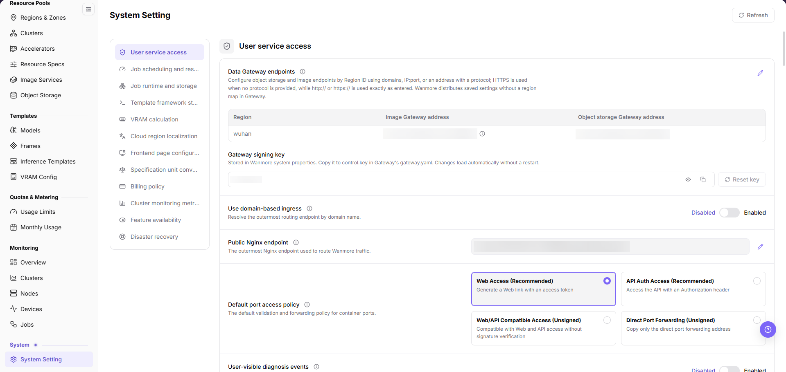

Go to `On-Prem > System > System Setting`. The page displays system-level configuration items. The list is used to view configuration item names, configuration values, descriptions, status, and possible action entries.

An editable item shows a pencil icon at the end of its value row. Opening edit mode is a write action, so stop at field review and do not perform the final submit.

## Main Operations

This section is organized by configuration group. Each group documents the review actions only, and each image follows the step it supports.

### Review User Service Access Configuration

#### Applicable Scenarios

Use the `User service access` group to confirm the entry addresses, signing key, domain-based ingress switch, public Nginx endpoint, default port access policy, and user-visible diagnosis events that user-facing services depend on.

#### Steps

1. Go to `On-Prem > System > System Setting`.
2. In the group list on the left, click `User service access`.
3. Check the three columns of the embedded table under `Data Gateway endpoints`: `Region`, `Image Gateway address`, and `Object storage Gateway address`. The addresses are internal addresses. In documentation, tickets, and screenshots, record them as `<internal address>` only.
4. Check `Gateway signing key`: the read-only field shows masked dots, `Eye` and `Copy` icons sit to its right, and the `Reset key` button sits at the end of the row.
5. Check the current state of the `Use domain-based ingress` and `User-visible diagnosis events` switches, and check the port and path template of `Public Nginx endpoint`.
6. Check which card is selected under `Default port access policy`. The four options are `Web Access (Recommended)`, `API Auth Access (Recommended)`, `Web/API Compatible Access (Unsigned)`, and `Direct Port Forwarding (Unsigned)`.

The following image covers the full visible range of this group, so each configuration item name and control form above can be aligned one by one.

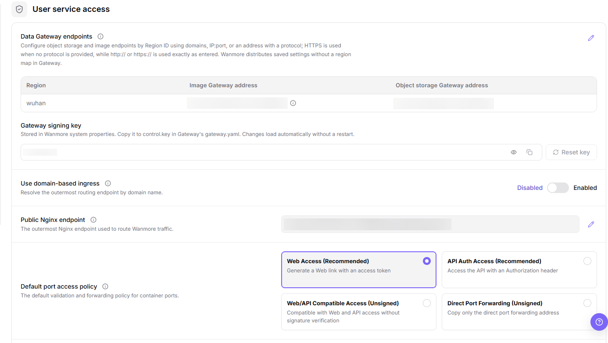

#### Result Validation

- All six configuration item titles in the group are visible, each mapped to a masked field, a switch, a radio card, or a value row with a pencil icon.
- The key is displayed only in masked form, and no plaintext key appears on the page or in the documentation.

#### Notes

- `Reset key` is a write action and appears disabled in this capture set. Its confirmation dialog and result message are not collected (see U-03), so do not click it during a read-only review.
- Gateway addresses, signing keys, and internal endpoints must not be written into documentation, screenshots, tickets, or chats.

### Review Job Scheduling And Resource Governance Configuration

#### Applicable Scenarios

Use the `Job scheduling and resource governance` group to confirm which job types are queued, the RDMA related settings, the scheduling thresholds, and how strict resource precheck is.

#### Steps

1. Go to `On-Prem > System > System Setting`.
2. In the group list on the left, click `Job scheduling and resource governance`.
3. Check the tags already included under `Queued job types`, and the current state of the `Ignore RDMA settings` switch.
4. Check the two columns `Cluster ID` and `Network annotation value` in the `Cluster RDMA configuration` table. Record in-cluster identifiers as `<cluster ID>` only.
5. Check the current values and unit forms of `Missing K8s entity fallback threshold`, `Resource scheduling threshold`, and `Ephemeral storage scheduling threshold`.
6. Check the current state of the `Job scheduling logs`, `Strict resource precheck`, and `Allow duplicate K8s clusters` switches.

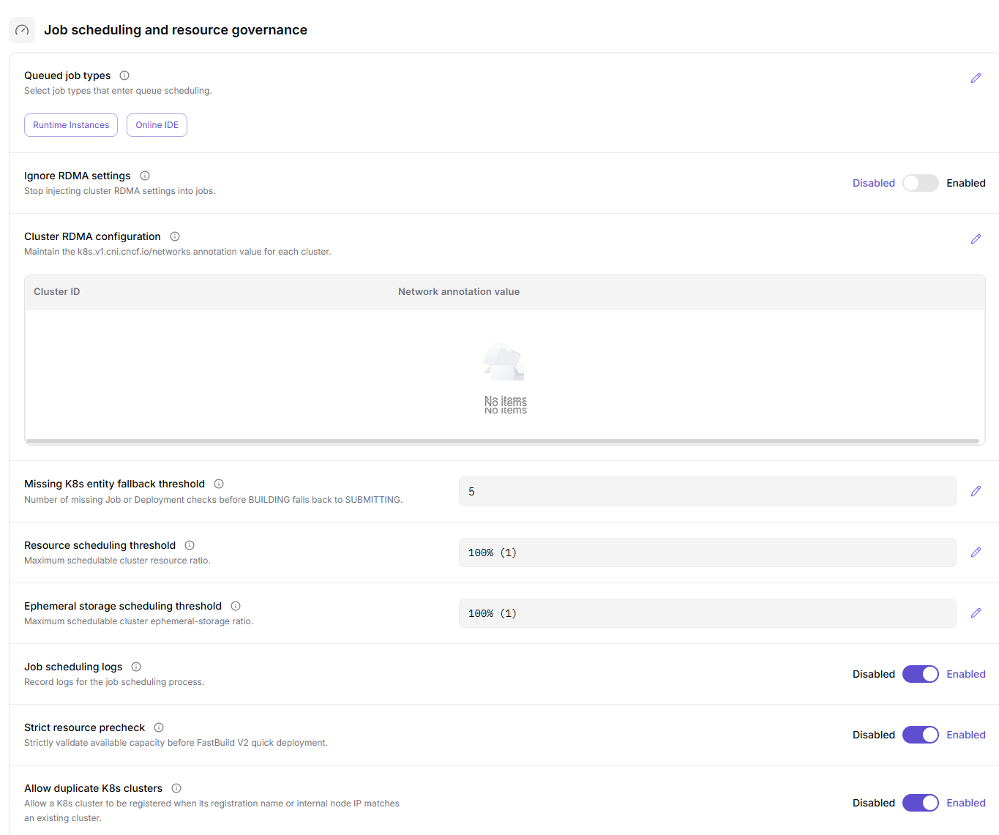

#### Result Validation

- All nine configuration item titles in the group are visible; threshold items show their values, and tag or table items show the selected content or an empty-state message.
- The state of each switch matches its highlighting on the page, so you can tell whether queueing, precheck, and duplicate cluster registration are actually allowed.

#### Notes

- Scheduling thresholds, resource precheck, and queued job types directly affect whether a job can be scheduled. Confirm the impact scope and rollback plan before changing them.
- The full option set behind the pencil icon, such as other job types that can be queued, is not evidenced by the captures (see U-07).

### Review Job Runtime And Storage Configuration

#### Applicable Scenarios

Use the `Job runtime and storage` group to confirm the workload form used by jobs, the DNS resolver address, and the system disk and shared memory limits.

#### Steps

1. Go to `On-Prem > System > System Setting`.
2. In the group list on the left, click `Job runtime and storage`.
3. Check the tags selected under `Job types using Deployment`, and keep them distinct from the queued tags in `Job scheduling and resource governance`.
4. Check `Pod DNS resolver`. The value is an internal address and is recorded as `<internal address>` in documentation.
5. Check the current values and their capacity or bandwidth units for `Job system disk limit`, `Default shared memory size`, and `Default pod bandwidth`.
6. Check the three columns `Cluster ID`, `XPU count`, and `SHM size` in the `Cluster SHM size map` table. Record cluster identifiers as `<cluster ID>`.

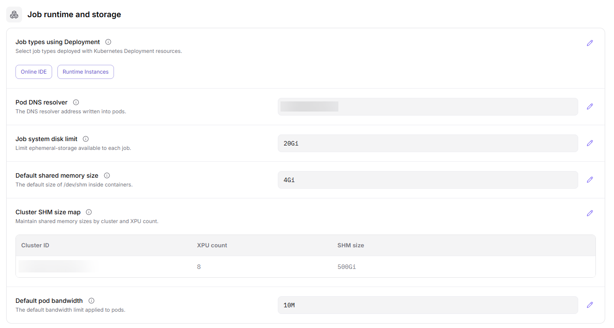

#### Result Validation

- All six configuration item titles are visible, and capacity items show values with their units.
- The number of rows in `Cluster SHM size map` matches the number of configured clusters; unconfigured clusters do not appear in the table.

#### Notes

- The system disk limit, shared memory size, and default bandwidth determine the resources a job can request. Confirm node capacity and quota impact before relaxing them.
- Changing `Job types using Deployment` changes the scheduling form of jobs. The page shows the currently selected tags.

### Review Template Framework Start Commands Configuration

#### Applicable Scenarios

Use the `Template framework start commands` group to confirm the default start command template delivered to a job for a given inference framework version.

#### Steps

1. Go to `On-Prem > System > System Setting`.
2. In the group list on the left, click `Template framework start commands`.
3. Select the target framework in the tab strip above the group, then select the target version in the `Framework version` list on the left. The current capture shows `default` selected.
4. Check the command and its parameter placeholders in the `Main node command` panel, such as `${modelName}`, `${servedModelName}`, `${nodeNum}`, and `${prefixExtraParamString}`.
5. Check the command in the `Worker node command` panel. Its address takes the form `job-cluster-${id}:6379`, which is how a worker node rejoins the Ray cluster on the main node.

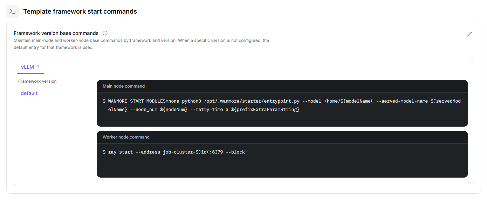

#### Result Validation

- After you switch the framework tab or an entry in `Framework version`, both command panels change to the selected version.
- Parameter placeholders stay unchanged and are not replaced with a concrete model name or node count.

#### Notes

- This command template directly determines how a new job starts. A change affects every later job that uses the version, so run it through the change process.
- The full framework tab set, the meaning of the number behind a tab, and the version hierarchy are not fully captured (see U-09).

### Review VRAM Calculation Configuration

#### Applicable Scenarios

Use the `VRAM calculation` group to confirm how much VRAM is reserved for each model classification during VRAM estimation, or to check the minimum reserve and reserve ratio of a model type.

#### Steps

1. Go to `On-Prem > System > System Setting`.
2. In the group list on the left, click `VRAM calculation`.
3. Check the counter line above `Framework VRAM reserve rules` to confirm the number of rules and the sort order.
4. Check the columns `Model classification`, `Modality conditions`, `Minimum reserve`, `Reserve ratio`, and `Enabled`, and compare the reserve basis row by row.
5. Read the formula in the footnote below the table: reserved VRAM takes the larger value between the minimum reserve and the model weight memory multiplied by the reserve ratio.

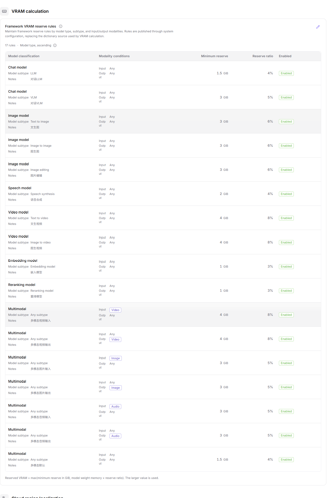

#### Result Validation

- The number of table rows matches the rule count in the counter line, and the `Enabled` column can be read row by row.
- No two rows for the same model classification carry conflicting reserve ratios.

#### Notes

- This group drives the VRAM estimation result. Tightening the reserve shrinks the model specifications users can request, so assess representative models first.
- Whether `Enabled` can be turned off, and whether rules can be added, removed, or reordered, is not evidenced (see U-10).

### Review Cloud Region Localization Configuration

#### Applicable Scenarios

Use the `Cloud region localization` group to confirm the name shown to users for a cloud region in a given language, or to investigate why a region shows its Region ID instead of a localized name.

#### Steps

1. Go to `On-Prem > System > System Setting`.
2. In the group list on the left, click `Cloud region localization`.
3. Check the four columns `Cloud provider`, `Region ID`, `Locale`, and `Translated name` in the `Cloud region name mappings` table.
4. For the same `Region ID`, compare the translated names across `Locale` values and confirm whether a mapping row exists for the target language. Without a mapping, the interface shows the Region ID.

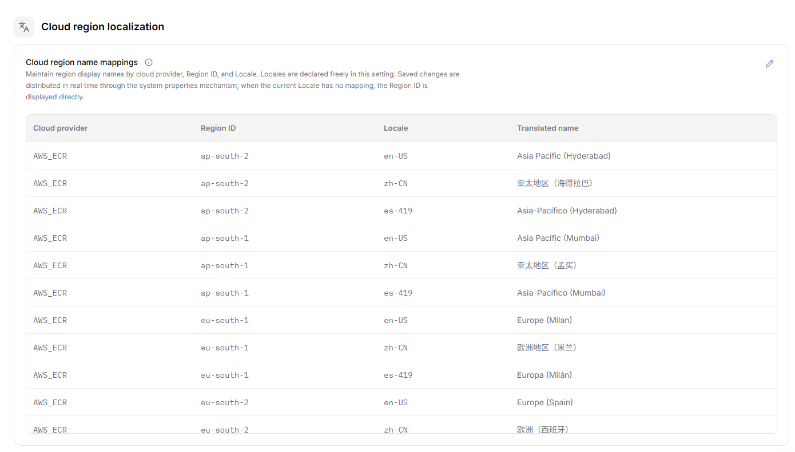

#### Result Validation

- For the target provider and Region ID pair, a mapping row exists for the current interface language and its name matches what the interface shows.
- A region without a translated name falls back to its Region ID rather than showing a blank cell.

#### Notes

- The page shows the `AWS_ECR` provider.
- Translated names belong to the presentation layer. They do not change the region actually connected, but they do affect how users choose a region.

### Review Frontend Page Configuration

#### Applicable Scenarios

Use the `Frontend page configuration` group to confirm the content version currently effective for each operator page section, or to investigate why a section has not been updated.

#### Steps

1. Go to `On-Prem > System > System Setting`.
2. In the group list on the left, click `Frontend page configuration`.
3. Check the two columns `Page section` and `Timestamp` in the `Page section timestamps` table to confirm the latest update time of each section.
4. Map each section key to the position reported in the interface, and decide whether that section refreshed at the expected time.

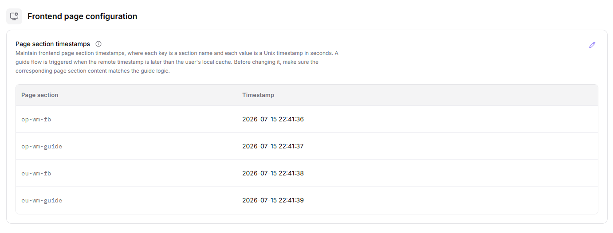

#### Result Validation

- The number of section rows matches the number of page sections actually exposed, with no section missing.
- The timestamp of the target section is not earlier than the last content release.

#### Notes

- Section keys and timestamps are runtime data. Replace them with shape placeholders such as `<date>` before sharing information externally.
- This group reflects only the presentation layer version, not whether the backend service or the data itself has been updated.

### Review Specification Unit Conversion Configuration

#### Applicable Scenarios

Use the `Specification unit conversion` group to confirm the multiplier applied to a resource unit in billing and usage statistics, or to investigate why a usage figure differs from expectation.

#### Steps

1. Go to `On-Prem > System > System Setting`.
2. In the group list on the left, click `Specification unit conversion`.
3. Check the two columns `Unit` and `Conversion multiplier` in the `Specification metric units` table, and confirm row by row that every unit in use has a mapping.
4. For memory and storage units, confirm the conversion base so that units stepping by 1000 and units stepping by 1024 are not mixed.

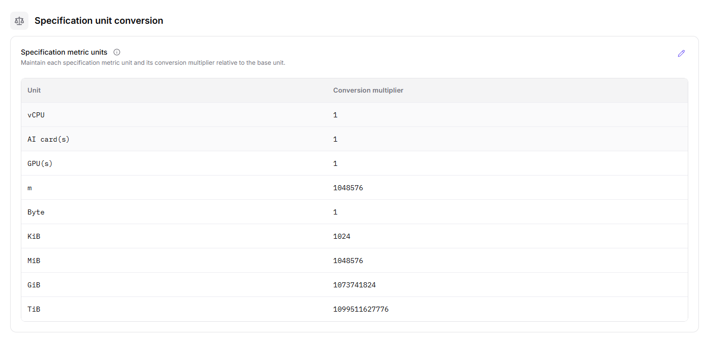

#### Result Validation

- Every unit shown on usage or billing pages has a matching row and multiplier in the table.
- An unregistered unit does not participate in conversion with a default multiplier; confirm it in this table first.

#### Notes

- Conversion multipliers take part in billing calculations. A change makes historical and new usage inconsistent in basis, so assess it together with the billing policy.
- A multiplier is a static conversion factor. During a read-only review, do not fill in values or submit.

### Review Billing Policy Configuration

#### Applicable Scenarios

Use the `Billing policy` group to confirm which consumption type the platform currently bills on, or to check the retention period of objects pending deletion when the balance is insufficient.

#### Steps

1. Go to `On-Prem > System > System Setting`.
2. In the group list on the left, click `Billing policy`.
3. Check which segment is selected in the `Consumption type` control. The two mutually exclusive options are `credits` and `Spec quota`.
4. Check the current value of `Bucket retention after insufficient credits` to confirm whether data is retained or cleaned on schedule when the balance runs out.

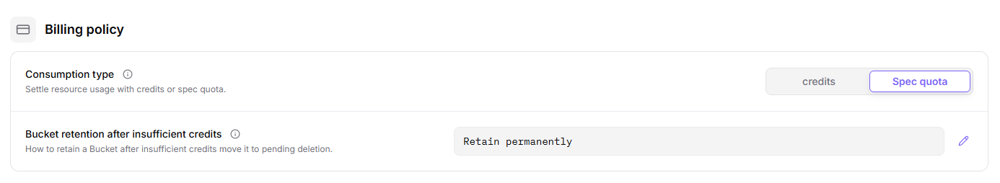

#### Result Validation

- The selected consumption type matches the metering basis shown on user-side quota, usage, and billing pages.
- The retention value matches the cleanup behavior actually observed on the storage side.

#### Notes

- Switching the consumption type changes both the quota display on the user side and the billing basis. It is a high-impact change that requires approval and a rollback plan.
- The English control currently reads `Spec quota`, which differs in capitalization from the form used on other Quotas & Metering pages. Whether the whole site should be unified is a product decision (see U-15); this page records the literal wording from the capture.

### Review Cluster Monitoring Metrics Configuration

#### Applicable Scenarios

Use the `Cluster monitoring metrics` group to confirm which monitoring metrics are collected into storage, or to investigate a missing series on a monitoring chart.

#### Steps

1. Go to `On-Prem > System > System Setting`.
2. In the group list on the left, click `Cluster monitoring metrics`.
3. Check the metric tags listed under `Stored monitoring metrics` to confirm whether the target metric is already included.
4. Match each tag against the metric name used by the chart on monitoring pages. A metric that is not stored does not appear in the dropdown or the chart.

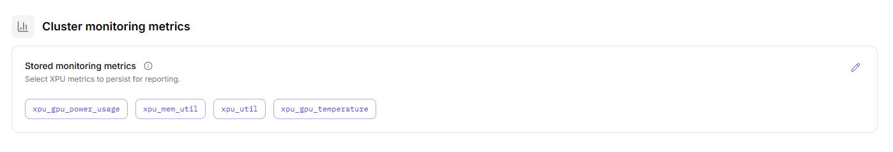

#### Result Validation

- Every metric selectable on a monitoring chart appears as a tag in this group.
- After a tag is added, the corresponding chart shows a series once the reporting cycle elapses.

#### Notes

- Metric tags are collection configuration. Removing a tag hides the historical series on the chart side, which is not the same as the backend data being purged.
- The tag options follow what the page displays.

### Review Feature Availability Configuration

#### Applicable Scenarios

Use the `Feature availability` group to confirm whether a platform capability is open to users, or to investigate a user report that an entry cannot be found.

#### Steps

1. Go to `On-Prem > System > System Setting`.
2. In the group list on the left, click `Feature availability`.
3. Check the current state of the `Automatic deployment profile collection` switch and its description line.
4. Confirm against the user-side interface whether the capability is actually open, instead of judging from the switch alone.

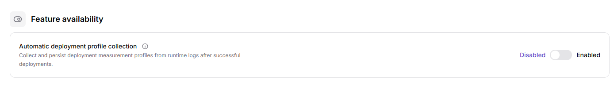

#### Result Validation

- The switch state matches the visibility or availability of the corresponding entry on the user side.
- After a change, the affected page recovers once refreshed and does not require re-login.

#### Notes

- Feature availability changes what users can see. Before enabling it, confirm the collection scope and compliance requirements.
- This group shows one configuration item.

### Review Disaster Recovery Configuration

#### Applicable Scenarios

Use the `Disaster recovery` group to confirm whether recovery scheduling is enabled, or to judge whether jobs can be rescheduled during incident handling.

#### Steps

1. Go to `On-Prem > System > System Setting`.
2. In the group list on the left, click `Disaster recovery`.
3. Check the current state of the `Recovery scheduling` switch and its description line.

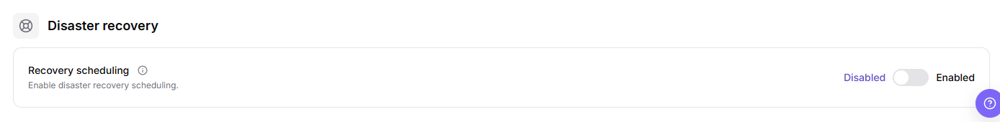

#### Result Validation

- The switch state matches the rescheduling behavior observed in drills or incident handling.
- The change record lists the approver, impact scope, and rollback plan.

#### Notes

- A recovery capability switch is a high-impact configuration. Adjust it only inside an approved change window.
- Do not infer failure behavior or recovery duration from the disabled state; this group shows one configuration item.

### Edit And Save A Configuration Item

#### Applicable Scenarios

Follow this section when a change is approved, impact-assessed, and rollback-ready, and the value of an editable configuration item in `System Setting` must be modified.

#### Pre-Operation Check

1. Confirm that the current environment, account, and target group match the change target.
2. Confirm that change approval is in place and that the impact on scheduling, storage, billing, monitoring, or feature availability is assessed.
3. Confirm the form of the edit entry: the captures evidence only the pencil icon at the end of a value row. The `Edit` and `Save` button wording is not captured (see U-01 and U-02).

#### Steps

1. Go to `On-Prem > System > System Setting`.
2. In the group list on the left, locate the target group.
3. Click the pencil icon at the end of the target configuration item to enter edit mode.
4. Change only the approved field, and leave the other configuration items in the same group untouched.
5. Before submitting, re-check the approval, impact scope, and rollback plan. Do not perform the final submit action until they are confirmed.

#### Result Validation

- The target item shows the new value, while other items in the same group and all other groups keep their original values.
- The affected user service access, job scheduling, resource governance, or page behavior matches the expected change.

#### Notes

- System settings are global configuration. One change can affect several tenants, jobs, or services at the same time. Do not submit without approval, without a rollback plan, or outside an approved change window.
- Write entries such as `Reset key` appear disabled in the captures, and their confirmation dialog and result message are not collected, so their outcome is not described here.

### Refresh The Configuration

#### Applicable Scenarios

Use `Refresh` in the top-right corner to reload the configuration when someone else has just changed it, when the page appears to lag, or when the currently effective values must be read again.

#### Steps

1. Go to `On-Prem > System > System Setting`.
2. Confirm that the target group has finished loading.
3. Click `Refresh` in the top-right corner of the page.
4. Return to the target group and check whether the values and switch states are the latest read result.

#### Result Validation

- Values and states across groups show the latest read result, and a change submitted earlier but not yet displayed appears on the page.
- Refreshing does not change any configuration value.

#### Notes

- The captures evidence `Refresh` as the only view-oriented entry. Whether `Search`, `Filter`, `Expand`, or `Details` also exist is not collected (see U-13).
- If the page still differs from expectation after a refresh, check the object state on prerequisite pages first, then judge whether it is an effective-scope issue.

## Parameter Quick Reference

| Group | Configuration Item | Control | Example On Screen | Description |
| --- | --- | --- | --- | --- |
| `User service access` | `Data Gateway endpoints` | Inline edit (pencil icon) | `<internal address>` | One row per region, covering image and object storage Gateway addresses. |
| `User service access` | `Gateway signing key` | Masked field, `Eye`/`Copy` icons, `Reset key` | `<value>` | Read-only masked display. Never record the plaintext key. |
| `User service access` | `Use domain-based ingress` | Switch | `Disabled` | Decides whether entries resolve by domain name. |
| `User service access` | `Public Nginx endpoint` | Inline edit (pencil icon) | `<internal address>` | External Nginx entry, including port and path template. |
| `User service access` | `Default port access policy` | Radio cards (4) | `Web Access (Recommended)` | Sets the default access mode for job ports. |
| `User service access` | `User-visible diagnosis events` | Switch | `Disabled` | Controls whether diagnosis events are exposed to the user side. |
| `Job scheduling and resource governance` | `Queued job types` | Inline edit (tag set) | `<option>` | Tags on screen: `Runtime Instances`, `Online IDE`. |
| `Job scheduling and resource governance` | `Ignore RDMA settings` | Switch | `Disabled` | Decides whether RDMA settings on a job are skipped. |
| `Job scheduling and resource governance` | `Cluster RDMA configuration` | Inline edit (table) | `<cluster ID>` | Columns `Cluster ID` and `Network annotation value`; empty state `No items`. |
| `Job scheduling and resource governance` | `Missing K8s entity fallback threshold` | Inline edit (number) | `<number>` | Threshold for fallback decisions when a K8s entity is missing. |
| `Job scheduling and resource governance` | `Resource scheduling threshold` | Inline edit (percent and number) | `100% (1)` | Controls the resource watermark at which scheduling stops. |
| `Job scheduling and resource governance` | `Ephemeral storage scheduling threshold` | Inline edit (percent and number) | `100% (1)` | The same kind of watermark threshold for ephemeral storage. |
| `Job scheduling and resource governance` | `Job scheduling logs` | Switch | `Enabled` | Decides whether scheduling steps are logged. |
| `Job scheduling and resource governance` | `Strict resource precheck` | Switch | `Enabled` | Decides whether a failed precheck rejects the job outright. |
| `Job scheduling and resource governance` | `Allow duplicate K8s clusters` | Switch | `Enabled` | Decides whether the same cluster can be registered more than once. |
| `Job runtime and storage` | `Job types using Deployment` | Inline edit (tag set) | `<option>` | Tags on screen: `Online IDE`, `Runtime Instances`. |
| `Job runtime and storage` | `Pod DNS resolver` | Inline edit | `<internal address>` | DNS resolver address injected into job pods. |
| `Job runtime and storage` | `Job system disk limit` | Inline edit (capacity) | `20Gi` | System disk ceiling available to one job. |
| `Job runtime and storage` | `Default shared memory size` | Inline edit (capacity) | `4Gi` | Default shared memory size when none is specified. |
| `Job runtime and storage` | `Cluster SHM size map` | Inline edit (table) | `<cluster ID>` | Columns `Cluster ID`, `XPU count`, `SHM size`. |
| `Job runtime and storage` | `Default pod bandwidth` | Inline edit (bandwidth) | `10M` | Default network bandwidth of a pod. |
| `Template framework start commands` | `Framework version base commands` | Tabs, version list, code panels | `<value>` | Split into `Main node command` and `Worker node command`, with placeholders such as `${modelName}`. |
| `VRAM calculation` | `Framework VRAM reserve rules` | Inline edit (table) | `<number>` | Columns `Model classification`, `Modality conditions`, `Minimum reserve`, `Reserve ratio`, `Enabled`. |
| `Cloud region localization` | `Cloud region name mappings` | Inline edit (table) | `<value>` | Columns `Cloud provider`, `Region ID`, `Locale`, `Translated name`. |
| `Frontend page configuration` | `Page section timestamps` | Inline edit (table) | `<date>` | Columns `Page section` and `Timestamp`, one update time per section. |
| `Specification unit conversion` | `Specification metric units` | Inline edit (table) | `<number>` | Columns `Unit` and `Conversion multiplier` for usage and billing conversion. |
| `Billing policy` | `Consumption type` | Segmented control (2) | `Spec quota` | Mutually exclusive with `credits`; sets the billing and quota basis. |
| `Billing policy` | `Bucket retention after insufficient credits` | Inline edit | `Retain permanently` | Retention policy for objects pending deletion when credits run out. |
| `Cluster monitoring metrics` | `Stored monitoring metrics` | Inline edit (tag set) | `<option>` | Tags include four metric names such as `xpu_util` and `xpu_mem_util`. |
| `Feature availability` | `Automatic deployment profile collection` | Switch | `Disabled` | Decides whether deployment profile collection runs automatically. |
| `Disaster recovery` | `Recovery scheduling` | Switch | `Disabled` | Decides whether recovery rescheduling is used during incidents. |
| Top-right of the page | `Refresh` | Button | `Refresh` | Reloads all configuration values without changing them. |

## Pitfalls

- System settings may affect global platform behavior. Confirm the impact scope before making changes.
- The pencil icon at the end of a value row is the write entry. Field validation after entering edit mode and the final submit action are not captured (see U-01 and U-02), so stop at review during read-only learning.
- Incorrect feature availability, billing policy, disaster recovery, scheduling, or resource governance settings may affect user access, job scheduling, billing results, and recovery capability.
- Do not write real configuration values, tokens, AK/SK, internal endpoints, tenant information, accounts, secrets, or test parameters.
- If a configuration item involves authentication, networking, billing, scheduling, or resource governance, confirm it through the internal change process before modifying it.
- Values in VRAM calculation and specification unit conversion feed estimation and billing directly. Check the footnote formula and the conversion base first.

## Result Validation

| Check Item | Success Signal | If Abnormal |
| --- | --- | --- |
| Page entry | System Setting opens with the target operation entry | Check Operator permission and whether the menu is available |
| Object record | Configuration, status, and relationships on System Setting is visible in the list or details | Reset filters and verify name, ownership, and creation result |
| State result | State after creation or change matches the page message | Check operation feedback, dependency state, and latest update time |
| Downstream use | A downstream page can select or associate the target | Return to prerequisites and check enabled state, ownership, and visibility |

## FAQ

#### Service Behavior Is Abnormal After Saving a System Setting

**Symptom:**

The system setting reports success, but user service access, job scheduling, storage, or monitoring behavior is unexpected.

**Possible Causes:**

- The value format or unit does not meet page requirements.
- The edited group or effective scope is not the target.
- Downstream service cache has not refreshed or a dependent service has not reloaded.

**Solution:**

1. Return to the configuration group and verify the new value, description, scope, and update time.
2. Check the state, logs, or page prompt of affected services.
3. Restore the last verified configuration under the rollback plan and verify service state again.

#### Target Is Missing from System Setting

**Symptom:**

The page opens, but the expected Configuration, status, and relationships on System Setting is missing.

**Possible Causes:**

- Filters remain active.
- the object belongs to another scope.
- a prerequisite is incomplete.

**Solution:**

1. Reset filters
2. verify region or tenant ownership
3. confirm prerequisite state.

#### The Operation Entry on System Setting Is Unavailable

**Symptom:**

The create, register, or maintain entry is hidden or disabled.

**Possible Causes:**

- Role permission is insufficient.
- the page is read-only.
- dependencies are not ready.

**Solution:**

1. Check Operator permission
2. read the page message
3. complete dependency configuration first.

#### System Setting Has an Abnormal State After the Operation

**Symptom:**

A record exists after submission, but its state is unexpected.

**Possible Causes:**

- Connectivity or validation failed.
- a dependency is abnormal.
- processing is incomplete.

**Solution:**

1. Check feedback and update time
2. inspect related objects
3. troubleshoot the processing stage.

#### A Downstream Page Cannot Use System Setting

**Symptom:**

The current page is normal, but a downstream page cannot select or associate Configuration, status, and relationships on System Setting.

**Possible Causes:**

- Visibility differs.
- the object is disabled.
- downstream cache is stale.

**Solution:**

1. Check enabled state and ownership
2. verify role visibility
3. refresh and select again.

## Notes

- System Setting is a platform-level configuration entry and should not be modified casually.
- System settings affect global platform behavior. Confirm the impact scope, approval record, and rollback plan before real changes.
- Do not write real configuration values, secrets, tokens, internal endpoints, accounts, or tenant information in documentation, screenshots, or tickets.
- Before sharing page information externally, desensitize configuration values and internal identifiers.

## Next Steps

1. If configuration is missing, record the configuration item name and page location first, then follow the internal confirmation process.
2. If configuration must be changed, confirm the impact scope, approval record, and rollback plan first.
3. After changes, return to affected modules and verify that pages, tasks, or service behavior matches expectations.
