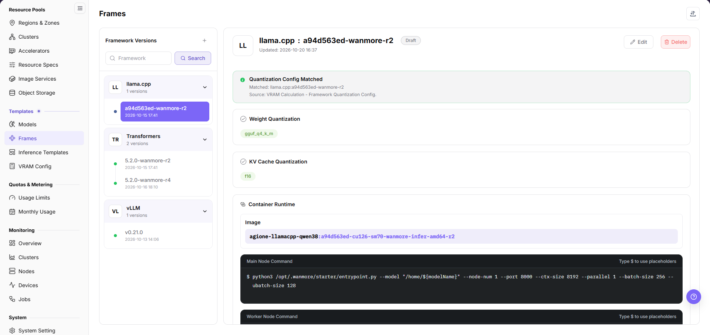
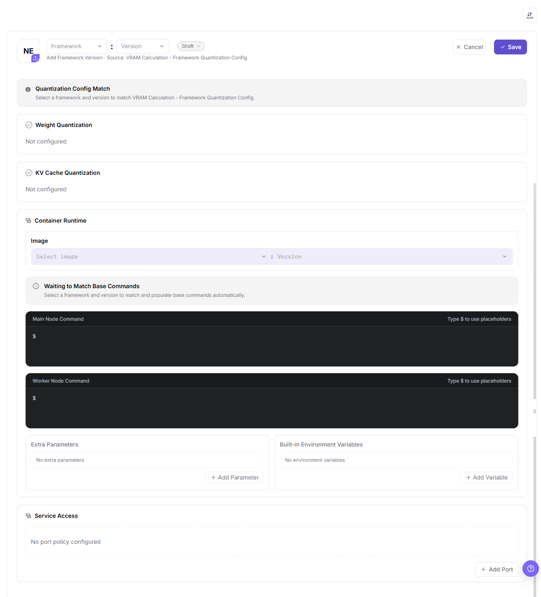

# Frames

## Feature Overview

| Item | Content |
| --- | --- |
| Applicable Role | Operator |
| Navigation Path | On-Prem > Templates > Frames |
| Page Route | `/powerone/fast-build-v2/frameworks` |
| Managed Object | Frameworks, framework versions, state, image, node commands, extra parameters, built-in environment variables, and service ports |

#### Beginner Explanation

Framework configuration is like a standard startup manual for model services. It defines which container image to use, which commands the main node and worker nodes run, which ports are exposed, which environment variables are injected, and what message is shown to users after creation succeeds. When users deploy a model through an inference template, the platform assembles the runtime environment from this configuration.

#### Terms

| Term | Description |
| --- | --- |
| Framework Configuration | A reusable deployment environment template composed of core parameters such as container images, startup commands, network policies, and environment variables. |
| Framework Name | Name of the underlying inference framework or engine. Use the official framework name where possible, such as `VLLM`, `TensorRT`, or `Triton Inference Server`. |
| Version Name | Version identifier of the framework configuration, used for iteration tracking or compatibility management. It can align with the underlying framework version or use an internal scenario name. |
| Version Status | The lifecycle state a framework version carries. It is chosen on the add form, defaults to `Draft`, and shows as the badge in the detail header. |
| Quantization Config Match | The read-only block that resolves weight quantization and KV Cache quantization for the selected framework and version from `VRAM Config`. Unmatched entries show `Not configured`. |

#### Recommended Operation Order

Confirm prerequisites for Framework name, version name, image, main node startup command, worker node startup command, extra parameters, environment variables, port exposure policy and port tags, follow Main Operations, run Result Validation, and continue to the next page.

#### First-Time User Notes

Confirm that the task involves Configuration, status, and relationships on Frames, and then follow the recommended order. If fields or state differ from expectations, check prerequisites before continuing downstream.

## Prerequisites

1. The framework image has been prepared and can be pulled by the target region and target cluster.
2. The supported model types, quantization methods, ports, main node startup command, and worker node startup command have been clarified.
3. Extra parameters, environment variables, port exposure policy and port tags have been planned.
4. Startup commands, environment variables, extra parameters, and message text have been confirmed not to expose real keys, tokens, AK/SK, private keys, or internal download addresses.
5. The current account has template management permissions.
6. The framework quantization configuration of the target framework and version has been maintained on `VRAM Config`, otherwise the matched block shows `Not configured`.

## Page Description

This page maintains framework versions in a master-detail layout: the left panel lists frameworks as cards, and selecting a version fills the detail area on the right.

The panel is titled `Framework Versions`. Its header carries the add entry as a `+` icon button, the search box below shows the placeholder `Framework`, and `Search` runs the filter. Each framework card shows an abbreviation avatar with an upload marker, the framework name, and a version count; expanding a card lists its versions with the version string, an update timestamp, and a state dot, and the selected version is highlighted.

The detail header shows `<FRAMEWORK> : <VERSION>`, the version state badge, the line `Updated: <YYYY-MM-DD HH:MM>`, and the `Edit` and `Delete` buttons at the top right.

Below the header the detail area reads, in order, `Quantization Config Matched`, `Weight Quantization`, `KV Cache Quantization`, `Container Runtime` with its `Image` row, `Main Node Command`, and `Worker Node Command`. Each command box shows the hint `Type $ to use placeholders`.

The matched block reports `Source: VRAM Calculation - Framework Quantization Config.`, so the quantization fields are consumed here instead of being maintained on this page, and an entry without a match shows `Not configured`. Two icon buttons without text labels sit at the top right of the page, and a floating help button sits at the bottom right.

## Main Operations

### Add Framework Version

#### Applicable Scenarios

Use this entry to register the first version of a framework, or to add another version whose image, commands, parameters, or ports differ from the existing ones.

#### Steps

1. Go to `On-Prem > Templates > Frames`.
2. Click the `+` icon button in the `Framework Versions` panel header to open the add form in the content area.
3. In the form header, choose the framework in the `Framework` selector and the version in the `Version` selector; the two are separated by `:`.
4. In `Container Runtime`, set the `Image` row by choosing the repository in `Select image` and the tag in the `Version` selector next to it.
5. Check `Quantization Config Match`: after the framework and version are set, the page fills the weight quantization and KV Cache quantization entries and the matched base commands from `VRAM Config`.
6. Confirm `Main Node Command` and `Worker Node Command` once `Waiting to Match Base Commands` resolves, and type `$` in a command box to insert placeholders.
7. Add runtime inputs in `Extra Parameters` (`+ Add Parameter`) and `Built-in Environment Variables` (`+ Add Variable`) when the framework needs them.
8. Configure exposure in `Service Access` with `+ Add Port`, then click `Save`; `Cancel` leaves the form without saving.

The form below opens inside the content area, with `Cancel` and `Save` in its header and the match, command, parameter, and port blocks stacked underneath.

#### Result Validation

- The framework card in `Framework Versions` increases its version count and the new version row appears with a state dot.
- Selecting the version fills the detail header with `<FRAMEWORK> : <VERSION>`, its state badge, and the `Updated:` time.
- The read-only areas resolve the chosen image, the matched quantization configuration, and both node commands.

#### Notes

- `Save` is a high-risk final action; verify framework, version, image, commands, and ports before clicking it.
- Do not write real tokens, AK/SK, private keys, passwords, or internal endpoints into commands, extra parameters, or environment variables.

### Import or Export Frameworks

#### Applicable Scenarios

Batch-maintain framework definitions, export the current scope for audit or reconciliation, or move a definition set between controlled environments.

#### Steps

1. Go to `On-Prem > Templates > Frames`.
2. Open the import or export icon buttons at the top right of the page.
3. For import, upload the file as the page requires and verify framework, version, image, commands, and port configuration.
4. For export, confirm the framework or version filter scope, then generate and download the file as prompted.
5. Before importing, verify that the image, port, and model dependencies exist in the target environment, and keep export files in a controlled directory.

#### Result Validation

- The framework list shows the added or updated version and its version count.
- The framework scope in the export file matches the filter applied before the export.
- Inference templates and deployment pages resolve the imported version and port configuration.

#### Notes

- Commands, images, and port settings must match the runtime environment; verify foreground startup and access policy before importing.
- Import can update fields on a framework version with the same identifier; check referenced templates and instances first.

### Edit Framework Version

#### Applicable Scenarios

Adjust the image, node commands, parameters, environment variables, or ports of an existing framework version.

#### Steps

1. Go to `On-Prem > Templates > Frames` and select the target version in the `Framework Versions` panel.
2. Click `Edit` at the top right of the detail header, then verify the framework and version identifiers.
3. Update the editable fields in the form, with special attention to the image, both node commands, and the access policy.
4. Before clicking `Save`, verify the impact on referenced templates and running instances.
5. Return to the detail area and verify the updated fields and the `Updated:` time.

#### Result Validation

- The detail header shows the updated state badge and `Updated:` time.
- The read-only areas resolve the new image, commands, and matched quantization configuration.
- Inference templates read the edited version without a new missing-configuration error.

#### Notes

- Changing a command, image, or port can prevent new instances from starting; arrange compatibility checks and rollback handling first.
- `Save` on the edit form is a high-risk final action, and a version referenced by templates or instances must be migrated before it is removed.

### Delete Framework Version

#### Applicable Scenarios

Remove a framework version that is no longer used and that no inference template, instance, or job depends on.

#### Steps

1. Go to `On-Prem > Templates > Frames` and select the target version in the `Framework Versions` panel.
2. Click `Delete` at the top right of the detail header; the button uses the destructive red style.
3. Read the confirmation prompt and verify framework, version, image, ports, and downstream references.
4. After confirming the replacement version and impact scope, click the confirmation button to delete it.
5. Refresh the panel and check the framework scope offered by inference templates and deployment pages.

#### Result Validation

- The version row is removed and the framework card decreases its version count accordingly.
- Downstream templates and new instance configuration no longer offer that version.
- Other framework versions, images, and running instances are not removed.

#### Notes

- Deleting a version does not delete the image in the registry; handle dependencies and retention separately.
- `Delete` is a high-risk final action, so never remove a referenced version before its templates or instances are migrated.

### Maintain Framework Ports

#### Applicable Scenarios

Add, change, or remove the ports a framework version exposes when its service access changes.

#### Steps

1. Go to `On-Prem > Templates > Frames`, select the target version, and click `Edit` in the detail header.
2. In `Service Access`, review the current entries; an area without configuration shows `No port policy configured`.
3. Click `+ Add Port` to add a port entry, or update the entry that no longer matches the running service.
4. Before clicking `Save`, verify that templates, instances, and access entries will not become invalid.
5. Return to the detail area and verify the port list and access policy.

#### Result Validation

- The detail area lists the updated ports under `Service Access`.
- Health checks and later access entries use the correct port.
- Templates or instances that depend on the port show no new missing configuration.

#### Notes

- Changing or removing a port affects service probing, routing, and access; confirm migration handling for existing instances and callers first.
- Unauthenticated or direct forwarding policies expand the exposure scope; use them only inside a clearly controlled network boundary.

## Parameter Quick Reference

| Field Name | Required | Field Type | Example | Description |
| --- | --- | --- | --- | --- |
| Framework Name | Yes | Text | `vLLM` | Name of the underlying inference framework or engine. Use the official framework name where possible for easier identification and technical integration. |
| Version Name | Yes | Text | `v0.8.0` | Version identifier of the framework configuration, used for iteration tracking or compatibility management. Align it with the underlying framework version or use a stable internal scenario name. |
| Version Status | Yes | Selection | `Draft` | State the framework version carries. The add form opens on `Draft`, and the detail header shows it as a badge. |
| Weight Quantization | No | Read-only | `Not configured` | Weight quantization method resolved by `Quantization Config Match`. The value is maintained on `VRAM Config`, not edited on this page. |
| KV Cache Quantization | No | Read-only | `Not configured` | KV Cache quantization method resolved by the same match block. Unmatched entries show `Not configured`. |
| Image | Yes | Text | `<BASE_URL>/<PROJECT>/<IMAGE>:<TAG>` | Container image required to run inference tasks. Enter the real image address in the system form. When sharing outside the console, use placeholders and do not publish real registry addresses. |
| Image Region | Conditionally required | Text | `wuhan` | Region where the image is hosted or can be pulled. Keep it consistent with target region, cluster network, and registry permissions. |
| Main Node Startup Command | Yes | Configuration text | `<config>` | Startup command for the main node in the task cluster. In single-node tasks, this is used directly as the node startup command. The command must run as a foreground process to avoid immediate container exit. |
| Worker Node Startup Command | Required for distributed scenarios | Configuration text | `python worker.py` | Startup command for Worker nodes, used in distributed inference. Keep it consistent with main-node communication, scheduling topology, and framework version. |
| Extra Parameters | No | Configuration text | `--max-model-len 8192` | Parameters used to dynamically supplement or adjust startup commands. They can be injected into commands through placeholders. Do not write real tokens, AK/SK, private keys, passwords, or internal addresses. |
| Environment Variables | No | Configuration text | `ENV=prod` | Preset environment variables injected when the container starts. Use only non-sensitive variables. Use platform credentials or Secret mechanisms for sensitive values. |
| Service Port | Yes | Port / number | `8000` | Listening port used for platform probing, routing, or service exposure. Must match the actual listening port of the framework. |
| Port Exposure Policy | Conditionally required | Port / number | `<option>` | Default exposure method and access authentication mechanism for the port. Do not select a non-authenticated policy for external or cross-tenant access. |
| Port Tag | No | Port / number | `OpenAI API Port` | Used to identify port protocol type or purpose. System predefined tags can generate corresponding access help documents. |
| Health Check | Conditionally required | Address / path | `/health` | Path or command used to determine whether the framework service starts successfully. Match the actual service path, port, and startup delay. |
| Parameter Placeholder | No | Configuration text | `${modelName}` | Variable used in startup commands and extra parameters. Use platform-supported placeholder names and avoid unsupported variables. |
| Actions | System-generated | Action entry | `Edit` | Add, edit, save, and similar page operations. `Save` (on the framework add and edit forms) is a high-risk final action. |

#### Port Exposure Policy and Port Tags

| Configuration | Value | Description |
| --- | --- | --- |
| Port Exposure Policy | `Web access` | Provides a Web-based access entry. Access requests carry a time-limited security token, `wmtoken`. |
| Port Exposure Policy | `API validation access` | Provides a native API endpoint. The `Authorization` request header must carry valid signature information. |
| Port Exposure Policy | `Web/API compatible validation access` | The port does not enable authentication. Use it only in trusted networks or test scenarios. |
| Port Exposure Policy | `Direct port forwarding` | The port does not enable authentication and is accessed through the cluster node IP and mapped port. It is suitable for internal debugging or specific network architectures. |
| Port Tag | `OpenAI API Port` | Identifies an inference service compatible with the OpenAI API format. The system generates corresponding API call help documents. |
| Port Tag | `Ollama API Port` | Identifies an inference service compatible with the Ollama API format. The system generates corresponding Ollama API usage guides. |
| Port Tag | `Custom` | Used for internal notes or special protocol identifiers. It does not trigger automatic document generation. |

#### Parameter Placeholder Description

Startup commands and extra parameters can use placeholders, and each command box shows the hint `Type $ to use placeholders`. When a job is created, the platform replaces placeholders with actual task cluster parameters.

| Placeholder | Description |
| --- | --- |
| `${regionId}` | Region ID assigned to the task cluster. |
| `${zoneId}` | Zone ID assigned to the task cluster. |
| `${name}` | Task cluster name. |
| `${flavorId}` | Specification ID used by the task cluster. |
| `${image}` | Image used by the task cluster. |
| `${envs}` | Environment variables. |
| `${useRdma}` | Whether to use the RDMA network. |
| `${openSsh}` | Whether SSH is enabled. |
| `${startCommand}` | Startup command object, including main node and worker node commands. |
| `${clusterId}` | Cluster ID assigned to the task. |
| `${portOpenPolicy}` | Port exposure policy. |
| `${portTag}` | Port tag of the exposed port. |
| `${jobType}` | Task deployment type. |
| `${modelName}` | Fast deployment model name. |
| `${frame}` | Fast deployment framework name. |
| `${frameVersion}` | Fast deployment framework version. |
| `${extraParamString}` | Extra parameter concatenation string. Parameter names do not include the `--` prefix. |
| `${prefixExtraParamString}` | Extra parameter concatenation string. Parameter names include the `--` prefix. |
| `${vendor}` | Model vendor. |
| `${supportModelClusterIds}` | List of cluster IDs that support the current model. |

## Pitfalls

- The startup command must run as a foreground process to avoid the container exiting immediately after startup.
- The service port must match the actual framework listening port, otherwise health checks or access entries may fail.
- The image must include framework dependencies, model loading dependencies, and required system libraries.
- Inconsistent image region, image registry permissions, or target cluster network may cause image pull failures.
- A non-authenticated port exposure policy may expand the real service exposure scope. Do not select it for external or cross-tenant access.
- Environment variables and extra parameters must not contain real tokens, AK/SK, private keys, passwords, or internal endpoints.
- `Save` (on the Add Framework Version and Edit Framework Version forms) is a high-risk final action. Confirm the scope and impact before executing it.

## Result Validation

| Check Item | Success Signal | If Abnormal |
| --- | --- | --- |
| Page entry | Frames opens with the target operation entry | Check Operator permission and whether the menu is available |
| Object record | Configuration, status, and relationships on Frames is visible in the list or details | Reset filters and verify name, ownership, and creation result |
| State result | The state badge in the detail header matches the state after creation or change | Check operation feedback, dependency state, and the `Updated:` time |
| Downstream use | A downstream page can select or associate the target | Return to prerequisites and check enabled state, ownership, and visibility |

## FAQ

#### An Imported Framework Cannot Be Used by an Inference Template

**Symptom:**

The framework import completes, but the framework version is missing from an inference template or deployment page.

**Possible Causes:**

- Framework image, region, or port configuration is unavailable in the target environment.
- Framework version state or visibility does not allow downstream selection.
- Framework or version identifiers in the import file do not match dependency references.

**Solution:**

1. Open framework details and verify version, image, region, ports, and state.
2. Check dependencies on Regions & Zones and Inference Templates.
3. Correct identifiers or visibility according to page requirements before importing again.

#### An Instance Fails After Framework Version Editing

**Symptom:**

The framework saves successfully, but a new instance cannot start or its health check fails.

**Possible Causes:**

- The image lacks dependencies or cannot be pulled.
- The startup command does not run as a foreground process.
- Service port, port policy, or health check does not match the application.

**Solution:**

1. Verify image, startup command, port, and health check in framework details.
2. Check image availability and network reachability in Regions & Zones.
3. Under the approved change process, restore the verified version and repeat startup validation.

#### Framework Version Deletion Fails

**Symptom:**

Deletion fails or the page reports that associated objects still exist.

**Possible Causes:**

- An inference template, instance, or job still references the version.
- The current account lacks deletion permission.
- Another framework task is still processing.

**Solution:**

1. Check version references on Inference Templates and deployment pages.
2. Verify permission and framework task state.
3. Complete migration or remove references, then delete according to approval.

#### The Access Entry Fails After Port Removal

**Symptom:**

The service access entry fails or health checks continue to fail after port maintenance.

**Possible Causes:**

- Application listening port does not match the configuration.
- Port exposure policy or tag was changed.
- Referenced templates or instances have not refreshed the new port configuration.

**Solution:**

1. Verify startup command, service port, and health-check path.
2. Check exposure policy, port tag, and network access rules.
3. Confirm references are updated in template or instance details; restore the previous port under the approved change process if needed.

#### Target Is Missing from Frames

**Symptom:**

The page opens, but the expected Configuration, status, and relationships on Frames is missing.

**Possible Causes:**

- Filters remain active.
- the object belongs to another scope.
- a prerequisite is incomplete.

**Solution:**

1. Reset filters
2. verify region or tenant ownership
3. confirm prerequisite state.

## Notes

- Do not write keys in environment variable examples, extra parameters, or screenshots.
- Before changing framework image, port exposure policy, or startup command, confirm the impact scope of templates and instances that use this framework.
- Images are related to regions. After adding a region or migrating images, revalidate framework availability.

## Next Steps

1. Reference the framework in [Inference Templates](../inference-templates/).
2. Use a test model to verify image, command, port, extra parameters, and placeholders.
3. Include framework changes in version records to avoid affecting existing templates.
