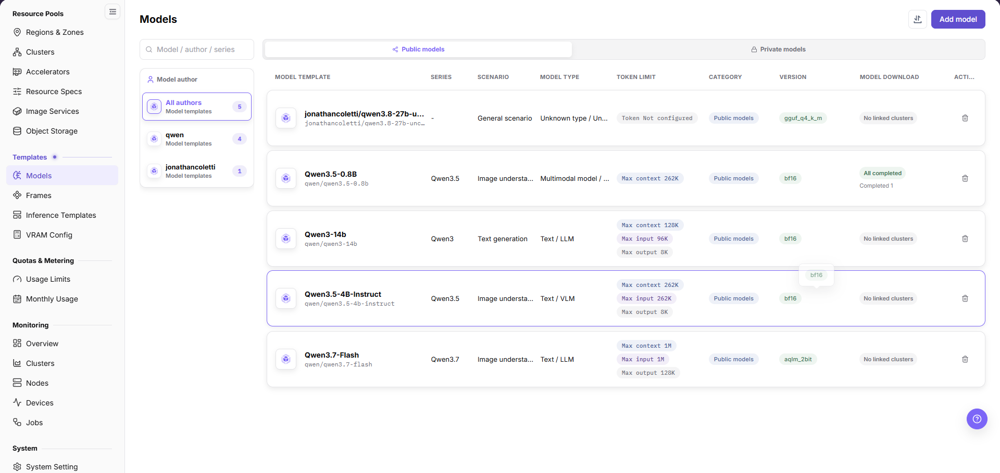
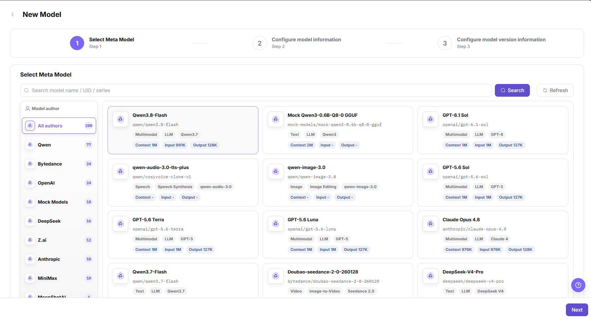
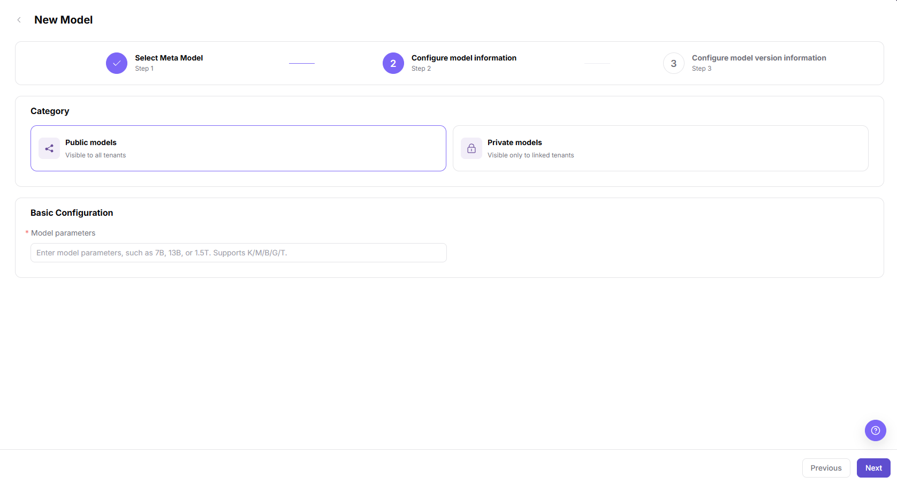
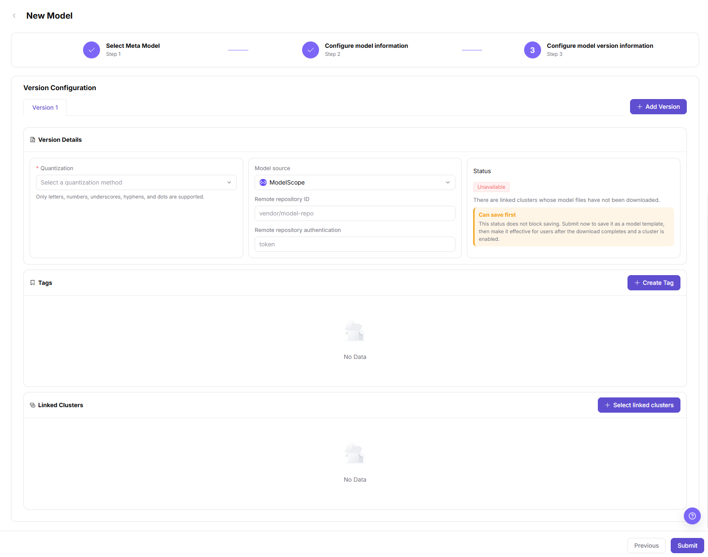
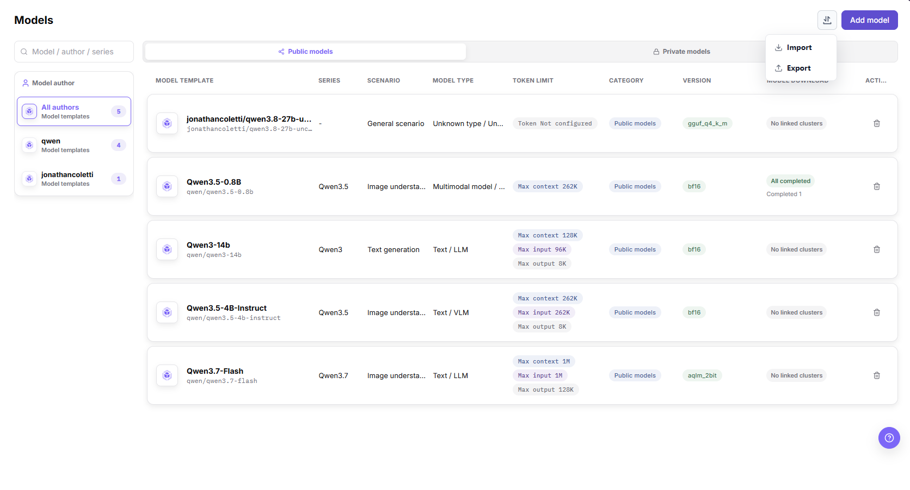
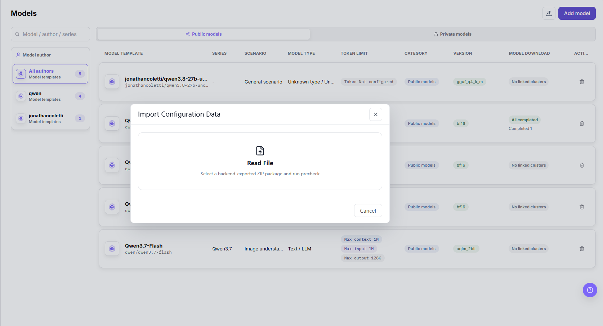
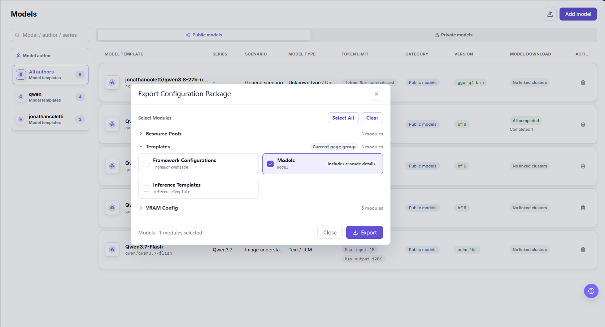
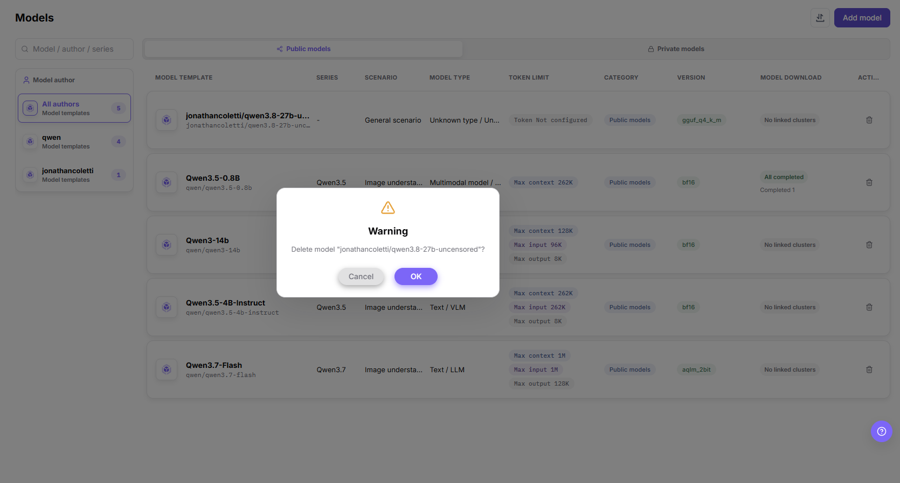

# Models

## Feature Overview

| Item | Content |
| --- | --- |
| Applicable Role | Operator |
| Navigation Path | On-Prem > Templates > Models |
| Page Route | `/powerone/fast-build-v2/models` |
| Managed Object | Configuration, status, and relationships on Models |

#### Beginner Explanation

Model configuration is like a model asset card before listing a model. It organizes model paths, parameter sources, environment variables, and startup parameters so frameworks can load models correctly.

#### Terms

| Term | Description |
| --- | --- |
| Base Model | Model family or base model abstraction, such as a common description for the same model series. |
| Model Version | Version record of specific weights, quantization, source, and file path. |
| KV Token | Tokens related to inference KV Cache, which affect VRAM estimation. |

#### Recommended Operation Order

Confirm prerequisites for Base models, model versions, model sources, quantization methods, tags, and associated clusters, follow Main Operations, run Result Validation, and continue to the next page.

#### First-Time User Notes

Confirm that the task involves Configuration, status, and relationships on Models, and then follow the recommended order. If fields or state differ from expectations, check prerequisites before continuing downstream.

## Prerequisites

1. Model source, authorization, version, and parameter count have been confirmed.
2. Model files can be downloaded by the target cluster or have been prepared in shared storage.
3. Related quantization methods, KV Token, or calculation factors have been maintained in VRAM estimation.
4. The current account has template management permissions.

## Page Description

Use this page to manage meta-models, model versions, model sources, quantization methods, tags, and associated clusters.

The left panel groups models by `Model author` with a per-author count, the `Model / author / series` box filters the list, the main area offers the `Public models` and `Private models` tabs, and the columns are `MODEL TEMPLATE`, `SERIES`, `SCENARIO`, `MODEL TYPE`, `TOKEN LIMIT`, `CATEGORY`, `VERSION`, and `MODEL DOWNLOAD`, followed by an icon-only action column that holds the trash icon. The `MODEL DOWNLOAD` column shows `No linked clusters`, `All completed`, or `Completed N`. The icon button at the top right opens the `Import` / `Export` menu, and `Add model` sits to its right.

## Main Operations

### Add Model

#### Applicable Scenarios

Use the **"Add model"** entry at the top right of the page to create a model template that inference templates can reference. The wizard runs in three steps: `Select Meta Model`, `Configure model information`, and `Configure model version information`.

#### Steps

1. Go to `On-Prem > Templates > Models` and confirm on the `Public models` or `Private models` tab that the target model is not configured yet.
2. Click **"Add model"** at the top right to open the three-step wizard titled `New Model`.
3. In Step 1 `Select Meta Model`, narrow the candidates with the `Model author` list or the `Search model name / UID / series` box (with **"Search"** and **"Refresh"**), check the card tags such as `Multimodal`, `Text`, `Speech`, `Image`, and `Video` together with the `Context`, `Input`, and `Output` values, and click **"Next"**.

Step 1 is shown below: the left panel groups meta-models by author with a per-author count, and the card grid on the right lists candidates with their capability tags.

4. In Step 2 `Configure model information`, select `Public models` (`Visible to all tenants`) or `Private models` (`Visible only to linked tenants`) under `Category`, fill in the required `Model parameters` field (placeholder `Enter model parameters, such as 7B, 13B, or 1.5T. Supports K/M/B/G/T.`), and click **"Next"**.

Step 2 is shown below: it provides only the `Category` and `Basic Configuration` blocks, and `Model parameters` is the only required field.

5. In Step 3 `Configure model version information`, maintain versions on the `Version 1` tab in the `Version Configuration` block, and click **"+ Add Version"** when one model needs more versions.
6. In the `Version Details` block, select the required `Quantization` value, confirm `Model source` (`ModelScope` in the captured screen), and fill in `Remote repository ID` (placeholder `vendor/model-repo`) and `Remote repository authentication` (placeholder `token`) as the selected source requires.
7. Click **"+ Create Tag"** in the `Tags` block to maintain model classification, and click **"+ Select linked clusters"** in the `Linked Clusters` block to define where model files can be downloaded and deployed.
8. Check the conclusion in the `Status` block, then click **"Submit"**.

Step 3 is shown below: the three `Version Details` columns cover quantization, model source and repository information, and the `Status` conclusion, followed by the `Tags` and `Linked Clusters` blocks.

#### Result Validation

- After submission the list shows the model under `MODEL TEMPLATE`, and `CATEGORY` matches the `Public models` or `Private models` choice made in Step 2.
- The `VERSION` column shows the quantization selected in Step 3, such as `bf16`, `gguf_q4_k_m`, or `aqlm_2bit`.
- The `MODEL DOWNLOAD` column shows `No linked clusters`, `All completed`, or `Completed N` to indicate download progress on linked clusters.

#### Notes

- `Quantization` is required and supports only letters, numbers, underscores, hyphens, and dots; `Model parameters` supports K/M/B/G/T suffixes.
- When `Status` shows `Unavailable` with `There are linked clusters whose model files have not been downloaded.`, the page also shows the `Can save first` notice: the status does not block saving, so you can submit now and make the model effective for users after the download completes and a cluster is enabled.
- `Remote repository authentication` holds a credential reference only. Do not put real tokens, AK/SK, accounts, or passwords in documents, screenshots, or tickets.

### Import or Export Models

#### Applicable Scenarios

Use the icon button in the top right of the page, which opens the `Import` / `Export` menu, to move model configuration between environments or to archive the configuration maintained on this page.

#### Steps

1. Go to `On-Prem > Templates > Models` and click the icon button to the left of `Add model` in the page header to open the menu that lists `Import` and `Export`.

The page header menu is shown below: `Import` opens the import dialog and `Export` opens the export dialog.

2. Import: click `Import` to open the dialog titled `Import Configuration Data`, then select the ZIP package exported from the backend in the `Read File` area. The area reads `Select a backend-exported ZIP package and run precheck`, so the page runs a precheck after a file is chosen.
3. Click `Cancel` at the bottom of the dialog, or the close icon at the top right, to discard the import. The dialog state after a file is selected and the precheck result are not shown in the screenshots for this page; follow the on-page message.

The import dialog is shown below: before a file is chosen it offers only the `Read File` area and a single `Cancel` button.

4. Export: click `Export` to open the dialog titled `Export Configuration Package`, and use **"Select All"** or **"Clear"** in the `Select Modules` area, or tick the module cards one by one.
5. Expand the `Templates` group (marked `Current page group`, `3 modules`) and select `Models` (module key `model`, card labelled `Includes cascade details`), together with `Framework Configurations` (`frameworkVersion`) and `Inference Templates` (`inferenceTemplate`) when needed; the collapsed groups `Resource Pools` (`3 modules`) and `VRAM Config` (`5 modules`) are also selectable.
6. Confirm that the footer count matches the intended modules (for example `Models · 1 modules selected`), then click **"Export"** to generate the package; click **"Close"** to discard this export.

The export dialog is shown below: `Models` is ticked and labelled `Includes cascade details`, and the footer count sits next to the **"Export"** button.

#### Result Validation

- Before exporting, confirm the footer count matches the ticked modules; the `Includes cascade details` label on the `Models` card means the export carries the cascade details of that module.
- On the import side, follow the dialog message: the `Read File` area states that the file is a backend-exported ZIP package and that a precheck runs first.
- When configuration moves between environments, `Import` and `Export` are used as a pair, so confirm the model sources, clusters, and other dependencies are ready in the target environment before importing.

#### Notes

- `Export` is the final action of the export dialog and `Close` produces no package; before a file is chosen the import dialog offers only `Cancel`.
- A configuration package can carry model identifiers and source information, so confirm the target environment before importing and avoid writing configuration into the wrong environment.
- The export dialog lists several module groups; the export belongs to this page only when `Models` is the module you tick.

### Delete Model

#### Applicable Scenarios

Delete a model from the action column at the end of its row when a model template must no longer be offered to downstream inference templates or to the user side.

#### Steps

1. Go to the `Models` list and locate the target model on the `Public models` or `Private models` tab, using the `Model author` panel or the `Model / author / series` search box.
2. Click the trash icon in the action column of that row to open a confirmation box titled `Warning`, whose body reads `Delete model "<model identifier>"?` (the angle brackets stand for the full identifier of that row, shown here as a placeholder).
3. Click **"OK"** to delete, or click **"Cancel"** to discard this deletion.

The delete confirmation is shown below: the body echoes only the target model identifier, and `OK` (`确定` in the Chinese screen) is the final action.

#### Result Validation

- After confirmation the row disappears from the `MODEL TEMPLATE` list; check whether the per-author counts in the left `Model author` panel (such as `All authors 5`) follow.
- Confirm the model is no longer selectable in the model picker of downstream inference templates; if it still appears, troubleshoot with the FAQ entry "The Model Is Still Selectable After Deletion".

#### Notes

- The confirmation box echoes the model identifier only and shows no cascade impact, so check downstream templates and running instances before deleting.
- The confirmation box does not state whether deletion is reversible; export a ZIP configuration package first when the configuration must be kept.
- `OK` is a high-risk final action on this page. Check that the identifier in the dialog matches the target row before clicking it.

## Parameter Quick Reference

| Field Name | Required | Field Type | Example | Description |
| --- | --- | --- | --- | --- |
| Model Name | Yes | Dropdown / enum | `Qwen3-14b` | Model name displayed by the platform and referenced by templates; it comes from the meta-model selected in Step 1. Use a maintainable model name instead of temporary test naming. |
| Model Author | Conditionally required | Dropdown / enum | `Qwen` | Author or source provider of the model; the `Model author` panel on the left groups models and shows a per-author count. Keep it consistent with page filters, model series, and authorization source. |
| Model Series | Conditionally required | Dropdown / enum | `Qwen3.5` | Model family or base model series, shown in the `SERIES` column. Helps inference templates filter models by series. |
| Model Type | Conditionally required | Dropdown / enum | `Text / LLM` | Model capability type or business category, shown in the `MODEL TYPE` column. Keep it consistent with inference frameworks, template type, and user-side selection scope. |
| Scenario | Conditionally required | Dropdown / enum | `Text generation` | Business scenario where the model applies, shown in the `SCENARIO` column. Do not mix test, training, or inference scenarios. |
| Token Limit | Conditionally required | Number / capacity | `Max context 262K` | Context length, input/output token limit, or KV Cache-related limit. The `TOKEN LIMIT` column shows max context, max input, and max output on separate lines, or `Token Not configured` when it is empty. Keep it consistent with model capability, VRAM estimation, and template parameters. |
| Model Parameters | Yes | Text | `7B` | The only required field in the `Basic Configuration` block of Step 2; the placeholder supports K/M/B/G/T suffixes. Keep it consistent with VRAM estimation and selectable downstream specifications. |
| Model Source | Yes | Dropdown / enum | `ModelScope` | Model file source in the `Version Details` block of Step 3; visible candidates include `HuggingFace`, `ModelScope`, and `Local`. Confirm authorization and network reachability for external sources. |
| Remote Repository ID | Conditionally required | Text | `vendor/model-repo` | Unique remote repository identifier in the `Version Details` block of Step 3. `vendor/model-repo` is the page placeholder. Confirm that the source repository matches the target model. |
| Remote Repository Authentication | Conditionally required | Credential / sensitive text | `token` | Credential reference required to access the remote repository. `token` is the page placeholder. Reference credential objects only; do not write real credentials in documents. |
| Version | Yes | Dropdown / enum | `Version 1` | Maintained as a `Version N` tab in the `Version Configuration` block of Step 3; click **"+ Add Version"** to add one. The `VERSION` column shows the quantization of that version. Keep versions traceable. |
| Quantization | Yes | Dropdown / enum | `bf16` | Required field in the `Version Details` block of Step 3. Visible values look like `bf16`, `gguf_q4_k_m`, and `aqlm_2bit`; the option list follows the page. Keep it consistent with the runtime framework and VRAM estimation configuration. |
| Model Path | Yes | Address / path | `s3://example-bucket/model` | Path, repository identifier, or object storage location where the framework loads model files. Do not write real keys, tokens, accounts, passwords, or internal addresses. |
| Parameter Source | Conditionally required | Number / capacity | `Template default` | Whether parameters come from model configuration, template defaults, or user input. Prevent template defaults from overriding model-specific parameters. |
| Environment Variables | No | Configuration text | `ENV=prod` | Variables passed into the container runtime environment. Use only non-sensitive variables. Use credential references for sensitive values. |
| Startup Parameters | No | Dropdown / enum | `--max-model-len 8192` | Model parameters appended to the framework startup command. Match framework version, token limits, and resource specifications. |
| Model Source Credential | Conditionally required | Credential / sensitive text | `Object Storage` | Credential reference used when accessing a private model repository or object storage. Reference credential objects only. Do not write real credentials in documents. |
| Associated Cluster | Conditionally required | File / configuration text | `cluster-a` | Cluster scope where model files are accessible or deployable. Confirm network and storage accessibility for target clusters before submission. |
| Tags | No | Text | `llm` | Tags used for filtering, classification, or template matching. Keep tag meanings stable and avoid temporary tags. |
| Visibility Scope | Conditionally required | Dropdown / enum | `Tenant A` | Model visibility boundary for templates, tenants, or user-side pages. Incorrect visibility affects user-side selectable models. |
| Actions | System-generated | Action entry | `Add model` | Page operations such as `Add model` and the `Import` / `Export` menu in the page header, the delete icon in the row action column, `Submit` in the wizard, `Cancel` in the import dialog, `Export` and `Close` in the export dialog, and `OK` (`确定` in the Chinese screen) in the delete confirmation box. `Submit`, `Export`, and `OK` are high-risk final actions. |

The `Model Name`, `Model Path`, `Parameter Source`, `Environment Variables`, `Startup Parameters`, `Model Source Credential`, and `Visibility Scope` rows do not appear in the three wizard screens for adding a model. Their field form and values follow the page and are not shown in the screenshots for this page.

## Pitfalls

- Incorrect model paths, repository addresses, object storage paths, or credential references can cause model loading failures after template deployment.
- Do not write real keys, tokens, AK/SK, accounts, passwords, or internal addresses in environment variables, startup parameters, or model paths.
- Incorrect associated clusters or visibility scope can affect model selection in inference templates and user-side visibility.
- Clarify the parameter source to prevent template default values from overriding model-specific parameters.
- `Submit`, `Export`, and the `OK` button of the delete confirmation box (`确定` in the Chinese screen) are the final actions on this page. Verify the version, model source, tags, linked clusters, and target model identifier before executing them.

## Result Validation

| Check Item | Success Signal | If Abnormal |
| --- | --- | --- |
| Page entry | Models opens with the target operation entry | Check Operator permission and whether the menu is available |
| Object record | Configuration, status, and relationships on Models is visible in the list or details | Reset filters and verify name, ownership, and creation result |
| State result | State after creation or change matches the page message | Check operation feedback, dependency state, and latest update time |
| Downstream use | A downstream page can select or associate the target | Return to prerequisites and check enabled state, ownership, and visibility |

## FAQ

#### An Imported Model Cannot Be Used by an Inference Template

**Symptom:**

The model import completes, but the model cannot be found in an inference template or publish flow.

**Possible Causes:**

- The base model, model source, or model version is missing or unavailable in the target environment.
- Cluster association, visibility, or model state does not meet downstream selection conditions.
- Model identifier or version fields in the import file are inconsistent.

**Solution:**

1. Open model details and verify base model, source, version, state, and visibility.
2. Open Model Sources and Clusters to verify dependencies and associations.
3. Check identifiers and version fields in the import file against page requirements.

#### The Model Is Still Selectable After Deletion

**Symptom:**

The model is gone from Model Configuration, but a downstream page still offers it.

**Possible Causes:**

- The downstream page cache has not refreshed.
- A downstream template or instance stores a historical reference.
- The deletion request is still processing.

**Solution:**

1. Refresh the downstream page and reopen the model selector.
2. Check historical references in inference templates, publish records, and running instances.
3. Check model update time and page prompt to confirm deletion has completed.

#### Target Is Missing from Models

**Symptom:**

The page opens, but the expected Configuration, status, and relationships on Models is missing.

**Possible Causes:**

- Filters remain active.
- the object belongs to another scope.
- a prerequisite is incomplete.

**Solution:**

1. Reset filters
2. verify region or tenant ownership
3. confirm prerequisite state.

#### The Operation Entry on Models Is Unavailable

**Symptom:**

The create, register, or maintain entry is hidden or disabled.

**Possible Causes:**

- Role permission is insufficient.
- the page is read-only.
- dependencies are not ready.

**Solution:**

1. Check Operator permission
2. read the page message
3. complete dependency configuration first.

#### Models Has an Abnormal State After the Operation

**Symptom:**

A record exists after submission, but its state is unexpected.

**Possible Causes:**

- Connectivity or validation failed.
- a dependency is abnormal.
- processing is incomplete.

**Solution:**

1. Check feedback and update time
2. inspect related objects
3. troubleshoot the processing stage.

## Notes

- Model source and authorization must be traceable.
- Do not expose access keys in model paths, descriptions, or screenshots.
- Do not write real model repository addresses, object storage paths, AK/SK, tokens, accounts, passwords, or internal addresses in examples, screenshots, or tickets.
- Before modifying associated clusters, tags, or visibility scope, confirm the impact on inference templates and user-side deployment entries.

## Next Steps

1. Go to [Frames](../frames/) to maintain frameworks available for the model.
2. Go to [Inference Templates](../inference-templates/) to establish relationships among model, framework, specification, and parameters.
3. Go to [VRAM Config](../vram-config/) to calibrate KV Token, quantization, and dynamic expressions.
