# VRAM Config

## Feature Overview

| Item | Content |
| --- | --- |
| Applicable Role | Operator |
| Navigation Path | On-Prem > Templates > VRAM Config |
| Page Route | `/powerone/fast-build-v2/vram-factor-forms` |
| Managed Object | Precision specs, framework quantization configurations, model KV Token configurations, deployment profiles, dynamic expression labels, and VRAM calculation factor forms |

#### Beginner Explanation

VRAM configuration is like a capacity estimator before deployment. It estimates required VRAM from model size, precision, context length, and KV Token, avoiding the discovery that the service cannot fit only after startup.

#### Terms

| Term | Description |
| --- | --- |
| VRAM | Accelerator memory used to store model weights, KV Cache, and intermediate computation. |
| KV Token | Tokens related to Key/Value Cache in the inference context. |
| Factor | Variable involved in VRAM calculation, such as parameter count, precision, concurrency, and context length. |

#### Recommended Operation Order

Confirm prerequisites for precision specs, framework quantization configurations, model KV Token configurations, deployment profiles, dynamic expression labels, and VRAM calculation factor forms, follow Main Operations, run Result Validation, and continue to the next page.

#### First-Time User Notes

Confirm which tab the task involves (precision specs, framework quantization, model KV Token, deployment profiles, dynamic expression labels, or VRAM calculation factor forms), and then follow the recommended order. If fields or state differ from expectations, check prerequisites before continuing downstream.

## Prerequisites

1. Model parameter count, precision, context length, concurrency, and framework VRAM overhead have been clarified.
2. Resource specifications that can be referenced by inference templates have been prepared.
3. VRAM capacity and usable margin of different accelerator models have been confirmed.
4. The current account has template management permissions.

## Page Description

Use this page to maintain the precision spec dictionary, framework quantization configurations, model KV Token configurations, deployment profiles, dynamic expression labels, and VRAM calculation factor forms used by VRAM estimation.

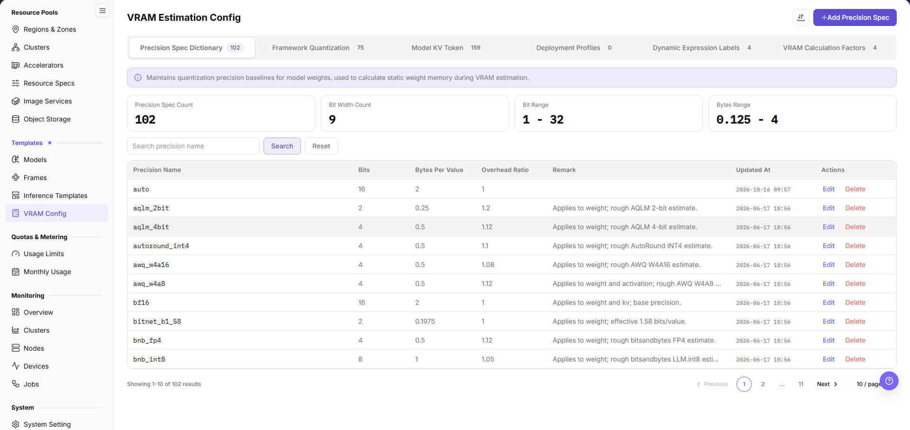

The page is organized into six tabs, each showing its own entry count after the tab name: `Precision Spec Dictionary`, `Framework Quantization`, `Model KV Token`, `Deployment Profiles`, `Dynamic Expression Labels`, and `VRAM Calculation Factors`. The screenshot shows the default `Precision Spec Dictionary` tab, where you maintain `Bits`, `Bytes Per Value`, and `Overhead Ratio` for each precision.

## Main Operations

### Maintain the Precision Spec Dictionary

#### Applicable Scenarios

- Add a precision spec when a new quantization scheme needs its own bytes-per-value and overhead-ratio baseline for VRAM estimation.
- Edit an entry when the recorded bits, bytes per value, or overhead ratio needs correction.

#### Steps

1. Go to `On-Prem > Templates > VRAM Config`. The page opens on the `Precision Spec Dictionary` tab.
2. To add an entry, click **"+Add Precision Spec"** at the top right to open the `Add Precision Spec` dialog. To change one, click `Edit` in the `Actions` column of the target row.

The image shows the `Add Precision Spec` dialog: the `Precision Name` field has the placeholder `e.g. fp16`, `Bits`, `Bytes Per Value`, and `Overhead Ratio` are steppers with the initial values `8`, `1`, and `1`, and the footer buttons are `Cancel` and `Save`.

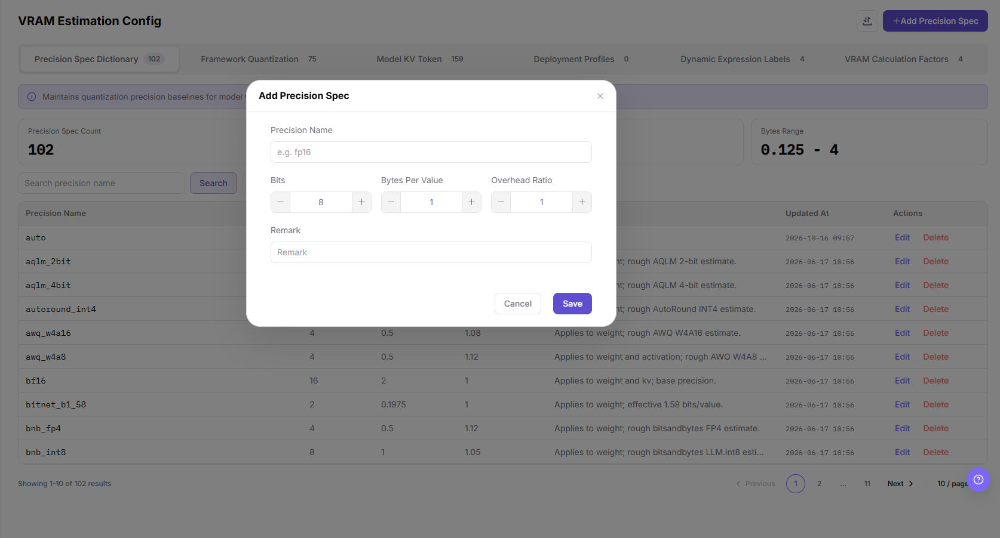

3. Enter the `Precision Name`, then set `Bits`, `Bytes Per Value`, and `Overhead Ratio` according to the quantization definition of that precision.
4. (Optional) In `Remark`, record the applicable model family or the estimation definition.
5. Check the values and click **"Save"**. To discard the entry, click `Cancel` or the close icon at the top right of the dialog.

The image shows the `Edit Precision Spec` dialog: the `auto` record carries `Bits` `16`, `Bytes Per Value` `2`, and `Overhead Ratio` `1`, the `Precision Name` field stays editable in the edit state, `Remark` shows the placeholder `Remark`, and the footer buttons are `Cancel` and `Save`.

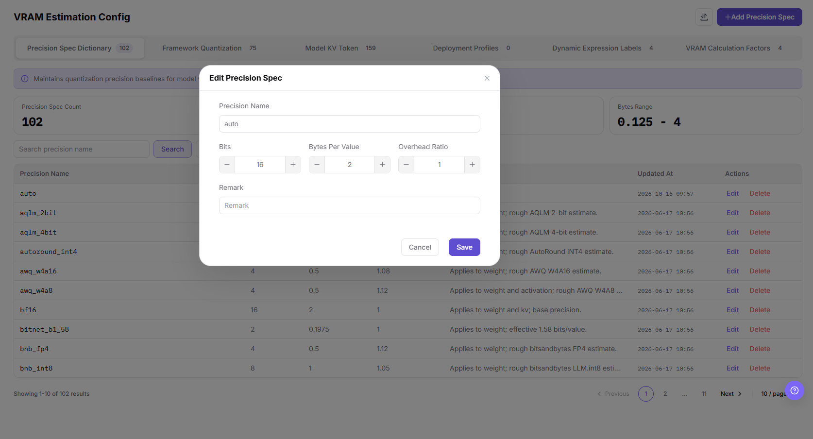

#### Result Validation

- The `Updated At` value of the target row changes to the time of this operation, and `Precision Name`, `Bits`, `Bytes Per Value`, `Overhead Ratio`, and `Remark` match what you entered.
- The count on the tab and the total in the list footer (`Showing 1-10 of 102 results`) update after an addition.
- The four summary cards above the list (`Precision Spec Count`, `Bit Width Count`, `Bit Range`, `Bytes Range`) change accordingly.

#### Notes

- Precision specs are the base dictionary of VRAM estimation. Wrong bits or bytes per value make downstream results too large or too small.
- None of the four fields shows a required marker in the dialog, but the name and the three numeric values are all needed for calculation; follow the on-screen prompt before saving.
- Use `Search precision name` with `Search` and `Reset` to locate a record, and use the page controls with `10/page` at the bottom right to paginate.

### Maintain Framework Quantization Configurations

#### Applicable Scenarios

- Add a configuration when a new version of an inference framework needs its supported weight and KV Cache quantization ranges registered.
- Edit a configuration when the quantization methods supported by a registered version change.

#### Steps

1. Go to `On-Prem > Templates > VRAM Config` and switch to the `Framework Quantization` tab.
2. To add a configuration, click **"+Add Framework Quantization"** at the top right to open the `Add Framework Quantization` dialog. To change one, click `Edit` in the `Actions` column of the target version row to open `Edit Framework Quantization`.

The image shows the `Framework Quantization` tab: configurations are grouped by framework with an `N version configs` badge on the right of each group header, and each group lists `Framework Version`, `Weight Quantization`, `KV Cache Quantization`, `Updated At`, and `Actions`.

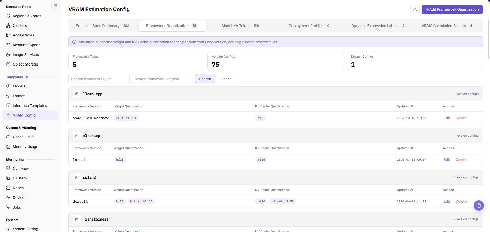

3. Enter the framework type in the dialog and confirm the framework version, whose label carries an information icon and whose default value is `default`.
4. Select the supported weight quantization methods and the KV Cache quantization methods in the two dropdown lists below.

The image shows the `Add Framework Quantization` dialog: the fields are `Framework Type` (placeholder `e.g. vllm`), `Framework Version` (default `default`), `Weight Quantization` (placeholder `Select weight quantization`), and `KV Cache Quantization` (placeholder `Select KV Cache quantization`), and the footer buttons are `Cancel` and `Save`.

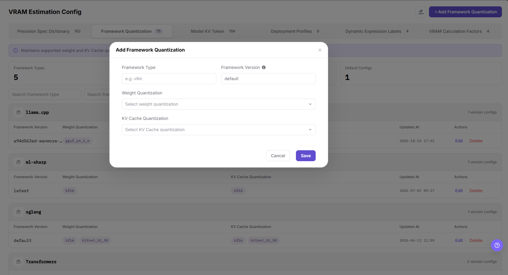

5. Save the configuration. In the edit dialog the framework type and the framework version are read-only, so only the two quantization selections can be changed.

The image shows the `Edit Framework Quantization` dialog: `Framework Type` and `Framework Version` are greyed out and read-only, the two quantization dropdowns stay editable, and the footer buttons are `Cancel` and `Save`.

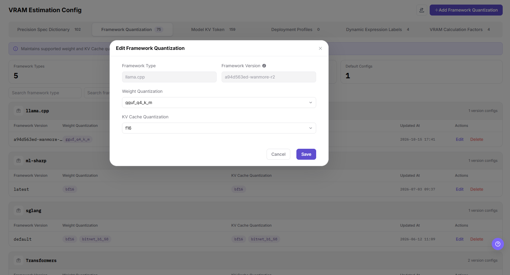

#### Result Validation

- The summary cards above the list (`Framework Types`, `Version Configs`, and `Default Configs`) and the tab count update after the change.
- The new version row appears inside its framework group, and the two quantization columns show the selected methods as tags.
- The update time of the row changes after an edit.

#### Notes

- These configurations define which quantization precisions a framework version supports and how framework overhead is accounted for, so a wrong selection distorts both compatibility checks and VRAM estimation.
- Because the framework type and version cannot be changed after creation, a misregistered version must be deleted and added again.
- The tab provides two filter inputs, `Search framework type` and `Search framework version`, used with `Search` and `Reset`.

### Maintain Model KV Token Configurations

#### Applicable Scenarios

- Add a configuration when the estimation engine must calculate KV Cache VRAM for a model, a framework, and a KV data type dynamically.
- Edit a configuration when the bytes per token of a recorded data type, or the applicable framework, changes.

#### Steps

1. Go to `On-Prem > Templates > VRAM Config` and switch to the `Model KV Token` tab.
2. To add a configuration, click **"+ Add Model KV Token Config"** at the top right; a drawer titled `Add Model KV Token Config` slides in from the right side of the page. To change one, click `Edit` in the `Actions` column of the target row to open `Edit Model KV Token Config`.

The image shows the `Model KV Token` tab: `Model Name / UID` is the leading column, followed by `Framework Type`, `Configured Quants`, `Updated At`, and `Actions`.

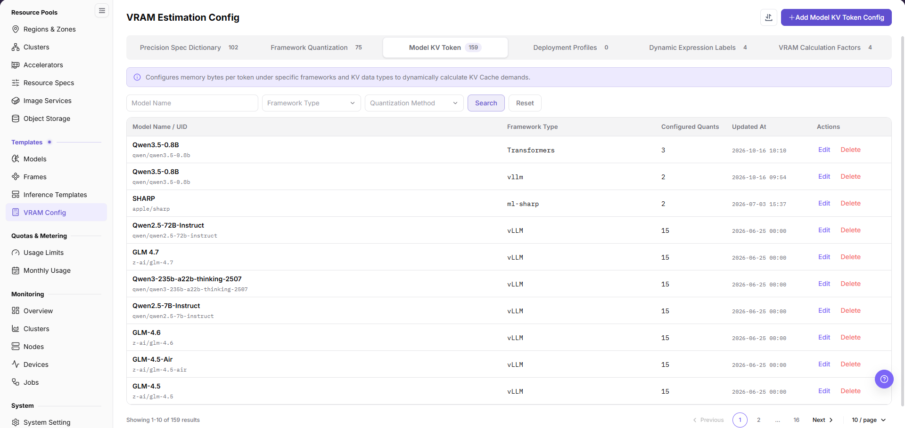

3. Select the target model in the model dropdown, then confirm or enter the framework type.
4. In the single-token consumption section, enter one row per data type. Each row consists of a data-type dropdown, a numeric input, and a delete icon; use the add-row button below to configure more data types.

The image shows the `Add Model KV Token Config` drawer: the three required fields are `* Model Name` (placeholder `Select model`), `* Framework Type`, and `* Single Token Cost Config`, the section note reads `Values below are measured in byte`, more rows are added with **"+ Add dtype Config"**, `Remark` shows the placeholder `Enter remark`, and the footer buttons are `Cancel` and `Save`.

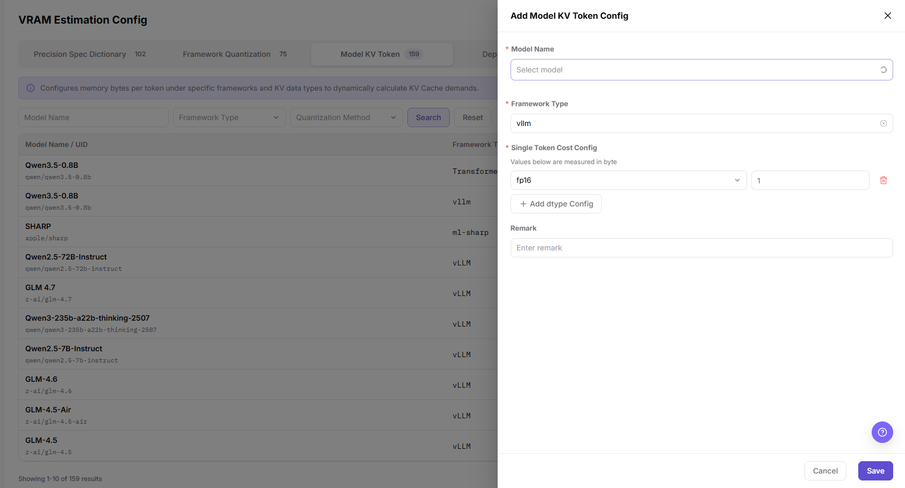

5. (Optional) Record the derivation of the configured values in the remark field.
6. Save the configuration. In the edit drawer the model field shows the selected model together with its source and context-length tags, and all configured data-type rows are listed.

The image shows the `Edit Model KV Token Config` drawer: the `Model Name` field echoes the selected model together with its author and the `text` / `262K` tags, and the configured data types `float16`, `fp16`, and `auto` each carry the value `12288`.

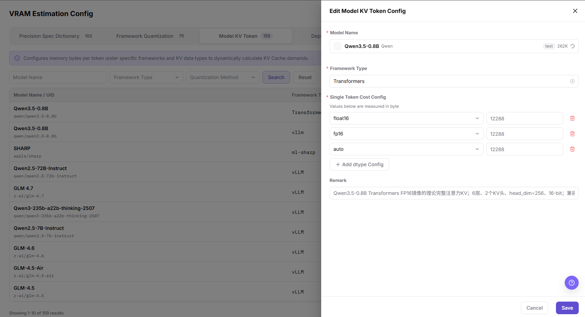

#### Result Validation

- The configured-quantization count of the target row matches the number of data-type rows in the drawer, and the update time changes.
- The tab count and the total in the list footer update after an addition.
- One model can have several rows for different frameworks, so check the framework type row by row.

#### Notes

- The unit of this section is byte. Entering another unit multiplies or divides the KV Cache result.
- Complete the three required fields before saving; do not record numeric values in the remark field instead.
- The tab filters by `Model Name`, `Framework Type`, and `Quantization Method`, used with `Search` and `Reset` to locate a record.

### Enter a Deployment Measurement Profile Manually

#### Applicable Scenarios

- Enter a profile when real stress-test or runtime data exists and the estimation engine should use measured values instead of the theoretical formula.
- Check this tab when you need to confirm whether the environment already holds measured profiles.

#### Steps

1. Go to `On-Prem > Templates > VRAM Config` and switch to the `Deployment Profiles` tab.
2. Click **"+ Manual Entry"** at the top right to open the `Manually Enter Deployment Profile` dialog.

The image shows the empty `Deployment Profiles` tab: the filter area offers four dropdowns (`Meta Model`, `Framework Type`, `Accelerator`, and `Estimate Enabled`, all defaulting to `All`) with `Search`, `Reset`, and `More Filters` controls, and an empty list reads `No Matching Deployment Profiles` / `Adjust the filters and search again.`

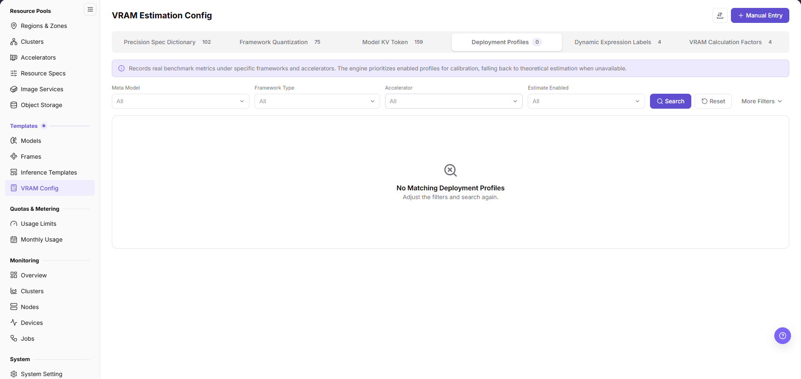

3. In the matching-dimension group, complete the required fields: meta model ID, version, framework type, framework version, deployment mode, accelerator ID, and KV Cache data type.
4. In the required estimation-field group, enter the per-card runtime overhead value in `GiB` and the effective single-token KV Cache byte count across accelerators in `B`. The group note states that both fields take part in VRAM estimation and must be filled before the profile can be saved.
5. Confirm the state of the toggle that controls whether this profile takes part in VRAM estimation; its label carries an information icon.
6. Check the matching dimensions and the two estimation fields, then click the save-profile button in the dialog footer. To discard the entry, click cancel or the close icon at the top right.

The image shows the `Manually Enter Deployment Profile` dialog: the two groups are `Matching Dimensions` and `VRAM Estimation Fields (Required)`, the switch at the bottom is labelled `Participate in VRAM Estimation`, and the footer buttons are `Cancel` and `Save Profile`.

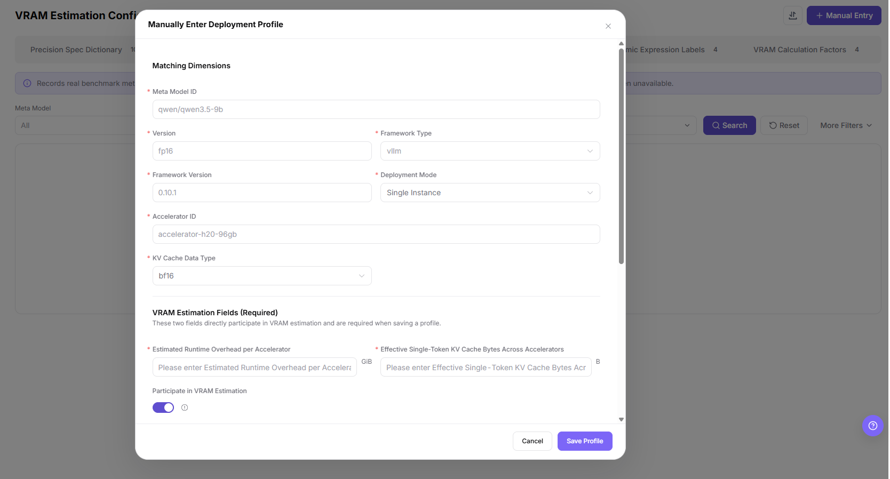

#### Result Validation

- The tab count changes from `0` to the real number of profiles and the empty-state message disappears.
- The matching dimensions of the new profile (meta model, framework, accelerator, deployment mode) match what you entered.
- The estimation-enabled filter can be used to confirm whether the profile takes part in estimation.

#### Notes

- Entering more than one profile for the same set of matching dimensions leaves the engine without a single effective record, so check the existing rows with the four filter dropdowns first.
- The two required estimation fields are the precondition for a profile to take effect; saving without them is blocked.
- The fields revealed by the more-filters control are not shown in the screenshots for this page; follow the on-screen options.

### Maintain Dynamic Expression Labels

#### Applicable Scenarios

- Maintain dynamic expression labels when an input parameter in deployment estimation (concurrency, context, reserve ratio, and similar) has no consistent display label or unit description.
- Use the same area to update the title or description of an existing option.

#### Steps

1. Go to `On-Prem > Templates > VRAM Config` and switch to the `Dynamic Expression Labels` tab.
2. Select the dynamic expression to maintain in the dropdown at the top of the tab. The banner below echoes both the display name and the variable name of the selection.
3. Click **"Edit Labels"** at the top right of the tab to enter edit mode, where the header buttons become `Cancel` and **"Save"**.

The image shows the browse state of the `Dynamic Expression Labels` tab: the option set is identified by its display name and variable name (`Matched framework list` / `matched_framework_list`), the left column is `Editable Options` with an `N options · M missing titles` counter, `L1`/`L2` levels and `frame:`/`frameVersion:` variable rows, and the right column edits `Title` and `Title Description`, both marked `Multilingual` with a `Chinese`/`English` switch and the hint `Displayed in English`.

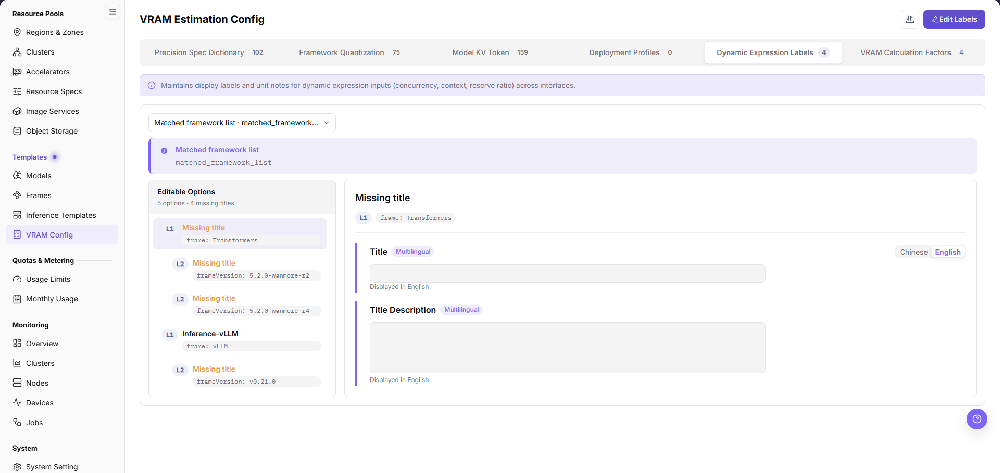

4. Select the option entry to change in the left column.
5. Enter the display title in the title field and the description in the description field. Switch the language control to maintain the Chinese and English texts separately.
6. Save the change, or click cancel to discard it.

The image shows the edit state of the same tab: `Title` and `Title Description` become editable inputs and the header button **"Edit Labels"** is replaced by `Cancel` and **"Save"**.

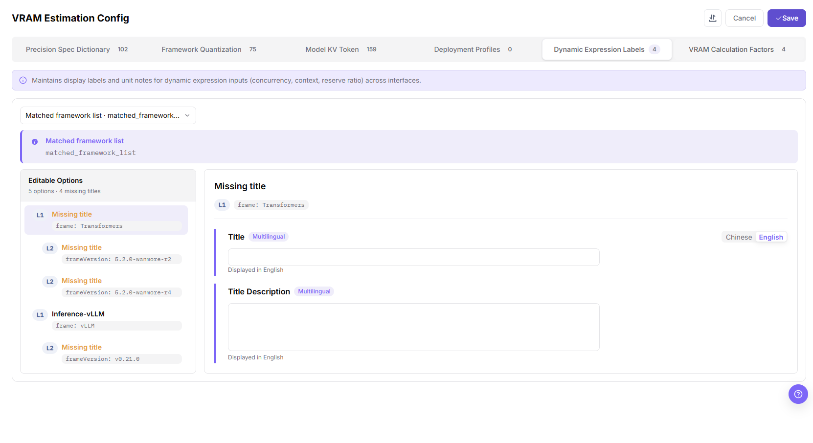

#### Result Validation

- After saving, the entry in the left column no longer shows `Missing title`, and the missing-title count in `N options · M missing titles` decreases.
- The Chinese and English texts take effect independently after you switch the language control.
- The expression dropdown and the variable name in the banner stay unchanged.

#### Notes

- This tab maintains display text only. It does not change the calculation logic or the variable names of the expression.
- Entries without a title fall back to `Missing title` on the user side, so check the missing-title counter before releasing.
- Whether this tab supports adding or deleting option entries is not shown in the screenshots for this page; follow the entries actually offered on the page.

### Maintain VRAM Calculation Factor Forms

#### Applicable Scenarios

- Add a factor form when the user-side deployment flow must collect the inputs needed for VRAM estimation.
- Open the details page from the list when you need to verify the factors and values of a form.

#### Steps

1. Go to `On-Prem > Templates > VRAM Config` and switch to the `VRAM Calculation Factors` tab.
2. To add a form, click **"+Add Form"** at the top right; the page navigates to the `Add VRAM Estimation Config` full-page form. To review one, click `View` in the `Actions` column of the target row to open `VRAM Estimation Config Details`.

The image shows the `VRAM Calculation Factors` tab: the list columns are `Form Name` (with a numeric ID under each name), `Factors`, `Linked Templates`, `Updated At`, and `Actions`, and the action column offers `View` and `Delete`.

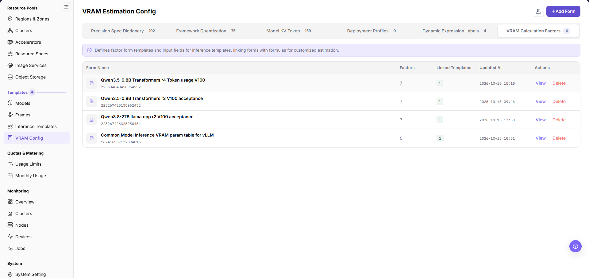

3. In the `Business Parameters` group of the full-page form, enter the `Form Name` (placeholder `Enter VRAM estimation config name`); the group note reads `Estimate VRAM needs by deployment purpose and framework version.`
4. Maintain factors in the `User Step 2 Preview` area: add a factor group with **"+ Add Factor"**, adjust a factor with the gear icon on its step card (for example `1/1 Business Param 1`), and fill the `Parameter description` field.
5. Provide candidate values for a factor by maintaining its option entries (for example `Option 1`) and their `Description` fields, and add more options with **"+ Add Option"**. The `Chinese` / `English` / `Spanish` switch at the top right of the preview area changes the preview language.
6. Check the preview, then click save at the top right of the page. To discard the form, click cancel or the back icon at the top left.

The image shows the `Add VRAM Estimation Config` page: the `Business Parameters` group, the `User Step 2 Preview` area, **"+ Add Option"**, and **"+ Add Factor"** are arranged from top to bottom, and the page header offers `Cancel` and **"Save"**.

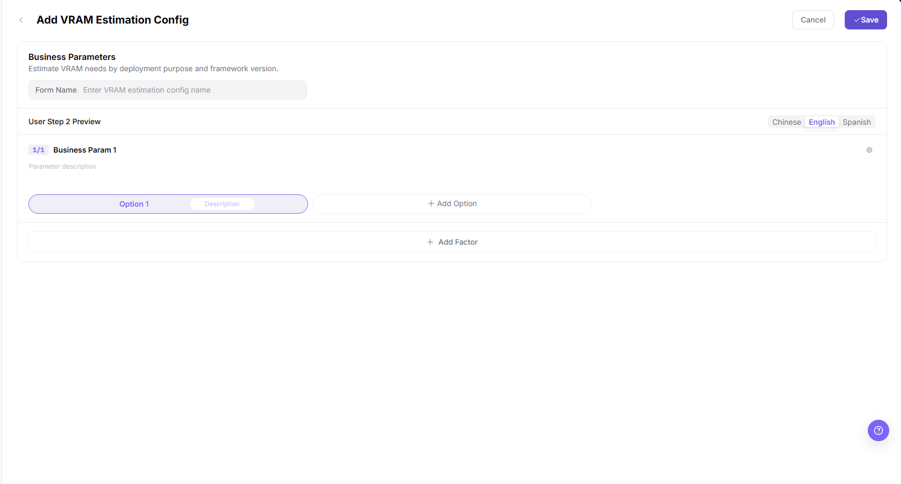

7. On the details page, click **"Edit"** at the top right to return to the same form. When a form is no longer used, go back to the list and click `Delete` in the `Actions` column of the target row, then complete the confirmation shown on the page.

The image shows the `VRAM Estimation Config Details` page: factors are shown as `N/7` step cards titled `Inference framework`, `Accelerator`, `Acceptance concurrency`, `Acceptance context (K)`, `Weight artifact format`, and `KV cache dtype`, and each card shows the selected candidate together with a `Custom` value.

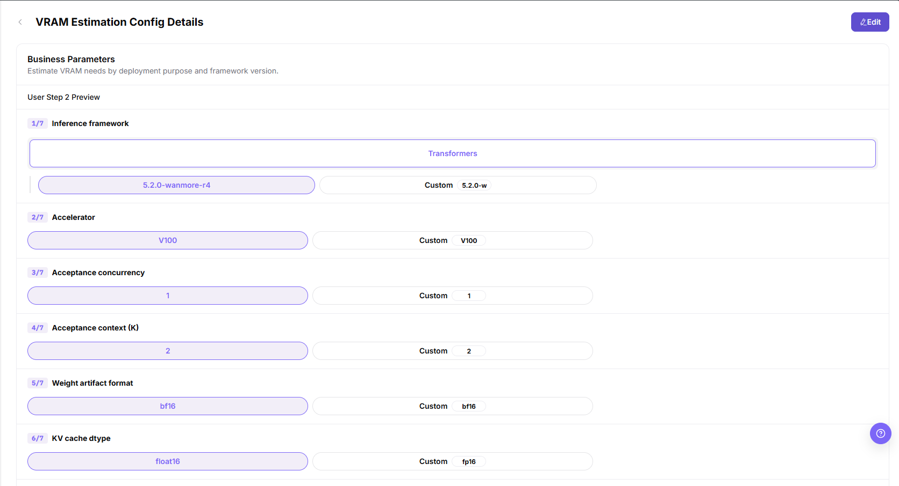

#### Result Validation

- The new form appears as a row in the list, its `Factors` value matches the number of step cards on the details page, and the `Linked Templates` column shows the number of linked templates.
- Every step on the details page echoes the selected candidate or the custom value that was saved.
- After deletion, confirm in the list and in the tab count that the form is no longer present (the post-deletion view is not shown in this page's screenshots; follow what the page shows).

#### Notes

- A factor form decides what the user must fill in step two of deployment. A change affects the estimation entry of every linked template, so verify the preview before saving.
- The factor titles on the details page are English text. Cross-check them against the dynamic expression labels so that one parameter does not end up with two different wordings.
- Do not delete a form that is still linked to an inference template; unlink it or switch to a replacement first. The deletion confirmation dialog is not shown in the screenshots for this page, so follow the on-screen prompt.

## Parameter Quick Reference

| Field Name | Required | Field Type | Example | Description |
| --- | --- | --- | --- | --- |
| `Precision Name` | Not marked in dialog | Text | `bf16` | Identifier of an entry on the `Precision Spec Dictionary` tab; placeholder is `e.g. fp16`. |
| `Bits` | Not marked in dialog | Number (stepper) | `16` | Bit width of the precision; the summary card reports `Bit Range` `1 - 32`. |
| `Bytes Per Value` | Not marked in dialog | Number (stepper) | `2` | Bytes occupied by one parameter value; the summary card reports `Bytes Range` `0.125 - 4`. |
| `Overhead Ratio` | Not marked in dialog | Number (stepper) | `1` | Extra overhead multiplier applied to static weight VRAM; default `1`. |
| `Framework Type` | Not marked in dialog | Text | `llama.cpp` | Grouping key on the `Framework Quantization` tab; placeholder is `e.g. vllm`, and the field is read-only in the edit dialog. |
| `Framework Version` | Not marked in dialog | Text | `default` | Together with `Framework Type` it identifies one configuration; its label carries an information icon and it is read-only when editing. |
| `Weight Quantization` | Not marked in dialog | Multi-select dropdown | `gguf_q4_k_m` | Weight-side quantization methods supported by that framework version; placeholder is `Select weight quantization`. |
| `KV Cache Quantization` | Not marked in dialog | Multi-select dropdown | `f16` | KV Cache-side quantization methods supported by that framework version; placeholder is `Select KV Cache quantization`. |
| `Model Name` | Required | Dropdown selection | `Qwen3.5-0.8B` | First field of the model KV Token drawer on the `Model KV Token` tab; placeholder is `Select model`. |
| `Single Token Cost Config` | Required | List of data-type rows | `fp16` = `12288` | One row per data type, measured in byte, with **"+ Add dtype Config"** below. |
| `Meta Model ID` | Required | Text | `qwen/qwen3.5-9b` | One of the matching dimensions of a manually entered deployment profile; the example is a placeholder. |
| `Deployment Mode` | Required | Dropdown selection | `Single Instance` | Forms the matching dimensions together with the meta model, framework, and accelerator. |
| `Accelerator ID` | Required | Text | `accelerator-h20-96gb` | Accelerator the profile matches; the example is a placeholder. |
| `Estimated Runtime Overhead per Accelerator` | Required | Number (`GiB`) | — | One of the two fields that take part in VRAM estimation. |
| `Effective Single-Token KV Cache Bytes Across Accelerators` | Required | Number (`B`) | — | The other field that takes part in VRAM estimation. |
| `Form Name` | Not marked on page | Text | — | Name field of the full-page form opened from the `VRAM Calculation Factors` tab; placeholder is `Enter VRAM estimation config name`. |
| Factor / option | Not marked on page | Grouped configuration | `7` | Factors and candidate options are maintained in `User Step 2 Preview`; the list shows the count in `Factors`. |

## Pitfalls

- The single-token consumption section is measured in byte, while the two deployment-profile fields use `GiB` and `B`. Confirm the unit before entering values across tabs.
- Wrong bits or bytes per value in a precision spec push every estimation that references it in the same direction.
- The framework type and framework version cannot be changed after a quantization configuration is created, so a misregistered version must be deleted and added again.
- A VRAM factor form defines what the user must fill in step two of deployment, so a change affects every linked template.

## Result Validation

| Check Item | Success Signal | If Abnormal |
| --- | --- | --- |
| Page entry | VRAM Config opens with the target operation entry | Check Operator permission and whether the menu is available |
| Object record | The target record is visible in the list, drawer, or full-page details of its tab, and the tab count matches the total in the footer | Reset filters and verify the name, the tab it belongs to, and the creation result |
| State result | State after creation or change matches the page message | Check operation feedback, dependency state, and latest update time |
| Downstream use | A downstream page can select or associate the target | Return to prerequisites and check enabled state, ownership, and visibility |

## FAQ

#### A VRAM Estimation Result Looks Abnormal

**Symptom:**

The configuration is saved, but an inference template produces a result that is much too large, too small, or unavailable.

**Possible Causes:**

- Bits, bytes per value, or overhead ratio of the precision spec differ from the expected definition.
- Framework version or dynamic expression is unavailable in the target environment.
- The referenced resource specification is missing or its metrics do not match.

**Solution:**

1. Open rule details and verify factors and dynamic expressions one by one.
2. Check model, framework, and resource specification versions and metrics.
3. Recalculate with representative parameters and reconcile with a verified result.

#### Deletion Reports Associated Objects

**Symptom:**

Deletion fails or the page reports that associated objects still exist.

**Possible Causes:**

- An inference template or deployment configuration still references the rule.
- The current account lacks removal permission.
- The rule is still being calculated or processed.

**Solution:**

1. Check rule references on inference template and deployment pages.
2. Verify permission, rule state, and update time.
3. Replace or remove references, then remove the rule according to approval.

#### Target Is Missing from VRAM Config

**Symptom:**

The page opens, but the expected precision spec, framework quantization configuration, model KV Token configuration, deployment profile, dynamic expression label, or VRAM calculation factor form is missing.

**Possible Causes:**

- Filters remain active.
- the object belongs to another scope.
- a prerequisite is incomplete.

**Solution:**

1. Reset filters
2. verify region or tenant ownership
3. confirm prerequisite state.

#### The Operation Entry on VRAM Config Is Unavailable

**Symptom:**

The create, register, or maintain entry is hidden or disabled.

**Possible Causes:**

- Role permission is insufficient.
- the page is read-only.
- dependencies are not ready.

**Solution:**

1. Check Operator permission
2. read the page message
3. complete dependency configuration first.

#### A Downstream Page Cannot Use VRAM Config

**Symptom:**

The current page is normal, but a downstream page cannot select or associate the precision spec, framework quantization configuration, model KV Token configuration, or VRAM factor form.

**Possible Causes:**

- Visibility differs.
- the object is disabled.
- downstream cache is stale.

**Solution:**

1. Check enabled state and ownership
2. verify role visibility
3. refresh and select again.

## Notes

- VRAM estimation is a recommendation and validation basis. It does not replace real stress testing.
- Before modifying a precision spec, a quantization configuration, or a factor form, confirm the impact scope on templates and user creation flows that use them.

## Next Steps

1. Reference VRAM estimation rules in inference templates.
2. Verify VRAM estimation results with small, medium, and large models.
3. Continuously calibrate precision definitions and safety margins based on online failure cases.
