# Online IDE

## Feature Overview

| Item | Content |
| --- | --- |
| Applicable Role | Model Provider |
| Navigation Path | On-Prem > Dev Resources > Online IDE |
| Page Route | `/powerone/dev-training/dev-ide` |
| Managed Object | Online IDE instances and their runtime configuration |

#### Beginner Explanation

You can understand Online IDE as a cloud development machine running in the resource pool. You do not need to install a GPU environment locally. Select an image and specification, and the platform creates an accessible development environment.

#### Terms

| Term | Description |
| --- | --- |
| Image | Container environment required to run a job, usually from platform image services or a custom image project. |
| Specification | Resource package that a job can request, such as CPU, memory, GPU model, and card count. |
| Quota | Resource upper limit available to a tenant. Common dimensions include GPU, CPU, memory, and specifications. |

#### Recommended Operation Order

1. Go to `On-Prem > Dev Resources > Online IDE`.
2. To create an environment, follow Create Online IDE.
3. To manage an existing IDE, follow the operation for its status, details, ports, or storage mounts.
4. To troubleshoot an IDE, check its events, logs, monitoring, and console.
5. Check the result of the operation.
6. Save code and output before pausing or deleting an IDE.

#### First-Time User Notes

Before creating an IDE, prepare the image, specification, quota, and any required storage. For an existing IDE, locate its card and choose the operation for your task.

## Prerequisites

1. The current account has permission to create online IDEs.
2. The target region has available specifications and quota.
3. An available image exists and contains the required development tools.
4. If data or code directories need to be mounted, related storage has been prepared.

## Page Description

Use the list to locate an IDE and its details tabs to inspect configuration, manage ports and mounts, or troubleshoot runtime issues.

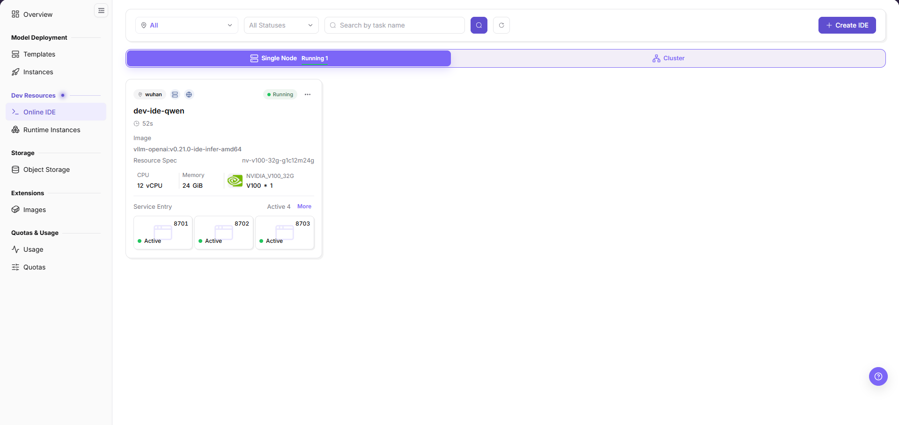

The list groups IDEs into tabs by deployment form and status, filters them by region and status, and searches them by task name. Each card shows the image, resource specification, CPU, memory, and service entry status of one IDE. Clicking a card name opens the details page with the Basic Info, Open Ports, Storage Mounts, Logs, Monitoring, and Console tabs.

#### Page Areas

| Field/Area | Description |
| --- | --- |
| Tabs | Switch between single-node running, single-node stopped, and cluster IDEs, with counts. |
| Filter Area | Filters by region and status and searches by task name. |
| Create IDE | Opens the deployment type page of the creation flow. |
| Card Summary | Shows image, resource specification, CPU, memory, and service entry status of one IDE. |
| More | Opens the status management menu of one card, with pause or start and delete. |
| Pagination Area | View by page when there are many IDEs. |

## Main Operations

### Create Online IDE

#### Applicable Scenarios

Create an online IDE when an interactive development, debugging, or Notebook environment is needed.

#### Pre-Operation Check

1. Target specification and quota are available.
2. The image contains Python, CUDA, frameworks, or other development dependencies.
3. The runtime cycle has been confirmed to avoid long idle resource consumption.

#### Steps

1. Go to `On-Prem > Dev Resources > Online IDE`.
2. Click **"Create IDE"** to open the deployment type page.
3. Select `Single Node` or `Cluster` on the deployment type page.

The deployment type page lists the two forms and the Fill Parameters entry.

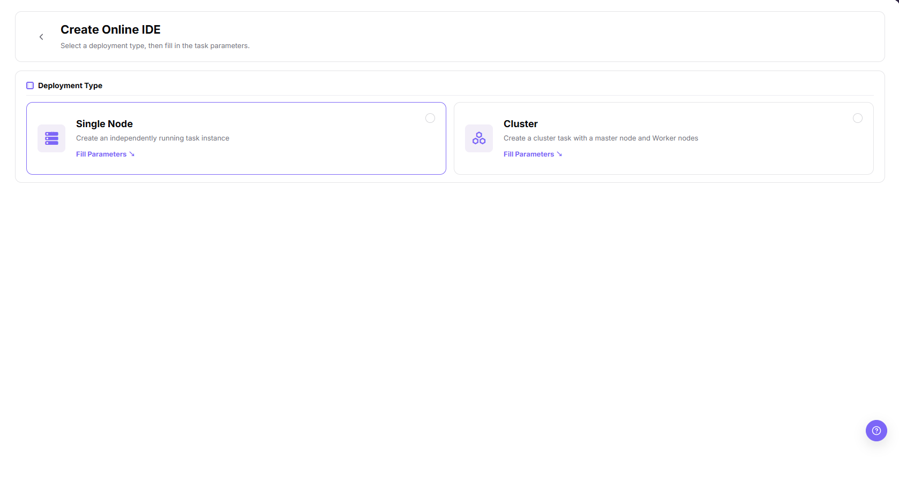

4. Click **"Fill Parameters"** to open the creation form.
5. In Basic Information, fill in the instance name and confirm the region and project.
6. In Runtime Configuration, choose the image and its image version, or change the image first.
7. In Run specification, select one specification row with CPU, memory, accelerator, and price.
8. In Storage Configuration, add a data source and storage paths when a mount is needed.

The creation form collects basic information, runtime configuration, run specification, and storage configuration.

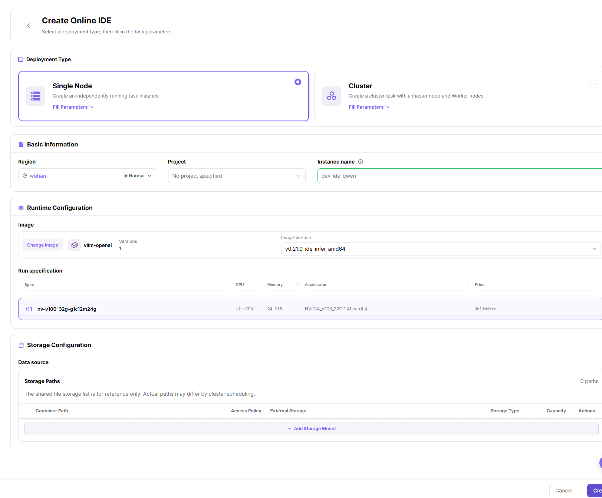

9. Click **"Create"** and wait for the list to show the new IDE.

#### Result Validation

- After submission, check the list for the new IDE and its status.
- If the new IDE appears, open Basic Info and compare its configuration with the submitted values.

#### Notes

- Creating an online IDE occupies quota and cluster resources for its whole runtime.
- The form shows the version count of the selected image; choose the image version before creating.

### Pause, Start, and Delete an IDE

#### Applicable Scenarios

Use this operation to stop a running IDE temporarily, resume a stopped one, or remove an IDE that is no longer needed.

#### Steps

1. Before pausing or deleting an IDE, save code and output to persistent storage.
2. Locate the card on the list and open its **"More"** menu.
3. For a running card, choose **"Pause"** to stop it or **"Delete"** to remove it.

The More menu of a running card offers Pause and Delete.

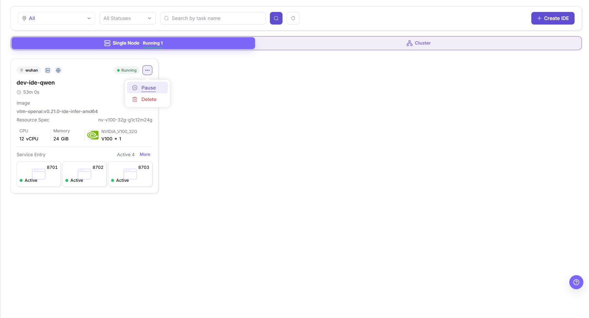

4. For a stopped card, choose **"Start"** to resume it or **"Delete"** to remove it.

The More menu of a stopped card offers Start and Delete.

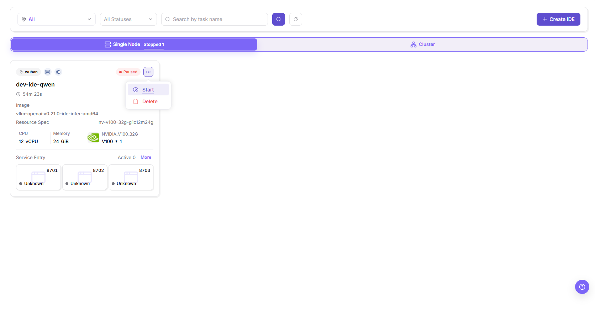

#### Result Validation

- After pause, the card leaves the running tab and appears under the stopped tab with the paused status chip.
- After start, the card returns to the running tab with the running status chip.

#### Notes

- Delete is a final action.
- Pause and start act on the whole IDE, not on single ports or mounts.

### View Basic Info, Pod Info, and Events

#### Applicable Scenarios

Use this operation to verify the runtime facts of one IDE: service entry, configuration, specification, pod scheduling, and container events.

#### Steps

1. Click the card name to open the details page, which opens on the `Basic Info` tab.
2. Read the `Service Entry` tiles and the port cards with their access status.
3. Read `Basic Configuration`: creator, bandwidth, image, start time, end time, project, and runtime, plus the `Spec ID` with CPU, memory, and storage.

The Basic Info tab shows the service entry, the basic configuration, and the specification of the IDE.

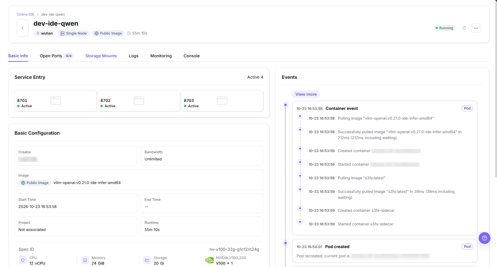

4. Read the `Events` timeline on the right and open **"View more"** for older entries.
5. Read the pod scheduling facts: running node, pod IP, pod start time, host IP, pod status chips, and container status.

The pod information block and the event timeline show scheduling and container lifecycle facts.

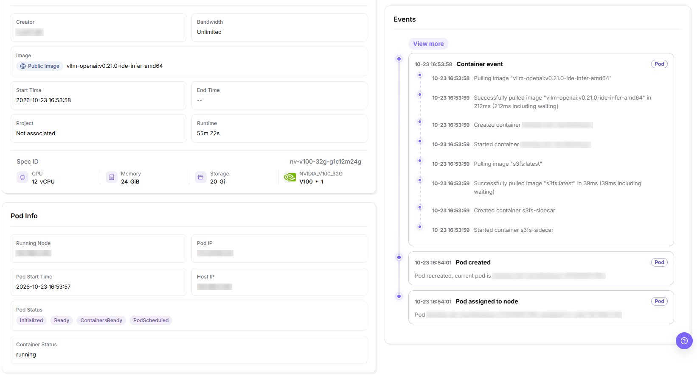

#### Result Validation

- The pod status chips show `Initialized`, `Ready`, `ContainersReady`, and `PodScheduled`, and the container status is running.
- The event timeline lists image pull, container creation, and container start entries with timestamps.

#### Notes

- Node and pod addresses in the pod information block are for diagnosis only; redact them before sharing the screenshot.
- Missing event entries alone do not establish whether a lifecycle step ran.

### Manage Open Ports

#### Applicable Scenarios

Use this operation to expose container ports of one IDE for web or API access and to adjust the access policy and allowlist of a mapping.

#### Steps

1. Open the details page and switch to the `Open Ports` tab.
2. Read the columns: access status, container port, port tags, access policy, and actions.

The Open Ports tab lists every port mapping with its access status and policy.

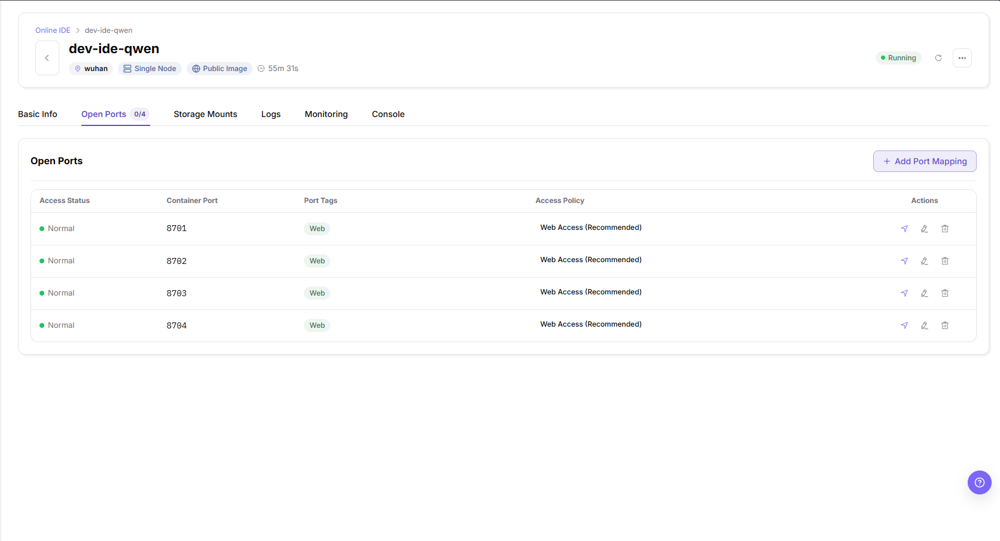

3. Click **"+ Add Port Mapping"** and fill in the container port with an integer from 1 to 65535.
4. Add port tags when needed, choose one access policy card, and add allowlist CIDR entries when the policy requires them.

The Add Port dialog collects the container port, port tags, access policy, and allowlist.

5. Confirm the dialog; to change an existing mapping, open its edit dialog with the same fields and confirm again.

The Edit Port dialog reuses the fields of the Add Port dialog for one existing mapping.

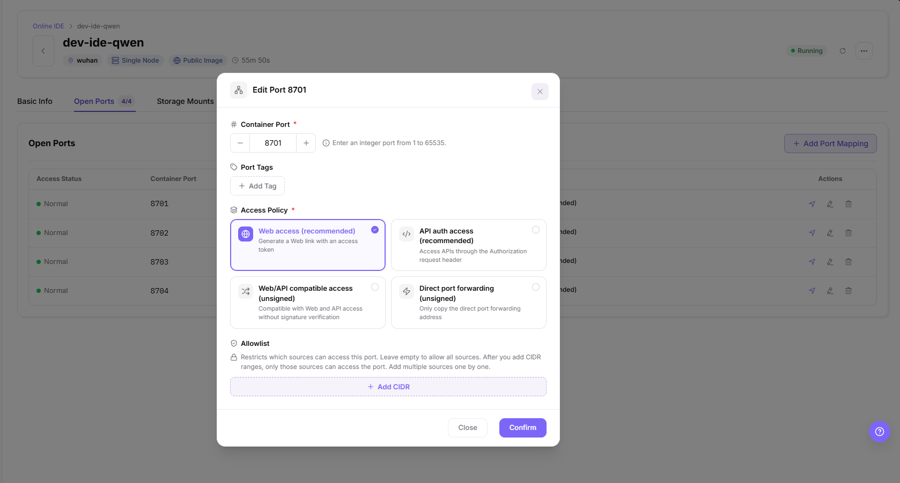

#### Result Validation

- After submission, check the mapping row, access status, and policy.
- Web-policy rows show the recommended web access policy.

#### Notes

- The four access policy cards are mutually exclusive; the allowlist accepts CIDR entries only.
- The container port must stay inside 1 to 65535, as the dialog hint states.

### Manage Storage Mounts

#### Applicable Scenarios

Use this operation to review and add the storage mounts that place external storage into container paths of one IDE.

#### Steps

1. Open the details page and switch to the `Storage Mounts` tab.
2. Read the columns: container path, access policy, external storage, storage type, capacity, and actions; an IDE without mounts shows the empty-state text.
3. Click **"+ Add Mount"** to add a mount for code, data, or output directories.

The Storage Mounts tab lists the mounts of the IDE and the add-mount entry.

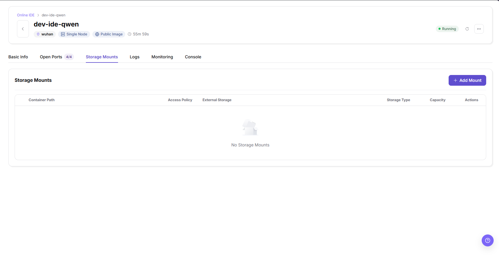

#### Result Validation

- An IDE created without storage mounts shows the empty-state text on this tab.

#### Notes

- Storage visibility does not establish reachability.
- Confirm mount paths before relying on them, because output written outside a mount stays in the temporary container directory.

### View Logs, Monitoring, and Console

#### Applicable Scenarios

Use this operation to troubleshoot a running IDE: stream container logs, watch resource charts, or work in the web terminal.

#### Steps

1. Switch to the `Logs` tab and set the log source, line limit, keyword filter, case sensitivity, context lines, and time range.

The Logs tab streams container logs with the filter and range controls.

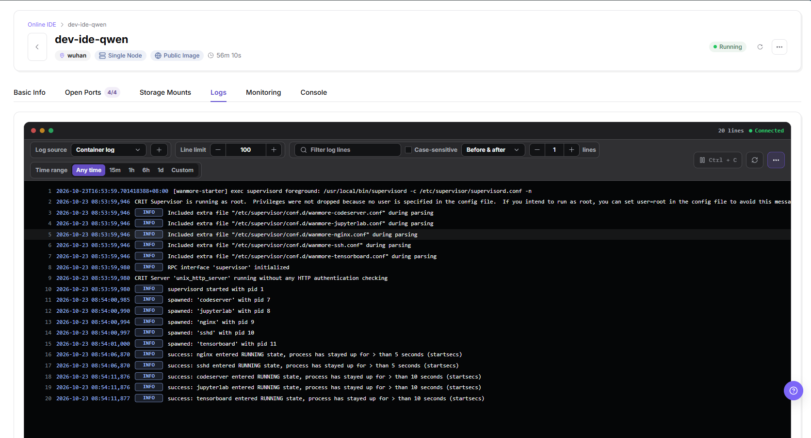

2. Switch to the `Monitoring` tab and choose a sub-tab for common, AI accelerator, or network metrics, with the sampling interval and the real-time resource consumption charts.

The Monitoring tab shows the resource consumption charts of the IDE.

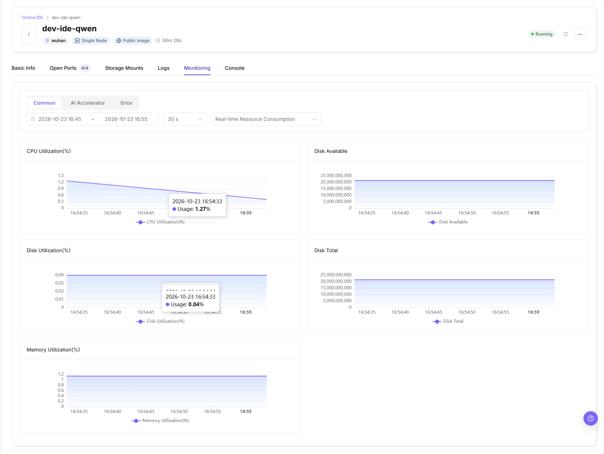

3. Switch to the `Console` tab to use the web terminal, or open it in a new tab.

The Console tab opens a shell session in the workspace directory of the IDE.

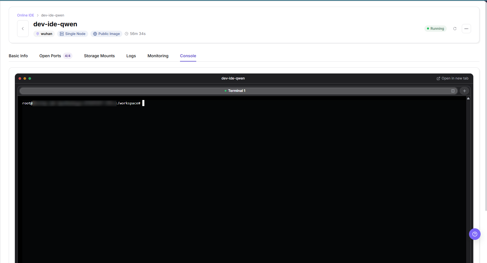

#### Result Validation

- The log panel shows a connected state with line count and timestamped entries.
- The monitoring charts render CPU, disk, and memory series for the selected interval.
- The console shows a shell prompt in the workspace directory.

#### Notes

- The console prompt contains the pod hostname; redact it before sharing the screenshot.
- Log entries can contain internal paths of the image; redact them before sharing.

## Parameter Quick Reference

| Field Name | Required | Field Type | Description |
| --- | --- | --- | --- |
| Instance name | Yes | Text | Display name of the online IDE in the creation form. |
| Deployment Type | Yes | Radio | Select the single-node or cluster form on the deployment type page. |
| Region | Yes | Drop-down | Target region of the online IDE, shown with its status. |
| Project | No | Drop-down | Associates the IDE with a project; leaving the default keeps it unassociated. |
| Image | Yes | Drop-down | Development environment image, with its image version. |
| Run specification | Yes | Drop-down | Compute specification row with CPU, memory, accelerator, and price. |
| Storage Configuration | No | Path | Data source and storage paths added as storage mounts. |
| Startup Command | No | Text | Startup or runtime command of the online IDE. |

## Pitfalls

- Cluster mode may require more quota. Use single-node first for regular debugging.
- If the image lacks dependencies, the IDE may start but code may fail to run.
- `Submit`, `OK`, and `Confirm` are final actions.

#### Configuration Rules and Impact

- Resource consumption depends on runtime; avoid leaving an IDE idle.
- Operators configure images, specifications, and storage; the current account selects from the options visible to it.

## Result Validation

| Check Item | Success Signal | If Abnormal |
| --- | --- | --- |
| Page entry | The list or required details tab opens | Check the current account's operation permissions and the page message |
| IDE instance | The expected card appears under the selected filters | Reset filters and verify the instance name and region |
| Configuration | Basic Info shows the expected image, specification, and project | Compare the displayed values with the intended configuration |

## FAQ

#### Target Is Missing from Online IDE

**Symptom:**

The expected IDE card is missing from the list.

**Possible Causes:**

Filters may exclude the instance, or the selected region may differ from the instance's region.

**Solution:**

1. Reset the status and task-name filters.
2. Check the region and deployment tab.
3. Search for the instance name again.

#### The Operation Entry on Online IDE Is Unavailable

**Symptom:**

Create IDE or the required action in More is unavailable.

**Possible Causes:**

Operation permissions or the current instance state may not meet the action's requirements.

**Solution:**

1. Check the page message and instance state.
2. Confirm that the current account has permission for the action.
3. If permission needs adjustment, contact an administrator.

#### A Required Field on Online IDE Has No Options

**Symptom:**

The creation form opens, but no image or specification can be selected.

**Possible Causes:**

Available options may differ by region or account visibility.

**Solution:**

1. Confirm the selected region.
2. Ask an administrator to check the available image or specification.
3. Refresh the form after the configuration or permissions have been confirmed.

#### Online IDE Has an Abnormal State After the Operation

**Symptom:**

The instance appears in the list, but its state is unexpected.

**Possible Causes:**

The operation may still be processing, or a runtime dependency may have failed; confirm the cause from events and logs.

**Solution:**

1. Check the instance status and operation feedback.
2. Open Basic Info and inspect pod status and events.
3. Check Logs for errors and provide relevant details when requesting help.

#### A Downstream Page Cannot Use Online IDE

**Symptom:**

An IDE cannot be selected on another page.

**Possible Causes:**

Do not assume a cache or enabled-state issue.

**Solution:**

1. Record the target page and expected action.
2. Ask an administrator to confirm the workflow and account permissions.
3. Troubleshoot against the confirmed prerequisites.

## Notes

- Do not store credentials such as passwords, tokens, or private keys in notebooks, repositories, or screenshots.
- Before sharing configuration, logs, or screenshots, check for credentials and sensitive environment information.

## Next Steps

1. Enter the IDE to write and debug code.
2. Save important code, data, and output to persistent storage.
3. When the IDE is no longer needed, follow Pause, Start, and Delete an IDE.
