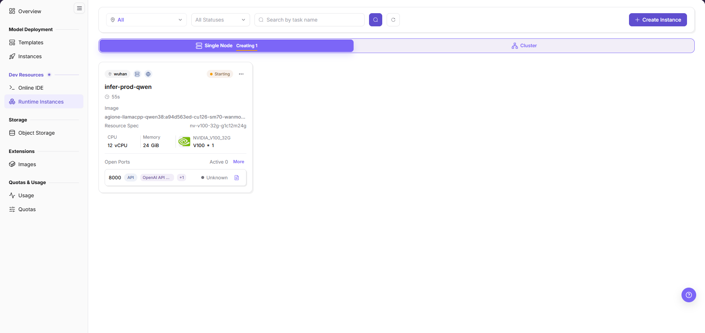
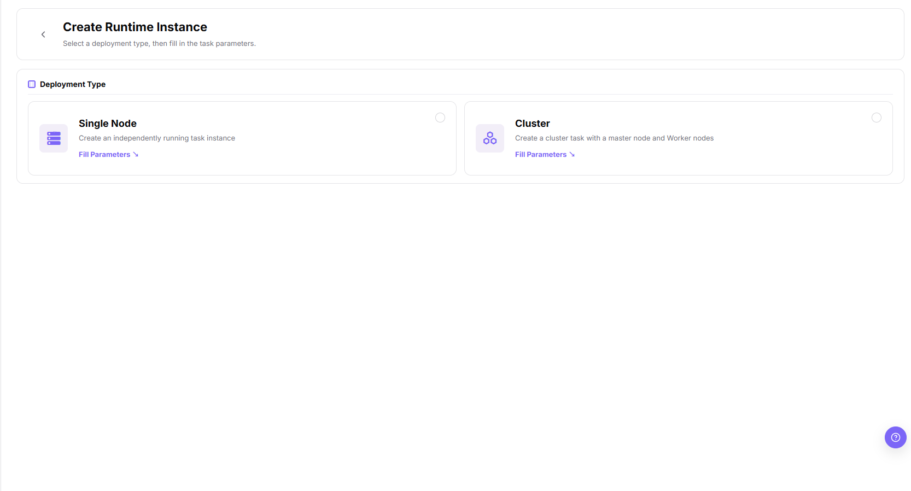
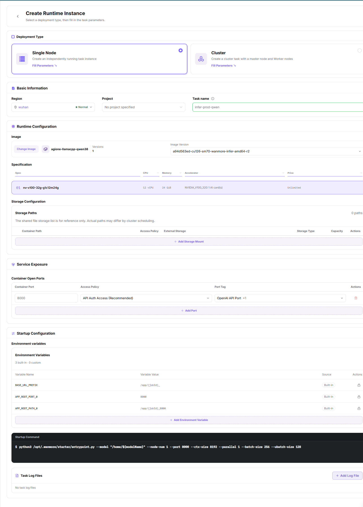
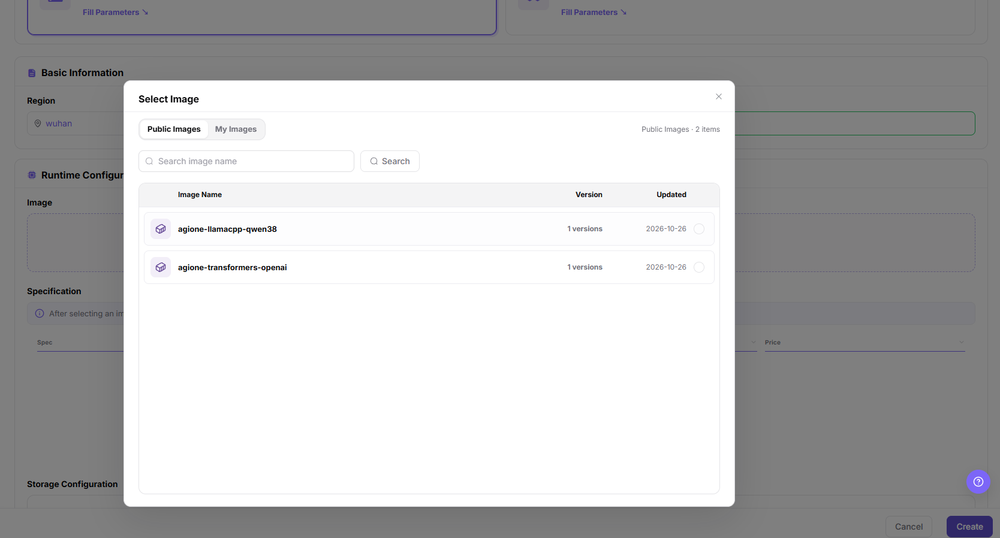
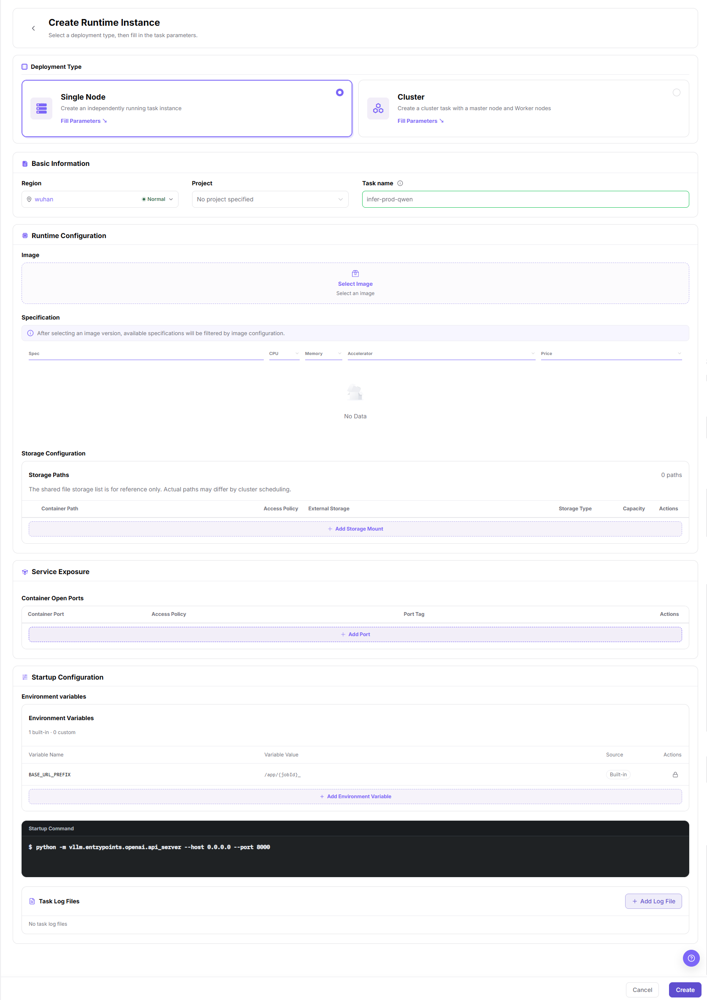

# Runtime Instances

## Feature Overview

| Item | Content |
| --- | --- |
| Applicable Role | Model Provider |
| Navigation Path | On-Prem > Dev Resources > Runtime Instances |
| Page Route | `/powerone/inference/online-inference` |
| Managed Object | Runtime instances (`Single Node` / `Cluster` cards), Image and Image Version, Specification, Storage Paths, Container Open Ports, Environment Variables, Startup Command, and Task Log Files |

#### Beginner Explanation

A runtime instance is like an on-demand task machine: you prepare the image, code, data, and startup command, and the platform starts the instance according to the selected specification. It is more task-execution oriented than Online IDE and more flexible than model instances.

#### Terms

| Term | Description |
| --- | --- |
| Image | Instance runtime environment. |
| Startup Command | Command or script executed after container startup. |
| Batch Processing | One-time or periodic task that processes data, converts files, or generates results, usually exiting after completion. |

#### Recommended Operation Order

Confirm the image, specification, storage, and startup command prerequisites, then fill the form in order - `Deployment Type`, `Basic Information`, `Runtime Configuration`, `Storage Configuration`, `Service Exposure`, `Startup Configuration`, and `Task Log Files` - run Result Validation, and continue to the next page.

#### First-Time User Notes

Confirm that the task needs a new runtime instance, and then follow the recommended order. If fields or state differ from expectations, check prerequisites before continuing downstream.

## Prerequisites

1. The current account has permission to create runtime instances.
2. Available images and specifications exist.
3. Training scripts, model files, or input data have been prepared.
4. Output directories have been planned to object storage, file storage, or shared directories.
5. Startup commands do not contain real keys, passwords, tokens, or AK/SK.

## Page Description

Use this page to view runtime instances and to start the creation flow.

The list page organizes instances under the `Single Node` and `Cluster` tabs, and provides filtering by region and status, search by task name, clearing the filters, and the `Create Instance` entrypoint. Each instance is shown as a card with its status, image, resource specification, and open ports. The create entrypoint first selects a deployment type and then opens the task parameter form.

## Main Operations

### Create Runtime Instance

#### Applicable Scenarios

Use this to start an independently running task instance in `Single Node` form. `Cluster` creates a cluster task with a master node and Worker nodes; its parameter form adds a cluster-level configuration block and splits the startup command into a master-node command and a worker-node command; this page does not quote the English labels of those fields.

#### Steps

1. Go to `On-Prem > Dev Resources > Runtime Instances`.
2. Click `Create Instance` to open the `Create Runtime Instance` page, which prompts you to select a deployment type before filling in the task parameters.
3. In the `Deployment Type` area, select `Single Node`, described as creating an independently running task instance.
4. Click `Fill Parameters` on the card to open the task parameter form.
5. In the `Basic Information` group, set `Region` (the drop-down also shows the health status of the region), `Project` (which can be left as the value for not specifying a project), and `Task name`.
6. In the `Runtime Configuration` group, click `Select Image`, choose the target image from the image list, and then select the specific version in `Image Version`.
7. Select the target row in the `Specification` list, which is made up of the `Spec`, `CPU`, `Memory`, `Accelerator`, and `Price` columns.
8. In the `Storage Paths` list under `Storage Configuration`, check the `Container Path`, `Access Policy`, `External Storage`, `Storage Type`, `Capacity`, and `Actions` columns, and click `Add Storage Mount` when a new mount is required.
9. In the `Service Exposure` group, click `Add Port` and declare the container listening port and its access method in the `Container Port`, `Access Policy`, and `Port Tag` fields of that row.
10. In the `Startup Configuration` group, check the `Variable Name`, `Variable Value`, `Source`, and `Actions` columns of `Environment Variables`, click `Add Environment Variable` as needed, and enter the command to run after container startup in `Startup Command`.
11. In the `Startup Configuration` group, click `Add Log File` to register the log files to collect inside the instance; when nothing is registered the area shows `No task log files`.
12. Review every group and click `Create` to submit, or click `Cancel` to discard.

After you click `Create Instance`, the `Deployment Type` page appears first, and the `Single Node` and `Cluster` cards each provide a `Fill Parameters` entry.

With `Single Node` selected in `Deployment Type`, the task parameter form shows seven groups from top to bottom: `Deployment Type`, `Basic Information`, `Runtime Configuration`, `Storage Configuration`, `Service Exposure`, `Startup Configuration`, and `Task Log Files`.

Clicking `Select Image` in step 6 opens the image picker dialog: its title is `Select Image`, it contains the `Public Images` and `My Images` tabs, its list is made up of the `Image Name`, `Version`, and `Updated` columns, and the footer provides `Cancel` and `Create`.

With nothing filled in, the `Image` area under `Runtime Configuration` shows the `Select Image` and `Select an image` placeholders, the `Specification` list shows `No Data`, and the bottom-right corner of the page pins the `Cancel` and `Create` buttons.

#### Result Validation

- The instance appears under the corresponding tab, and the task name on the card matches the value entered in `Task name`.
- The image, resource specification, `CPU`, `Memory`, and accelerator count on the card match what was selected at creation.
- The `Open Ports` block shows the port rows configured at creation.

#### Notes

- Entries whose `Source` is `Built-in` in `Environment Variables` are generated by the platform, and their `Actions` column only provides a lock indicator.
- Before an image is selected, `Specification` and `Storage Paths` may return no data. Complete the image selection before checking downstream configuration.

## Parameter Quick Reference

| Field Name | Required | Field Type | Description |
| --- | --- | --- | --- |
| Task name | Yes | Text | Display name of the runtime instance on the list card. |
| Deployment Type | Yes | Radio card | Select the single-node or cluster form. |
| Region | Yes | Drop-down | Select the target region. The drop-down also shows the health status of the region. |
| Project | Not marked | Drop-down | Set the ownership scope of the instance, which can be left unspecified. |
| Image | Yes | Dialog picker | Select through `Select Image` or `Change Image` from `Public Images` and `My Images`. |
| Image Version | Yes | Drop-down | Specify the `Image Version` among the versions of the selected image. |
| Specification | Yes | List selection | Select the target specification in the list made up of `Spec`, `CPU`, `Memory`, `Accelerator`, and `Price`. |
| Resource Spec (list card) | N/A | Card field | The label shown on the list card for the selected compute specification. The create form uses the `Specification` list. |
| Storage Paths | Not marked | Table configuration | Configure `Container Path`, `Access Policy`, `External Storage`, `Storage Type`, and `Capacity` through `Add Storage Mount`. |
| Container Open Ports | Not marked | Table configuration | Configure `Container Port`, `Access Policy`, and `Port Tag` through `Add Port`. |
| Environment Variables | No | Key-value configuration | Check entries whose `Source` is `Built-in`, and add custom entries through `Add Environment Variable`. |
| Startup Command | Yes | Text | Configure the command or script executed after container startup. |
| Task Log Files | Not marked | List configuration | Register the log files to keep inside the instance through `Add Log File`. |

The page shows no required-field marker on the field labels. For rows marked `Not marked` in the `Required` column, the submission validation result of the page prevails.

### Python Training Script

Used to start a training entry script. The document only describes that the entry script, data source, output location, and parameter passing method must be checked, without recording real paths or test parameters.

### Shell Script

Used to execute batch processing, data preparation, or multi-step tasks. Before creation, confirm that the script exists in the image or mounted directory, and that output is written to a persistent path.

### Custom Service

Used to start a long-running service process. Before creation, confirm the service entrypoint, listening method, health status, and resource release method.

### Parameter Passing Methods

| Method | Applicable Scenario | Description |
| --- | --- | --- |
| Command-line parameters | The script supports command-line parameters. | Pass parameters on the command line inside `Startup Command`. Do not record real parameters in the document. |
| Environment variables | The framework reads environment variables to control behavior. | Describe field usage only. Do not record real tokens, passwords, or endpoints. |
| Configuration file | Many parameters or reusable configuration is needed. | Confirm that the configuration file comes from a mounted directory or an image built-in path. |
| Mount path | Input data, model files, or output results. | Confirm that input and output directories use persistent storage. |

## Pitfalls

- Runtime instance status changes may affect downstream flows. Confirm impact before submission.
- Sanitize credentials, addresses, customer information, or business identifiers before attaching screenshots or tickets to a support request.
- If the list is empty, check filters, region, and permissions first.
- The label of the final action button follows what the page actually shows; the screenshots in this page show `Create` and `Cancel`.
- Creating a runtime instance occupies quota, scheduling resources, and storage resources.
- Incorrect startup command, environment variable, or mount path configuration may cause instance startup failure or output loss.
- Reading a `0` counter in `Open Ports` as "no port was exposed" is a misjudgment: the port row may already be present as configured, with only its status still unknown.

## Result Validation

| Check Item | Success Signal | If Abnormal |
| --- | --- | --- |
| Page entry | Runtime Instances opens with the target operation entry | Check that the current account has permission for runtime instances and that the menu is available |
| Object record | The instance appears under the corresponding tab, and its card shows `Image`, `Resource Spec`, `CPU`, `Memory`, and `Open Ports` | Reset filters and verify name, ownership, and creation result |
| State result | State after creation or change matches the page message | Check operation feedback, dependency state, and latest update time |
| Downstream use | A downstream page can select or associate the target | Return to prerequisites and check enabled state, ownership, and visibility |

## FAQ

#### Target Is Missing from Runtime Instances

**Symptom:**

The page opens, but the expected runtime instance is missing.

**Possible Causes:**

- Filters remain active.
- The object belongs to another scope.
- A prerequisite is incomplete.

**Solution:**

1. Reset filters
2. Verify region or tenant ownership
3. Confirm prerequisite state.

#### The Operation Entry on Runtime Instances Is Unavailable

**Symptom:**

The `Create Instance` entry is hidden or disabled.

**Possible Causes:**

- Role permission is insufficient.
- The page is read-only.
- Dependencies are not ready.

**Solution:**

1. Check the current account permission
2. Read the page message
3. Complete dependency configuration first.

#### A Required Field on Runtime Instances Has No Options

**Symptom:**

The form opens, but a selection list is empty.

**Possible Causes:**

- Candidates are disabled.
- Ownership differs.
- The current account cannot see them.

**Solution:**

1. Check candidate state
2. Verify ownership
3. Confirm visibility and refresh the form.

#### Runtime Instances Has an Abnormal State After the Operation

**Symptom:**

A record exists after submission, but its state is unexpected.

**Possible Causes:**

- Connectivity or validation failed.
- A dependency is abnormal.
- Processing is incomplete.

**Solution:**

1. Check feedback and update time
2. Inspect related objects
3. Troubleshoot the processing stage.

#### A Downstream Page Cannot Use Runtime Instances

**Symptom:**

The current page is normal, but a downstream page cannot select or associate the runtime instance.

**Possible Causes:**

- Visibility differs.
- The object is disabled.
- Downstream cache is stale.

**Solution:**

1. Check enabled state and ownership
2. Verify role visibility
3. Refresh and select again.

## Notes

- Do not write keys directly in startup commands, environment variables, or screenshots.
- Output data should be written to persistent storage to avoid loss after instance release.
- Do not write real tenant, region, image address, resource specification ID, data path, output path, token, password, endpoint, startup parameter, log, or test data in the document text. The screenshots in this page are captured from the interface, and the task names, image and specification values, and region names shown there are interface content and are not covered by this rule.

## Next Steps

1. Enter instance details to view logs and output.
2. Evaluate resource consumption from the usage page.
3. After the task completes, act on the instance through the items that the instance card actually provides.
4. Accumulate stable commands into team scripts or inference template parameters.
