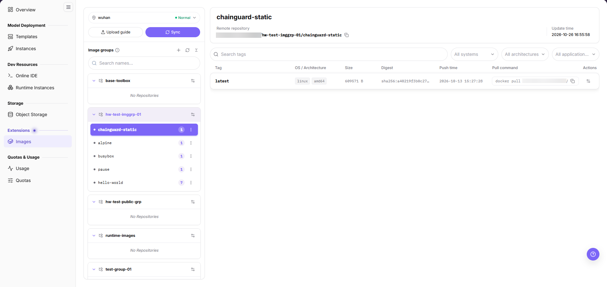
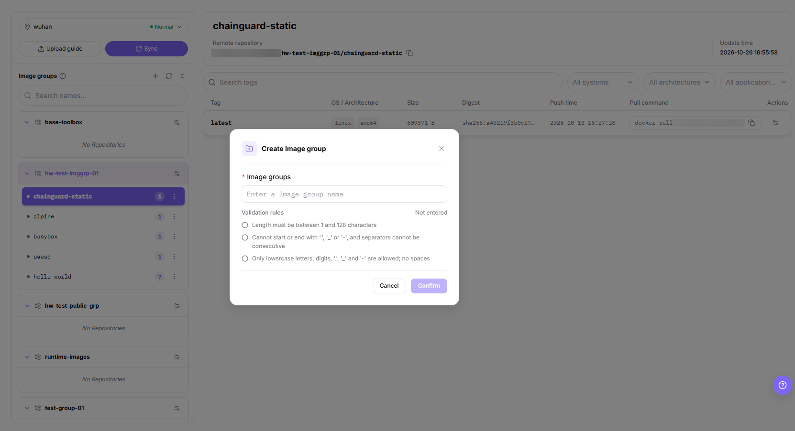
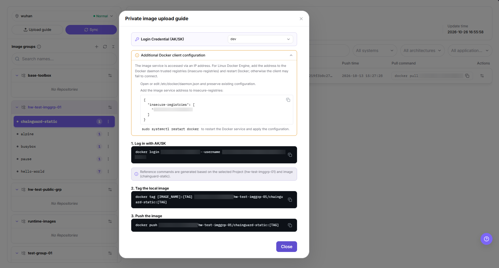
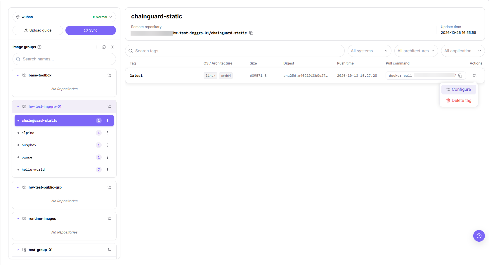
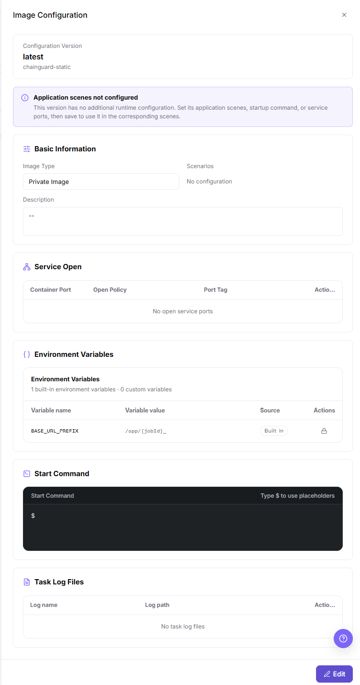

# Images

## Feature Overview

| Item | Content |
| --- | --- |
| Applicable Role | Model Provider |
| Navigation Path | On-Prem > Extensions > Images |
| Page Route | `/powerone/expand-service/image-service` |
| Managed Object | Image groups, the repositories they contain, image tags, and the private-image upload guide |

The `Applicable Role` and `Page Route` values above do not appear in any of the 5 screens of this batch, so this document does not describe them as on-screen items. The navigation path keeps the information-table row as the only form used in this page body; the screens carry no breadcrumb bar, so this document makes no claim about its on-screen segment form.

#### Beginner Explanation

An image is the runtime environment of a job: the operating system, framework, Python packages, startup scripts, and dependencies. This page organizes images at two levels. A card in the `Image groups` panel is a namespace, a repository row under it is one image, and the table on the right lists the tags of that image.

#### Terms

| Term | Description |
| --- | --- |
| Image | Container runtime environment. |
| Image Group | Namespace shown as a card in the `Image groups` panel. |
| Repository | One image inside an image group; its tags are listed in the table on the right. |
| Image Tag | Image version identifier, such as the `latest` value in the `Tag` column. |

#### Recommended Operation Order

Confirm the region chip shows `Normal`, select an image group and one of its repositories, push a private image from `Upload guide`, click `Sync` to refresh the list, maintain the tag with `Configure`, and then complete Result Validation.

#### First-Time User Notes

Read the `Image groups` panel first: a group without any repository is labelled `No Repositories`. The tag table and the detail pane always describe the repository that is selected. Apply `Additional Docker client configuration` before you run any command from `Upload guide`.

## Prerequisites

1. Image services have been opened in the target region.
2. The current account has permissions to view image groups, create image groups, and push images.
3. Docker or a compatible container tool has been installed locally.
4. A buildable Dockerfile or local image has been prepared.
5. The image service is accessed by IP address, so that address must be listed in `insecure-registries` in `/etc/docker/daemon.json` and the Docker service must be restarted before the client can connect.
6. Select the credential in `Login Credential (AK/SK)` inside the upload guide, and do not expose access keys, repository passwords, or access tokens in screenshots, documentation, or command records.

## Page Description

Use this page to maintain image groups, browse the repositories they contain, check the tags of each repository, and obtain the commands for pushing a private image.

The screen has three areas: the `Image groups` panel on the left lists groups as cards below a `Search names...` box and its toolbar icons; the repository rows of the selected group follow, each with a status dot, a tag-count badge, and a row menu icon; the detail area on the right shows the repository name, its `Remote repository` address with a copy icon, and its `Update time`, above the tag area that holds `Search tags`, the `All systems` and `All architectures` dropdowns and a third scene dropdown, the tag table, and the page-level `Upload guide` and `Sync` buttons.

The previous version described three views named `My Images`, `Public Images`, and `Push History`; no such tabs appear in this screen, so this document does not repeat that statement.

## Main Operations

### View Image Groups and Repositories

#### Applicable Scenarios

Use this operation to locate one repository, read the address it is pushed to, and confirm how many tags it currently holds.

#### Steps

1. Open the Images page (`On-Prem > Extensions > Images`) and confirm the region chip shows `Normal`.
2. Read the cards in the `Image groups` panel; a card without a repository is labelled `No Repositories`.
3. Select a group card and check the repository rows listed under it.
4. Select a repository row so that the tag table and the detail pane load it.
5. Check the status dot and the tag-count badge on that row.

The screen in Page Description shows these three areas with one repository selected.

#### Result Validation

- The selected group card and its repository rows are visible in the `Image groups` panel.
- The tag-count badge on the selected row matches the number of rows in the tag table.
- The detail pane title, `Remote repository` value, and `Update time` all describe the repository you selected.

#### Notes

- The three icons in the panel header carry the hover labels `Create Image group`, `Refresh image list`, and `Collapse all projects`, and the icon at the end of each image-group card row carries the hover label `Image group actions`; these icons have no static text label on the screen, so this document records only the hover wording and does not describe what happens after a click.
- The earlier statement that project details expose member permissions does not appear in this batch, so this document does not describe member permissions on this page.
- Which image groups hold platform-provided base images cannot be told from this screen, so this document does not carry the earlier `Public Images` statement forward.

### Search and Filter Tags

#### Applicable Scenarios

Use this operation to shorten a long group list by name, or a long tag list by keyword, operating system, architecture, or application scene.

#### Steps

1. Enter a keyword in `Search names...` to filter the cards in the `Image groups` panel.
2. Enter a keyword in `Search tags` to filter the rows of the tag table.
3. Use the `All systems` and `All architectures` dropdowns, and the third scene dropdown, above the tag table.
4. Read the remaining rows against the columns `Tag`, `OS / Architecture`, `Size`, `Digest`, `Push time`, `Pull command`, and `Actions`.

#### Result Validation

- Every remaining row matches the keyword and each dropdown value you selected.
- The `Pull command` cell of a remaining row still shows its `docker pull` command with a copy icon.

#### Notes

- The third dropdown label is cut off on this screen and reads `All application...`; its full wording is `All application scenes`, and on this screen that full wording appears only in the tooltip shown when you hover the label. The last column header of the tag table is fully visible as `Actions` on this screen.

### Create an Image Group

#### Applicable Scenarios

Use this operation when no existing group can hold a new image, or when a team needs its own namespace.

#### Steps

1. Open the Images page (`On-Prem > Extensions > Images`) and locate the `Image groups` panel.
2. Click the `+` icon in the panel header to open the `Create Image group` dialog.
3. Enter the name in the `* Image groups` field; the placeholder reads `Enter a Image group name`.
4. Watch the three entries under `Validation rules` while typing; the value stays `Not entered` until the name is filled in.
5. Click **"Confirm"** to create the group, or **"Cancel"** to close the dialog without creating anything.

The following screen shows the dialog with its validation rules.

#### Result Validation

- The new group appears as a card in the `Image groups` panel.
- The card has no repository row until an image is pushed into it.

#### Notes

- A group name must be 1 to 128 characters long, may contain only lowercase letters, digits, `.`, `_`, and `-`, may not start or end with `.`, `_`, or `-`, may not contain consecutive separators, and may not contain spaces.
- A group name is a namespace, not a repository: push the first image into it from `Upload guide`.
- Creating a group writes to shared registry infrastructure, so agree on the naming with your team before you create it.

### Upload a Private Image

#### Applicable Scenarios

Use this operation to push a locally built image into a repository of an image group so that Online IDE, Runtime Instances, or a model service can select it.

#### Pre-Operation Check

1. The target image group is selected in the `Image groups` panel before you open the dialog.
2. `Additional Docker client configuration` has been applied: the registry address is listed in `insecure-registries` in `/etc/docker/daemon.json`, the existing configuration is kept, and the Docker service has been restarted.
3. The access key comes from `Login Credential (AK/SK)`, is used only in the local terminal, and is not written into documentation, script repositories, or screenshots.
4. The image carries an explicit version tag instead of only `latest`.

#### Steps

1. On the Images page (`On-Prem > Extensions > Images`), click **"Upload guide"**.
2. Select the credential in the `Login Credential (AK/SK)` dropdown.
3. Expand `Additional Docker client configuration`, copy the JSON block into `/etc/docker/daemon.json` while keeping the existing entries, and run `sudo systemctl restart docker`.
4. Copy the command under `1. Log in with AK/SK` into the local terminal.
5. Build or tag the local image, then run the commands under `2. Tag the local image` and `3. Push the image`.
6. Click **"Close"**, select the target repository, and then click **"Sync"** on the page.

The following screen shows the dialog with the credential dropdown, the Docker client configuration block, and the three command steps.

#### Result Validation

- `docker push` returns without an authentication or connection error in the local terminal.
- After **"Sync"**, the repository appears under the selected group and its tag-count badge grows.
- The pushed tag is listed in the tag table with its `Push time`, and its `Pull command` cell is populated.

#### Notes

- The dialog states that the reference commands are generated from the selected project and image, so they are not a generic template.
- The push-history view described by the previous version does not appear on this screen, so this document does not describe push records here.
- This screen only offers `Login Credential (AK/SK)`; whether `Robot Credentials` still exist as a credential type is left unstated in this document, in either direction.

### Configure or Delete a Tag

#### Applicable Scenarios

Use this operation to maintain the application scene, startup command, service ports, or environment variables of a tag, or to remove an obsolete tag.

#### Steps

1. In the tag table, click the row menu icon at the end of the target row.
2. Click **"Configure"** to open the `Image Configuration` drawer, or **"Delete tag"** to remove that tag.

The following screen shows the row menu with both entries.

3. In the drawer, check the `Configuration Version` card and the `Basic Information`, `Service Open`, `Environment Variables`, `Start Command`, and `Task Log Files` blocks.
4. Click **"Edit"** in the drawer footer to open the editable form.

The following screen shows the drawer in read-only mode.

#### Result Validation

- The drawer title is `Image Configuration` and its `Configuration Version` card shows the tag and the image you opened.
- When no scene is configured, the drawer warns `Application scenes not configured` and `Basic Information` shows `No configuration`.
- A deleted tag is no longer listed in the tag table.

#### Notes

- The confirmation step for **"Delete tag"**, and any entry for deleting a group or a repository, does not appear in this batch, so this document does not describe those operations.
- The selectable values behind `Scenarios` and `Open Policy`, and the form behind **"Edit"**, are not visible in the read-only drawer, so this document lists only what the drawer displays.
- The drawer lists built-in and custom variables separately, and a built-in variable such as `BASE_URL_PREFIX` carries a lock icon.
- Deleting the last tag removes the only pushed copy of that version; push it again from `Upload guide` if a downstream page still needs it.

### View Repository Details

#### Applicable Scenarios

Use this operation to read where an image is pulled from, when it was last updated, and which tags it currently exposes.

#### Steps

1. Open the Images page (`On-Prem > Extensions > Images`), select an image group card, and then select one of its repository rows.
2. Read the repository name in the title of the detail pane.
3. Copy the address next to `Remote repository` with its copy icon.
4. Check the `Update time` value below it.
5. Scan the tag table columns `Tag`, `OS / Architecture`, `Size`, `Digest`, `Push time`, and `Pull command`.

The screen in Page Description shows the detail pane of a selected repository.

#### Result Validation

- The `Remote repository` value starts with the registry address of the current environment and ends with the selected image.
- The tag-count badge on the repository row equals the number of rows in the tag table.
- The `Update time` is not earlier than the newest `Push time` shown in the table.

#### Notes

- The address under `Remote repository` is an internal registry address; use it in the local terminal only, and never paste it into a public ticket or document.
- No deletion entry for a group or a repository appears in this screen; this document does not conclude that the page supports or refuses deletion.

## Parameter Quick Reference

| Field Name | Required | Field Type | Example | Description |
| --- | --- | --- | --- | --- |
| Image groups | Yes | Text | `<image-group>` | The `* Image groups` field in the `Create Image group` dialog. |
| Remote repository | System-generated | URL | `<REGISTRY_HOST>:<PORT>/<image-group>/<image>:<TAG>` | The value shown next to `Remote repository`. |
| Image Tag | Yes | Text | `latest` | The value in the `Tag` column of the tag table. |
| OS / Architecture | System-generated | Enum | `linux`, `amd64` | Chips in the `OS / Architecture` column, filtered by `All systems` and `All architectures`. |
| Size | System-generated | Number | `<bytes>` | The value in the `Size` column. |
| Digest | System-generated | Text | `sha256:...` | The value in the `Digest` column. |
| Push time | System-generated | Timestamp | `YYYY-MM-DD HH:mm:ss` | The value in the `Push time` column. |
| Update time | System-generated | Timestamp | `YYYY-MM-DD HH:mm:ss` | The `Update time` value in the detail pane. |
| Login Credential (AK/SK) | Conditionally required | Secret text | `<PERSONAL_KEY>` | The credential dropdown in `Private image upload guide`. |
| Robot Credentials | Conditionally required | Secret text | `<PERSONAL_KEY>` | This credential type does not appear in this batch, so this document makes no claim about it. |
| Sync Status | System-generated | Enum | `Synced` | This status does not appear in this batch, so this document does not describe its values or transitions. |

Replace every placeholder with the value the page shows. Do not copy a real registry address or access key into documentation.

## Pitfalls

- If `docker login` fails, first check that the registry address is listed in `insecure-registries` in `/etc/docker/daemon.json` and that Docker was restarted afterwards, before you suspect the access key.
- The commands in `Private image upload guide` follow the image that was selected before the dialog opened, so switch the image and reopen the guide instead of reusing an older command.
- If an image push fails, check the `Remote repository` address, the image group, the image name, and the tag before rebuilding the image.
- Use explicit version tags instead of relying on `latest`, so that runtime environments remain traceable.
- Do not include keys, internal addresses, or customer data in an image, and complete a security check before publishing it.

## Result Validation

| Check Item | Success Signal | If Abnormal |
| --- | --- | --- |
| Page entry | The Images page opens with the `Image groups` panel, `Upload guide`, and `Sync` visible | Check permissions and whether the image service is opened in the current region |
| Group record | The created group is listed as a card in the `Image groups` panel | Clear `Search names...` and select another group to rule out a filter |
| Repository record | The pushed image appears as a repository row with a tag-count badge | Check the pushed address, image group, image name, and tag |
| State result | The repository row status dot and `Update time` refresh after you click **"Sync"** | Check operation feedback, dependency state, and the latest update time |
| Downstream use | A downstream page can select or associate the pushed image | This outcome does not appear in this batch; the row is kept only as a check item |

## FAQ

#### Target Is Missing from Images

**Symptom:**

The page opens, but the expected image group, repository, or tag is missing.

**Possible Causes:**

- A keyword remains in `Search names...` or `Search tags`.
- the repository belongs to another image group.
- the push has not been synced yet.

**Solution:**

1. Clear both search boxes
2. select the group card that should contain the repository
3. click `Sync` and check the tag table again.

#### The Operation Entry on Images Is Unavailable

**Symptom:**

The `+`, `Upload guide`, `Sync`, or row menu entry is hidden or disabled.

**Possible Causes:**

- Role permission is insufficient.
- the page is read-only.
- dependencies are not ready.

**Solution:**

1. Check the account permission
2. read the page message
3. complete dependency configuration first.

#### A Required Field Has No Options

**Symptom:**

The `Create Image group` dialog or the `Login Credential (AK/SK)` dropdown opens, but the list is empty.

**Possible Causes:**

- Candidates are disabled.
- ownership differs.
- the current account cannot see them.

**Solution:**

1. Check candidate state
2. verify ownership
3. confirm visibility and refresh the form.

#### Images Has an Abnormal State After the Operation

**Symptom:**

A group or tag exists after submission, but its state is unexpected.

**Possible Causes:**

- The name does not satisfy the rules listed under `Validation rules`.
- a dependency is abnormal.
- processing is incomplete.

**Solution:**

1. Read the entries under `Validation rules` and the `Update time`
2. inspect the status dot on the repository row
3. troubleshoot the processing stage.

#### A Downstream Page Cannot Use The Image

**Symptom:**

The current page is normal, but a downstream page cannot select the image pushed from this page.

**Possible Causes:**

- Visibility differs.
- the tag has not been pushed or synced.
- downstream cache is stale.

**Solution:**

1. Check the `Remote repository` address and the tag row
2. verify role visibility
3. refresh the downstream page and select again.

## Notes

- Do not screenshot access keys, repository passwords, or tokens shown in `Private image upload guide` or in credential dropdowns.
- Production images should use explicit version tags and avoid using only `latest`.
- When a push fails, do not paste the complete registry address, username, or access key into a public ticket.

## Next Steps

1. Select this image in Online IDE or Runtime Instances to verify dependencies.
2. Maintain version tags and change records for production images.
3. Clean up unused tags with **"Delete tag"** to reduce image repository storage usage.
