# Instances

## Feature Overview

| Item | Content |
| --- | --- |
| Applicable Role | Model Provider |
| Navigation Path | On-Prem > Model Deployment > Instances |
| Page Route | `/powerone/quickstart/model-service` |
| Managed Object | Model-service instances and their deployment configuration |

#### Beginner Explanation

A model instance runs a deployed model service. Create it from a deployment template or use Custom Deploy on this page, then inspect its card, publish its inference service, or delete it when no longer needed.

#### Terms

| Term | Description |
| --- | --- |
| Instance | A runtime object created by the platform and scheduled to a cluster, such as a model service, online IDE, or runtime instance. |
| Specification | Resource package that a job can request, such as CPU, memory, GPU model, and card count. |
| Single Instance | One model service instance runs independently, suitable for testing or low-traffic scenarios. |

#### Recommended Operation Order

1. Go to `On-Prem > Model Deployment > Instances`.
2. To create an instance, use a deployment template or follow Create Custom Model Instance.
3. For an existing instance, check its card, then use the details tabs for configuration, ports, storage, or diagnosis.
4. Before continuing to private-model registration, check the API smoke-test result.
5. Before deletion, confirm service impact and save any required data.

#### First-Time User Notes

Prepare the model version, framework image, specification, and region before custom deployment. For an existing instance, use its card to identify the model, resources, status, and available actions.

## Prerequisites

1. The current account has permission for the intended instance operation.
2. For custom deployment, the model version, framework image, specification, and region are available.
3. For publishing or deletion, confirm the target instance and the impact on service users.

## Page Description

Use this page to view model-service instance cards and to start custom deployment, publishing, or deletion from the list.

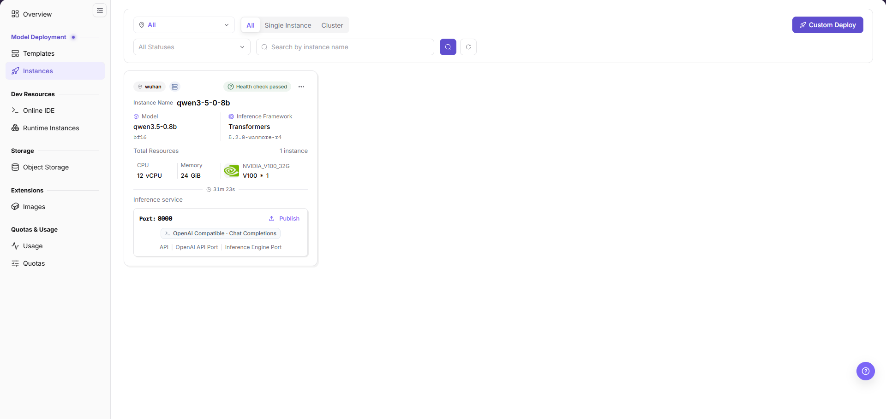

The card shows a region chip, an `Inference service ready` status chip, the instance name, elapsed runtime, `Model` with its precision tag, `Inference Framework` with its version, `Total Resources`, and CPU / memory / GPU allocations. Its service entry shows `Port: 8000`, `OpenAI Compatible · Chat Completions`, and `API`, `OpenAI API Port`, and `Inference Engine Port` chips, plus `Publish` and a `…` menu.

#### Page Areas

| Field/Area | Description |
| --- | --- |
| Instance Type Filter | Switch between `All`, `Single Instance`, and `Cluster`. |
| Region and Status Filters | The `All` region dropdown and the `All Statuses` dropdown narrow the list. |
| Search Area | Enter a keyword in `Search by instance name`, then use the search icon button; the refresh icon button reloads the list. |
| List Area | Displays instance cards and their status. |
| Details Tabs | Basic Info, Task Info, Open Ports, Storage Mounts, Logs, Monitoring, and Console. |

## Main Operations

### Create Custom Model Instance

#### Applicable Scenarios

Create a model-service instance directly from the model library when you need to choose its deployment plan, framework image, resources, and runtime configuration.

#### Pre-Operation Check

- The selected model version shows the `Deployable` badge.
- The intended region shows `Normal` in `Region and Zone`.

#### Steps

1. Go to `On-Prem > Model Deployment > Instances` and click **Custom Deploy**.
2. In `Model Library`, search with `Search model / author / tag / accelerator` and select a model marked `Deployable`.
3. In `Model Versions`, search with `Search versions, parameter sizes, or frameworks` and choose a version.

The model library shows capabilities such as Tool Calling and Reasoning; the right panel lists versions of the selected model.

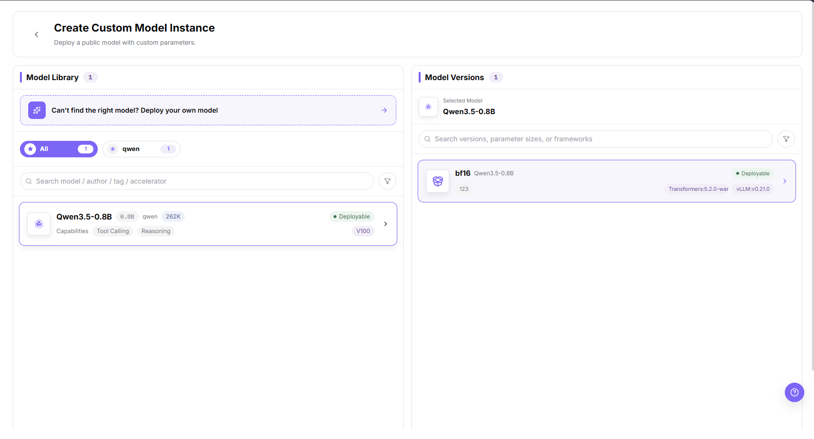

4. Choose `Single Instance` or `Cluster` under `Deployment Plan`; the shown form uses Single Instance.
5. Select an `Inference Framework` image and a `Specification` row, checking CPU, memory, and accelerator allocations. The image filter shows `All images 2`.
6. Confirm the region under `Region and Zone` and configure `Storage Mounts` when needed.
7. Check `Exposed Ports`, including the `Model service API port` designation and `API inference protocol`.
8. Review `Environment Variables` and `Start Command`; the shown form has `3 built-in · 0 custom` variables.

The form includes storage, ports, variables, and the start command. Built-in variables include `BASE_URL_PREFIX`, `APP_ROOT_PORT_0`, and `APP_ROOT_PATH_0`.

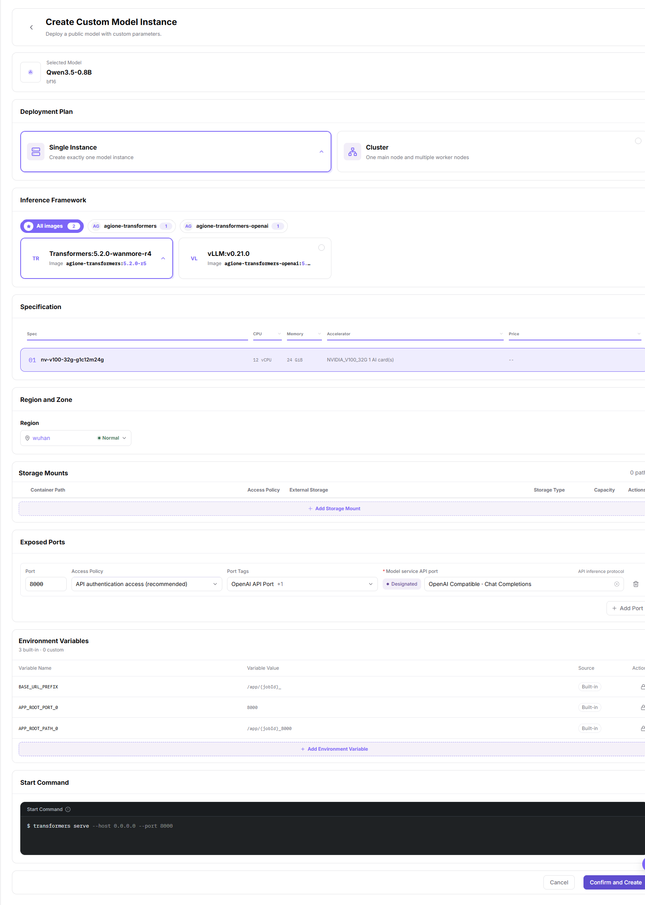

9. Check the configuration and resource impact, then click **Confirm and Create**.

#### Result Validation

- After submission, check the list for the instance and its status.
- If the instance appears, compare the model, framework, and resource summary on its card with the intended deployment.

#### Notes

### View Basic Info and Task Configuration

#### Applicable Scenarios

Check an instance's model attributes, deployment information, resource allocation, and runtime configuration before investigating a service issue.

#### Steps

1. In the target instance's details, select `Basic Info`.
2. Read `Model attributes`: scenario, model type, function/tool calling, reasoning mode, token limits, input/output modalities, architecture, attention, parameters, context window, and quantization.
3. In `Task instance`, check Deployment Name, Project, Created At, Updated At, Runtime, and Resource Config.

Basic Info separates model attributes from task-instance information and the CPU, memory, storage, and accelerator allocation.

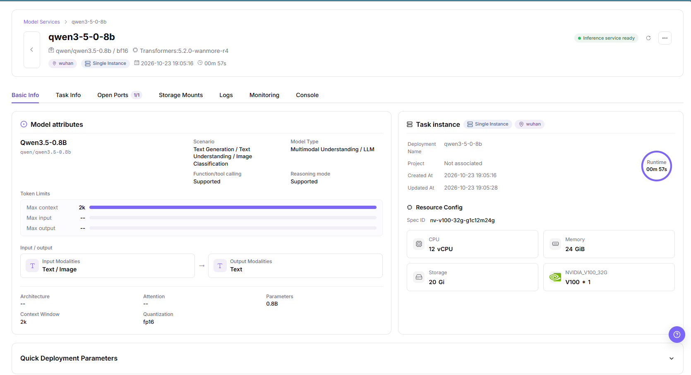

4. Select `Task Info` and check Image, Start Time, End Time, Project, Runtime, and Spec ID under Basic Configuration.

The task configuration shows the selected image, time fields, project association, runtime, and resource specification.

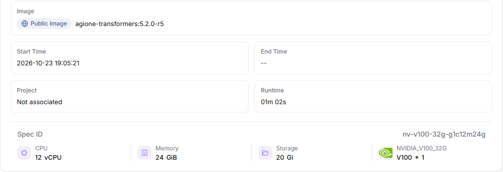

#### Result Validation

- Check that the task-instance information belongs to the intended deployment and compare its resource allocation with the intended specification.
- Read Created At separately from Runtime; the former is a timestamp and the latter is elapsed time.

#### Notes

- Model-attribute labels describe metadata; they do not independently prove that the deployed service supports a capability.
- Read the header precision tag and the Quantization field separately rather than assuming their displayed values are interchangeable.

### Manage Open Ports

#### Applicable Scenarios

Review a model instance's port mappings or adjust a mapping's open policy, tags, and permitted source networks.

#### Steps

1. In the instance details, select `Open Ports` and read Access Status, Port, Access Policy, Port Tags, and Action.

The port table shows a Normal row and a Model service API port badge with its protocol.

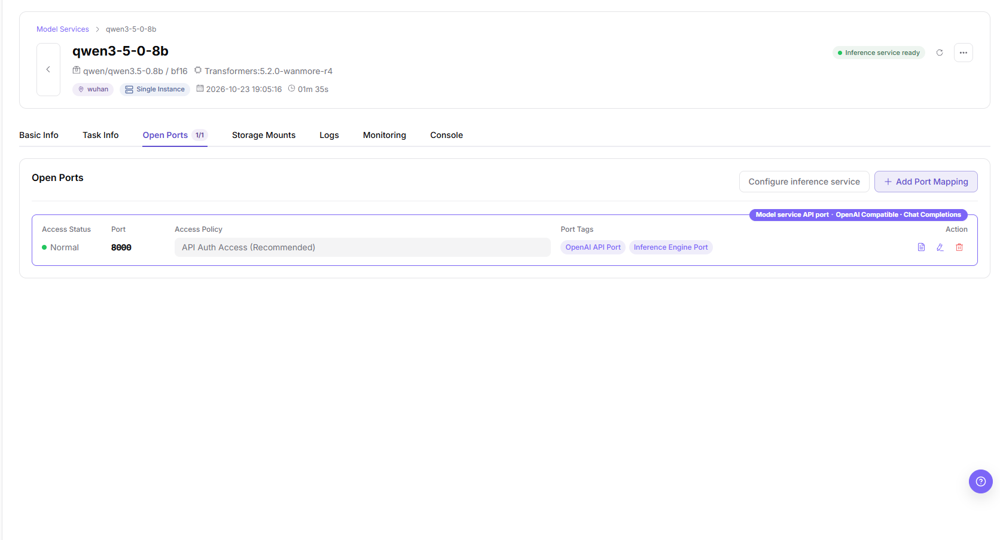

2. Click **Add Port Mapping** to open Add Port and enter an integer Container Port from 1 to 65535.
3. Choose an Open Policy: `Web Access (Recommended)`, `API Auth Access (Recommended)`, `Web/API Compatible Access (Unsigned)`, or `Direct Port Forwarding (Unsigned)`.
4. Set Port Tags when needed. For source restrictions, use **Add Whitelist** to add the intended CIDR ranges; check the settings before **Confirm**.

The Add Port dialog contains the container port, policy cards, port tags, whitelist, Cancel, and Confirm.

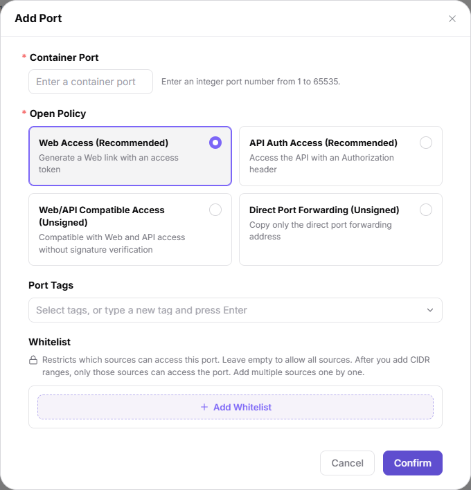

5. For an existing row, use its pencil icon to open Edit Port, check the policy, tags, and whitelist, then confirm only after reviewing access impact.

Edit Port shows the existing port value; the pictured Container Port field is disabled.

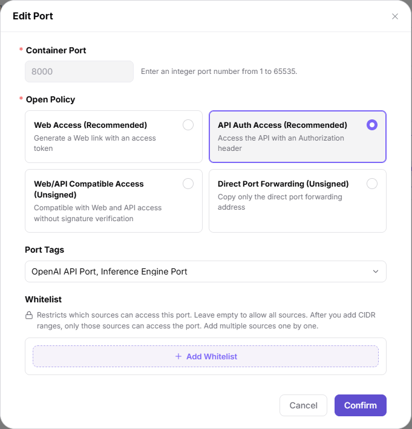

6. Click the **View API access info** icon on a port row to open the **API Access** popover. It shows the service **Endpoint** and the required **Request Header** (`Authorization: Bearer <token>`), plus a footer hint to add that header to your request.

The endpoint and token values are masked in the screenshot; do not copy them into documentation.

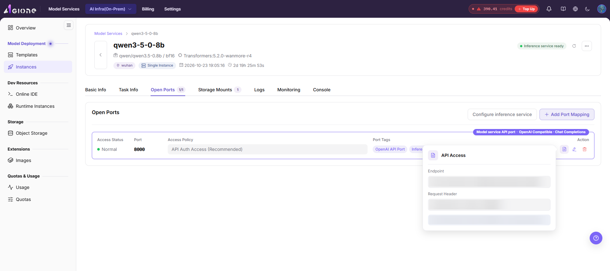

#### Result Validation

- After confirmation, compare the mapping row and policy with the intended settings.

#### Notes

- The whitelist hint states that leaving it empty allows all sources; adding CIDR ranges restricts access to those ranges. Check exposure before confirmation.
- The API Access popover lists the endpoint and Bearer token; both are masked in the screenshot above. Do not copy endpoint or authorization values into documentation.

### Configure the Inference Service

#### Applicable Scenarios

Choose which exposed port is the model-service API port and check its API inference protocol before publishing.

#### Steps

1. On `Open Ports`, click **Configure inference service**.
2. Select `Model service API port` and check `API inference protocol`.

The dialog shows port 8000 and OpenAI Compatible · Chat Completions, with Cancel and Confirm actions.

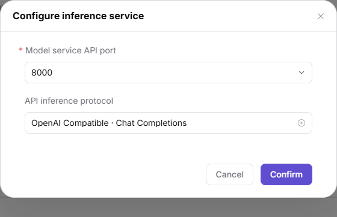

3. Check the intended port and protocol before **Confirm**; use **Cancel** to leave without confirming.

#### Result Validation

- Compare the designated API-port badge and protocol on the port row with the intended configuration.

#### Notes

- This dialog configures the instance's inference-service port and protocol; it is not the publish dialog's Edit Request Configuration panel.

### Manage Storage Mounts

#### Applicable Scenarios

Review storage attached to the instance or locate the entry for adding a mount for code, data, or output directories.

#### Steps

1. In the instance details, select `Storage Mounts`.
2. Read Container Path, Open Policy, External Storage, Storage Type, Capacity, and Action; the empty state is `No storage mounts`.

The Storage Mounts tab shows the empty table and the Add Mount entry.

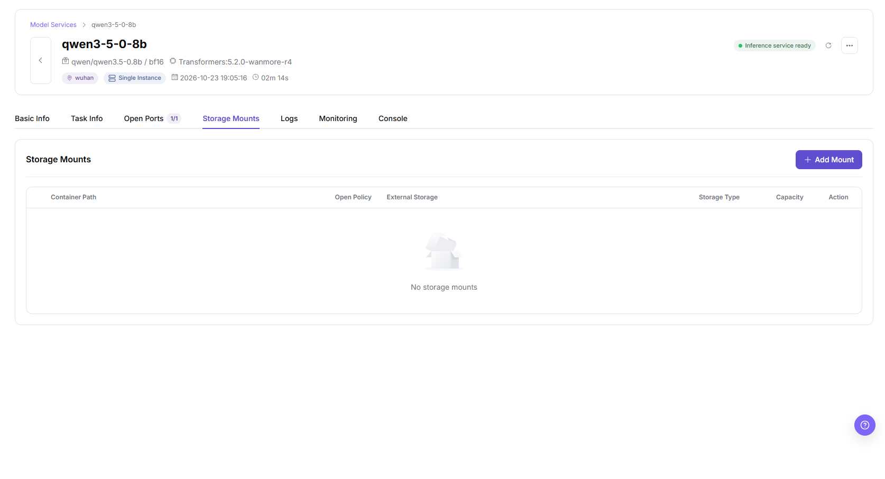

3. If a mount is needed, use **Add Mount**.

#### Result Validation

- An empty table displays No storage mounts.

#### Notes

- Confirm the intended persistent path before relying on it for output.

### View Logs, Monitoring, and Console

#### Applicable Scenarios

Inspect logs and resource charts or locate the web terminal when investigating a model-service instance.

#### Steps

1. Select `Logs` and review Log source, Line limit, Filter log lines, Case-sensitive, Before & after, and Time range.

The log controls show Container log, the Connected status, and time-range choices Any time, 15m, 1h, 6h, 1d, and Custom.

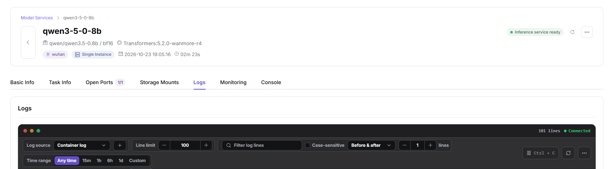

2. Select `Monitoring`. The sub-tabs are `Common`, `AI Accelerator`, and `SrIov`; inspect the selected time range, sampling interval, and Real-time Resource Consumption charts.

The Common panel shows CPU Utilization(%), Disk Available, Disk Utilization(%), Disk Total, and Memory Utilization(%).

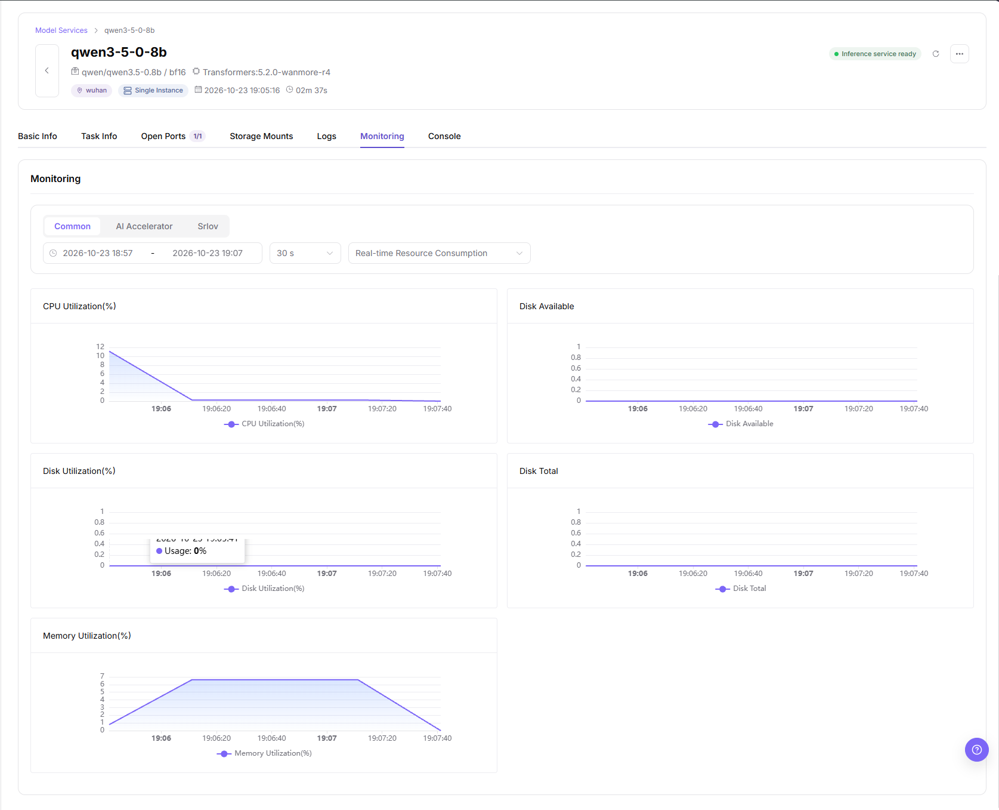

3. Select `Console` to locate `Terminal 1` and **Open in new tab**.

The console header provides a terminal tab and the new-tab entry.

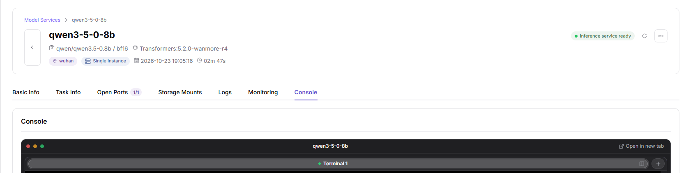

#### Result Validation

- Logs shows a connection state and line count; Monitoring shows the common CPU, disk, and memory charts; Console shows Terminal 1.
- Static charts do not establish service health.

#### Notes

- Check commands and their impact before using the terminal; redact credentials and sensitive environment information before sharing logs or terminal output.
- These instructions start from the instance details page.

### Publish Model

#### Applicable Scenarios

Publish an instance's inference service as a private model by checking API connectivity and continuing to model registration.

#### Pre-Operation Check

- The card shows `Inference service ready`, and `Selected service port` in the publish dialog shows `Normal`.
- The smoke test sends a real request; confirm authorization and request impact before proceeding.

#### Steps

1. On the target card, open the `…` menu and choose **Publish Model**.

The card menu provides Publish Model and Delete.

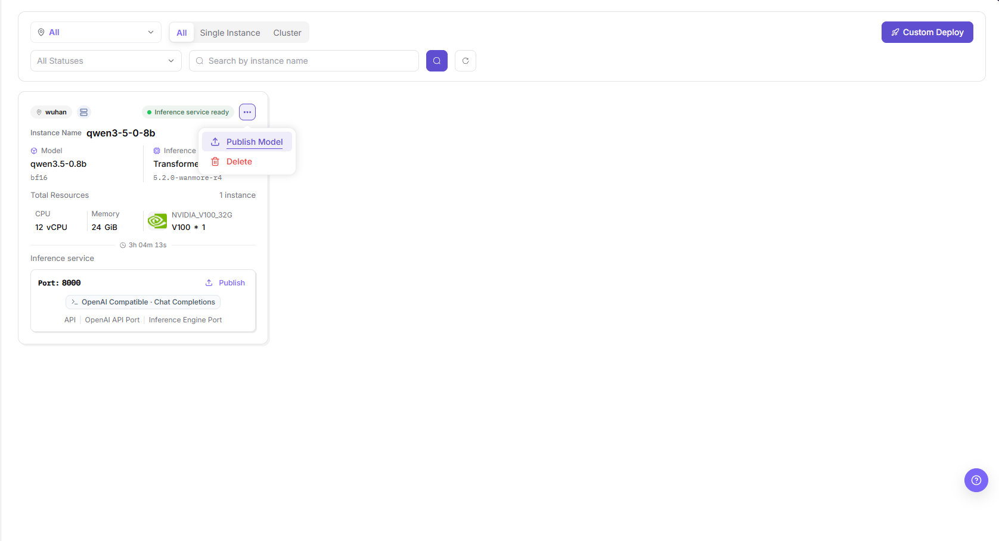

2. In `Select publish type`, review `Private Model` and `Public Model`. Use **Publish as Private Model** for the private-model path.

The public-model card provides a Contact Us entry.

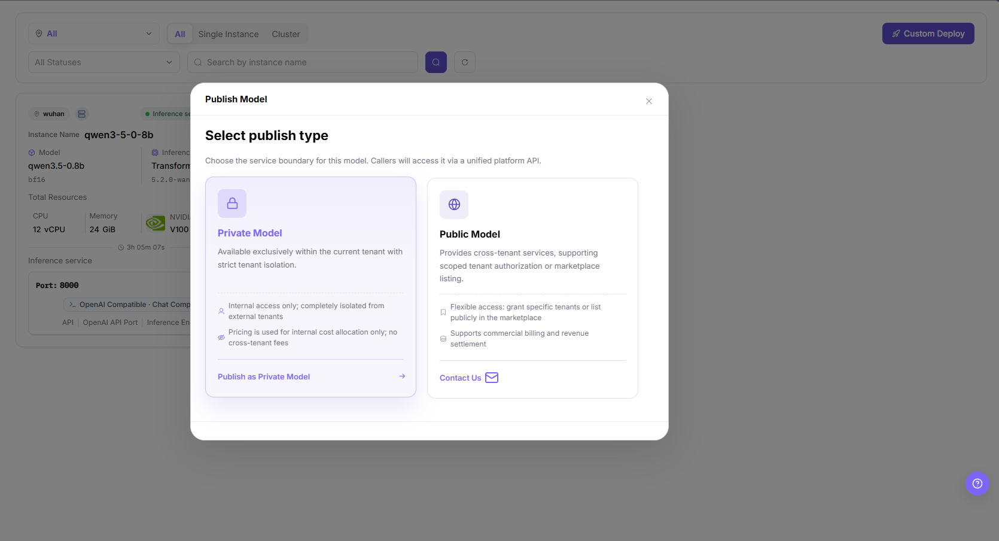

3. In the smoke-test dialog, check `Selected service port` and `Inference Request Protocol` with the `Using inference service configuration` badge.
4. Check the `API Connectivity Smoke Test` result. Continue only after **API smoke test passed**, then click **Jump to Publish**.

The success message and Jump to Publish entry identify the point at which you can continue to registration.

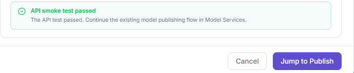

5. On `My Models` with the `Private` tag, check the registration page before proceeding. The wizard headings are `Basic Information`, `Billing Configuration`, and `Rate Limit Configuration`.

The landing page starts at Basic Information; the transition does not establish that the model has been published.

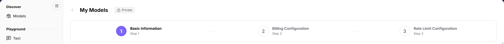

#### Result Validation

- The smoke-test success message confirms the test result, not completion of model publishing.

#### Notes

- Do not share request credentials, internal addresses, or raw smoke-test output.
- A visible Public Model option or Contact Us entry does not establish completion of a public-model publishing workflow.

### Delete Model Instance

#### Applicable Scenarios

Decommission an instance that is no longer needed after checking its service impact.

#### Steps

1. Confirm the target instance and business impact, and save any required data before proceeding.
2. Open the target card's `…` menu and click **Delete**.
3. Read any on-screen prompt carefully before the final action.

#### Result Validation

- Clicking the menu entry alone does not prove successful deletion.

#### Notes

- Deletion may interrupt service; confirm business impact before operating.
- `Stop` and `Restart` are not documented as executable actions here.

## Parameter Quick Reference

| Field Name | Description |
| --- | --- |
| Instance Name | Model-service instance name shown on the card. |
| Instance Type | List tabs: `All`, `Single Instance`, and `Cluster`; the form offers Single Instance and Cluster deployment plans. |
| Status | Card status, such as `Inference service ready`. |
| Model | The deployed model and its precision tag. |
| Inference Framework | The framework and version shown on the card. |
| Specification | CPU, memory, and accelerator allocations selected for deployment. |
| Region | The instance's region, shown on the card and selected in the creation form. |
| Runtime | Elapsed runtime shown on the card; do not substitute it for creation time. |
| Created At | Creation timestamp under Task instance in Basic Info; separate from Runtime. |
| Updated At | Update timestamp under Task instance in Basic Info. |
| Service Entry | Port and protocol chips, plus the Publish entry. |
| Actions | `Publish Model` and `Delete` in the card's `…` menu. |

## Pitfalls

- If an instance is missing, check filters and region first.
- A passed API smoke test and a jump to My Models do not mean publishing is complete.
- Do not infer `Stop` and `Restart` behavior from other resource pages.

## Result Validation

| Check Item | Success Signal | If Abnormal |
| --- | --- | --- |
| Page entry | The list and required action are available | Check the current account's permissions and the page message |
| Instance card | The expected instance is visible with its model and resource summary | Reset filters and check the instance name and region |
| API smoke test | The dialog shows `API smoke test passed` | Check the service port, protocol, and test feedback without sharing credentials |
| Publish handoff | My Models opens with the Private tag | Check the transition to the publishing flow. |

## FAQ

#### Target Is Missing from Instances

**Symptom:**

The expected model-service instance card is missing.

**Possible Causes:**

Active filters or the selected region may exclude the instance.

**Solution:**

1. Reset the status and name filters.
2. Check the region and instance-type tab.
3. Search for the instance name and check the creation message if available.

#### The Operation Entry on Instances Is Unavailable

**Symptom:**

Custom Deploy or the required card action is unavailable.

**Possible Causes:**

Account permissions or instance state may not meet the action's requirements.

**Solution:**

1. Check the page message and instance state.
2. Confirm that the current account has permission for the intended action.
3. Contact an administrator if permissions need adjustment.

#### A Required Field on Instances Has No Options

**Symptom:**

No model version, framework image, or specification can be selected during custom deployment.

**Possible Causes:**

Search conditions or the available deployment configuration may limit the options.

**Solution:**

1. Clear the relevant model or version search condition.
2. Check the selected model, version, and region.
3. Ask an administrator to check the required deployment resources.

#### Instance Status Is Unexpected

**Symptom:**

The card shows an unexpected state after an operation.

**Possible Causes:**

Processing or runtime dependencies may need investigation; the state alone does not establish the cause.

**Solution:**

1. Record the instance name, card state, and operation feedback.
2. Check Task Info, Logs, and Monitoring for relevant runtime information; do not infer a cause from the status alone.
3. Share only relevant, sanitized diagnostic information when requesting help.

#### Publishing Is Not Complete After the Jump

**Symptom:**

The smoke test passed and My Models opened, but registration is not complete.

**Possible Causes:**

Jump to Publish opens registration rather than proving completed publication.

**Solution:**

1. Check that the landing page is My Models with the Private tag.
2. Confirm the remaining registration requirements before continuing.
3. Verify the final result separately; do not report the smoke test as publishing success.

## Notes

- Do not store or share credentials, API keys, or sensitive environment information in documents, repositories, or screenshots.
- Confirm request impact before smoke tests and business impact before deletion.
- Read each instance tab on its own terms; request-protocol settings in the publish dialog and in Open Ports are separate configuration areas.

## Next Steps

1. For custom deployment, check the instance card and operation feedback.
2. For publishing, continue registration only after confirming the smoke-test result.
3. Use Basic Info, Task Info, Logs, and Monitoring when diagnosing the instance.
