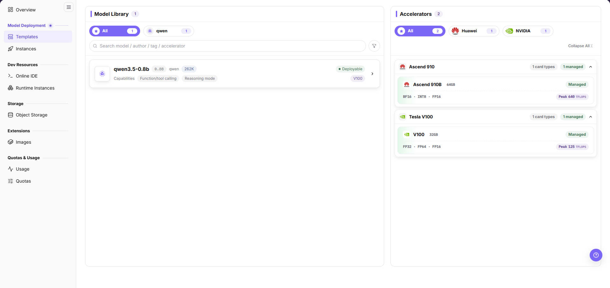
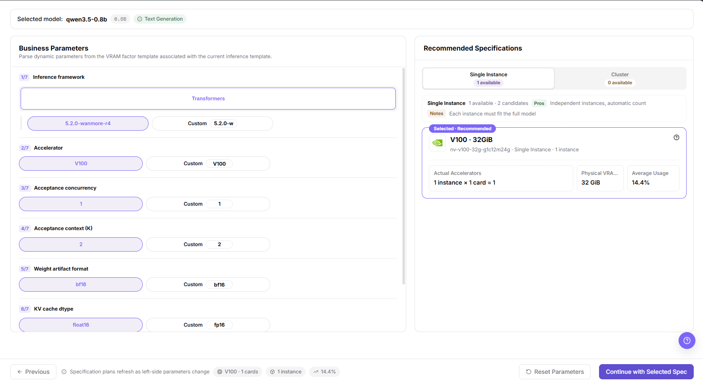
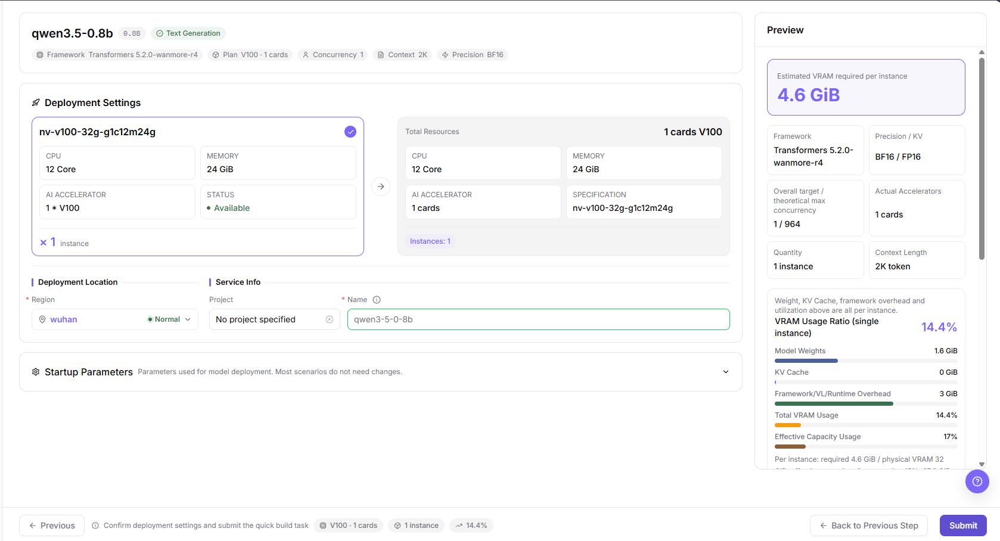
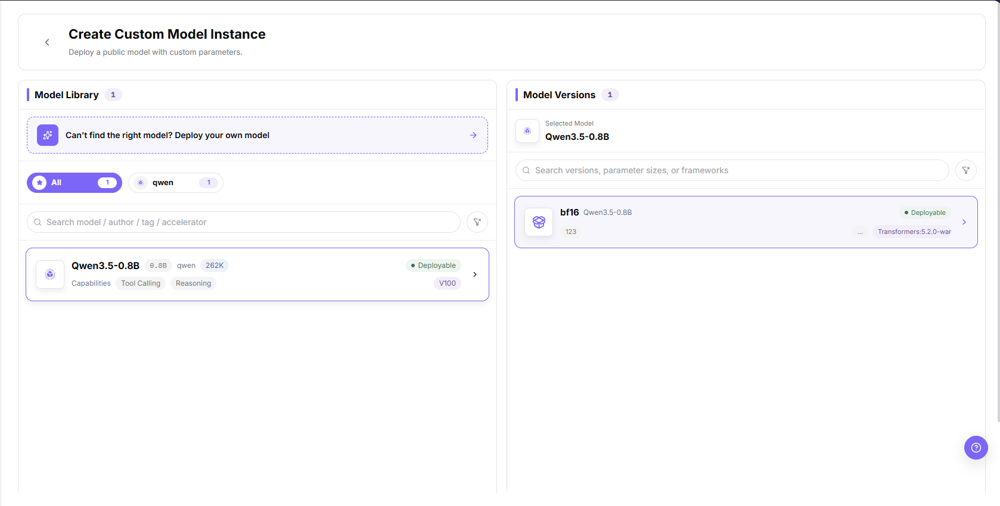

# Templates

## Feature Overview

| Item | Content |
| --- | --- |
| Applicable Role | Model Provider |
| Navigation Path | On-Prem > Model Deployment > Templates |
| Page Route | `/powerone/quickstart/inference-template` |
| Managed Object | Configuration, status, and relationships on Templates |

#### Beginner Explanation

Templates can be understood as an ordering page for model services. The user first selects a model, then checks the available accelerator and recommended specification, fills in deployment settings when needed, and finally reviews the preview before creating a model instance.

#### Terms

| Term | Description |
| --- | --- |
| Template | A deployable solution maintained by operators that combines model, framework, image, specification, startup parameters, and visibility rules. |
| Model Library | Area that displays models available to the current user or tenant. |
| Accelerator | Hardware option, such as GPU or NPU, that can run the selected model. |

#### Recommended Operation Order

Confirm prerequisites for Model library, accelerators, business parameters, recommended specifications, deployment settings, and preview information, follow Main Operations, run Result Validation, and continue to the next page.

#### First-Time User Notes

Confirm that the task involves Configuration, status, and relationships on Templates, and then follow the recommended order. If fields or state differ from expectations, check prerequisites before continuing downstream.

## Prerequisites

1. The operator has published at least one template visible to the current tenant.
2. The current tenant has available quota in the target region.
3. Images, accelerators, specifications, and framework parameters required by the template have been configured by the operator.
4. If the deployment will expose a service, confirm the access scope and security policy before creating an instance.

## Page Description

Use this page to select a model, accelerator, business parameters, recommended specification, deployment settings, and preview information.

The page displays model library, accelerators, business parameters, recommended specifications, deployment settings, and preview information in a wizard. The screenshot shows the templates list area.

#### Page Areas

| Field/Area | Description |
| --- | --- |
| Model Library | Displays deployable models by vendor and model name. |
| Accelerators | Displays accelerator vendor, model, VRAM, adaptation status, and peak capability. |
| Business Parameters | Displays model capability, context, startup, or runtime parameters that need confirmation. |
| Recommended Specifications | Displays selectable instance forms and recommended resource specifications. |
| Deployment Settings | Used to enter instance name, region, specification, startup parameters, and other deployment information. |
| Preview | Summarizes the selected configuration before submission. |

## Main Operations

### View Deployment Templates

#### Applicable Scenarios

- Use this entry to find a deployable model and confirm which accelerators can run it before you start a deployment.

#### Steps

1. Go to `Model Deployment > Templates`.
2. In `Model Library`, narrow the list with the author tabs, the `Search model / author / tag / accelerator` box, the sort option `Default`, or `Clear Filters`.
3. Check each model card for the model name, parameter size, author, context length, the `Capabilities` tags, and the `Deployable` state. After you pick a card, the wizard replaces the `Model Library` list with the `Selected model: qwen3.5-0.8b 0.8B Text Generation` summary bar, so no outlined card stays on this screen.
4. In `Accelerators`, narrow the list with the vendor tabs, then use `Expand All` or `Collapse All` to read the card groups.
5. Check each accelerator group for the card model, memory size, the `Managed` or `Unmanaged` state, the supported precisions, and the `Peak ... TFLOPS` value.
6. In the wizard, check the model version, the resource flavor, and the replica count. The image, port and storage fields are not shown on this screen; they belong to the custom deployment flow (`Inference Framework` with `All images`, `Exposed Ports`, `Storage Mounts`).

#### Result Validation

- The model list returns the target model with the `Deployable` state, and the accelerator panel returns at least one card group.
- If the list is empty, clear the filters and check which author tab is selected.

#### Notes

- An `Unmanaged` accelerator may not be directly deployable.
- The counts next to `Model Library` and `Accelerators` are the records visible to the current account, not the platform total.

### Review Deployment Parameters and Cost

#### Applicable Scenarios

- Use this entry after a model is selected, to confirm the business parameters and compare the recommended specifications before you commit resources.

#### Steps

1. Check the `Selected model:` line, which repeats the model name, parameter size, and capability such as `Text Generation`.
2. In `Business Parameters`, review each numbered parameter in turn: `1/7 Inference framework`, `2/7 Accelerator`, `3/7 Acceptance concurrency`, `4/7 Acceptance context (K)`, `5/7 Weight artifact format`, `6/7 KV cache dtype`, and `7/7 Planning headroom (%)`.
3. Select the option that matches your workload. Each parameter row shows the resolved value next to its `Custom` entry, such as `Custom V100` and `Custom bf16`.
4. In `Recommended Specifications`, switch between `Single Instance` and `Cluster`, and compare the available count under each tab, such as `1 available` and `0 available`. The `Multi-instance` tab is not shown on this screen.
5. Read the `Pros` and `Notes` line for the selected tab, such as `Independent instances, automatic count` and `Each instance must fit the full model`, then compare `Actual Accelerators`, `Physical VRAM per instance`, and `Average Usage` across the candidate cards. On the captured screen that label renders as `Physical VRA…` inside its own metric box.

The following screen shows the business parameters and the recommended specifications side by side.

6. Confirm the resource and cost impact before the final deployment action, and deploy only after approval.

#### Result Validation

- The right-hand list refreshes after you change a left-hand parameter, as stated by `Specification plans refresh as left-side parameters change`.
- At least one specification card is selectable, and the chosen card is marked `Selected · Recommended`.

#### Notes

- When every tab shows zero available specifications, first check accelerator adaptation, resource specifications, quota, and region; if the wizard has just opened, re-check the counts after the list settles, because a zero count during loading is not a stable result.
- A specification that fits the model may still exceed the quota of the current tenant; the page does not reserve resources until you submit.

### Deploy Template

#### Applicable Scenarios

- Use this entry to turn the selected model, business parameters, and specification into a running model instance.

#### Pre-Operation Check

1. Confirm that the current account has access to `Model Deployment > Templates`.
2. The top bar provides no global tenant or region selector; the switcher only toggles between `On-Cloud` and `On-Prem`. Confirm the region inside the deployment form, where it is a required field.

#### Steps

1. On the selected-model bar, check the summary chips `Framework Transformers 5.2.0-wanmore-r4`, `Plan V100 · 1 cards`, `Concurrency 1`, `Context 2K`, and `Precision BF16`.
2. In `Deployment Settings`, check the specification card for `CPU 12 Core`, `MEMORY 24 GiB`, `AI ACCELERATOR 1 * V100`, and the `STATUS` value such as `Available`. The `Switch Specification` button is not shown on this screen.
3. Check the `Total Resources` panel for the aggregated `CPU`, `MEMORY`, `AI ACCELERATOR`, `SPECIFICATION`, and `Instances:` values, such as `1 cards` and `nv-v100-32g-g1c12m24g`.
4. In `Deployment Location`, set `Region`, such as `wuhan`, check its state, and set `Project` when the deployment needs one; the default value is `No project specified`. The `Availability Zone` field is not shown on this screen; it appears in the custom deployment flow under `Region and Zone`.
5. In `Service Info`, check the required `Name` field, and expand `Startup Parameters` only when the inherited values do not fit your case; that section reads `Parameters used for model deployment. Most scenarios do not need changes.`
6. Check the `Preview` panel for `Estimated VRAM required per instance`, `Framework`, `Precision / KV`, `Overall target / theoretical max concurrency`, `Actual Accelerators`, `Quantity`, `Context Length`, `VRAM Usage Ratio (single instance)`, `Model Weights`, `KV Cache`, `Framework/VL/Runtime Overhead`, `Total VRAM Usage`, and `Effective Capacity Usage`.
7. Read the per-instance statement `Weight, KV Cache, framework overhead and utilization above are all per instance.`, then the summary line below it, such as `Per instance: required 5 GB / physical VRAM 32 GB; effective capacity after reserving 15%: 27.2 GB.`
8. Read the footer hint `Confirm deployment settings and submit the quick build task`, then click `Submit`. Use `Previous` or `Back to Previous Step` to revise an earlier choice.

The following screen shows the deployment settings and the preview of the same submission.

#### Result Validation

- The `STATUS` value on the selected specification card shows `Available` before you submit.
- After submission, the instance appears on the Instances page and its configuration matches the `Preview` panel.

#### Notes

- Template parameters are maintained by operators. Do not modify startup parameters casually, because incorrect parameters may cause model service startup failure.
- The `Name` field is prefilled from the model name. Replace the generated default with a name that follows your own convention.

### Create a Custom Model Instance (Model and Version)

#### Applicable Scenarios

- Use this entry when the model you need is not in the list, or when you want to deploy a public model with your own parameters.

#### Steps

1. Open the custom deployment entry `Custom Deploy`.
2. On the `Create Custom Model Instance` page, read the subtitle `Deploy a public model with custom parameters.`.
3. In `Model Library`, narrow the list with the author tabs and the `Search model / author / tag / accelerator` box.
4. Check the model card for the model name, parameter size, author, context length, the `Capabilities` tags such as `Tool Calling` and `Reasoning`, and the `Deployable` state. A selected card is outlined and its title is highlighted.
5. If no model fits, use the banner `Can't find the right model? Deploy your own model` to switch to your own model.
6. In `Model Versions`, check the `Selected Model` line, narrow the list with `Search versions, parameter sizes, or frameworks`, and select a version card by its precision tag, parameter size, and framework label.

The following screen shows the model library and the model versions of this step.

#### Result Validation

- The `Selected Model` line in the right column shows the model you picked in the left column.
- The version card you selected shows the `Deployable` state.

#### Notes

- At the captured window width the framework label on a version card is already cut off inside its own box, which reads `Transformers:5.2.0-war` for the full name `Transformers:5.2.0-wanmore-r4`, and no ellipsis glyph is drawn at its right edge.
- The counts next to `Model Library` and `Model Versions` are the records visible to the current account.

### Create a Custom Model Instance (Configuration and Submission)

#### Applicable Scenarios

- Use this entry after the model and version are selected, to finish the deployment configuration and create the instance.

#### Steps

1. In `Deployment Plan`, choose `Single Instance` or the cluster plan; in the cluster plan, check `Main Node Count` and `Worker Count`.
2. In `Inference Framework`, filter the image list with `All images` and the vendor tabs, then select a framework card.
3. In the `Specification` table, compare the columns including `Price` and select one row.
4. In `Region and Zone`, select the region and confirm that its state is `Normal`.
5. In `Storage Mounts`, `Exposed Ports`, `Environment Variables`, and `Start Command`, review the inherited values before you create the instance.
6. Read the command generated in `Start Command`, then click `Confirm and Create`.

The section names above are taken verbatim from the English screen of this step.

#### Result Validation

- The selected framework card and the selected specification row stay highlighted before you submit.
- After creation, the new instance appears on the Instances page.

#### Notes

- In the captured screen the `Price` cell shows `--`; this does not mean every specification has an empty price.
- The page shows the mounted-storage summary as `0 paths`; in the captured screen the right end of that value is covered by a floating widget outside the application, which is a capture limit, not a product defect.

## Parameter Quick Reference

| Field Name | Required | Field Type | Description |
| --- | --- | --- | --- |
| Template Name | System-generated | Text | Name of the deployable template shown by the platform. |
| Model | Required | Selection | Model selected from the model library. |
| Accelerator | Required | Selection | Accelerator vendor and model used for this deployment. |
| Business Parameters | Depends on template | Form fields | Model capability, context, startup, or runtime parameters maintained by the template. |
| Recommended Specification | Required | Selection | Resource specification recommended or allowed by the template. |
| Region | Required when deploying | Selection | Region or resource pool where the model instance will be created. |
| Instance Name | Required when deploying | Text | Name of the model instance to be created. Do not use real customer or sensitive names in documentation. |
| Startup Parameters | Depends on template | Text or form fields | Startup parameters inherited from the template or adjusted for a clear business need. |
| Status | System-generated | Enum | Whether the template or selected option can be used to create an instance. |

## Pitfalls

- If an accelerator shows `Unadapted` or `Unmanaged`, it may not be directly deployable.
- When recommended specifications are empty, first check accelerator adaptation, resource specifications, quota, and region.
- `Submit` and `Confirm and Create` are the high-risk final actions on this page's screens, and neither was executed while capturing them. `Confirm` appears only in the dialog that clears incompatible downstream settings when you switch a configuration, so it is not a deployment action.

## Result Validation

| Check Item | Success Signal | If Abnormal |
| --- | --- | --- |
| Page entry | Templates opens with the target operation entry | Check Operator permission and whether the menu is available |
| Object record | Configuration, status, and relationships on Templates is visible in the list or details | Reset filters and verify name, ownership, and creation result |
| State result | State after creation or change matches the page message | Check operation feedback, dependency state, and latest update time |
| Downstream use | A downstream page can select or associate the target | Return to prerequisites and check enabled state, ownership, and visibility |

## FAQ

#### Target Is Missing from Templates

**Symptom:**

The page opens, but the expected Configuration, status, and relationships on Templates is missing.

**Possible Causes:**

- Filters remain active.
- the object belongs to another scope.
- a prerequisite is incomplete.

**Solution:**

1. Reset filters
2. verify region or tenant ownership
3. confirm prerequisite state.

#### The Operation Entry on Templates Is Unavailable

**Symptom:**

The create, register, or maintain entry is hidden or disabled.

**Possible Causes:**

- Role permission is insufficient.
- the page is read-only.
- dependencies are not ready.

**Solution:**

1. Check Operator permission
2. read the page message
3. complete dependency configuration first.

#### A Required Field on Templates Has No Options

**Symptom:**

The form opens, but a selection list is empty.

**Possible Causes:**

- Candidates are disabled.
- ownership differs.
- the current account cannot see them.

**Solution:**

1. Check candidate state
2. verify ownership
3. confirm visibility and refresh the form.

#### Templates Has an Abnormal State After the Operation

**Symptom:**

A record exists after submission, but its state is unexpected.

**Possible Causes:**

- Connectivity or validation failed.
- a dependency is abnormal.
- processing is incomplete.

**Solution:**

1. Check feedback and update time
2. inspect related objects
3. troubleshoot the processing stage.

#### A Downstream Page Cannot Use Templates

**Symptom:**

The current page is normal, but a downstream page cannot select or associate Configuration, status, and relationships on Templates.

**Possible Causes:**

- Visibility differs.
- the object is disabled.
- downstream cache is stale.

**Solution:**

1. Check enabled state and ownership
2. verify role visibility
3. refresh and select again.

## Notes

- Deploying through a template may create real model instances, occupy resources, and generate usage. Confirm instance name, region, specification, and runtime cycle before submission.
- Screenshots or tickets must not contain internal service addresses, access keys, endpoints, sensitive startup parameters, logs, or customer information.
- Templates, specifications, and accelerators are maintained by operators. If the user side cannot select a target option, check publishing scope, tenant visibility, quota, and resource pool status with the operator.

## Next Steps

1. Go to [Instances](../instances/) to view model instance status.
2. Go to [Usage](../../quotas-usage/usage/) or [Quotas](../../quotas-usage/quotas/) to review quota and usage changes.
