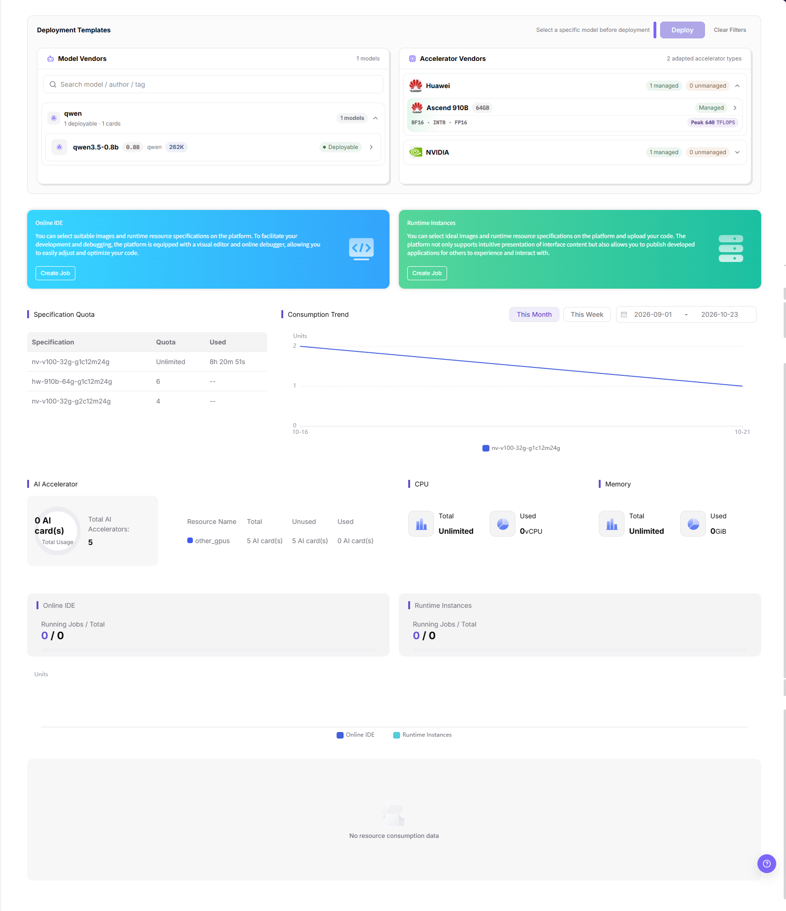
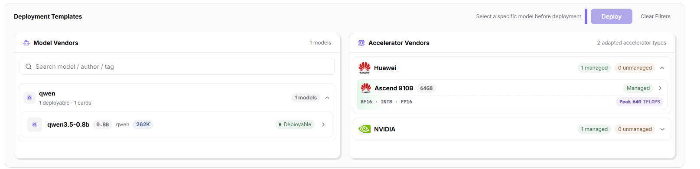
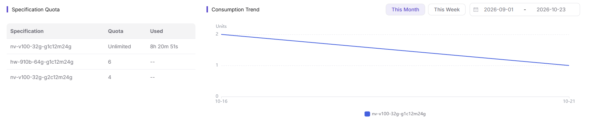

# Overview

## Feature Overview

| Item | Content |
| --- | --- |
| Applicable Role | Model Provider and Model Consumer |
| Navigation Path | On-Prem > Overview |
| Page Route | `/powerone/overview` |
| Managed Object | Configuration, status, and relationships on Overview |

#### Beginner Explanation

The overview page can be understood as the homepage of the On-Prem user console: the upper area tells you which models can be deployed and which accelerators are available; the middle area provides quick entrypoints for Online IDE and Runtime Instance; the lower area helps you confirm whether quota is sufficient and whether resources have consumption records.

#### Terms

| Term | Description |
| --- | --- |
| Specification | Resource package that a job can request, such as CPU, memory, GPU model, and card count. |
| Quota | Resource upper limit available to a tenant. Common dimensions include GPU, CPU, memory, and specifications. |
| Accelerator | GPU, NPU, or other AI computing device, displayed on the page by vendor and model. |

#### Recommended Operation Order

1. Go to `On-Prem > Overview`.
2. Check `Deployment Templates` to confirm whether a deployable model exists.
3. Check `Accelerator Vendors` to confirm the accelerator types the current resource pool supports.
4. Use the `Online IDE` or `Runtime Instances` card to enter the creation flow.
5. Check `Specification Quota`, `Consumption Trend`, and the resource usage panels to confirm whether the resources a job needs are available.

#### First-Time User Notes

Confirm that the task involves Configuration, status, and relationships on Overview, and then follow the recommended order. If fields or state differ from expectations, check prerequisites before continuing downstream.

## Prerequisites

1. The current account can enter the `AI Infra(On-Prem)` subsystem.
2. The operator has opened visible regions, availability zones, clusters, specifications, and templates for the tenant.
3. To create an online IDE, runtime instance, or model instance, the account needs the corresponding creation permissions and available quota.

## Page Description

Use this page to review deployment templates, accelerator resources, quick entries, specification quotas, and resource-usage trends.

The upper area displays deployment templates and accelerator vendors; the middle area provides two quick entry cards for Online IDE and Runtime Instances; the lower area displays the specification quota table, the consumption trend chart, and the resource usage panels. The image below is a full-height capture of the page content area and does not include the fixed left menu.

#### Page Areas

| Field/Area | Description |
| --- | --- |
| Deployment Templates | Displays deployable models and deployment entrypoints. The deployment button is usually unavailable before a model is selected. |
| Accelerator Vendors | Displays accelerator models and adaptation status per vendor. This capture shows `Huawei` and `NVIDIA`; the Chinese capture shows `NVIDIA` only, and the earlier capture also showed `AMD` and `Intel` (see OV-05). |
| Quick Entry Cards | The two cards titled `Online IDE` and `Runtime Instances` each provide a `Create Job` entrypoint. The page itself shows no `Quick Guide` heading (see OV-07). |
| Specification Quota | Displays the specification-level `Specification`, `Quota`, and `Used` columns. |
| Consumption Trend | Displays the consumption trend for the current cycle, with the `This Month` and `This Week` switch and a date range. If there is no job consumption, it shows an empty state. |
| Resource Usage | Displays the `AI Accelerator`, `CPU`, `Memory`, `Online IDE`, and `Runtime Instances` panels with their total and used values. |

## Main Operations

This section is organized by page area. Each area documents the functional actions only, and each image follows the steps it supports.

### View Deployable Models

#### Applicable Scenarios

Use the `Deployment Templates` area to confirm which models the current tenant can deploy and to reach the deployment entry.

#### Steps

1. Go to `On-Prem > Overview`.
2. In the `Model Vendors` list, check the vendor row and its counters, for example the `qwen` row shows `1 deployable · 1 cards` and `1 models`.
3. Expand a vendor row to read the model rows. A model row gives the parameter tags and the status, for example `qwen3.5-0.8b` with `0.8B`, `qwen`, `262K`, and the status `Deployable`.
4. Filter the list with the `Search model / author / tag` field, and restore the full list with `Clear Filters`.
5. Click the `>` at the end of a model row to leave the overview and open the detail view of that model (the target page is outside this capture set, see OV-08). While no model is selected, the area title line shows `Select a specific model before deployment` and `Deploy` stays unclickable.

The image below is a close-up of the `Deployment Templates` area, so the vendor counters, model tags, status text, and deployment entry above can be aligned one by one.

#### Result Validation

- The vendor row, the model rows, and the status text are all visible, and a deployable model reads `Deployable`.
- After a keyword is typed in `Search model / author / tag`, the `Model Vendors` counter changes, and `Clear Filters` restores the full list.

#### Notes

- `Deploy` appears disabled in this capture because no model is selected. The sibling Chinese capture shows the selected state, where the area title line names the chosen model and the button becomes clickable; the English wording of that label is not captured (see OV-02, OV-09).
- The vendor and model counts and the model list come from what the operator opened for this tenant, and neither the Model Provider nor the Model Consumer can change them on this page.
- The `Expand remaining 13 models` row in the earlier capture does not exist in this capture set (this sample has 1 model in total), so do not write it from the old image.

### Review Accelerator Vendors

#### Applicable Scenarios

Use the `Accelerator Vendors` area to confirm which accelerator types the current resource pool has adapted and whether a card model is managed.

#### Steps

1. Read the adapted count at the right of the `Accelerator Vendors` title, for example `2 adapted accelerator types`.
2. In each vendor row, read the two counters, for example the `Huawei` row shows `1 managed` and `0 unmanaged`.
3. Expand a vendor row to read the card rows. A card row gives the model, memory, and management status, for example `Ascend 910B` with `64GB` and `Managed`, followed by the precision list `BF16 · INT8 · FP16` and the peak throughput `Peak 640 TFLOPS`.

#### Result Validation

- The adapted count and the vendor row counters are visible together, and each vendor arrow matches the collapsed or expanded state of that row.
- The model, memory, and management status of a card row are readable within one row, with the precision list and peak throughput below it.

#### Notes

- A collapsed vendor row (for example `NVIDIA` showing `1 managed` and `0 unmanaged`) gives counters only, and the card details appear after it is expanded.
- Whether a card row offers an entry to its detail page is not confirmed in this capture set (see OV-03), so this section does not write that entry.
- The earlier capture contains the `AMD` and `Intel` vendor rows, which are not visible in this capture set (see OV-05); the page area table records this as a version difference instead of deleting the row.

### Create Jobs from the Quick Entry Cards

#### Applicable Scenarios

Use the two quick entry cards in the middle of the page to start the creation flow of an interactive development environment or a runtime instance directly from the overview page.

#### Steps

1. Confirm the two cards in the middle of the page: the blue `Online IDE` card and the green `Runtime Instances` card, each with one description paragraph and one `Create Job` button.
2. Click `Create Job` inside the `Online IDE` card to enter the creation flow of an online development environment.
3. Click `Create Job` inside the `Runtime Instances` card to enter the creation flow of a runtime instance.

#### Result Validation

- Both cards and their `Create Job` buttons are visible together, and the card titles match the `Online IDE` and `Runtime Instances` items of the left user menu word for word.
- After the click, the page leaves the overview; the overview page itself shows no creation result.

#### Notes

- The target form fields, required marks, and submit messages of both creation flows are outside this capture set (see OV-04), so this section does not write them.
- The cards are entrypoints only, and they do not replace the pages under `Model Deployment > Instances` or `Dev Resources`.
- Whether creation succeeds also depends on the quota and the remaining resources, so check the `Specification Quota` table and the usage panels on this page first.

### Review Specification Quota and Consumption Trend

#### Applicable Scenarios

Use the `Specification Quota` table and the `Consumption Trend` chart in the lower half of the page to confirm the upper limit and used amount of each specification and the consumption curve of the current cycle.

#### Steps

1. Read the three columns of the `Specification Quota` table: `Specification`, `Quota`, and `Used`.
2. Check the form of the quota value: no upper limit shows `Unlimited`, and a limited quota shows a number, for example `6` and `4`.
3. Check the form of the used value: no consumption record shows `--`, and a record with consumption shows a duration, for example `8h 20m 51s`.
4. Switch `This Month` and `This Week` at the right of `Consumption Trend`, and check the date range, for example `2026-09-01` - `2026-10-23`; the vertical axis unit is `Units`, and the legend is given by specification name, for example `nv-v100-32g-g1c12m24g`.

The image below covers the specification quota and consumption trend band, so the three quota columns, the cycle switch, and the specification legend can be aligned one by one.

#### Result Validation

- After switching `This Month` and `This Week`, the date range follows the selected cycle, and each legend name maps to a specification row of the `Specification Quota` table.
- The value forms of the `Quota` and `Used` columns stay consistent within one screen, and one column never mixes numbers with durations.

#### Notes

- This capture shows a curve, while the bottom `Units` chart shows `No resource consumption data`; the empty-state wording of `Consumption Trend` itself is not captured (see OV-11). An empty trend does not mean the quota is 0, so verify it in `Quotas & Usage > Usage`.
- This capture set shows no region or project selector in the upper-right corner, so whether the statistics scope can be switched by region is not confirmed (see OV-01).

### Review Resource Usage Panels

#### Applicable Scenarios

Use the resource usage panels in the lower half of the page to confirm the total and used amount of accelerators, CPU, memory, and the two job types.

#### Steps

1. In the `AI Accelerator` panel, check the usage value at the center of the ring, the `Total Usage` label, and the title line `Total AI Accelerators: 5`.
2. In the detail table of the same panel, read the four columns `Resource Name`, `Total`, `Unused`, and `Used`, for example the `other_gpus` row shows `5 AI card(s)`, `5 AI card(s)`, and `0 AI card(s)`.
3. In the `CPU` panel, check that `Total` reads `Unlimited` and `Used` reads `0vCPU`.
4. In the `Memory` panel, check that `Total` reads `Unlimited` and `Used` reads `0GiB`.
5. In the `Online IDE` and `Runtime Instances` panels, check `Running Jobs / Total` in each, which reads `0 / 0` in this capture set; the bottom of the panel area shows `No resource consumption data`.

#### Result Validation

- The titles and values of all five panels are visible together, and the card unit of the `AI Accelerator` detail table is consistently `AI card(s)`.
- The ring value, the detail table, and the panel title give the same total for one resource, and the same resource never shows two different totals in different places.

#### Notes

- The earlier capture titles this panel `AI card` with `Total AI cards: Unlimited`, while this capture shows `AI Accelerator` with `Total AI Accelerators: 5`. This is a version difference, and the text follows this capture.
- The panels give summary values only; the detail of a single card or a single job must be verified in the pages under `Monitoring`.

### Troubleshoot Quota or Resource Anomalies

#### Applicable Scenarios

When the deployment entry is unavailable, a target specification cannot be requested, or an instance fails scheduling after creation, locate the cause on this page first: a quota shortage or a resource shortage.

#### Steps

1. Return to the `Specification Quota` table, record the target specification row with its `Quota` and `Used` values, and record the vendor and card model.
2. Go to `Quotas & Usage > Usage` to verify the allocated quota and the consumption records of the current tenant or project.
3. If the quota is sufficient but the instance still fails scheduling, check `Monitoring > Overview`, `Clusters`, `Nodes`, and `Devices` to verify whether the physical cards are fully occupied; the availability-zone entry and its values are outside this capture set (see OV-06).

#### Result Validation

- The target specification row is locatable in the `Specification Quota` table, and its quota and used values map to the records in `Quotas & Usage > Usage`.
- The accelerator usage value on the overview page and the device statistics under `Monitoring` show no directional contradiction within the same time range.

#### Notes

- A sufficient quota does not mean the cluster definitely has idle resources. When creation fails, also check the availability zone and the specification.
- Overview data may have statistical delays. For troubleshooting, verify again on the instance detail, monitoring, or quota pages instead of concluding from the summary on this page.
- This page provides no quota adjustment entry. Quota changes are completed by the operator on the Operator side.

## Parameter Quick Reference

| Field Name | Required | Field Type | Example | Description |
| --- | --- | --- | --- | --- |
| Region | No | Drop-down | `Sample region` | Overview statistics region. |
| Resource Type | No | Enum | `Sample resource type` | Overview resource category. |
| Quota | System-generated | Number | `Sample quota` | Available quota for the current account. |
| Used Amount | System-generated | Number | `Sample used amount` | Current used resource amount. |
| Update Time | System-generated | Date time | `Sample update time` | Overview data update time. |

## Pitfalls

- When the deployment button is unavailable, usually no model or accelerator has been selected.
- Sufficient quota does not mean the cluster definitely has idle resources. If creation fails, check region, availability zone, and specifications.

- Do not record real tenants, regions, clusters, specifications, resource usage, consumption data, or test parameters.
- Overview data may have statistical delays. For troubleshooting, verify again on instance details, monitoring, or quota pages.

## Result Validation

| Check Item | Success Signal | If Abnormal |
| --- | --- | --- |
| Page entry | Overview opens with filters or statistics | Check menu permission, current business identity, and tenant scope |
| Data scope | Lists or statistics match the selected time, region, and object | Reset filters and verify time boundaries, time zone, and aggregation scope |
| Data update | Update time or latest record matches the expected cycle | Check whether the source job, metering, or quota record has been generated |
| Cross-check | Configuration, status, and relationships on Overview matches its details, billing, or monitoring records | Compare the responsible detail page by object identifier and time range |

## FAQ

#### No Records on Overview

**Symptom:**

The page opens, but lists or statistics are empty.

**Possible Causes:**

- Filters are too narrow.
- source records are not generated.
- the role cannot see them.

**Solution:**

1. Reset filters
2. verify the source job or metering cycle
3. check business identity and tenant scope.

#### Overview Shows the Wrong Scope

**Symptom:**

Data does not belong to the expected time, region, or object.

**Possible Causes:**

- Time boundaries differ.
- the region filter did not apply.
- ownership changed.

**Solution:**

1. Select time and region again
2. verify object identifiers
3. confirm ownership in source details.

#### Overview Is Delayed

**Symptom:**

A source operation completed, but its record is not visible.

**Possible Causes:**

- Aggregation is not complete.
- the page is cached.
- source state is still processing.

**Solution:**

1. Verify source state
2. wait one aggregation cycle and refresh
3. inspect the processing task if delay persists.

#### Details or Download Is Unavailable

**Symptom:**

The details, expand, or download entry is disabled.

**Possible Causes:**

- The record does not support it.
- role permission is insufficient.
- the file is not generated.

**Solution:**

1. Select an eligible record
2. check role permission
3. confirm the statistics or export task is complete.

#### Summary and Details Do Not Match

**Symptom:**

The summary differs from the total of individual records.

**Possible Causes:**

- Periods differ.
- values are rounded.
- some records are still processing.

**Solution:**

1. Align period and time zone
2. compare by object
3. wait for pending records and check again.

## Notes

- Do not judge failure causes only by the homepage summary. Key instance status should be based on the corresponding detail page.
- Before creation, confirm region, specification, and image source to avoid creation failure caused by unschedulable resources after submission.
- The overview page only provides summary display and does not replace creation, detail, or troubleshooting pages of specific modules.
- Templates, specifications, and accelerators are configured by operators. Model Consumers cannot modify them directly on the overview page.

## Next Steps

1. Go to `Model Deployment > Templates` to create a model instance.
2. Go to `Dev Resources > Online IDE` to create an interactive development environment.
3. Go to `Quotas & Usage > Quotas` to view resource limits.
