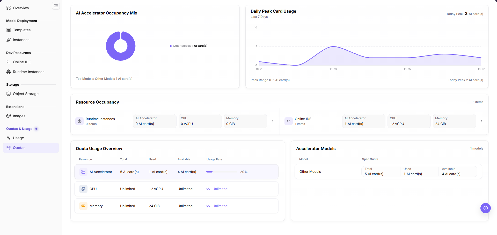
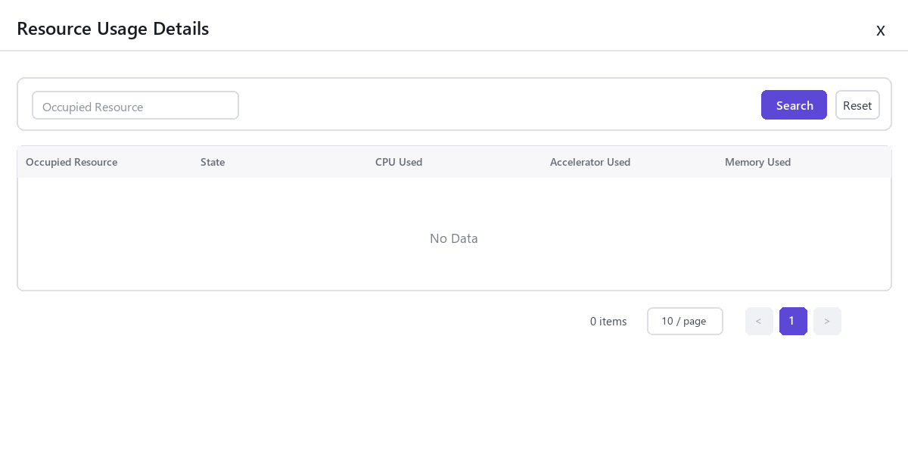

# Quotas

## Feature Overview

| Item | Content |
| --- | --- |
| Applicable Role | Model Provider and Model Consumer |
| Navigation Path | On-Prem > Quotas & Usage > Quotas |
| Page Route | `/powerone/quota-usage/quota` |
| Managed Object | Configuration, status, and relationships on Quotas |

#### Beginner Explanation

My quota is like a personal resource balance sheet. It shows how many instances can still be created and how much compute and storage can still be used.

#### Terms

| Term | Description |
| --- | --- |
| Quota | Resource upper limit available to a tenant. Common dimensions include GPU, CPU, memory, and specifications. |
| AI card | AI accelerator quota, which may include GPU, NPU, or other cards. |
| Used | Used resource amount. |

#### Recommended Operation Order

1. Go to `Quotas & Usage > Quotas`.
2. In `Quota Usage Overview`, check `Total` and `Used` for `AI Accelerator`, `CPU`, and `Memory`.
3. In `Accelerator Models`, check `Spec Quota` by `Model`.
4. In `Resource Occupancy`, check the occupation of `Runtime Instances` and `Online IDE`, and click the `>` at the right end of a card for details.
5. When the quota is insufficient, release idle instances or contact the operator for an adjustment.

#### First-Time User Notes

Confirm that the task involves Configuration, status, and relationships on Quotas, and then follow the recommended order. If fields or state differ from expectations, check prerequisites before continuing downstream.

## Prerequisites

1. The current account has permission to view quotas.
2. The operator has allocated resource quotas to the tenant.
3. If quota adjustment is needed, target specification and business requirements are clear.

## Page Description

Use this page to review AI Accelerator, CPU, and Memory quota and occupation, and the resource occupation of runtime instances and online IDEs.

The page contains five panels from top to bottom: `AI Accelerator Occupancy Mix`, `Daily Peak Card Usage`, `Resource Occupancy`, `Quota Usage Overview`, and `Accelerator Models`.

#### Page Areas

| Field/Area | Description |
| --- | --- |
| `AI Accelerator Occupancy Mix` | Shows the occupied accelerator models as a donut chart, with the model and card count in the legend and a `Top Models` line at the bottom. |
| `Daily Peak Card Usage` | Shows the daily peak card usage for `Last 7 Days` as an area line chart, with `Today Peak` at the top-right. |
| `Resource Occupancy` | Shows the `Runtime Instances` and `Online IDE` cards side by side, each with `AI Accelerator`, `CPU`, and `Memory` occupation. |
| `Quota Usage Overview` | Shows `Total`, `Used`, `Available`, and `Usage Rate` for each `Resource` row. |
| `Accelerator Models` | Shows `Total`, `Used`, and `Available` under `Spec Quota` for each `Model` row. |
| `>` | Located at the right end of a `Resource Occupancy` card, used to open the occupation details of that type. |

## Main Operations

### View Resource Quotas

#### Applicable Scenario

Use this operation to check how much AI Accelerator, CPU, or Memory quota is still available, or to verify the specification quota by model.

#### Procedure

1. Go to `On-Prem > Quotas & Usage > Quotas`.

The following figure shows the overall page layout.

2. In `Quota Usage Overview`, check `Total`, `Used`, `Available`, and `Usage Rate` for each `Resource` row.
3. For a resource row without an upper limit, `Total` and `Available` show `Unlimited`, and `Usage Rate` shows `∞ Unlimited`.
4. In `Accelerator Models`, check `Total`, `Used`, and `Available` under `Spec Quota` for each `Model` row.

#### Result Validation

- The `Resource` column in `Quota Usage Overview` contains `AI Accelerator`, `CPU`, and `Memory`, measured in `AI card(s)`, `vCPU`, and `GiB`.
- The column headers in `Accelerator Models` are `Model` and `Spec Quota`.
- The `Total`, `Used`, and `Available` values in one row correspond to each other.

#### Notes

- A quota is an upper limit and is not equivalent to real-time idle resources in the underlying cluster.
- Redact quota values before sharing them.

### View the AI Accelerator Occupancy Mix

#### Applicable Scenario

Use this operation to confirm which models make up the accelerators currently occupied.

#### Procedure

1. Go to `On-Prem > Quotas & Usage > Quotas`.
2. In `AI Accelerator Occupancy Mix`, view the donut chart and the legend on its right.
3. Check the model name and card count in the legend, and the `Top Models` line at the bottom of the panel.

#### Result Validation

- The model and card count in the legend match the `Model` row and `Used` value in `Accelerator Models`.
- The card count is measured in `AI card(s)`.

#### Notes

- This panel reflects only the AI accelerator occupancy mix, not CPU or Memory.
- A model name is a grouped label shown by the platform, not a specific hardware identifier in the cluster.

### View Daily Peak Card Usage

#### Applicable Scenario

Use this operation to judge whether card usage has been rising or falling recently.

#### Procedure

1. Go to `On-Prem > Quotas & Usage > Quotas`.
2. In `Daily Peak Card Usage`, view the area line chart for the `Last 7 Days` sub-title.
3. Check `Today Peak` at the top-right of the panel, and the `Today Peak` and `Peak Range` lines at the bottom.

#### Result Validation

- The horizontal axis is labeled by date, and the vertical axis is the card count scale.
- The `Today Peak` value at the top-right matches the `Today Peak` value at the bottom.

#### Notes

- The peak is aggregated per day, which differs from the `Used` value in `Quota Usage Overview`.
- The values change over time. Record the viewing time when quoting them.

### View Resource Occupation

#### Applicable Scenario

When creation fails with insufficient quota, or when you need to confirm which type of workload occupies resources, view resource occupation details.

#### Procedure

1. Go to `On-Prem > Quotas & Usage > Quotas`.
2. In `Resource Occupancy`, view the `Runtime Instances` and `Online IDE` cards shown side by side.
3. Check the occupation count under each card name, and the `AI Accelerator`, `CPU`, and `Memory` blocks inside the card.
4. Click the `>` at the right end of a card to open the details drawer on the right side of the same page, without navigating away.
5. Type a keyword in the search box at the top of the drawer and click `Search` to filter the details, or click `Reset` to restore them.

The following figure shows the resource occupation details drawer, used to view instance-level resource usage.

6. Check the detail table column by column: the occupied resource item, its state, and the CPU, accelerator and memory usage.
7. After locating the occupying instance, go to the corresponding instance list for handling; the detail rows themselves are not clickable.

#### Result Validation

- The `AI Accelerator` occupation in `Resource Occupancy` corresponds to the `Used` value in `Quota Usage Overview`.
- `Runtime Instances` and `Online IDE` are counted separately and are not merged.

#### Notes

- If the occupation details are empty but `Used` is not 0, a statistical delay may exist.
- When the detail table is empty it shows `No Data`, and the pager shows `0 items` and `10 / page`.
- Quota reclamation may have a short delay after instances are released.

### Identify Quota Risk and Open a Request

#### Applicable Scenario

Use this operation to judge which resource is near its limit, or to prepare the justification for an increase.

#### Procedure

1. Go to `On-Prem > Quotas & Usage > Quotas`.
2. In `Quota Usage Overview`, locate the resource rows with a high `Usage Rate`.
3. A resource row whose `Usage Rate` shows `∞ Unlimited` has no upper limit and is not judged by usage rate.
4. In `Accelerator Models`, confirm which model the risk is concentrated on.
5. If an increase is required, contact the operator to adjust the quota and prepare the business justification.

#### Result Validation

- A resource row with an upper limit shows `Total`, `Used`, `Available`, and a percentage `Usage Rate` together.
- After an adjustment, open the page again and verify the result against `Total` and `Available` in `Quota Usage Overview`.

#### Notes

- Before requesting an adjustment, verify the amount and impact and execute the action only after approval.
- A usage rate reflects quota consumption only and does not guarantee that the cluster can create resources.

## Parameter Quick Reference

| Field Name | Required | Field Type | Example | Description |
| --- | --- | --- | --- | --- |
| `Resource` | System-generated | Enum | `AI Accelerator` | Resource category counted in the quota overview. |
| `Total` | System-generated | Number / capacity | `5 AI card(s)` | Upper limit currently available. Shows `Unlimited` when no limit is set. |
| `Used` | System-generated | Number / capacity | `1 AI card(s)` | Quota already consumed by current occupation. |
| `Available` | System-generated | Number / capacity | `4 AI card(s)` | Quota still available for resource creation. Shows `Unlimited` when no limit is set. |
| `Usage Rate` | System-generated | Percentage | `20%` | Ratio of Used to Total. Shows `∞ Unlimited` when no limit is set. |
| `Model` | System-generated | Text | `Other Models` | Grouped model label shown by the platform. |
| `Spec Quota` | System-generated | Group | `Total` / `Used` / `Available` | The three quota values shown per model. |
| Drawer search box | Optional | Text input | `ide` | Filters the resource occupation details, used with the `Search` and `Reset` buttons. |

## Pitfalls

- When quota is sufficient but creation fails, actual cluster resources may be insufficient.
- If occupation details are empty but Used is not 0, statistical delay may exist.

### Configuration Rules and Impact

- Quotas control tenant upper limits and are not equivalent to real-time idle resources in the underlying cluster.
- Online IDE and runtime instance occupation may be counted separately.
- Quota reclamation may have a short delay after instances are released.

## Result Validation

| Check Item | Success Signal | If Abnormal |
| --- | --- | --- |
| Page entry | Quotas opens with the quota and occupation panels | Check menu permission, current business identity, and tenant scope |
| Data scope | Lists or statistics match the selected time, region, and object | Reset filters and verify time boundaries, time zone, and aggregation scope |
| Data update | Update time or latest record matches the expected cycle | Check whether the source job, metering, or quota record has been generated |
| Cross-check | Configuration, status, and relationships on Quotas matches its details, billing, or monitoring records | Compare the responsible detail page by object identifier and time range |

## FAQ

#### No Records on Quotas

**Symptom:**

The page opens, but lists or statistics are empty.

**Possible Causes:**

- Filters are too narrow.
- source records are not generated.
- the role cannot see them.

**Solution:**

1. Reset filters
2. verify the source job or metering cycle
3. check business identity and tenant scope.

#### Quotas Shows the Wrong Scope

**Symptom:**

Data does not belong to the expected time, region, or object.

**Possible Causes:**

- Time boundaries differ.
- the region filter did not apply.
- ownership changed.

**Solution:**

1. Select time and region again
2. verify object identifiers
3. confirm ownership in source details.

#### Quotas Is Delayed

**Symptom:**

A source operation completed, but its record is not visible.

**Possible Causes:**

- Aggregation is not complete.
- the page is cached.
- source state is still processing.

**Solution:**

1. Verify source state
2. wait one aggregation cycle and refresh
3. inspect the processing task if delay persists.

#### Details or Download Is Unavailable

**Symptom:**

The details, expand, or download entry is disabled.

**Possible Causes:**

- The record does not support it.
- role permission is insufficient.
- the file is not generated.

**Solution:**

1. Select an eligible record
2. check role permission
3. confirm the statistics or export task is complete.

#### Summary and Details Do Not Match

**Symptom:**

The summary differs from the total of individual records.

**Possible Causes:**

- Periods differ.
- values are rounded.
- some records are still processing.

**Solution:**

1. Align period and time zone
2. compare by object
3. wait for pending records and check again.

## Notes

- Sufficient remaining quota does not guarantee successful creation. Region, specification, image, storage, and cluster capability must also be satisfied.
- Do not expose tenant names, business project names, or internal resource IDs in screenshots.
- Quota refresh may be delayed. After releasing resources, wait until page update time changes.

## Next Steps

1. When remaining quota is insufficient, release unused instances, jobs, or storage resources.
2. After confirming that business expansion is required, contact the operator to request credit adjustment.
3. When instance creation fails, verify credits, specification availability, and cluster capacity together.
4. Periodically view credit changes to avoid long-running resources occupying all quotas.
