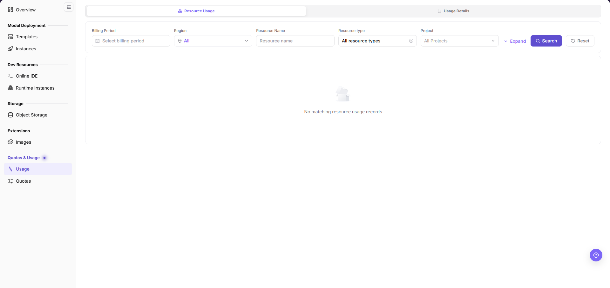
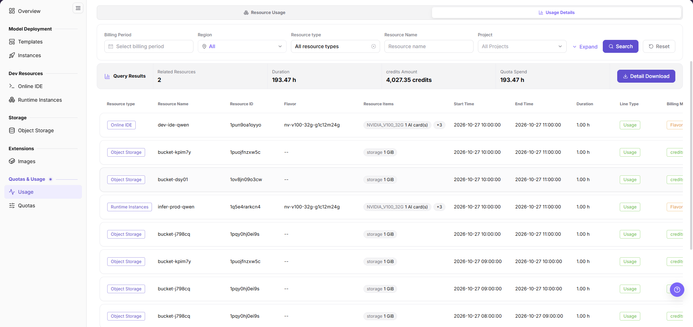
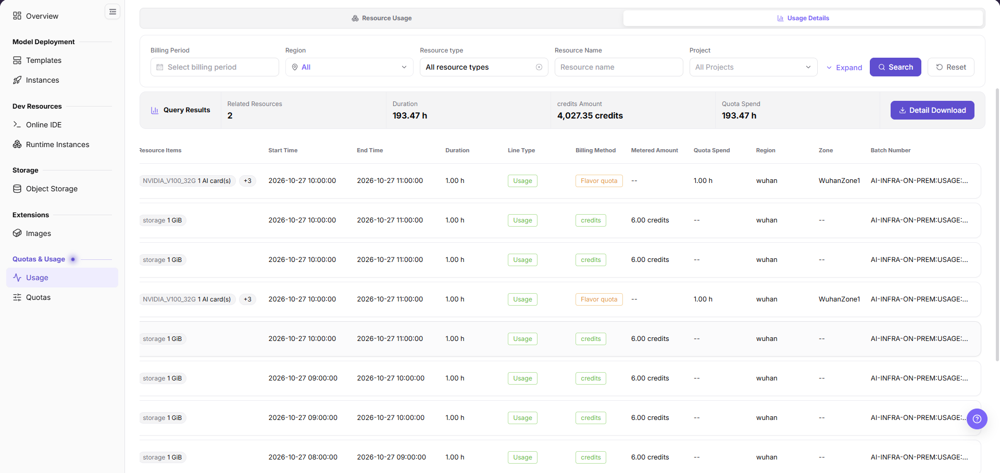
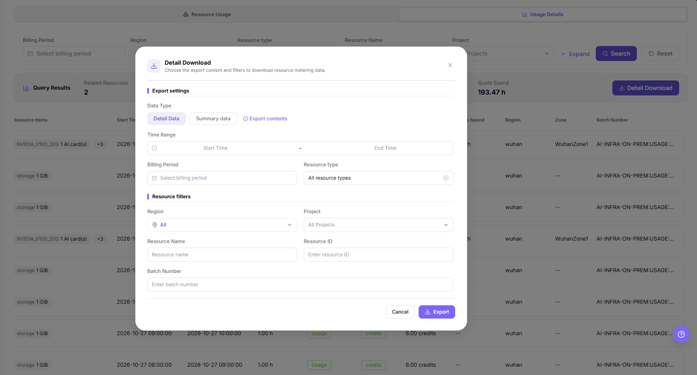

# Usage

## Feature Overview

| Item | Content |
| --- | --- |
| Applicable Role | Model Provider and Model Consumer |
| Navigation Path | On-Prem > Quotas & Usage > Usage |
| Page Route | `/powerone/quota-usage/usage` |
| Managed Object | Configuration, status, and relationships on Usage |

#### Beginner Explanation

My usage is like a personal resource consumption record, used to view how much compute, storage, and service resources were used over a period of time.

#### Terms

| Term | Description |
| --- | --- |
| Quota | Resource upper limit available to a tenant. Common dimensions include GPU, CPU, memory, and specifications. |
| Specification | Resource flavor identifier shown in the `Flavor` column of usage details, such as `nv-v100-32g-g1c12m24g`. |
| Usage Details | Resource metering records listed row by row on the `Usage Details` tab. |
| Detail Download | Dialog entrypoint that exports metering data from the `Usage Details` tab. |

#### Recommended Operation Order

1. Go to `On-Prem > Quotas & Usage > Usage`.
2. On the `Resource Usage` tab, set the filters and click `Search`.
3. Switch to the `Usage Details` tab and check the `Query Results` band and the detail columns.
4. Click `Detail Download` to export the current filter scope for records or external review.
5. Locate abnormal records row by row by `Resource Name`, `Flavor`, and `Batch Number`.

#### First-Time User Notes

Confirm that the task involves Configuration, status, and relationships on Usage, and then follow the recommended order. If fields or state differ from expectations, check prerequisites before continuing downstream.

## Prerequisites

1. The current account has permission to view resource usage.
2. The platform already has quota or usage statistics.
3. To locate specific instances, permission to view the corresponding instances is required.

## Page Description

Use this page to review resource usage by billing period, region, resource name, resource type, and project, and to check or export individual metering records.

The page provides `Resource Usage` and `Usage Details` tabs. In the screenshot the `Resource Usage` tab is selected, the filter area shows `Billing Period`, `Region`, `Resource Name`, `Resource type`, and `Project` with `Expand`, `Search`, and `Reset`, and the list area shows `No matching resource usage records` when nothing matches.

#### Page Areas

| Field/Area | Description |
| --- | --- |
| Tab Area | Switches between `Resource Usage` and `Usage Details`. |
| Filter Area | Queries by `Billing Period`, `Region`, `Resource Name`, `Resource type`, and `Project`; `Expand` adds more conditions. |
| Query Results Band | Shows `Related Resources`, `Duration`, `credits Amount`, and `Quota Spend`. |
| Detail List | Shows resource type, flavor, time range, metered amount, and quota spend row by row. |
| Detail Download | Opens the export dialog to choose the data type and filters before exporting metering data. |

## Main Operations

### View Resource Usage

#### Applicable Scenarios

- When you need to review resource usage by billing period, region, resource name, resource type, or project.
- When you need to confirm whether the current filter scope returns any usage records.

#### Steps

1. Go to `On-Prem > Quotas & Usage > Usage` and stay on the `Resource Usage` tab.
2. Select a `Billing Period` and set `Region`, `Resource Name`, `Resource type`, and `Project` as needed.
3. Click `Search` to load the result.
4. Click `Expand` for more conditions, or `Reset` to restore the defaults.

#### Result Validation

- The list area shows usage results when records match, or `No matching resource usage records` when none match.
- After the query, confirm the filter values still match the conditions you submitted.

#### Notes

- When no record is returned, check the `Billing Period` and `Project` scope first, then decide whether to switch to the `Usage Details` tab.
- Usage data may contain business resource names. Redact it before external communication.

### Query Usage Details

#### Applicable Scenarios

- Switch to the `Usage Details` tab when you need record-by-record metering data for a period.
- When you need to tell whether consumption comes from `Flavor quota` or `credits`.

#### Steps

1. Click the `Usage Details` tab at the top of the page.
2. Set `Billing Period`, `Region`, `Resource type`, `Resource Name`, and `Project`, then click `Search`.
3. Read `Related Resources`, `Duration`, `credits Amount`, and `Quota Spend` in the `Query Results` band.
4. Scroll the list sideways to check `Metered Amount`, `Quota Spend`, `Region`, `Zone`, and `Batch Number`.

The figure below shows the results band and the left columns of the list.

The next figure shows the right columns of the same list.

#### Result Validation

- The column headers are `Resource type`, `Resource Name`, `Resource ID`, `Flavor`, `Resource Items`, `Start Time`, `End Time`, `Duration`, `Line Type`, `Billing Method`, `Metered Amount`, `Quota Spend`, `Region`, `Zone`, and `Batch Number`.
- `Line Type` shows `Usage`, and `Billing Method` shows `Flavor quota` or `credits`.
- The band is titled `Query Results`, and its values correspond to the records matched by the current filters.

#### Notes

- A column that shows `--` has no value for that row, which is not by itself a metering error.
- The specification and card-count markers in `Resource Items` differ by resource type; align the caliber before cross-type comparison.
- Each row covers a time interval; use the `Duration` column for the per-row length.

### Download Usage Details

#### Applicable Scenarios

- When you need to export metering data within the current filter scope for archiving or external review.
- When you need data in either the `Detail Data` or `Summary data` form.

#### Steps

1. Finish the filters on the `Usage Details` tab and click `Search`.
2. Click `Detail Download` on the right of the results band.
3. Under `Export settings`, choose `Detail Data` or `Summary data` as the `Data Type`.
4. Set `Time Range`, `Billing Period`, and `Resource type` as needed.
5. Under `Resource filters`, set `Region`, `Project`, `Resource Name`, `Resource ID`, and `Batch Number` as needed.
6. Click `Export` to start, or click `Cancel` or the top-right × to discard this export.

The figure below shows the dialog groups, fields, and buttons.

#### Result Validation

- The dialog is titled `Detail Download`, and its subtitle explains that the export content and filters are chosen before downloading metering data.
- The dialog contains the `Export settings` and `Resource filters` groups, with the fields listed in the steps above.
- After `Cancel` or ×, the dialog closes and the tab and filters stay unchanged.

#### Notes

- The dialog fields are identical for `Detail Data` and `Summary data`; only the exported data form differs.
- Exported files contain business resource names and resource IDs. Redact them before external delivery.
- The export scope follows the filters inside the dialog, so confirm them separately from the page list filters.

## Parameter Quick Reference

| Field Name | Required | Field Type | Example | Description |
| --- | --- | --- | --- | --- |
| Billing Period | No | Date | `2026-10` | Narrows usage and metering records to one billing period. |
| Resource Name | No | Text | `dev-ide-qwen` | Locates the resource that generated the usage. |
| Resource Type | No | Enum | `Online IDE` | The `Resource type` column shows values such as `Online IDE`, `Runtime Instances`, and `Object Storage`. |
| Duration | System-generated | Duration | `1.00 h` | Metered duration of a single detail row. |
| credits Amount | System-generated | Number | `4,027.35 credits` | credits amount of the current query shown in the results band. |
| Quota Spend | System-generated | Duration | `193.47 h` | Quota spend reading of the current query shown in the results band. |

## Pitfalls

- If details are empty, this specification may currently have no consumption records.
- Statistical data may be delayed and is not suitable as a replacement for real-time instance status.

#### Configuration Rules and Impact

- Resource usage is used for statistics and reconciliation and does not directly create or release resources.
- Unlimited means there is no fixed upper limit, but underlying resources and scheduling conditions still apply.
- Consumption details may be delayed. Judge real-time status together with instance details.

## Result Validation

| Check Item | Success Signal | If Abnormal |
| --- | --- | --- |
| Page entry | Usage opens with filters or statistics | Check menu permission, current business identity, and tenant scope |
| Data scope | Lists or statistics match the selected time, region, and object | Reset filters and verify time boundaries, time zone, and aggregation scope |
| Data update | Update time or latest record matches the expected cycle | Check whether the source job, metering, or quota record has been generated |
| Cross-check | Configuration, status, and relationships on Usage matches its details, billing, or monitoring records | Compare the responsible detail page by object identifier and time range |

## FAQ

#### No Records on Usage

**Symptom:**

The page opens, but lists or statistics are empty.

**Possible Causes:**

- Filters are too narrow.
- source records are not generated.
- the role cannot see them.

**Solution:**

1. Reset filters
2. verify the source job or metering cycle
3. check business identity and tenant scope.

#### Usage Shows the Wrong Scope

**Symptom:**

Data does not belong to the expected time, region, or object.

**Possible Causes:**

- Time boundaries differ.
- the region filter did not apply.
- ownership changed.

**Solution:**

1. Select time and region again
2. verify object identifiers
3. confirm ownership in source details.

#### Usage Is Delayed

**Symptom:**

A source operation completed, but its record is not visible.

**Possible Causes:**

- Aggregation is not complete.
- the page is cached.
- source state is still processing.

**Solution:**

1. Verify source state
2. wait one aggregation cycle and refresh
3. inspect the processing task if delay persists.

#### Details or Download Is Unavailable

**Symptom:**

The details, expand, or download entry is disabled.

**Possible Causes:**

- The record does not support it.
- role permission is insufficient.
- the file is not generated.

**Solution:**

1. Select an eligible record
2. check role permission
3. confirm the statistics or export task is complete.

#### Summary and Details Do Not Match

**Symptom:**

The summary differs from the total of individual records.

**Possible Causes:**

- Periods differ.
- values are rounded.
- some records are still processing.

**Solution:**

1. Align period and time zone
2. compare by object
3. wait for pending records and check again.

## Notes

- Usage statistics may lag behind resource status changes. Short-term differences are common.
- Usage data may contain business resource names. Sanitize it before external communication.
- Fee or Credits explanations should follow platform metering rules. Do not use a single screenshot as final settlement basis.

## Next Steps

1. When usage grows abnormally, locate high-consumption instances and jobs by resource name or time range.
2. When usage is inconsistent with credit changes, wait for metering synchronization and check again. Contact the operator if necessary.
3. For cost review, export or record usage trends, resource types, and business purposes.
4. Set shutdown or cleanup plans for long-running resources to avoid continuous credit consumption.
