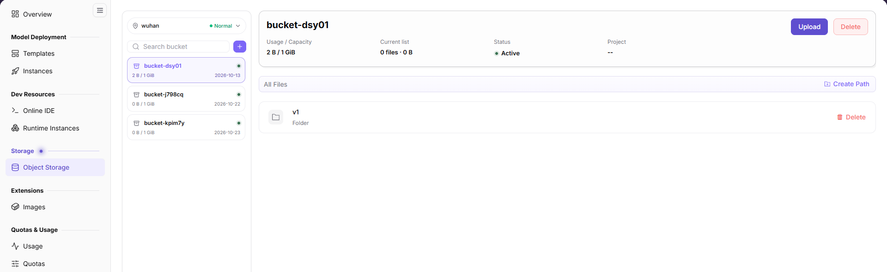
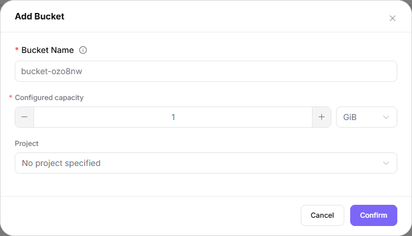
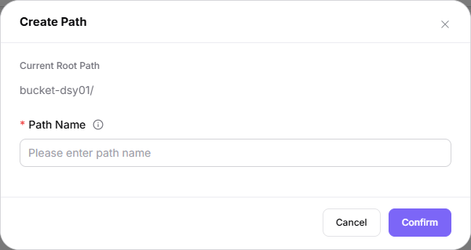
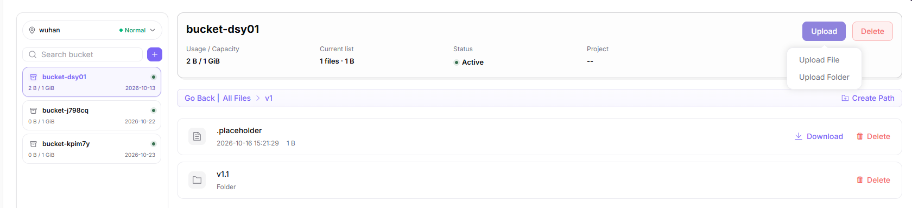

# Object Storage

## Feature Overview

| Item | Content |
| --- | --- |
| Applicable Role | Model Provider |
| Navigation Path | On-Prem > Storage > Object Storage |
| Page Route | `/powerone/storage-service/object` |
| Managed Object | Object storage buckets, object files, object paths, and object storage capability within a region |

#### Beginner Explanation

Object storage is like cloud drive for models and data. It stores files, datasets, model packages, and output results with buckets and objects. It is suitable for uploading, downloading, and sharing files by path, but it is not the same as a directly mountable POSIX shared directory.

#### Terms

| Term | Description |
| --- | --- |
| Bucket | Top-level container in object storage. |
| Object | A single file or data item in a bucket. |
| Object Path | File path inside a bucket, used to locate data in jobs. |

#### Recommended Operation Order

Confirm prerequisites for Object storage buckets, object files, object paths, and object storage capability within a region, follow Main Operations, run Result Validation, and continue to the next page.

#### First-Time User Notes

Confirm that the task involves object storage buckets, object files, object paths, or object storage capability within a region, and then follow the recommended order. If fields or state differ from expectations, check prerequisites before continuing downstream.

## Prerequisites

1. Object storage capability has been opened by the operator in the target region.
2. The current account has permissions to view, create buckets, and manage objects.
3. Bucket name, object path, and data retention policy have been planned.
4. If used by jobs, the job region should be able to access this object storage.

## Page Description

Use this page to manage object-storage buckets, objects, paths, and regional object-storage capability.

The left bucket panel has the region at its top and a `+` entry to the right of `Search bucket`. Selecting a bucket exposes its usage/capacity, current list, status, and project overview; file and folder controls belong to the current directory.

## Main Operations

### Search and Read Bucket Overview

#### Applicable Scenarios

Locate a bucket by name and read its current overview.

#### Steps

1. Open Object Storage and check the region at the top of the left bucket panel.
2. Enter the bucket name in `Search bucket` and select the target bucket in the left list.
3. Read `Usage / Capacity`, `Current list`, `Status`, and `Project` in the bucket overview.

#### Result Validation

- Check whether the selected bucket name and overview match the intended bucket; distinguish bucket usage from the file count and size of the current list.

#### Notes

- The screenshot establishes the search box and region selector as entrypoints, not a completed search or region switch.
- Mounts or connections, creation time, events and anomaly troubleshooting do not appear in the captured views, so this page does not describe those operations.

### Add Bucket

#### Applicable Scenarios

Create a bucket after planning its name, capacity, and project association.

#### Steps

1. Check the region at the top of the left panel; the region is not in the upper-right corner.
2. Click the `+` button to the right of `Search bucket` to open the `Add Bucket` dialog.
3. Fill in `Bucket Name` and `Configured capacity`; the visible unit is `GiB`. Review `Project`, which shows `No project specified` in the example.
4. After checking the values and obtaining authorization, click `Confirm` to submit.

The dialog below shows `Bucket Name`, `Configured capacity`, `GiB`, `Project`, and `Confirm`.

#### Result Validation

- After submission, check the actual feedback and whether the intended bucket appears with the intended capacity and project.

#### Notes

- The form shows required markers for `Bucket Name` and `Configured capacity`; naming validation, capacity limits, other units, project options, and post-submit behavior follow the actual page feedback.
- The user-side menu has three levels and its top level is a single item that combines the platform name with `On-Prem`, but the English label of that top item is not confirmed; the storage entry appears in the left menu as the group `Storage` with the leaf `Object Storage`. The four-segment string `On-Prem > Storage Services > Object Storage` is a historical original, not a UI label.

### Create Path

#### Applicable Scenarios

Prepare an object path within the selected bucket or directory.

#### Steps

1. Select the target bucket and locate the intended parent directory.
2. Click `Create Path` on the right of the bar above the file list; the bar shows `All Files` at the bucket root, and `Go Back` with the breadcrumb inside a folder.
3. Check `Current Root Path`, enter `Path Name`, and click `Confirm` only after checking the intended location.

The dialog below identifies the current root and the required `Path Name` input.

#### Result Validation

- After submission, inspect feedback and check whether the path appears in the intended parent.

#### Notes

- Path validation, nested-path support, duplicate-name handling, and post-submit behavior follow the actual page feedback; a dialog is not proof of creation.

### Browse Folders and Return

#### Applicable Scenarios

Navigate from a bucket root into a directory and back.

#### Steps

1. Select the bucket and click a folder name in its object list, such as `v1`.
2. Check the breadcrumb, shown as `All Files > v1` in the captured directory view.
3. Use `Go Back` for the parent entry or `All Files` for the root entry, then check the displayed location.

#### Result Validation

- Check the breadcrumb and current list after each navigation action.

#### Notes

- The directory state and return entrypoints are visible; the screenshots do not record a navigation sequence or prove every return transition.

### Upload Files or Folders

#### Applicable Scenarios

Choose the upload type for the current bucket directory.

#### Steps

1. Select the bucket and navigate to the destination directory; check its breadcrumb.
2. Open `Upload` in the bucket overview and choose `Upload File` or `Upload Folder` for the intended local source.
3. Continue only according to the actual chooser and feedback after confirming the destination and authorization.

The expanded upload menu below shows both types; the same directory view also locates file `Download` and row `Delete` entrypoints.

#### Result Validation

- After an authorized upload, check actual feedback, destination entries, file sizes, and content as appropriate.

#### Notes

- The menu proves both upload entrypoints; size limits, overwrite policy, directory layout, chooser details, and transfer results follow the actual page feedback.

### Download a File

#### Applicable Scenarios

Retrieve an individual file from the selected directory.

#### Steps

1. Locate the target file in the intended bucket directory and check its name and displayed size.
2. Click `Download` on that file row; follow the actual browser response rather than assuming a specific dialog.

#### Result Validation

- Check whether the intended file is received and readable, and compare its size or checksum when available.

#### Notes

- The captured file row has `Download`; folder download is not evidenced. Do not infer a folder-download workflow from file controls.

### Delete a File or Folder

#### Applicable Scenarios

Remove an authorized file or folder after checking dependencies and backups.

#### Steps

1. Locate the intended file or folder within the selected bucket directory and verify its full context.
2. After authorization and dependency checks, use `Delete` on that row, not the bucket-level `Delete`.

#### Result Validation

- If deletion is performed, inspect the actual feedback and recheck the intended directory entry.

#### Notes

- File and folder rows show separate `Delete` entrypoints. Confirmation wording, recursive deletion, recovery, and deletion constraints follow the actual page feedback; do not assume a folder is deleted recursively.

### Delete a Bucket

#### Applicable Scenarios

Remove the selected bucket only after approval of its data and dependency impact.

#### Steps

1. Select the intended bucket and verify its name, region, and overview.
2. After approval and data-protection checks, use the bucket-level `Delete` beside `Upload`.

#### Result Validation

- If deletion is performed, inspect feedback and check the bucket list for the intended outcome.

#### Notes

- This entry is distinct from file/folder row deletion. Empty-bucket restrictions, confirmation dialogs, deletion scope, and recovery follow the actual page feedback; none is established here.

## Parameter Quick Reference

| Field Name | Requirement / Source | Meaning | Evidence Boundary |
| --- | --- | --- | --- |
| `Bucket Name` | Required marker in Add Bucket | Name of the bucket being created. | Naming validation follows the actual page feedback. |
| `Configured capacity` / `GiB` | Required marker in Add Bucket | Configured bucket capacity and visible unit. | Limits and other unit options follow the actual page feedback. |
| `Project` | Add Bucket / bucket overview | Project association; form shows `No project specified`. | Options and association behavior follow the actual page feedback. |
| `Usage / Capacity` | Bucket overview | Bucket usage and capacity. | Do not equate this with the current directory's file count. |
| `Current list` | Bucket overview | File count and size for the current list. | Folder-count rules follow the actual page display. |
| `Status` | Bucket overview | Captured example: `Active`. | Other state labels and transitions do not appear in the captured views. |
| Region | Top of the left bucket panel | Captured example: `wuhan`, `Normal`. | Region-switch side effects do not appear in the captured views. |
| Original Resource Name / Access Path / Available | Historical quick-reference terms | Original examples: `storage-a`, `/mnt/data`, `Available`; original capacity/quota example: `100GiB`. | Their fields, mount semantics, and enum mapping do not appear in the captured views and are not declared nonexistent. |

## Pitfalls

- If mounting fails, confirm region, permissions, and storage component status first; mount-entry availability follows the actual page.
- Before deleting storage resources, confirm that no instances, tasks, or output artifacts depend on them. (Avoid treating an empty current list as proof that no dependency exists.)
- Buckets are regional storage resources. Cross-region access capability depends on operator configuration.
- Object storage is suitable for unstructured files and not suitable for scenarios requiring POSIX shared directory semantics.
- Before deleting buckets or objects, confirm that no instances, models, scripts, or jobs depend on them. (Bucket/object dependency scope differs from the current directory.)
- Object paths can be used in startup commands or parameters, but do not write access keys into commands. (Downstream integration follows the actual page; the key-protection boundary still applies.)

## Result Validation

| Check Item | Success Signal | If Abnormal |
| --- | --- | --- |
| Page entry | Object Storage opens with the target operation entry | Check Operator permission and whether the menu is available |
| Object record | Object storage buckets, object files, object paths, and object storage capability within a region are visible in the list or details | Reset filters and verify name, ownership, and creation result |
| State result | State after creation or change matches the page message | Check operation feedback, dependency state, and latest update time |
| Downstream use | A downstream page can select or associate the target | Return to prerequisites and check enabled state, ownership, and visibility |

## FAQ

#### Target Is Missing from Object Storage

**Symptom:**

The page opens, but the expected object storage buckets, object files, object paths, or object storage capability within a region are missing.

**Possible Causes:**

- Filters remain active.
- The object belongs to another scope.
- A prerequisite is incomplete.

**Solution:**

1. Reset filters
2. Verify region or tenant ownership
3. Confirm prerequisite state.

#### The Operation Entry on Object Storage Is Unavailable

**Symptom:**

The create, register, or maintain entry is hidden or disabled.

**Possible Causes:**

- Role permission is insufficient.
- The page is read-only.
- Dependencies are not ready.

**Solution:**

1. Check Operator permission
2. Read the page message
3. Complete dependency configuration first.

#### A Required Field on Object Storage Has No Options

**Symptom:**

The form opens, but a selection list is empty.

**Possible Causes:**

- Candidates are disabled.
- Ownership differs.
- The current account cannot see them.

**Solution:**

1. Check candidate state
2. Verify ownership
3. Confirm visibility and refresh the form.

#### Object Storage Has an Abnormal State After the Operation

**Symptom:**

A record exists after submission, but its state is unexpected.

**Possible Causes:**

- Connectivity or validation failed.
- A dependency is abnormal.
- Processing is incomplete.

**Solution:**

1. Check feedback and update time
2. Inspect related objects
3. Troubleshoot the processing stage.

#### A Downstream Page Cannot Use Object Storage

**Symptom:**

The current page is normal, but a downstream page cannot select or associate object storage buckets, object files, object paths, or object storage capability within a region.

**Possible Causes:**

- Visibility differs.
- The object is disabled.
- Downstream cache is stale.

**Solution:**

1. Check enabled state and ownership
2. Verify role visibility
3. Refresh and select again.

## Notes

- Do not write keys, accounts, tokens, or customer-sensitive information in object paths or file names.
- Before deleting important data, confirm a usable backup; dependency-scope misjudgments are covered in Pitfalls.
- The viewing instructions below are historical text from the original manual, retained for comparison and not asserted as current UI steps.
- Historical guidance: “Open the corresponding storage-service page and filter by name, project, status, capacity, or update time.”
- Historical guidance: “Open details and check capacity, used space, access method, mount or connection status, and creation time.”
- Historical guidance: “If no record is returned, reset filters and check project and region. Do not share internal addresses or access credentials.”
- Historical guidance: “For capacity or status anomalies, inspect quota, events, and associated instances before creating another resource.”
- The guidance below is quoted from the original manual; confirm the capability and its actual entrypoint in the interface before relying on it.
- Treat the following original instructions as an evidence queue, not an executable workflow; do not attempt expansion, mount, unmount, permissions, or recovery on this basis.
- Plan checks for capacity, connection state, and events only after a capability is confirmed in the interface; no such operation or recovery outcome is recorded on this page.
- Historical guidance: “Open the target action menu and identify the impact of expansion, mount, unmount, permission, or deletion entries.”
- Historical guidance: “Record current capacity, associated instances, and data-protection status before changes.”
- Historical guidance: “Before expansion, unmount, or deletion, confirm tasks and backups. Before the final action, confirm the resource, data, and impact, and execute it only after approval.”
- Historical guidance: “After an approved change, check capacity, connection status, and events. If abnormal, stop subsequent actions and follow the recovery process.”

## Next Steps

1. Reference object paths in runtime instances, online IDEs, or model services.
2. Periodically clean up unused objects to control storage usage.
3. Establish backup or version archive rules for important models and datasets.
