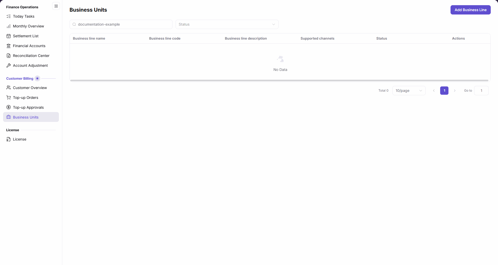
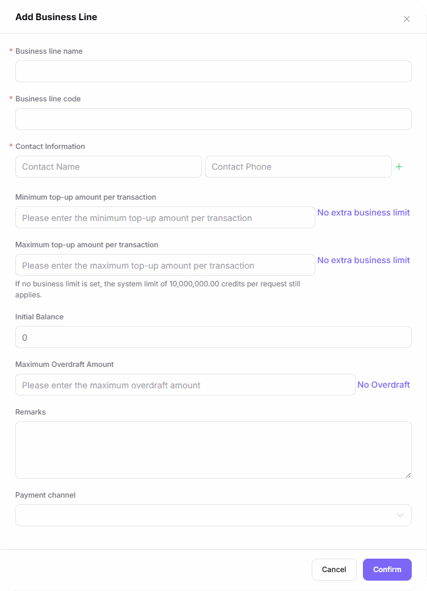

# Business Units

::: info Document Information
Version: v2.1
Updated: 2026-11-05
:::

## Feature Overview

| Item | Content |
| --- | --- |
| Applicable Role | Operations administrator |
| Navigation path | Billing > Customer Billing > Business Units |
| Page route | `/billing/customers/business-units` |
| Managed objects | Business lines, payment channels, per-transaction top-up limits, initial balance, and maximum overdraft amount |

Use this page to find business lines and maintain their configuration through `Add Business Line` and the row-level `Edit Business Line` entry.

#### Beginner Explanation

A business line works like a checkout configuration, grouping payment channels, per-transaction top-up limits, and overdraft settings within one business scope.

#### Terms Quick Reference

| Term | Description |
| --- | --- |
| Business line | A business object containing top-up channels, per-transaction limits, and balance-related settings. |
| Business line code | The code identifying a business line; confirm business ownership before changing it. |
| Payment channel | A payment channel selected in the business-line form. |
| Per-transaction top-up limits | Separate minimum and maximum top-up amounts per transaction. |
| Maximum Overdraft Amount | An overdraft setting separate from Initial Balance. |

## Prerequisites

1. Sign in to the platform and ensure you can access `Billing > Customer Billing > Business Units`.
2. Confirm the relevant operation permissions before adding or editing a business line.
3. Confirm the target business line, affected customers, channels, and balance policy in advance; do not submit configuration merely to inspect a form.

## Page Description

| Area | Description |
| --- | --- |
| Filters | Contains `Business line name` and `Status`. |
| Creation entry | `Add Business Line` opens the creation form. |
| List | Displays names, codes, descriptions, channels, statuses, and row actions. |
| Pagination | Displays the current result count and pagination controls. |

| Area | Description |
| --- | --- |
| Business line name | Display name of the business line. |
| Business line code | Code of the business line. |
| Business line description | Business description in the list. |
| Supported channels | Channels configured for the business line. |
| Status | Current business-line status. |
| Actions | When records are available, use the corresponding row's `Edit Business Line` entry. |

The figure shows the empty results for `documentation-example` in Business line name; the table retains six columns and displays `No Data` and `Total 0`.

## Main Operations

### Find Business Lines

1. Go to `Billing > Customer Billing > Business Units`.
2. Enter `Business line name` and select `Status` as needed.
3. Review the matching records' names, codes, descriptions, supported channels, and statuses.
4. If `No Data` appears, check the name and status conditions, then adjust or clear the inputs as needed.

### Add a Business Line

1. Click `Add Business Line` to open the form.
2. Fill in the required-marked `Business line name`, `Business line code`, and `Contact Information`; the contact group contains `Contact Name` and `Contact Phone`.
3. Set the optional `Minimum top-up amount per transaction` and `Maximum top-up amount per transaction` separately. Each has a `No extra business limit` button. Check the notice: `If no business limit is set, the system limit of 10,000,000.00 credits per request still applies.`
4. Review `Initial Balance`, which defaults to `0`; set the optional `Maximum Overdraft Amount` according to business policy, or use `No Overdraft`.
5. Enter `Remarks` and select `Payment channel` as needed. Payment channel has no required asterisk.
6. Click `Confirm` only when creation is intended and the name, code, contacts, top-up limits, balance, overdraft amount, and channels have been reviewed; click `Cancel` to leave without submitting.

The figure shows the unfilled creation form: the name, code, and Contact Information group have required marks, minimum and maximum top-up amounts are separate, Initial Balance is `0`, and the bottom actions are `Cancel` and `Confirm`.

### Edit a Business Line

1. Locate the target business line and verify its name, code, and status.
2. Click the row's `Edit Business Line` entry to review the existing configuration and the intended scope of changes.
3. Review payment channels, top-up limits, initial balance, and maximum overdraft amount in particular; submit only after confirming the business impact, or use `Cancel` to abandon changes.

## Parameter Quick Reference

| Field Name | Required | Field Type | Example | Description |
| --- | --- | --- | --- | --- |
| Business line name | Yes | Text | `documentation-example` | Required-marked form field; also available as a list filter. |
| Business line code | Yes | Text | `<business-line-code>` | Required-marked form field. |
| Contact Information | Required group | Field group | `<contact-information>` | The required mark belongs to the group containing name and phone. |
| Contact Name | Part of contact group | Text | `<contact-name>` | Field within Contact Information. |
| Contact Phone | Part of contact group | Text | `<contact-phone>` | Field within Contact Information. |
| Minimum top-up amount per transaction | No | Number | `0` | Separate optional field with a `No extra business limit` button. |
| Maximum top-up amount per transaction | No | Number | `0` | Separate optional field; the system limit of 10,000,000.00 credits per request still applies without a business upper limit. |
| Initial Balance | No required mark | Number | `0` | Defaults to 0 in the creation form. |
| Maximum Overdraft Amount | No | Number | `0` | Optional field with a `No Overdraft` button. |
| Remarks | No | Multiline text | `<business-description>` | Supplementary information in the form. |
| Payment channel | No required mark | Dropdown | `<payment-channel>` | Select channels according to business requirements. |
| Status | Optional filter | Dropdown / list value | `<status>` | Filters and displays the current status. |
| No extra business limit | Not applicable | Button | `No extra business limit` | Appears beside both top-up limit fields; does not mean an unlimited amount. |
| No Overdraft | Not applicable | Button | `No Overdraft` | Shortcut for the overdraft configuration. |
| Confirm | Not applicable | Button | `Confirm` | Final form confirmation entry; complete the business review first. |
| Cancel | Not applicable | Button | `Cancel` | Leave without submitting the current form. |

## Pitfalls

- `No extra business limit` does not mean an unlimited amount: `If no business limit is set, the system limit of 10,000,000.00 credits per request still applies.`
- The required mark for `Contact Information` is at group level; do not interpret it as a separate required asterisk on each input.
- The list uses `Business line description`, while the form uses `Remarks`; identify fields by their page area.
- `Initial Balance` and `Maximum Overdraft Amount` are separate fields, not a combined value.

## Result Validation

| Check Item | Success Signal | If Abnormal |
| --- | --- | --- |
| Query scope | Name and status conditions match the target business line | Adjust or clear the corresponding conditions. |
| Empty results | No matching results display `No Data` and `Total 0` | Review the filters; do not treat empty results as proof that configuration was deleted. |
| Form location | The creation form contains name, code, Contact Information, and separate top-up limit fields | Confirm that `Add Business Line` was opened. |
| Upper-limit notice | The maximum amount field displays the system limit of 10,000,000.00 credits per request | Review business policy against that limit, not an unlimited amount. |

## FAQ

#### Why Is the List Empty After Entering a Name?

**Symptom:** The list displays `No Data` and `Total 0`.

**Possible Causes:** No results match the current name and status conditions.

**Resolution:** Review `Business line name` and `Status`, then adjust or clear the conditions as needed.

#### Why Is a System Limit Displayed Without a Business Upper Limit?

**Symptom:** The maximum top-up amount field still displays a 10,000,000.00 credits notice.

**Possible Causes:** The UI explicitly states: `If no business limit is set, the system limit of 10,000,000.00 credits per request still applies.`

**Resolution:** Distinguish business restrictions from the system limit and review the per-request top-up policy against the notice.

## Notes

- Payment channels, top-up limits, initial balance, and overdraft amounts are critical business settings. Confirm affected customers and business authorization before changing them; do not submit configuration to test its effects.
- Use contact information only for authorized business purposes. Share only necessary records, without credentials or unrelated customer information.
- Before changing status or retiring a business line, assess the impact on associated customers and top-up operations; a status change does not replace a full business review.
- When only inspecting configuration, use `Cancel` rather than the final `Confirm` action.

## Next Steps

- Open [Top-up Orders](../top-up-orders/) to review the source, payment amount, credits added, and status by order.
- Open [Customer Overview](../customer-overview/) to review related customer information.
