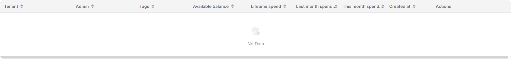
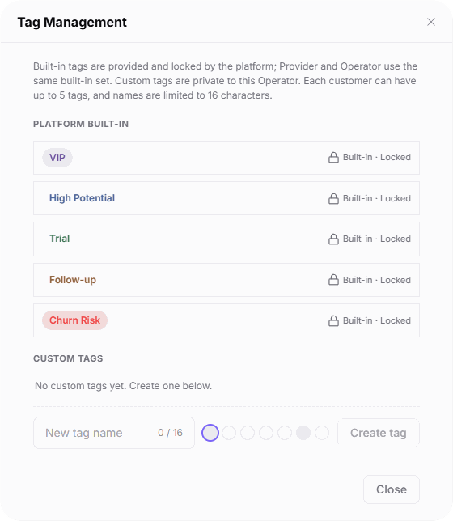

# Customer Overview

::: info Document Information
Version: v2.1
Updated: 2026-11-05
:::

## Feature Overview

| Item | Content |
| --- | --- |
| Applicable Role | Operations administrator |
| Navigation path | Billing > Customer Billing > Customer Overview |
| Page route | `/billing/customers/overview` |
| Managed objects | Customer identities, tags, consumption accounts, and revenue accounts |

`Customer Overview` locates customers by business identity, keyword, and tags, displays balances and consumption, and provides Details, Grant Credit, and Recall Credit entries.

#### Beginner Explanation

Customer Overview works like a customer billing index: End User consumption appears in a table, while Provider cards separate consumption and revenue accounts.

#### Terms Quick Reference

| Term | Description |
| --- | --- |
| End User | The end-user business identity, with a customer consumption table. |
| Provider | The service-provider business identity, with consumption and revenue account cards. |
| Credits | The unit used to display balances, consumption, and revenue. |
| Built-in tags | Tags provided and locked by the platform; Provider and Operator share the same set. |
| Custom tags | Tags private to the current Operator. |

## Prerequisites

1. Sign in with an operator account that can access `Customer Billing > Customer Overview`.
2. Confirm the business identity before querying; confirm the target customer and business reason before granting or recalling credit.

## Page Description

| Area | Description |
| --- | --- |
| Page header | Displays the `MTD spend updated:` time and provides `Refresh` and `Manage Tags`. |
| Filters | `Business identity` uses an `End User` / `Provider` segmented control. The keyword placeholder is `Enter a keyword`. `Filter by tag` supports multiple selections; matching any selected tag includes the customer (OR). |
| Summary | Four cards cover customer scale, funds, consumption, and balance risk. Read them separately from the customer results below. |
| End User results | A table displays customer identities, tags, balances, and consumption. |
| Provider results | Customer cards display consumption accounts, revenue accounts, and creation time rather than using the End User table layout. |

The four summary card names and visible metrics are listed below. An empty keyword-query table does not establish that summary values are 0.

| Area | Description |
| --- | --- |
| Total customer base | Total customers, End User / Provider counts, and customers active in consumption this month. |
| Credits pool | Credits funds, last month spend, and estimated days supported at this month's daily average. |
| This month spend | This month's consumption, daily average, and comparison with last month's daily average. |
| Balance risk | Count of customers below the 3-day runway and estimated days remaining. |

The End User table uses the following column names.

| Area | Description |
| --- | --- |
| Tenant | Customer tenant identity. |
| Admin | Customer administrator identity. |
| Tags | Tags applied to the customer. |
| Available balance | Credits currently available to the customer. |
| Lifetime spend | Cumulative Credits consumed by the customer. |
| Last month spend | Credits consumed by the customer last month. |
| This month spend | Credits consumed by the customer this month. |
| Created at | Customer account creation time. |
| Actions | Entries include `Details`, `Grant Credit`, and `Recall Credit`; an `Actions` entry is also available. |

The figure shows an empty End User keyword-query result table with tenant, administrator, tags, balance, consumption, creation time, and action columns; it does not include summary cards or Provider cards.

Provider cards separate `Consumption Account` and `Revenue Account`. The former contains `Available balance`, `This month spend`, and `Last month spend`; the latter contains `Revenue balance`, `Current pending revenue`, and `Last month revenue`. Cards also display `Created at` and provide `Details`, `Grant Credit`, `Recall Credit`, and `Actions` entries.

## Main Operations

### Query End User Customers

1. Go to `Billing > Customer Billing > Customer Overview`.
2. Select `End User` in the `Business identity` segmented control.
3. Enter a query in `Enter a keyword` and select tags as needed; multiple tags use OR matching.
4. Review the result table and verify the target customer's tenant, administrator, tags, available balance, and consumption fields.
5. To view customer information, verify the target customer first, then use that row's `Details` entry.

### View Provider Customers

1. Select `Provider` in the `Business identity` segmented control.
2. Enter a keyword and select tags as needed to locate the target customer card.
3. Check `Available balance`, `This month spend`, and `Last month spend` under `Consumption Account`.
4. Separately check `Revenue balance`, `Current pending revenue`, and `Last month revenue` under `Revenue Account`, along with the card's `Created at` value.

### Review Tag Management

1. Click `Manage Tags` to open `Tag Management`.
2. Review the `PLATFORM BUILT-IN` tags: `VIP`, `High Potential`, `Trial`, `Follow-up`, and `Churn Risk`, each marked `Built-in · Locked`.
3. Review `CUSTOM TAGS`. The illustrated state reads `No custom tags yet. Create one below.` The area provides `New tag name`, color choices, and a `Create tag` entry; names are limited to 16 characters.
4. Click `Close` or the top-right close button to exit the dialog.

The figure shows the Tag Management dialog with five locked built-in tags, an empty custom-tag area, and the new tag name input, color choices, Create tag, and Close entries.

### Grant Credit

1. Locate and verify the target customer, then click `Grant Credit`.
2. Check that the prefilled, read-only customer identity matches the target customer.
3. Fill in `Grant Amount` and `Reason`; both have required markers.
4. Recheck the customer, amount, and reason; click `Confirm` when you intend to submit.
5. To abandon the operation, click `Cancel` or the top-right close button.

### Recall Credit

1. Locate and verify the target customer, then click `Recall Credit`.
2. Check that the prefilled, read-only customer identity matches the target customer.
3. Fill in `Recall Amount` and `Reason`; both have required markers. The form also provides a `Recall all` button.
4. Recheck the customer, amount, and reason; click `Confirm` when you intend to submit.
5. To abandon the operation, click `Cancel` or the top-right close button.

## Parameter Quick Reference

| Field Name | Required | Field Type | Example | Description |
| --- | --- | --- | --- | --- |
| Business identity | Select for query | Segmented selection | `End User` | Select `End User` or `Provider`. |
| Enter a keyword | No | Text | `<query>` | Locates customers within the selected business identity using the entered keyword. |
| Filter by tag | No | Multi-select | `VIP` | Matching any selected tag includes the customer (OR). |
| Tenant | Read-only | Identity information | `<tenant>` | Customer tenant in the End User table. |
| Admin | Read-only | Identity information | `<administrator>` | Administrator in the End User table. |
| Tags | Read-only | Tag set | `VIP` | Each customer can have up to 5 tags. |
| Available balance | Read-only | Credits | `0` | Available balance in the End User table or Provider consumption account. |
| Lifetime spend | Read-only | Credits | `0` | Cumulative consumption in the End User table. |
| Last month spend | Read-only | Credits | `0` | Last month's consumption in the End User table or Provider consumption account. |
| This month spend | Read-only | Credits | `0` | This month's consumption in the End User table or Provider consumption account. |
| Created at | Read-only | Time | `<creation time>` | Shown in the End User table and Provider cards. |
| Revenue balance | Read-only | Credits | `0` | Provider revenue account balance. |
| Current pending revenue | Read-only | Credits | `0` | Provider revenue pending settlement this month. |
| Last month revenue | Read-only | Credits | `0` | Provider revenue from last month. |
| New tag name | Enter when creating | Text | `<tag name>` | Up to 16 characters; custom tags are private to the current Operator. |
| Color choices | Not marked required | Color options | `<color>` | Color choices provided in the custom-tag area. |
| Customer identity | Read-only | Prefilled information | `<customer identity>` | Identifies the target customer in the grant and recall forms. |
| Grant Amount | Yes | Number | `<amount>` | Required field in the Grant Credit form. |
| Recall Amount | Yes | Number | `<amount>` | Required field in the Recall Credit form. |
| Reason | Yes | Multiline text | `<business reason>` | Required in both credit forms. |
| Recall all | No | Button | `Recall all` | A separate entry provided in the Recall Credit form. |

## Pitfalls

- Multiple tags use OR matching; customers do not need to have every selected tag.
- End User uses a table, while Provider uses account cards. Do not compare both identities using the same table columns.
- `No Data` after a keyword query means the current query has no results, not that the platform has no customers or that summary amounts or counts are 0.
- The limit of 5 tags per customer concerns an individual customer's tags, not the total size of the tag library.

## Result Validation

| Check Item | Success Signal | If Abnormal |
| --- | --- | --- |
| Identity and layout | End User displays a table; Provider displays consumption and revenue account cards | Check the selected business identity. |
| Query scope | Results can be checked against the current keyword and selected tags; an empty result displays `No Data` | Check the current keyword and selected tags first; do not treat empty results as the platform customer count. |
| Tag Management | The dialog displays five built-in tags with locked markers and the current custom-tag content | Check the built-in and custom-tag areas separately. |
| Credit forms | The grant form shows required `Grant Amount` and `Reason`; the recall form shows required `Recall Amount` and `Reason` | Check the form entry and read-only customer identity; cancel or close if not proceeding. |

## FAQ

#### Why Does an Empty Query Table Not Mean the Platform Has No Customers?

**Symptom:**

The End User table displays `No Data` after entering a keyword.

**Possible Causes:**

The current keyword query has no matches; the table displays query results rather than the total customer base.

**Resolution:**

Check the current keyword, business identity, and selected tags, and read the summary cards separately from customer results.

#### Why Does the Provider View Not Have the End User Table Columns?

**Symptom:**

After selecting Provider, customer information appears as cards instead of a table.

**Possible Causes:**

The Provider view uses a card layout divided into `Consumption Account` and `Revenue Account`.

**Resolution:**

Check consumption and revenue fields separately in the cards rather than expecting the End User table columns.

## Notes

- Granting and recalling credit concern customer credit handling. Recheck the customer, amount, and reason before using the `Confirm` submission entry; opening a form or seeing required markers does not establish completion.
- `Recall all` and `Confirm` are different buttons in the recall form; do not treat them as interchangeable.
- Built-in tags are provided and locked by the platform, with the same set shared by Provider and Operator. Custom tags are private to the current Operator.
- Share only necessary verification information; do not disclose real customer identities, accounts, emails, financial amounts, or credentials.

## Next Steps

- See [Top-up Orders](../top-up-orders/) to check top-up orders.
- See [Business Units](../business-units/) to review customer business-unit configuration.
