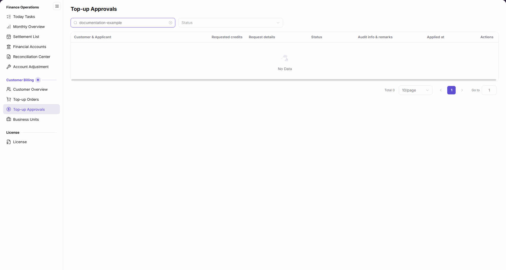

# Top-up Approvals

::: info Document Information
Version: v2.0
Updated: 2026-11-05
:::

## Feature Overview

| Item | Content |
| --- | --- |
| Applicable Role | Operations administrator |
| Navigation path | Billing > Customer Billing > Top-up Approvals |
| Page route | `/billing/customers/top-ups/approvals` |
| Managed objects | Customer top-up requests and their audit information |

`Top-up Approvals` provides customer name and status filters to locate top-up requests and review requested credits, request details, audit information, and remarks.

#### Beginner Explanation

Top-up Approvals is like a request register: identify the customer and status to query, then read the matching request information.

#### Terms Quick Reference

| Term | Description |
| --- | --- |
| Requested credits | The number of credits requested in a top-up request. |
| Audit info & remarks | The list column for audit information and remarks. |

## Prerequisites

1. You are signed in and can open `Billing > Customer Billing > Top-up Approvals` from the sidebar.
2. Have the customer name ready when querying by customer.

## Page Description

| Area | Description |
| --- | --- |
| Filters | Above the list, with a `Customer name` input and a `Status` dropdown. |
| Request list | Seven columns: `Customer & Applicant`, `Requested credits`, `Request details`, `Status`, `Audit info & remarks`, `Applied at`, and `Actions`. |
| Pagination | Shows the total for the current query, page size, and page number. |

The figure shows the Top-up Approvals list after entering `documentation-example` as the customer name: the status selector remains available, and `No Data` and `Total 0` apply only to the current query scope.

## Main Operations

### Query by Customer Name

1. Go to `Billing > Customer Billing > Top-up Approvals`.
2. Enter the name to find in `Customer name`; for example, enter `documentation-example` to view results for that example name.
3. Read the list and total to check whether records are returned for the current name condition.

### Narrow the Scope by Status

1. Open the `Status` dropdown above the list.
2. Select the status you need from the options currently offered by the interface.
3. Read the results together with the `Customer name` condition and check the `Status` column.

### Review Request Information

1. Check `Customer & Applicant` first to identify the request being read.
2. Read `Requested credits`, `Request details`, `Status`, `Audit info & remarks`, and `Applied at` in the same row.
3. If the list is empty, check the current customer name and status conditions first; do not interpret this as no requests for all customers.

## Parameter Quick Reference

The table distinguishes query inputs from list display items; display items require no input.

| Field Name | Required | Field Type | Example | Description |
| --- | --- | --- | --- | --- |
| Customer name | No | Text filter | `documentation-example` | Enter the customer name to query. |
| Status (filter) | No | Dropdown filter | Current UI options | Select a status to narrow the query scope. |
| Customer & Applicant | Not applicable (display item) | List column | — | Identify the customer and applicant for the request. |
| Requested credits | Not applicable (display item) | List column | — | Read the number of credits requested. |
| Request details | Not applicable (display item) | List column | — | Read the request description. |
| Status | Not applicable (display item) | List column | — | Check the request status. |
| Audit info & remarks | Not applicable (display item) | List column | — | Read audit information and remarks. |
| Applied at | Not applicable (display item) | List column | — | Check the application time. |
| Actions | Not applicable (display item) | List column | — | The action area for a record row. |

## Pitfalls

- `Customer name` and `Status` are query conditions; the `Status` column displays a request's status. Distinguish the filter from the result field.
- `Total 0` after entering `documentation-example` applies to that query scope, not to the total requests across all customers.

## Result Validation

| Check Item | Success Signal | If Abnormal |
| --- | --- | --- |
| Page location | The page displays `Top-up Approvals`, with `Customer name` and `Status` filters. | Locate the page again through `Customer Billing > Top-up Approvals`. |
| List fields | The headers include Customer & Applicant, Requested credits, Request details, Status, Audit info & remarks, Applied at, and Actions. | Check that you opened Top-up Approvals rather than Top-up Orders. |
| Empty-result scope | The example name `documentation-example` returns `No Data` and `Total 0`. | Check the name and status conditions before drawing conclusions about other customers. |

## FAQ

#### Does an Empty Result Mean That No Customers Have Top-up Requests?

**Symptom:**

After entering `documentation-example` as the customer name, the list shows `No Data` and `Total 0`.

**Possible Causes:**

The current result is restricted by the customer name and status conditions; its scope is not all customers.

**Resolution:**

Check the name input and status selection, change the query conditions as needed, and read the list for that scope. Do not infer that all customers have no requests from an empty result for one name.

## Notes

- Requested credits, approval status, and credited funds are different information. Do not treat the request list or an empty result as proof that funds were credited.
- The operations described here cover queries and list review only, not submission steps for approval, rejection, or other fund processing.

## Next Steps

1. To review customer information, see [Customer Overview](../customer-overview/).
2. To query top-up orders, see [Top-up Orders](../top-up-orders/).
