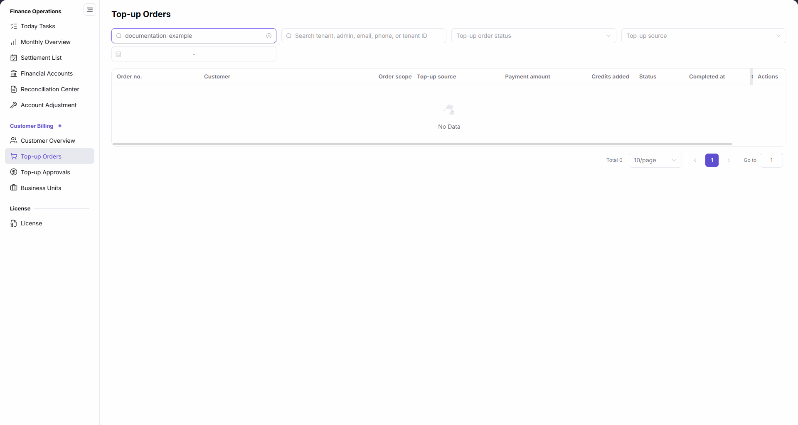

# Top-up Orders

::: info Document Information
Version: v2.1
Updated: 2026-11-05
:::

## Feature Overview

| Item | Content |
| --- | --- |
| Applicable Role | Operations personnel with access to Top-up Orders |
| Navigation path | Billing > Customer Billing > Top-up Orders |
| Page route | `/billing/customers/top-ups/orders` |
| Managed objects | Customer top-up orders, order scope, top-up source, payment amount, credits added, and status |

Use this page to locate top-up orders by order number, customer identity, status, source, and time range, then review amounts, credits added, and timestamps. Access approvals separately through [Top-up Approvals](../top-up-approvals/).

#### Beginner Explanation

Top-up Orders works like a top-up ledger: locate the order first, then review the original-currency amount, credits added, and order status separately.

#### Terms Quick Reference

| Term | Description |
| --- | --- |
| Order no. | Identifier used to locate a top-up order. |
| Order scope | The order's scope displayed in the table. |
| Top-up source | Source information in the table, also available as a filter. |
| Payment amount | Payment amount displayed in the order's original currency. |
| Credits added | The credited quantity in credits, reviewed separately from the original-currency amount. |

## Prerequisites

1. Sign in to the platform and ensure you can access `Billing > Customer Billing > Top-up Orders`.
2. Prepare the target order number or customer identity and confirm the customer scope you are authorized to view.
3. A matching order record is needed to open its row-level details; do not create a top-up or adjust a balance for a query.

## Page Description

| Area | Description |
| --- | --- |
| Order-number input | Placeholder: `Enter order no.` |
| Customer-identity input | Placeholder: `Search tenant, admin, email, phone, or tenant ID` |
| Status filter | `Top-up order status` dropdown. |
| Source filter | `Top-up source` dropdown. |
| Time range | A date-range control limits the query range. |
| Results and pagination | Displays matching records, total count, and pagination controls. |

| Area | Description |
| --- | --- |
| Order no. | Top-up order identifier. |
| Customer | Corresponding customer identity. |
| Order scope | Scope to which the order belongs. |
| Top-up source | Source of the top-up order. |
| Payment amount | Original-currency amount; do not interpret all orders as CNY. |
| Credits added | Credited quantity in credits, not the same value as Payment amount. |
| Status | Current order status. |
| Completed at | Order completion time. |
| Created at | Order creation time. |
| Actions | When records are available, open `Details` for the corresponding row. |

The figure shows the empty results for `documentation-example` in the order-number input, with `No Data` and `Total 0`, and visible order scope, top-up source, payment amount, credits added, and completion time. `Created at` is outside the readable area in this view; scroll the table horizontally to inspect it rather than treating its absence from the figure as an absent field.

## Main Operations

### Find Top-up Orders

1. Go to `Billing > Customer Billing > Top-up Orders`.
2. Enter the target order number in `Enter order no.`, or enter customer identity information in `Search tenant, admin, email, phone, or tenant ID`.
3. Select `Top-up order status`, `Top-up source`, and a time range as needed, then review the list results.
4. If `No Data` and `Total 0` appear, review and adjust the current inputs, status, source, and time range.

### View Top-up Order Details

1. When matching records are available, verify the target row's `Order no.`, `Customer`, `Order scope`, and `Top-up source` first.
2. Read the original-currency `Payment amount` and `Credits added` separately, then check `Status`, `Completed at`, and `Created at`; scroll the table horizontally if the timestamp columns are outside the visible area.
3. Click the target row's `Details` entry to review the order information, status, amount, and time.
4. To review the customer balance, open [Customer Overview](../customer-overview/) and locate the same customer; do not infer the current balance solely from the order amount.

### Open Top-up Approvals

1. For approval work, open the separate `Top-up Approvals` page from the `Customer Billing` menu.
2. Follow [Top-up Approvals](../top-up-approvals/) to review the approval object and operation boundaries; do not treat order queries and approvals as the same workflow.

## Parameter Quick Reference

| Field Name | Required | Field Type | Example | Description |
| --- | --- | --- | --- | --- |
| Enter order no. | No | Text | `<order-number>` | Order-number query input. |
| Search tenant, admin, email, phone, or tenant ID | No | Text | `documentation-example` | Combined customer-identity query input. |
| Top-up order status | No | Dropdown | `<order-status>` | Filters by order status. |
| Top-up source | No | Dropdown / list text | `<top-up-source>` | Filters and displays the order source. |
| Time range | No | Date range | `<start-date> - <end-date>` | Limits the query time range. |
| Order no. | Read-only | Text | `<order-number>` | Order identifier in the list. |
| Customer | Read-only | Customer information | `<customer>` | Corresponding customer identity. |
| Order scope | Read-only | Scope information | `<order-scope>` | Scope to which the order belongs. |
| Payment amount | Read-only | Original-currency amount | `<currency> <amount>` | Review in the order's original currency. |
| Credits added | Read-only | Credits | `0` | Review separately from the original-currency amount. |
| Status | Read-only | Status value | `<status>` | Current order status. |
| Completed at | Read-only | Time | `<completion-time>` | Order completion time. |
| Created at | Read-only | Time | `<creation-time>` | Order creation time. |
| Details | Not applicable | Row-level entry | `Details` | When records are available, open the target order to review its information. |

## Pitfalls

- `Payment amount` and `Credits added` are different columns: the former uses the order's original currency, while the latter uses credits. Do not give them a common currency or assume equal values.
- `Order scope` and `Top-up source` are different dimensions; review both when locating an order.
- `Completed at` and `Created at` are separate fields and are not interchangeable.
- Access approvals through the separate `Top-up Approvals` menu; do not treat an order's `Status` as an approval action.

## Result Validation

| Check Item | Success Signal | If Abnormal |
| --- | --- | --- |
| Query object | Order-number and customer-identity inputs match the target object | Review or adjust the corresponding inputs. |
| Empty results | No matching records display `No Data` and `Total 0` | Review order number, customer identity, status, source, and time range individually. |
| Amount basis | Original-currency payment amount and credits added are read separately | Recheck both columns in the target row; do not treat them as the same value. |
| Time basis | Completion and creation times are reviewed separately | Scroll the table horizontally if timestamp columns are outside the visible area. |

## FAQ

#### Why Does the List Display No Data?

**Symptom:** The table displays `No Data` and a count of `Total 0`.

**Possible Causes:** No records match the current query conditions.

**Resolution:** Review order number, customer identity, status, source, and time range, then adjust the conditions as needed.

#### Why Do Payment Amount and Credits Added Use Different Units?

**Symptom:** `Payment amount` uses the order currency, while `Credits added` uses credits.

**Possible Causes:** The columns represent original-currency payment and credited quantity respectively, not a single measurement field.

**Resolution:** Record each column with its unit and review it alongside order status and timestamps; do not directly compare the numbers for equality.

## Notes

- Use this page to query and review orders; open [Top-up Approvals](../top-up-approvals/) for approvals.
- If an amount or status is in doubt, review the order and customer scope first; do not use repeated top-ups or manual adjustments to test the result.
- Use customer identities and order information only within authorized business scope. Share only information needed for investigation, without credentials or unrelated customer data.

## Next Steps

- Open [Customer Overview](../customer-overview/) to review the target customer's balance and information.
- Open [Top-up Approvals](../top-up-approvals/) for the separate approval workflow.
