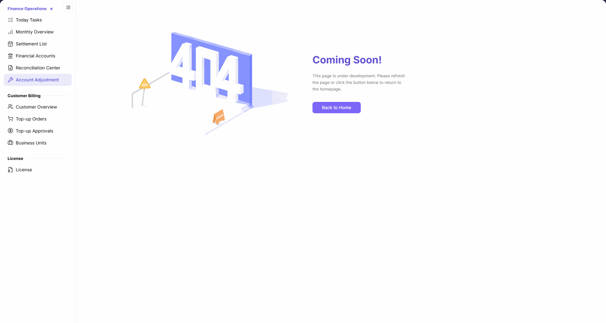

# Account Adjustment

::: info Document Information
Version: v2.1
Updated: 2026-11-05
:::

## Feature Overview

| Item | Content |
| --- | --- |
| Applicable Role | Operations administrator |
| Navigation path | Billing > Finance Operations > Account Adjustment |
| Page route | `/billing/admin/account-adjustments` |
| Managed objects | Current availability of the Account Adjustment page |

`Account Adjustment` currently displays an under-development notice rather than an adjustment input form. This page explains how to identify the notice and use the sidebar to continue with billing queries.

#### Beginner Explanation

The current page is like a service counter that has not opened yet: you can check its status, but cannot process an adjustment here.

#### Terms Quick Reference

| Term | Description |
| --- | --- |
| Under-development notice | The `Coming Soon!` message displayed on the page. |
| Back to Home | The page's link to the platform homepage. |

## Prerequisites

1. You are signed in and can open `Billing > Finance Operations > Account Adjustment` from the sidebar.
2. To continue with billing queries, identify whether you need account information or settlement statements.

## Page Description

| Area | Description |
| --- | --- |
| Sidebar | Retains Finance Operations, Customer Billing, and other page entries for navigating to other billing pages. |
| Status notice | Displays `Coming Soon!`. |
| Explanatory message | Displays `This page is under development. Please refresh the page or click the button below to return to the homepage.` |
| Return entry | The `Back to Home` link points to the platform homepage. |

The figure shows the current Account Adjustment page: the main area displays `Coming Soon!` and the under-development message, with `Back to Home` below and the billing sidebar retained.

## Main Operations

### Open the Page and Identify Its Status

1. Go to `Billing > Finance Operations > Account Adjustment`.
2. Read the `Coming Soon!` notice in the main area.
3. Check the message `This page is under development. Please refresh the page or click the button below to return to the homepage.` This is an under-development page, not an empty adjustment-record list.

### Continue to Available Billing Query Pages

1. To review account information, click `Financial Accounts` under `Finance Operations` in the sidebar.
2. To query settlement statements, click `Settlement List` in the same menu group.
3. Follow the corresponding page manual for queries; these queries do not constitute a completed adjustment.

## Parameter Quick Reference

The current page has no input form. The following are display items and a navigation entry, not adjustment input parameters.

| Field Name | Required | Field Type | Example | Description |
| --- | --- | --- | --- | --- |
| Status notice | Not applicable (display item) | Notice text | `Coming Soon!` | Indicates that the current page is under development. |
| Explanatory message | Not applicable (display item) | Explanatory text | `This page is under development. Please refresh the page or click the button below to return to the homepage.` | The page's instructions about refreshing or returning to the homepage. |
| Back to Home | Not applicable (navigation entry) | Link | `Back to Home` | Points to the platform homepage; it is not an adjustment submission button. |

## Pitfalls

- The under-development notice is an explicit message in the main page area, not an empty result after filtering adjustment records.
- `Back to Home` is a navigation entry, not a save, evaluation, or adjustment submission action.

## Result Validation

| Check Item | Success Signal | If Abnormal |
| --- | --- | --- |
| Page location | You open the page through `Finance Operations > Account Adjustment`. | Locate it again through the sidebar. |
| Status identification | The main area displays `Coming Soon!` and the under-development message. | Check that you are still on Account Adjustment; do not treat another page's status as an adjustment result. |
| Follow-up query entries | `Financial Accounts` and `Settlement List` are visible under `Finance Operations` in the sidebar. | Select the query page you need from the sidebar. |

## FAQ

#### Why Is There No Adjustment Form After Opening the Page?

**Symptom:**

After opening Account Adjustment, the main area displays `Coming Soon!` without an adjustment input form.

**Possible Causes:**

The page explicitly states: `This page is under development. Please refresh the page or click the button below to return to the homepage.`

**Resolution:**

To review existing billing information, open `Financial Accounts` or `Settlement List` from the sidebar. Do not interpret the under-development notice as the result of a submitted adjustment.

## Notes

- The current page is not evidence that an adjustment was evaluated, submitted, or applied.
- Billing queries review existing information rather than correct funds. Do not record navigation to another page as a completed adjustment.

## Next Steps

1. See [Financial Accounts](../financial-accounts/) to continue querying account information.
2. See [Settlement List](../settlement-list/) to continue reviewing settlement statements.
