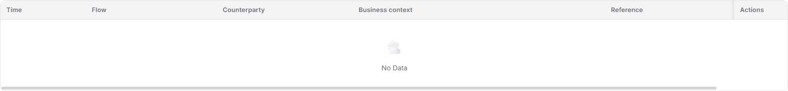

# Financial Accounts

::: info Document Information
Version: v2.1
Updated: 2026-11-05
:::

## Feature Overview

| Item | Content |
| --- | --- |
| Applicable Role | Operations administrator |
| Navigation path | Billing > Finance Operations > Financial Accounts |
| Page route | `/billing/admin/financial-accounts` |
| Managed objects | Platform clearing account, platform revenue account, live balances, billing-cycle statistics, and transactions |

Use this page to switch between two platform accounts, read live balances and clearing or revenue statistics for a selected billing cycle, and inspect transactions.

#### Beginner Explanation

The clearing account is a funds-in-transit pool, while the revenue account collects platform retained revenue; read live balances separately from billing-cycle statistics.

#### Terms Quick Reference

| Term | Description |
| --- | --- |
| Platform Clearing Account | Customer spend in credits lands here in real time; settlement execution pays tenants from this account and transfers the platform retained fee to the revenue account. |
| Platform Revenue Account | Retained fee lands here after posting confirmation; this page focuses on revenue collection and statistical trends. |
| Ledger balance | Account balance marked “Live”, not the selected billing cycle's net inflow. |
| Billing Cycle view | Clearing or revenue statistics for the selected billing cycle. |
| Transactions | Records for checking fund flow, counterparties, business context, and references. |

## Prerequisites

1. The current account can access `Billing > Finance Operations > Financial Accounts`.
2. Identify the platform account and billing cycle to inspect.
3. Before comparing Settlement List or Monthly Overview, distinguish live balances from billing-cycle statistics.

## Page Description

The menu is named `Financial Accounts`, while the content heading is `Platform Accounts`. Two button tabs, `Platform Clearing Account` and `Platform Revenue Account`, switch content on the same page; this is not an account-list-to-account-details workflow.

| Area | Description |
| --- | --- |
| Account tabs | Switch between the platform clearing and revenue accounts. |
| Ledger balance | Displays credits with a “Live” marker. |
| Billing Cycle view | Contains Billing Cycle selection and Refresh; the clearing account shows “Clearing queue” and the revenue account shows “Revenue”. |
| Clearing queue | Shows “To settle to Providers” and “Retained fee to transfer”. |
| Revenue | Shows “Pending credit”, “Retained fee”, “PowerOne self”, and “Statistical revenue total”. |
| Revenue account trend | Shows “Last 12 Billing Cycles” for Retained fee, PowerOne self, and Statistical revenue total, plus “Cumulative statistical revenue”. |
| Transactions | Contains Direction and Source system filters, the transaction table, and pagination. |

The transaction columns are `Time`, `Flow`, `Counterparty`, `Business context`, `Reference`, `Amount`, and `Actions`, in that order. The filters are `Direction` (Credit or Debit) and `Source system`; counterparties and references are result content, not tenant or transaction-number filter fields.

## Main Operations

### View Platform Clearing Account

1. Go to `Billing > Finance Operations > Financial Accounts`.
2. Click `Platform Clearing Account` and read the funds-in-transit description.
3. Read `Ledger balance`, marked “Live”.
4. Select the target `Billing Cycle` in `Billing Cycle view` and click `Refresh`.
5. Check `To settle to Providers` and `Retained fee to transfer`, then inspect Transactions on the same page.

### View Platform Revenue Account

1. Click `Platform Revenue Account`.
2. Read the live `Ledger balance` and the retained-fee posting description.
3. Select the target `Billing Cycle` and click `Refresh`.
4. Read `Pending credit`, `Retained fee`, `PowerOne self`, and `Statistical revenue total` separately.
5. Review the `Revenue account trend` legends for `Last 12 Billing Cycles` and `Cumulative statistical revenue`; do not treat statistical revenue as the live account balance.

### Query and Inspect Transactions

1. Stay on the target account tab and confirm the billing cycle shown in Transactions.
2. Select `Direction` (`Credit` or `Debit`) and `Source system` as needed.
3. Check Time, Flow, Counterparty, Business context, Reference, and Amount; use pagination when multiple pages are available.
4. When records are present and `Details` appears under `Actions`, open the target transaction and compare the displayed information with its list row to inspect fund and business clues.
5. Close details after the read-only inspection; viewing details does not complete settlement, posting confirmation, or any fund submission.

The figure shows the empty transaction table with Credit selected, its currently visible column headings, and “No Data”; only the table element is shown. `Amount` is outside the readable area in this view; scroll the table horizontally to inspect it. The parameter table defines all seven columns.

## Parameter Quick Reference

| Field Name | Required | Field Type | Example | Description |
| --- | --- | --- | --- | --- |
| Platform Clearing Account / Platform Revenue Account | Select as needed | Button tabs | Platform Clearing Account | Switch account content on the same page. |
| Ledger balance | Read-only | Amount | 0.00 credits | Marked “Live”; read separately from billing-cycle statistics. |
| Billing Cycle | Select for inspection | Month | 2026-11 | Defines the scope of Billing Cycle view and Transactions. |
| Refresh | As needed | Button | Refresh | Use after selecting a billing cycle. |
| To settle to Providers / Retained fee to transfer | Read-only | Amount | 0.00 credits | The two amounts in Clearing queue. |
| Pending credit | Read-only | Amount | 0.00 credits | Pending amount displayed in Revenue. |
| Retained fee / PowerOne self / Statistical revenue total | Read-only | Statistical amount | 0.00 credits | Read revenue components and total separately. |
| Last 12 Billing Cycles / Cumulative statistical revenue | Read-only | Trend and statistical amount | 0.00 credits | Trend period range and cumulative statistical value. |
| Direction | No | Select | Credit / Debit | Filters transactions by fund direction. |
| Source system | No | Select | Select a displayed option | Filters transactions by source system. |
| Time / Flow / Counterparty | Read-only | Transaction columns | — | Inspect record time, fund flow, and counterparty. |
| Business context / Reference | Read-only | Transaction columns | — | Locate business clues and related references. |
| Amount | Read-only | Transaction amount | 0.00 credits | Inspect with direction; do not substitute statistical revenue. |
| Details | As needed when records exist | Row action | Details | Read-only inspection of the transaction. |

## Pitfalls

- `Ledger balance` is marked “Live”, while `Billing Cycle view` identifies the selected cycle; these are not the same scope.
- `Statistical revenue total`, `Cumulative statistical revenue`, and live balance are separate displayed items, not interchangeable values.
- “No Data” with Credit selected describes only the current account, cycle, and filters; it does not establish a zero balance or an absence of Debit transactions.

## Result Validation

| Check Item | Success Signal | If Abnormal |
| --- | --- | --- |
| Account selection | The selected platform account name and description are displayed. | Check the selected account tab. |
| Statistical scope | Ledger balance is marked “Live” and Billing Cycle view shows the target cycle. | Read the scopes separately and check the cycle selection. |
| Transaction scope | The cycle, Direction, and Source system can be checked; the table shows records or “No Data”. | Check the selected conditions before drawing account-wide conclusions. |
| Transaction details | When records exist, Details supports inspection of the target transaction. | Return to the list and identify the target row; do not treat viewing as completion of a fund operation. |

## FAQ

#### Why Should Billing-Cycle Statistics Not Be Used Directly as the Live Balance?

**Symptom:** The page displays both “Ledger balance” and “Billing Cycle view”.

**Possible Causes:** The former is explicitly marked “Live”, while the latter uses the selected cycle; the revenue view also separates statistical and cumulative statistical revenue.

**Resolution:** Distinguish the account, live balance, and statistical scope first, then inspect the corresponding cycle's transactions without substituting statistics for balance.

#### What Does “No Data” Mean with Credit Selected?

**Symptom:** The table retains its column headings but contains no records.

**Possible Causes:** The displayed result is empty under the selected account, billing cycle, Direction, and Source system conditions.

**Resolution:** Check those conditions; do not extend the result to other directions or the entire account.

## Notes

- These instructions cover viewing and inspection; opening details does not replace posting confirmation or settlement execution.
- Confirm the account, billing cycle, fund direction, and business references separately rather than drawing conclusions from a single summary value.
- Do not publish real billing amounts, account identifiers, or customer data in documentation; amount examples use 0.

## Next Steps

1. Open [Settlement List](../settlement-list/) to inspect settlement documents.
2. Open [Monthly Overview](../monthly-overview/) to review billing-cycle totals.
3. Open [Reconciliation Center](../reconciliation-center/) for bilateral ledger, rounding, and compensation checks.
