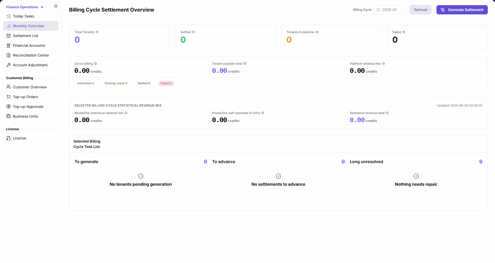

# Monthly Overview

::: info Document Information
Version: v2.1
Updated: 2026-11-05
:::

## Feature Overview

| Item | Content |
| --- | --- |
| Applicable Role | Operations administrator |
| Navigation path | Billing > Finance Operations > Monthly Overview |
| Page route | `/billing/admin/provider-settlements/monthly-overview` |
| Managed objects | Billing-cycle tenant settlement statistics, amount summaries, statistical revenue mix, and task list |

`Monthly Overview` lets you select a billing cycle and refresh statistics to review tenant settlement states, Gross billing, Tenant payable total, Platform retained fee, statistical revenue mix, and pending tasks, then open settlement generation.

#### Beginner Explanation

Monthly Overview is like a billing-cycle monthly report: select a month and click Refresh, read counts, amounts, and tasks, and then choose where to check details.

#### Terms Quick Reference

| Term | Description |
| --- | --- |
| Billing Cycle | The month used for this page's statistics; click Refresh after changing it. |
| Tenant settlement statistics | The four cards: Total Tenants, Settled, Tenants in pipeline, and Failed. |
| Selected billing cycle statistical revenue mix | ModelOne statistical retained fee, PowerOne self-operated AI Infra, and Statistical revenue total. |
| Selected Billing Cycle Task List | Counts and corresponding messages for To generate, To advance, and Long unresolved. |

## Prerequisites

1. The current account can access `Finance Operations > Monthly Overview`.
2. Identify the settlement month to query.
3. Before continuing to settlement generation, confirm the target billing cycle, tenants, and billing data scope, and prepare the required operation basis.

## Page Description

The Chinese content title is `月结总览`. The English menu is `Monthly Overview`, while the main content title is `Billing Cycle Settlement Overview`.

The figure shows the empty result after selecting billing cycle 2025-01 and clicking Refresh: all four statistic cards, amounts, and task counts are 0, with corresponding empty-state messages in the task list.

| Area | Description |
| --- | --- |
| Billing Cycle and Refresh | Select or enter a month, then click Refresh to load its statistics; changing the month alone does not load the corresponding statistics. |
| Generate Settlement | Opens the settlement generation page; does not indicate generation or receipt of funds. |
| Four statistic cards | Displays Total Tenants, Settled, Tenants in pipeline, and Failed counts. |
| Amount summary and states | Displays Gross billing, Tenant payable total, Platform retained fee, and counts for Generated, Posting check, Settled, and Failed. |
| Selected billing cycle statistical revenue mix | Displays the Updated time, ModelOne statistical retained fee, PowerOne self-operated AI Infra, and Statistical revenue total. |
| Selected Billing Cycle Task List | Displays To generate, To advance, and Long unresolved. Empty results show “No tenants pending generation”, “No settlements to advance”, and “Nothing needs repair”, respectively. |

## Main Operations

### Select a Billing Cycle and Read Statistics

1. Go to `Billing > Finance Operations > Monthly Overview`.
2. Select or enter the target month in `Billing Cycle`, for example `2025-01`.
3. Click **"Refresh"** to load statistics for that month; do not read the old statistics immediately after changing the input alone.
4. Read the four statistic cards: `Total Tenants`, `Settled`, `Tenants in pipeline`, and `Failed`.
5. Check `Gross billing`, `Tenant payable total`, and `Platform retained fee`, then read the `Generated`, `Posting check`, `Settled`, and `Failed` counts.
6. Review the revenue mix update time, `ModelOne statistical retained fee`, `PowerOne self-operated AI Infra`, and `Statistical revenue total`. All amounts use `credits`.
7. Read `To generate`, `To advance`, and `Long unresolved` counts and messages in the task list. In the empty-result example, all three are `0` with their respective empty-state messages.

### Open Settlement Generation

1. Confirm that the target billing cycle is selected and **"Refresh"** has been clicked.
2. Check the four statistic cards, amount summary, and task list to identify the scope to continue processing.
3. Click **"Generate Settlement"** to open the settlement generation page.
4. Continue with the four-step generation flow in [Settlement List](../settlement-list/). This page's button only opens the entry; it does not indicate successful generation, completed settlement, or receipt of funds.

## Parameter Quick Reference

| Field Name | Required | Field Type | Example | Description |
| --- | --- | --- | --- | --- |
| Billing Cycle | Yes | Month | `2025-01` | Set the query month, then click Refresh. |
| Refresh | Operation entry | Button | Refresh | Loads statistics for the selected billing cycle. |
| Total Tenants | Displayed by system | Number | `0` | Tenants included in the selected billing-cycle statistics. |
| Settled | Displayed by system | Number | `0` | Settled tenants in the four statistic cards. |
| Tenants in pipeline | Displayed by system | Number | `0` | Tenants pending processing in the selected billing cycle. |
| Failed | Displayed by system | Number | `0` | Failed count in the four statistic cards. |
| Gross billing | Displayed by system | Amount | `0.00 credits` | Total customer consumption for the selected billing cycle. |
| Tenant payable total | Displayed by system | Amount | `0.00 credits` | Total amount payable to tenants for the selected billing cycle. |
| Platform retained fee | Displayed by system | Amount | `0.00 credits` | Platform retained fee in the amount summary. |
| Generated / Posting check / Settled / Failed | Displayed by system | Number | `0` | Corresponding settlement state counts below the amount summary; read separately from tenant statistic cards. |
| ModelOne statistical retained fee | Displayed by system | Amount | `0.00 credits` | The ModelOne item in the selected billing cycle statistical revenue mix. |
| PowerOne self-operated AI Infra | Displayed by system | Amount | `0.00 credits` | The PowerOne self-operated AI Infra item in the selected billing cycle statistical revenue mix. |
| Statistical revenue total | Displayed by system | Amount | `0.00 credits` | Total in the selected billing cycle statistical revenue mix. |
| To generate | Displayed by system | Number | `0` | Tenants pending generation in the task list; empty state: “No tenants pending generation”. |
| To advance | Displayed by system | Number | `0` | Settlements to advance in the task list; empty state: “No settlements to advance”. |
| Long unresolved | Displayed by system | Number | `0` | Long-unresolved count in the task list; empty state: “Nothing needs repair”. |
| Generate Settlement | Operation entry | Button | Generate Settlement | Opens the settlement generation page; see Settlement List for subsequent steps. |

## Pitfalls

- Changing `Billing Cycle` alone does not load its statistics; click `Refresh` afterward.
- The four tenant statistic cards and the settlement state counts below the amount summary are separate areas; do not treat them as one set of counts.
- `ModelOne statistical retained fee` belongs to the revenue mix; distinguish it from `Platform retained fee` in the amount summary by their respective labels.
- `Generate Settlement` only opens the generation flow. It is not a success message or proof of receipt of funds.

## Result Validation

| Check Item | Success Signal | If Abnormal |
| --- | --- | --- |
| Billing-cycle loading | The month has been confirmed and Refresh clicked before reading statistics | Recheck the month and click Refresh |
| Empty result | In the 2025-01 example, all four statistic cards and amounts are 0, with three task-list empty-state messages | Check the cycle and whether Refresh was clicked; do not interpret an empty state as generation failure |
| Statistical scope | Tenant statistics, amounts, revenue mix, and task list have been read separately | Recheck area names and field labels |
| Generation entry | Generate Settlement opens the generation page | Continue checking the entry through Settlement List; opening the page does not mean generation is complete |

## FAQ

#### Why Do Statistics Not Change When the Billing-Cycle Input Changes?

**Symptom:** The billing-cycle input has changed, but statistics are not yet the target month's result.

**Possible Causes:** This page requires Refresh to load the selected billing cycle's statistics; changing the month alone does not trigger the corresponding statistics load.

**Resolution:** Check Billing Cycle, click Refresh, and then read the statistic cards, amounts, and task list.

#### Why Does the Task List Show No Pending Items?

**Symptom:** Task counts are 0, with “No tenants pending generation”, “No settlements to advance”, and “Nothing needs repair”.

**Possible Causes:** These are empty-result messages for the selected billing-cycle task list; the 2025-01 empty-result example shows this state.

**Resolution:** Confirm the selected month and that Refresh was clicked, then read the result for that cycle. Do not treat an empty state as evidence of generation failure or completed receipt of funds.

## Notes

- Confirm billing cycle, tenant scope, and amounts before continuing to settlement generation, and retain the required operation basis.
- Do not infer receipt of funds from overview amounts alone; check settlement details and account transactions.
- Follow data access and confidentiality requirements when sharing billing information. Do not put customer data or credentials in public materials.

## Next Steps

1. Open [Settlement List](../settlement-list/) to continue the four-step generation flow or check settlement records.
2. Open [Financial Accounts](../financial-accounts/) to check platform accounts and transactions.
3. Open [Reconciliation Center](../reconciliation-center/) for billing reconciliation information.
4. Open [Today Tasks](../today-tasks/) to return to the daily settlement and account summary.
