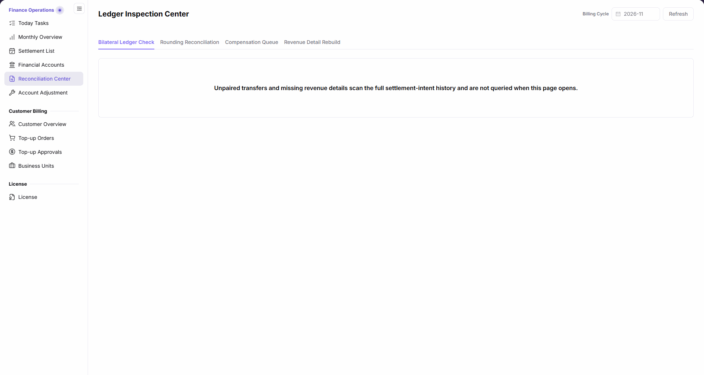
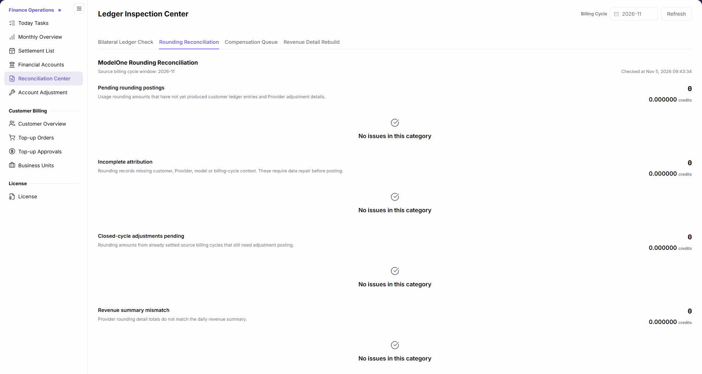
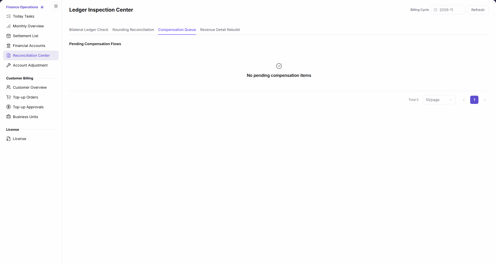
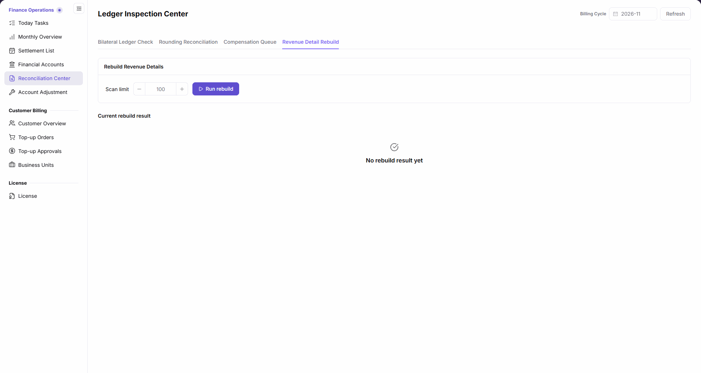

# Reconciliation Center

::: info Document Information
Version: v2.1
Updated: 2026-11-05
:::

## Feature Overview

| Item | Content |
| --- | --- |
| Applicable Role | Operations administrator |
| Navigation path | Billing > Finance Operations > Reconciliation Center |
| Page route | `/billing/admin/reconciliation` |
| Managed objects | Bilateral ledger checks, rounding reconciliation, compensation queue, and revenue detail rebuild |

Four tabs provide ledger checks, rounding categories, pending compensation flows, and the revenue detail rebuild entry.

#### Beginner Explanation

Reconciliation Center is a billing health-check desk: each tab checks different issues, so an empty result in one category cannot stand in for all checks.

#### Terms Quick Reference

| Term | Description |
| --- | --- |
| Bilateral Ledger Check | Inspects unpaired transfers and missing revenue details across the full settlement-intent history. |
| Rounding Reconciliation | Shows five ModelOne rounding check categories with counts and amounts. |
| Compensation Queue | Shows pending compensation flows. |
| Revenue Detail Rebuild | Provides a scan limit and a rebuild action, with results displayed separately. |
| Source billing cycle window | The source cycle window identified by rounding reconciliation results. |

## Prerequisites

1. The current account can access `Billing > Finance Operations > Reconciliation Center`.
2. Identify the check category and billing cycle, with related account transactions or settlement statements available for comparison.
3. Before running a revenue detail rebuild, confirm authorization, scan scope, and scan limit; read-only inspection does not require running a rebuild.

## Page Description

The menu is named `Reconciliation Center`, while the content heading is `Ledger Inspection Center`. `Billing Cycle` and `Refresh` appear at the top, followed by four button tabs in order.

| Area | Description |
| --- | --- |
| Bilateral Ledger Check | Displays “Unpaired transfers and missing revenue details scan the full settlement-intent history and are not queried when this page opens.” |
| Rounding Reconciliation | Shows “ModelOne Rounding Reconciliation”, source cycle window, checked time, and five categories with counts and six-decimal credits amounts. |
| Compensation Queue | Shows “Pending Compensation Flows”; the empty state is “No pending compensation items”. |
| Revenue Detail Rebuild | Shows “Rebuild Revenue Details”, Scan limit, Run rebuild, and Current rebuild result; the empty state is “No rebuild result yet”. |

The five rounding checks have the following meanings, as described on the page:

| Area | Description |
| --- | --- |
| Pending rounding postings | Usage rounding amounts that have not yet produced customer ledger entries and Provider adjustment details. |
| Incomplete attribution | Rounding records missing customer, Provider, model or billing-cycle context. These require data repair before posting. |
| Closed-cycle adjustments pending | Rounding amounts from already settled source billing cycles that still need adjustment posting. |
| Revenue summary mismatch | Provider rounding detail totals do not match the daily revenue summary. |
| Posting amount mismatch | Raw rounding amounts, two-decimal ledger entries, carry-forward values and Provider details do not reconcile. |

## Main Operations

### View Bilateral Ledger Check

1. Go to `Billing > Finance Operations > Reconciliation Center` and click `Bilateral Ledger Check`.
2. Read the full-history scan notice; results are not queried automatically when the page opens, so the absence of an initial result table does not mean there are no exceptions.
3. Check the billing cycle at the top, but do not interpret it as restricting unpaired-transfer and missing-revenue-detail scans to that cycle.
4. When query results are available, review unpaired transfers and missing revenue details separately; use Financial Accounts and Settlement List for further inspection, without treating a tab switch as a completed query.

The figure shows the full-history scan notice on Bilateral Ledger Check, stating that opening the page no longer queries results automatically; this view provides no exception-query conclusion.

### View Rounding Reconciliation

1. Click `Rounding Reconciliation` and check `Billing Cycle` at the top; use `Refresh` when you need to reload.
2. Read `Source billing cycle window` and `Checked at` under `ModelOne Rounding Reconciliation`.
3. Inspect counts and amounts separately for Pending rounding postings, Incomplete attribution, Closed-cycle adjustments pending, Revenue summary mismatch, and Posting amount mismatch.
4. If a category displays `No issues in this category`, record a conclusion only for that category and displayed scope; retain six-decimal credits precision rather than equating it with two-decimal transaction amounts.

The figure shows the upper part of ModelOne Rounding Reconciliation with the first four checks, their counts, six-decimal credits amounts, and “No issues in this category”, with the source cycle window and checked time above. The fifth check, `Posting amount mismatch`, is farther down the page; scroll down to review it rather than checking only the four categories visible here.

### View Compensation Queue

1. Click `Compensation Queue`.
2. Review `Pending Compensation Flows` and the total count; use pagination when multiple pages are available.
3. If `No pending compensation items` appears, record the current queue's empty state without extending it to bilateral or rounding checks.

The figure shows “Pending Compensation Flows” with “No pending compensation items” and pagination, not failure reasons, retry counts, or successful processing results.

### View the Revenue Detail Rebuild Entry and Results

1. Click `Revenue Detail Rebuild`.
2. Inspect `Scan limit`; the numeric input defaults to `100`.
3. Locate `Run rebuild`; do not click it when only viewing parameters and results. Confirm authorization and scan scope before any required execution.
4. Review `Current rebuild result`; `No rebuild result yet` does not establish whether historical revenue details are complete.
5. If result records exist, inspect their completion time, scan limit, scanned, generated, and skipped counts for that run; read these fields only when results exist, without treating an empty state as rebuild success.

The figure shows the default scan limit of 100, Run rebuild, and the “No rebuild result yet” state under Current rebuild result; it does not indicate that a rebuild was run.

## Parameter Quick Reference

| Field Name | Required | Field Type | Example | Description |
| --- | --- | --- | --- | --- |
| Billing Cycle | Select as needed | Month | 2026-11 | Top-level cycle selection; it does not restrict the full settlement-intent scope of bilateral checks. |
| Refresh | As needed | Button | Refresh | Top-level refresh entry; count changes are not a prerequisite for success. |
| Bilateral Ledger Check / Rounding Reconciliation / Compensation Queue / Revenue Detail Rebuild | Select as needed | Button tabs | Rounding Reconciliation | Switch between four task views. |
| Source billing cycle window | Read-only | Cycle window | 2026-11 | Source scope identified in rounding results. |
| Checked at | Read-only | Date and time | As displayed | Check time of rounding results. |
| Five rounding category counts | Read-only | Integer | 0 | Each category displays a separate count. |
| Five rounding category amounts | Read-only | Amount | 0.000000 credits | Six decimals; do not conflate with two-decimal transactions. |
| Pending Compensation Flows | Read-only | Queue | 0 items | Displays its empty state when no pending items are present. |
| Scan limit | Confirm before execution | Numeric input | 100 | Defaults to 100; do not infer undisplayed minimum or maximum values. |
| Run rebuild | Requires authorization | Button | Run rebuild | Executes a rebuild, not a read-only query. |
| Current rebuild result | Read-only | Result area | No rebuild result yet | When results exist, inspect completion time, scan limit, and scanned, generated, and skipped counts. |

## Pitfalls

- The bilateral check notice explicitly says results are not queried automatically; an initial view without a table is not evidence of no exceptions.
- Unpaired transfers and missing revenue details scan the full settlement-intent history; do not treat the top-level billing cycle as the entire scope of these two checks.
- Six-decimal rounding credits and two-decimal ledger entries use different precision; the Posting amount mismatch description also includes carry-forward values and Provider details.
- “No issues in this category”, “No pending compensation items”, and “No rebuild result yet” belong to separate areas and are not interchangeable conclusions.

## Result Validation

| Check Item | Success Signal | If Abnormal |
| --- | --- | --- |
| Check entries | All four tab names and their corresponding content can be inspected. | Confirm the selected tab and keep conclusions separate. |
| Bilateral scope | The full-history scan and no-automatic-query notice is visible. | Do not conclude there are no exceptions without query results. |
| Rounding results | Source window, checked time, and five category counts, amounts, or empty states can be checked. | Record the specific category and scope, then compare transactions and settlement statements. |
| Compensation queue | Pending Compensation Flows shows records or “No pending compensation items”. | Do not infer other check results from the queue's empty state. |
| Rebuild results | “No rebuild result yet” can be distinguished from actual result records. | Inspect scan statistics when results exist; do not claim execution success when none exist. |

## FAQ

#### Does the Absence of an Initial Bilateral Result Table Mean There Are No Exceptions?

**Symptom:** Bilateral Ledger Check displays a notice but no exception result table on opening.

**Possible Causes:** The page explicitly states: “Unpaired transfers and missing revenue details scan the full settlement-intent history and are not queried when this page opens.”

**Resolution:** Distinguish the initial view from actual query results; do not conclude there are no exceptions or treat cycle selection as a restriction on the full-history checks.

#### Does “No rebuild result yet” Mean Revenue Details Are Complete?

**Symptom:** Current rebuild result displays “No rebuild result yet”.

**Possible Causes:** The message describes the current rebuild result area, not a completeness check of all revenue details.

**Resolution:** Record only that the result area is empty; confirm authorization, scope, and scan limit before any required rebuild, without substituting the empty state for execution results.

## Notes

- Inspection results locate records for verification; they are not the sole basis for directly changing financial data.
- `Run rebuild` is an execution entry; reading this page or switching tabs does not grant execution authorization.
- Empty states in all five rounding categories do not establish that all platform billing is exception-free; evaluate bilateral checks and the compensation queue separately.
- Do not publish real billing amounts, account identifiers, customer data, or credentials.

## Next Steps

1. Open [Financial Accounts](../financial-accounts/) to inspect fund direction and account transactions.
2. Open [Settlement List](../settlement-list/) to check settlement status and amounts.
3. Open [Monthly Overview](../monthly-overview/) to review billing-cycle totals.
4. When manual correction is required, follow the approval process and refer to [Account Adjustment](../account-adjustment/), rather than acting solely on an inspection empty state.
