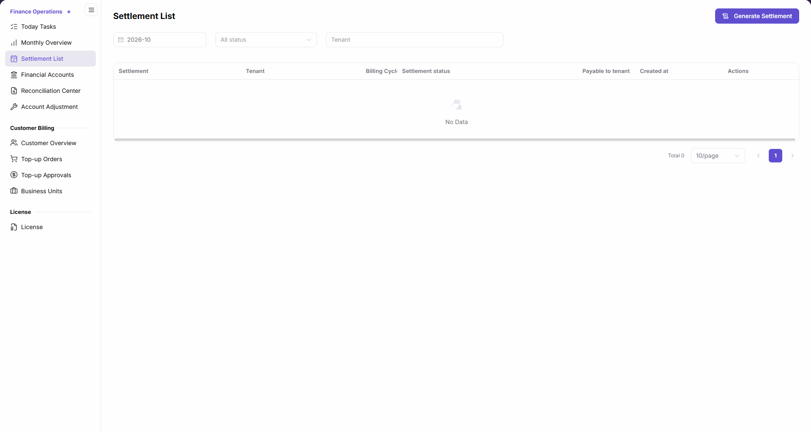
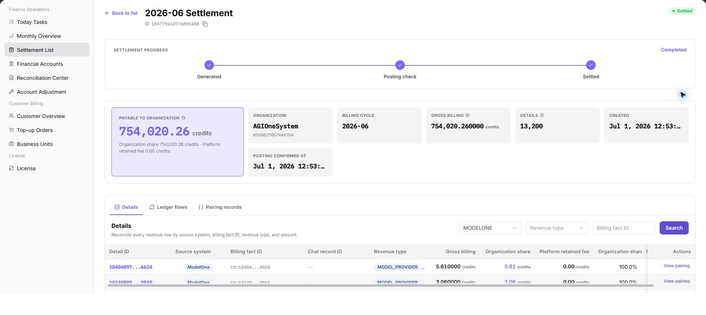
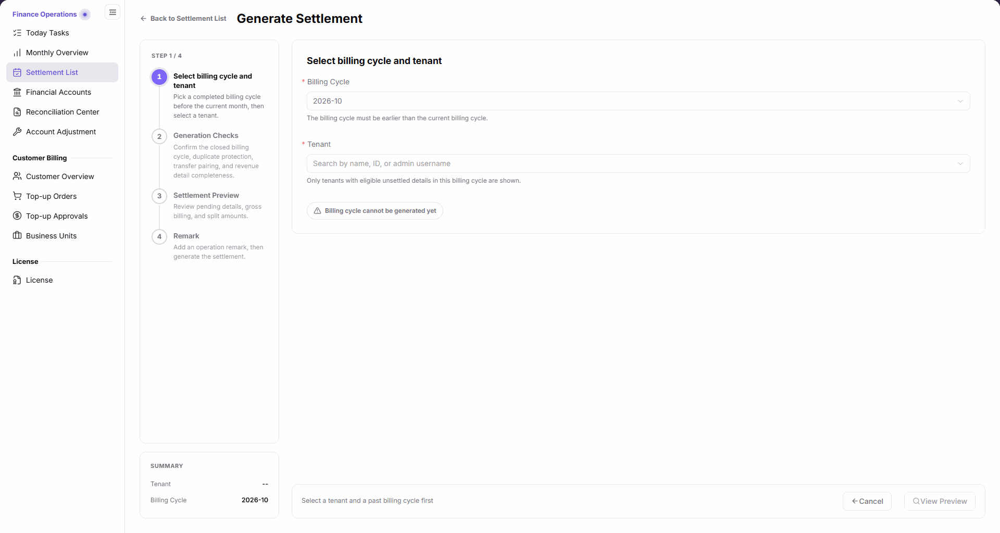
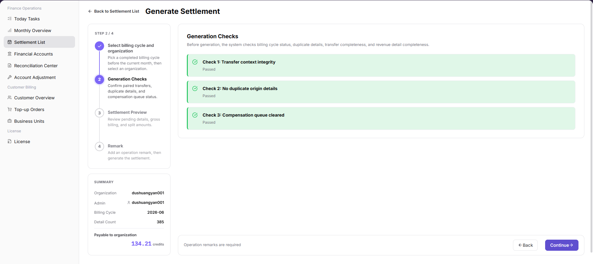
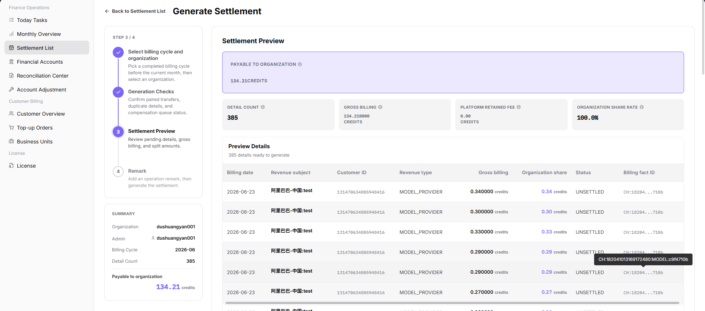
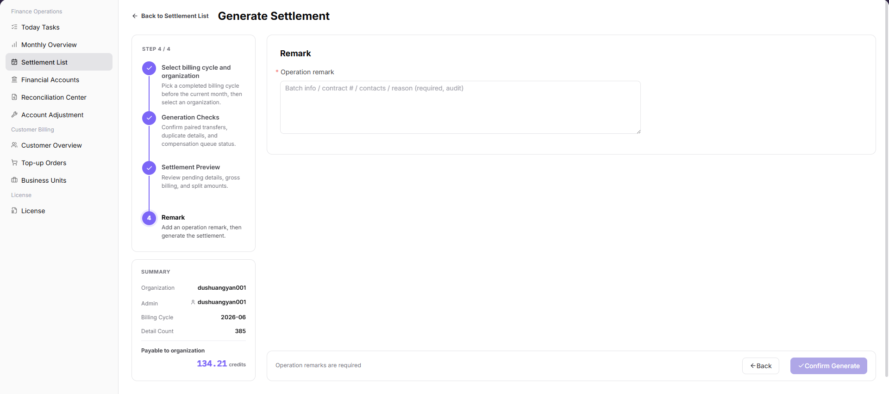

# Settlement List

::: info Document Information
Version: v2.1
Updated: 2026-11-05
:::

## Feature Overview

| Item | Content |
| --- | --- |
| Applicable Role | Operations administrator |
| Navigation path | Billing > Finance Operations > Settlement List |
| Page route | `/billing/admin/provider-settlements` |
| Managed objects | Tenant settlements by billing cycle, settlement amounts, and posting confirmation |

Use this page to locate settlements by billing cycle, settlement status, and tenant, open details to check progress and underlying records, or enter the settlement generation flow.

#### Beginner Explanation

A settlement is like a reconciliation checklist for a tenant and billing cycle. Opening the generation page only starts preparing that checklist; it does not mean a settlement has been generated or funds have been posted.

#### Terms Quick Reference

| Term | Description |
| --- | --- |
| Billing Cycle | The month used to query or generate settlements. |
| Payable to tenant | The amount payable to the tenant, in credits. |
| Generation Checks | The stage for reviewing transfers, duplicate details, and the compensation queue. |
| Settlement Preview | The stage for reviewing split amounts and pending details before confirmation. |
| Posting confirmation | Detail information for checking posting progress and confirmation time. |

## Prerequisites

1. Open `Billing > Finance Operations > Settlement List` as an operations administrator.
2. Identify the billing cycle, tenant, amount, and approval basis to check.
3. For generation, select a billing cycle before the current month. The tenant selector only shows tenants with eligible unsettled details in that billing cycle.
4. Complete business checks and required approvals before final generation. Do not perform final confirmation during a read-only review.

## Page Description

| Area | Description |
| --- | --- |
| Top entry | `Generate Settlement` opens the generation page; selecting the entry alone does not complete generation. |
| Filters | Three filters only: billing cycle, settlement status, and tenant. |
| Results table | Columns are Settlement, Tenant, Billing Cycle, Settlement status, Payable to tenant, Created at, and Actions. Amounts are in credits. |
| Pagination | Shows the total count, page size, and page navigation. |
| Generation page | Four stages: Select billing cycle and tenant, Generation Checks, Settlement Preview, and Remark. |

The figure shows the three filters, seven table columns, and top generation entry. `No Data` describes the current filter scope.

## Main Operations

### Query Settlements

1. Go to `Billing > Finance Operations > Settlement List`.
2. Select `Billing Cycle` and adjust the settlement status and tenant filters as needed.
3. Check Settlement, Tenant, Billing Cycle, Settlement status, Payable to tenant, and Created at in the results.
4. If the list shows `No Data`, check the three selected filters first. Do not conclude that other billing cycles or tenants have no settlements.

### View Settlement Details

1. Locate the target settlement in a populated list and click `Details` in its row.
2. Verify the tenant and billing cycle, then review settlement progress, payable amount, gross billing, detail count, and posting confirmation time.
3. Locate the target settlement detail and use its source system, revenue type, and billing fact ID to check the origin of the record.
4. Review account transactions and pairing records, and use the pairing view entry to inspect related information.
5. Cross-check amounts and details against the approval basis. If they differ, continue checking in Financial Accounts or Reconciliation Center rather than generating another settlement in place of reconciliation.

The figure shows settlement progress, amounts, detail count, posting confirmation time, and entries for settlement details, account transactions, and pairing records.

### Generate Settlement

1. Click `Generate Settlement` at the top of the list to open the generation page. The entry carries the selected billing cycle, for example `/billing/admin/provider-settlements/generate?cycle=2026-10`.
2. In `Select billing cycle and tenant`, fill in the required `Billing Cycle` and `Tenant`. The billing cycle must be before the current month. Search tenants by name, ID, or admin username; only tenants with eligible unsettled details in that billing cycle are shown.
3. Check the tenant and billing cycle in the summary. With no tenant selected, `View Preview` is disabled and the page shows `Billing cycle cannot be generated yet` and `Select a tenant and a past billing cycle first`. Meet the displayed requirements before selecting `View Preview`.

The figure shows the required billing cycle and tenant fields and the summary in the first stage. `View Preview` continues the review; it is not final generation confirmation.

4. In `Generation Checks`, read the results for transfer context completeness, absence of duplicate original details, and an empty compensation queue, then use the next-step control to continue reviewing.

The figure shows generation check results for transfer context, duplicate original details, and the compensation queue. Read each result before continuing.

5. In `Settlement Preview`, check the tenant, billing cycle, payable amount, split amounts, and pending details, then use the next-step control to proceed to the remark stage.

The figure shows split amounts and the detail scope in the settlement preview. Compare them with the billing cycle, tenant, and approval basis.

6. In `Remark`, fill in the required operation remark. Include only necessary business notes, not bank accounts, credentials, or sensitive customer information.
7. Finally verify the settlement scope, amounts, and approval basis. Select `Confirm Generate` only when authorized to generate the settlement. Do not perform this action for a read-only review.

The figure shows the required operation remark and final `Confirm Generate` button. Entering a remark does not itself complete generation.

8. After performing generation, return to the list and check whether the corresponding record is present for the billing cycle and tenant. Open details to check the amount, settlement progress, and posting confirmation. Opening the generation page or clicking a button alone is not evidence of completed generation or posted funds.

## Parameter Quick Reference

| Field Name | Required | Field Type | Example | Description |
| --- | --- | --- | --- | --- |
| Billing Cycle | Required for generation | Month selector | `2026-10` | List filter; must be before the current month for generation. |
| Tenant | Required for generation | Tenant selector | `<tenant>` | List filter; generation only lists tenants with eligible unsettled details in that billing cycle. |
| Settlement status | As needed for queries | Status selector / result field | `<settlement status>` | List filter and current settlement status; not the posting confirmation time. |
| Settlement | Displayed by system | Text | `<settlement identifier>` | Identifies the settlement and its details. |
| Payable to tenant | Displayed by system | Amount | `0 credits` | Amount payable to the tenant in the list and details. |
| Created at | Displayed by system | Date and time | `<creation time>` | Time when the settlement was created. |
| Generate Settlement | As needed | Navigation entry | `Generate Settlement` | Opens the generation page; does not mean generation is complete. |
| View Preview | As needed | Button | `View Preview` | Continues the first-stage review; disabled with no tenant selected. |
| Generation Checks | Displayed by system | Check results | `<check result>` | Review transfer context, duplicate original details, and the compensation queue. |
| Settlement Preview | Displayed by system | Amounts and details | `0 credits` | Review the generation scope, split amounts, and details. |
| Remark | Yes | Text | `<business note>` | Required operation note before final confirmation. |
| Confirm Generate | Business authorization required | Final button | `Confirm Generate` | Final generation action; check the approval basis first. |
| Details | As needed | Detail entry | `Details` | Review progress, amounts, details, transactions, pairing records, and posting confirmation time. |

## Pitfalls

- `Generate Settlement` enters the four-stage flow. Successful navigation is not successful generation.
- `No Data` only describes the selected filter scope; it does not show that historical settlements lack details.
- Billing cycle and tenant are both required for generation. Do not confuse the list's tenant scope with the eligible tenant scope on the generation page.
- The final button is `Confirm Generate`. The first-stage `View Preview` is not final confirmation.

## Result Validation

| Check Item | Success Signal | If Abnormal |
| --- | --- | --- |
| Query scope | The three filters match the billing cycle, status, and tenant to check. | Adjust the relevant filter; do not interpret an empty list as an absence of all historical records. |
| Generation entry | The generation page displays four stages and the first-stage form. | Return to the list and check the selected billing cycle; do not treat navigation as generation. |
| First-stage input | The summary tenant and billing cycle match the target. | Check the required tenant and the requirement for a billing cycle before the current month. |
| Settlement check | The record's tenant, billing cycle, and credits amount match the business basis. | Open details and compare with Monthly Overview. |
| Detail check | Progress, detail count, transactions, pairing records, and posting confirmation time can be reviewed. | Cross-check Financial Accounts and Reconciliation Center; do not confirm posting from the list amount alone. |

## FAQ

#### Why Is View Preview Disabled Without a Tenant?

**Symptom:** `View Preview` is disabled and the page shows `Billing cycle cannot be generated yet`.

**Possible Causes:** No tenant is selected. The page requires `Select a tenant and a past billing cycle first`.

**Resolution:** Select a billing cycle before the current month and an eligible tenant, then check the summary. Only tenants with eligible unsettled details in that billing cycle are listed.

#### Does Clicking Generate Settlement Complete Generation?

**Symptom:** Clicking `Generate Settlement` opens the first-stage form.

**Possible Causes:** The button is a generation-page entry. The page still lists Generation Checks, Settlement Preview, and Remark stages.

**Resolution:** Review scope and amounts through the four stages and use the approval basis to decide whether to select final `Confirm Generate`. Check the list and details for the result; do not treat entering the page as completed generation.

## Notes

- Do not perform final generation during a read-only review. Check the billing cycle, tenant, amount, and approval basis before generation.
- Do not use repeated generation or repeated financial actions to resolve amount differences. Check existing settlements, details, and transactions first.
- Check settlement status and posting confirmation separately. A list status or amount alone does not confirm that funds have been posted.
- Keep only necessary business information in remarks, tickets, and shared materials. Do not include sensitive customer data, bank accounts, passwords, tokens, or keys.

## Next Steps

1. Open [Monthly Overview](../monthly-overview/) to check the settlement scope for the same billing cycle and tenant.
2. Open [Financial Accounts](../financial-accounts/) to check related transactions and funds.
3. For further investigation, open [Reconciliation Center](../reconciliation-center/) and compare settlement details and pairing records.
