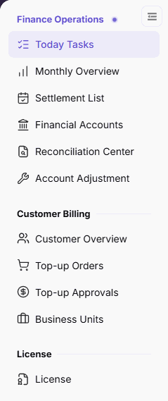

# Today Tasks

::: info Document Information
Version: v2.1
Updated: 2026-11-05
:::

## Feature Overview

| Item | Content |
| --- | --- |
| Applicable Role | Operations administrator |
| Navigation path | Billing > Finance Operations > Today Tasks |
| Page route | `/billing/admin/tasks` |
| Managed objects | Billing-cycle settlement metrics, platform account summary, Settlement Workbench, and Platform Account Reconciliation |

`Today Tasks` summarizes settlement progress, platform account amounts, and alerts. Two task cards connect to settlement and financial account pages.

#### Beginner Explanation

Today Tasks is like a daily finance desk: read the top metrics, review the two task cards, and then open the corresponding details.

#### Terms Quick Reference

| Term | Description |
| --- | --- |
| Previous closed billing cycle | The billing-cycle scope indicated for the top settlement metrics. |
| Platform Clearing Account | The live clearing account balance, not the settled amount for the displayed billing cycle. |
| Settlement Workbench | The card that summarizes settlement status and provides detail and generation entries. |
| Platform Account Reconciliation | The card that displays clearing obligations and account balancing information. |

## Prerequisites

1. The current account can access `Finance Operations > Today Tasks`.
2. Identify whether you need billing-cycle settlement progress or live platform account balances.
3. Before continuing to settlement generation, confirm the target billing cycle, tenant scope, and operation basis.

## Page Description

The main view contains top billing-cycle settlement metrics, a platform account summary, and two task cards.

The figure shows the current Today Tasks menu entry and its highlight in the left Finance Operations menu.

| Area | Description |
| --- | --- |
| Top settlement metrics | Displays Billing Cycle settled amount, the billing cycle and “Previous closed billing cycle” notice, plus Pending operator settlement, Settling, and Settled counts. |
| Platform account summary | Displays Platform Clearing Account, To settle to Providers, Platform Revenue Account, and Alerts; account balances use the live account scope. |
| Settlement Workbench | Displays Pending operator settlement, Posting check, Settled, Failed, settled percentage, settlement count, and Posting check > 48h; provides Generate Settlement and See detail. |
| Platform Account Reconciliation | Displays Clearing balance gap, To settle to Providers, Retained fee to transfer, Platform revenue account, Coverage, and Balance status. The scope is “Clearing obligations & balancing”; provides See detail. |

## Main Operations

### Read Settlement and Account Metrics

1. Go to `Billing > Finance Operations > Today Tasks`.
2. Read the billing cycle and `Previous closed billing cycle` notice, then check `Billing Cycle settled amount`.
3. Read `Pending operator settlement`, `Settling`, and `Settled` counts.
4. Read `Platform Clearing Account`, `To settle to Providers`, `Platform Revenue Account`, and `Alerts`; distinguish live account balances from billing-cycle settlement metrics.

### Review Cards and Open Details

1. In `Settlement Workbench`, review settlement states, the settled percentage, and `Posting check > 48h`.
2. Click **"See detail"** on this card to review settlement records. See [Settlement List](../settlement-list/) for subsequent operations.
3. In `Platform Account Reconciliation`, read Clearing balance gap, To settle to Providers, Retained fee to transfer, Coverage, and Balance status.
4. Click **"See detail"** on this card to review accounts and transactions. See [Financial Accounts](../financial-accounts/) for subsequent operations.

### Open Settlement Generation

1. Check the billing-cycle settlement information in Settlement Workbench.
2. Click **"Generate Settlement"** to open the settlement generation page.
3. Continue with the generation flow in [Settlement List](../settlement-list/). Opening the entry does not mean a settlement has been generated or funds have arrived.

## Parameter Quick Reference

| Field Name | Required | Field Type | Example | Description |
| --- | --- | --- | --- | --- |
| Billing Cycle settled amount | Displayed by system | Amount | `0.00 credits` | Settled amount for the billing cycle displayed at the top. |
| Pending operator settlement | Displayed by system | Number | `0` | Settlements awaiting operator action; the card counts providers. |
| Settling | Displayed by system | Number | `0` | In-progress settlement count displayed at the top. |
| Settled | Displayed by system | Number | `0` | Settled count; the card also shows a settled percentage. |
| Platform Clearing Account | Displayed by system | Amount | `0.00 credits` | Live clearing account balance; its scope does not change with the settlement billing cycle. |
| To settle to Providers | Displayed by system | Amount | `0.00 credits` | Amount to settle to providers in the platform account summary. |
| Platform Revenue Account | Displayed by system | Amount | `0.00 credits` | Live platform revenue account balance, not statistical revenue for the displayed billing cycle. |
| Alerts | Displayed by system | Number | `0` | Alert count in the platform account summary. |
| Posting check / Failed | Displayed by system | Number | `0` | Corresponding state counts in Settlement Workbench. |
| Posting check > 48h | Displayed by system | Number | `0` | Posting checks exceeding the duration displayed separately in Settlement Workbench. |
| Clearing balance gap / To settle to Providers / Retained fee to transfer | Displayed by system | Amount | `0.00 credits` | Corresponding amounts in Platform Account Reconciliation. |
| Coverage | Displayed by system | Percentage | `0%` | Read alongside the coverage status and balance status. |
| See detail | Operation entry | Button | See detail | Opens settlement or financial account pages from the corresponding card. |
| Generate Settlement | Operation entry | Button | Generate Settlement | Opens settlement generation; does not itself indicate successful generation. |

## Pitfalls

- `Previous closed billing cycle` scopes the top settlement metrics. Platform Clearing Account and Platform Revenue Account balances are live; do not treat them as settled amounts for that cycle.
- In Settlement Workbench, Pending operator settlement counts providers, while Posting check, Settled, and Failed count items. Check units before comparing.
- `Posting check > 48h` is a separate card metric; read it alongside the Posting check count.
- `Generate Settlement` is an entry to the subsequent flow, not evidence that settlement is complete.

## Result Validation

| Check Item | Success Signal | If Abnormal |
| --- | --- | --- |
| Billing-cycle scope | The top billing cycle and Previous closed billing cycle notice have been checked | Recheck the top notice, then query the target cycle in Monthly Overview |
| Card scope | Settlement Workbench and Platform Account Reconciliation have been reviewed separately | Distinguish settlement states from account balancing by card name |
| Settlement details | Settlement Workbench opens the settlement page | Continue through Settlement List in the left menu |
| Account details | Platform Account Reconciliation opens Financial Accounts | Continue through Financial Accounts in the left menu |

## FAQ

#### Why Can Account Balances Not Be Compared Directly with the Top Settled Amount?

**Symptom:** Platform account balances and Billing Cycle settled amount appear together but cannot be compared on the same basis.

**Possible Causes:** The top amount refers to the Previous closed billing cycle; platform account balances use the live account scope.

**Resolution:** Review target-cycle settlement statistics in Monthly Overview and live balances and transactions in Financial Accounts.

#### Why Is the Pending Operator Settlement Count Not a Settlement Item Count?

**Symptom:** Settlement Workbench displays both provider counts and settlement item counts.

**Possible Causes:** Pending operator settlement uses “Providers”, whereas Posting check, Settled, and Failed use “Items”; the counting units differ.

**Resolution:** Check each metric's unit before clicking See detail to inspect settlement records.

## Notes

- This page is a summary and navigation entry. Complete financial checks using settlement details and account transactions.
- Confirm billing cycle, tenant scope, and amounts before continuing to settlement generation, and retain the required operation basis.
- Follow data access and confidentiality requirements when sharing billing information. Do not put customer data or credentials in public materials.

## Next Steps

1. Open [Monthly Overview](../monthly-overview/) for billing-cycle statistics.
2. Open [Settlement List](../settlement-list/) to check records or continue generation.
3. Open [Financial Accounts](../financial-accounts/) to check platform balances and transactions.
4. Open [Reconciliation Center](../reconciliation-center/) for billing reconciliation information.
