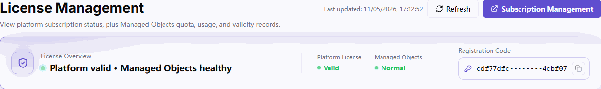
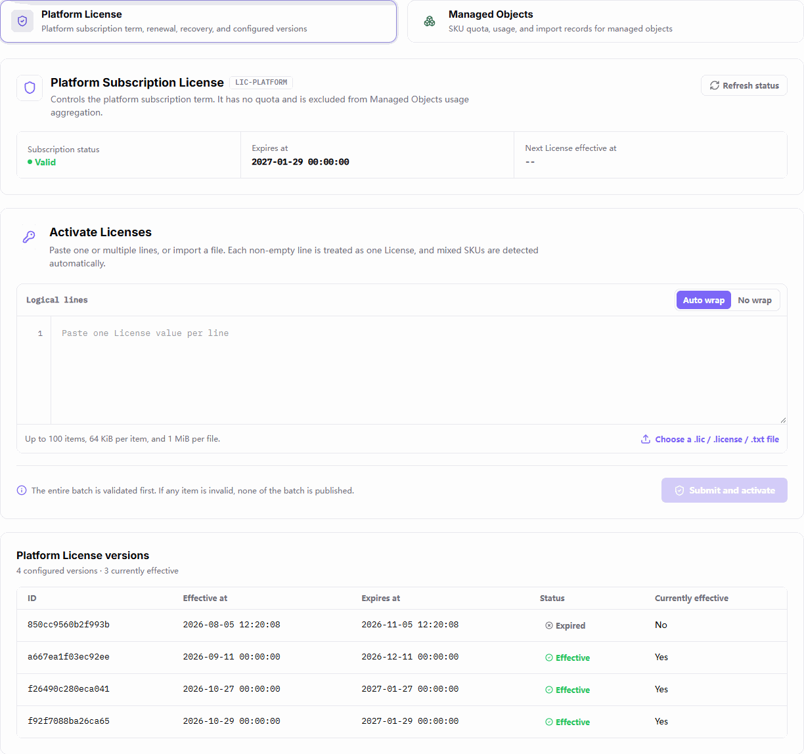
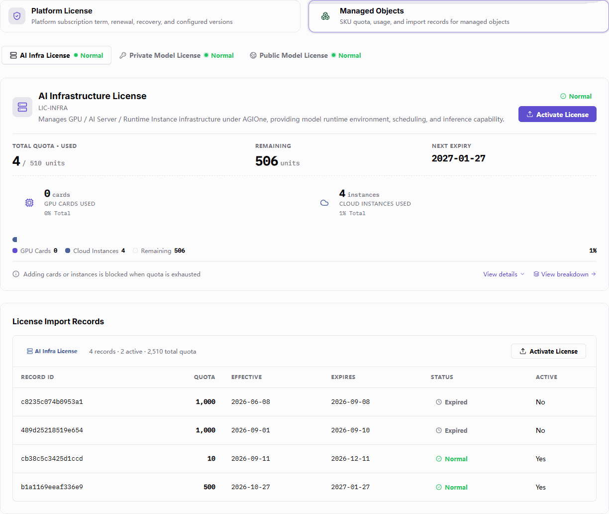

# License

::: info Document Information
Version: v2.1
Updated: 2026-11-05
:::

## Feature Overview

| Item | Content |
| --- | --- |
| Applicable Role | Operations administrator |
| Navigation Path | Billing > License > License |
| Page Route | `/user/usercenter/license/managed-objects` (default); the Platform License area uses `/user/usercenter/license/platform-license` |
| Managed areas | Platform License subscription status and authorized versions; Managed Objects SKU quota, usage, validity, and import records |

`License Management` has two tabs: `Platform License` and `Managed Objects`. The top `License Overview` summarizes the current state of both areas and shows a shortened system registration code; the tab below shows either the platform subscription or the managed-object authorization.

#### Beginner Explanation

Platform License controls how long the platform subscription remains valid; Managed Objects controls how much capacity each managed-object category can add. Neither replaces the other: check the overview first, then open the relevant tab.

#### Terms Quick Reference

| Term | Description |
| --- | --- |
| Platform License | Platform subscription term, renewal, recovery, and configured versions; it does not contain SKU quota. |
| Managed Objects | SKU authorization for AI infrastructure, private models, public models, and similar managed objects. |
| SKU | An authorization category under Managed Objects: AI Infra, Private Model, and Public Model. |
| Registration Code | Identifier for the current deployment, used to obtain a matching License; the page shows a shortened form by default. |
| Import Record | A record created by a License import, containing quota, effective time, expiry time, and active state. |

## Prerequisites

1. The current account can open `Billing > License > License`.
2. The current page belongs to the target environment and deployment.
3. Required internal approval and a trusted License source are available before activation.
4. The browser session is valid. Read-only checks do not require an activation code; activation requires the corresponding authorization.

## Page Description

The page contains:

The figure shows the upper part of the page: the tabs, subscription status and expiry at the top, and the License Overview with Platform License and Managed Objects states plus the shortened registration code.

| Area | Description |
| --- | --- |
| License Overview | Shows Platform License and Managed Objects states with the shortened system registration code. |
| Area tabs | `Platform License` and `Managed Objects` switch between subscription authorization and SKU authorization. |
| Platform License area | Shows subscription status, expiry time, next License effective time, activation editor, batch rules, and authorized-version table. |
| Managed Objects area | Provides AI Infra, Private Model, and Public Model SKU tabs; each SKU has a quota card and License import records. |
| SKU quota card | Shows SKU code and description, total quota and used, remaining quota, nearest expiry, usage breakdown, and the quota-exhaustion restriction. |
| License Import Records | Shows record ID, quota, effective time, expiry time, status, and active state per record. |
| Activation dialog | Opens from `Activate License`, with activation-code input, registration code, file import, and the final activation action. |

The `Platform License` area provides both logical-line input and file import. Each non-empty line is treated as one License, and mixed SKUs are allowed. The limits are 100 items per batch, 64 KiB per item, and 1 MiB per file. Submission validates the entire batch first; if any item is invalid, none of the batch is published.

The figure shows the Platform License area: the tabs, subscription status and expiry at the top, the activation editor and batch-validation notice in the middle, and the authorized-version table below.

The `Managed Objects` area is organized by the AI Infra, Private Model, and Public Model SKU tabs. Each SKU card shows total quota and used, remaining quota, nearest expiry, and usage breakdown. When quota is exhausted, the corresponding add operation for that SKU is blocked; the exact restriction is stated on the card. The import records below the card show record ID, quota, effective time, expiry time, status, and active state.

The figure shows the AI Infra License category under Managed Objects: the three SKU tabs, the quota and usage card, and the License import records with their fields.

## Main Operations

### Check the Overview and Switch Authorization Areas

1. Go to `Billing > License > License`.
2. Check the current Platform License and Managed Objects states in `License Overview`.
3. Confirm that the registration code belongs to the target deployment; the page shows only a shortened value. Do not copy it into public materials.
4. Select the `Platform License` or `Managed Objects` tab to open that authorization area.
5. When the state needs updating, click `Refresh status`; do not repeatedly submit a License to force a refresh.

### Review Platform License and Authorized Versions

1. Select the `Platform License` tab.
2. Check `Subscription status`, `Expires at`, and `Next License effective at`.
3. In `Activate Licenses`, paste License values line by line or import them with `Choose a .lic / .license / .txt file`.
4. Use `Auto wrap` or `No wrap` for display; this changes presentation only and does not alter License content.
5. Check the batch limits: up to 100 items, 64 KiB per item, and 1 MiB per file.
6. Read the batch-validation notice; stop before `Submit and activate` during read-only checks.
7. In the `Platform License versions` table, check ID, effective time, expiry time, status, and currently effective state.

### Review Managed Objects and Import Records

1. Select the `Managed Objects` tab.
2. Switch among `AI Infra License`, `Private Model License`, and `Public Model License`.
3. Check the SKU code, description, status, total quota and used, remaining quota, nearest expiry, and usage breakdown.
4. Read the quota-exhaustion restriction to determine which add operation is blocked for that SKU.
5. In `License Import Records`, check record ID, quota, effective time, expiry time, status, and active state.
6. Use `View details` or `View breakdown` on the card when further inspection is needed.

### Inspect the Activation Dialog Without Submitting

1. Click `Activate License` in the target SKU or import-record area.
2. The dialog title is `Get & Activate License`; select `I have an activation code`.
3. `I need to buy one` is a purchase entry and is outside read-only checks.
4. Verify that the displayed registration code belongs to the target deployment; complete registration codes do not appear in document images or public materials.
5. The activation-code editor supports one or multiple lines and also `.lic`, `.license`, or `.txt` import.
6. With no content entered, the `Activate` button is disabled; do not enter an activation code or click `Activate` during read-only checks.
7. Click `Close` when finished.

## Parameter Quick Reference

| Field Name | Required | Field Type | Example | Description |
| --- | --- | --- | --- | --- |
| Platform License tab | No | Area switch | `Platform License` | Opens the platform subscription and authorized versions. |
| Managed Objects tab | No | Area switch | `Managed Objects` | Opens SKU quota and import records. |
| Registration Code | System-generated | Sensitive text | Shortened by the system | Identifies the current deployment; the page does not show the complete value by default. |
| Refresh status | No | Button | `Refresh status` | Reloads the current authorization state. |
| Subscription status | System-generated | Status | `Valid` | Whether the Platform License is currently usable. |
| Expires at | System-generated | Time | `2027-01-29 00:00:00` | Expiry time of the current Platform License. |
| Next License effective at | System-generated | Time | `--` | Effective time of the next configured Platform License. |
| Logical lines | Yes for paste | Multi-line editor | `1` | Treats each non-empty line as one License. |
| Auto wrap / No wrap | No | Display control | `Auto wrap` | Changes display only; does not alter License content. |
| License file | No | File import | `.lic` / `.license` / `.txt` | Imports a file containing multiple Licenses. |
| Batch item limit | System-enforced | Quantity | `100` | Up to 100 License items per batch. |
| Item size limit | System-enforced | Size | `64 KiB` | Maximum content size per License item. |
| File size limit | System-enforced | Size | `1 MiB` | Maximum imported file size. |
| Submit and activate | Final action | Button | `Submit and activate` | Changes the deployment authorization state; not executed during read-only checks. |
| SKU tab | No | Category switch | `AI Infra License` | Switches AI infrastructure, private-model, or public-model authorization. |
| SKU code | System-generated | Text | `LIC-INFRA` | Authorization code for the current SKU. |
| Total quota and used | System-generated | Quantity | `4 / 510 units` | Total quota and used quantity for the current SKU. |
| Remaining | System-generated | Quantity | `506 units` | Remaining quota for the current SKU. |
| Next expiry | System-generated | Time | `2027-01-27` | Nearest expiry among the current SKU's authorizations. |
| Usage breakdown | System-generated | Statistics | `GPU Cards 0` / `Cloud Instances 4` | Quota usage by object type. |
| View details / View breakdown | No | Button | `View details` | Opens details or quota composition for the current SKU. |
| Record ID | System-generated | Identifier | `Record ID` | Unique identifier of an import record, not the License content itself. |
| Quota | System-generated | Quantity | `1,000` | Quota corresponding to that import record. |
| Effective at / Expires at | System-generated | Time | `2026-06-08` | Effective and expiry dates of that record. |
| Status / Active | System-generated | Status | `Normal` / `Yes` | That record's status and whether it is currently active. |
| Activate | Final action | Button | `Activate` | Changes the deployment authorization state; disabled when no content is entered. |

## Pitfalls

- Platform License and Managed Objects are separate authorization dimensions; a healthy state in one area does not prove the other area is valid.
- Registration codes and activation codes are deployment-level sensitive information; do not expose complete values in screenshots, tickets, or public materials.
- `Auto wrap` and `No wrap` change display only; they do not merge or split a License.
- Batch activation validates the entire batch first: any invalid item blocks the whole batch.
- Authorized quota is not billing balance; check financial pages for funding and settlement questions.
- A record ID in License Import Records identifies a record; it is not License content or an activation code.

## Result Validation

| Check Item | Success Signal | If Abnormal |
| --- | --- | --- |
| Page is accessible | `License Management` opens and `Billing > License > License` is highlighted. | Check the account permission and page loading state. |
| Overview state | `License Overview` shows both Platform License and Managed Objects states. | Click `Refresh status` and check again; do not resubmit a License. |
| Platform area | Subscription status, expiry time, and the authorized-version table can be checked. | Confirm the Platform License tab is selected, then check status and time. |
| Managed Objects area | The three SKU tabs switch, and the quota card and import records are visible. | Check the selected SKU tab and record scope. |
| Batch rules | The logical-line editor, wrap control, file types, and size limits are visible. | Confirm the Platform License tab is selected and reload the page. |
| Activation dialog | The title is `Get & Activate License`, with activation-code and purchase tabs. | Check the current SKU and account permission; do not enter a code or click Activate. |

## FAQ

#### Why Is the Activate Button Disabled?

**Symptom:**

After opening `Get & Activate License`, the `Activate` button cannot be clicked.

**Possible Causes:**

The editor currently contains no activation-code content; the button remains disabled while the input is empty.

**Resolution:**

Stop the read-only check here. To activate, obtain authorization, paste or import a valid License, and follow the dialog prompts. Do not attempt activation while the source and approval are unconfirmed.

#### Platform License Is Valid but a Managed Objects SKU Is Low on Quota

**Symptom:**

Platform License shows Valid, but the remaining quota for a SKU is near or at exhaustion.

**Possible Causes:**

The two authorizations are calculated separately: platform subscription status does not include SKU quota, which comes from imported authorizations.

**Resolution:**

Open the SKU and check total quota, used, remaining, and import records; read the card notice to identify which add operations are blocked before deciding whether more License is needed.

#### What Is the Difference Between Status and Active in an Import Record?

**Symptom:**

A record may show `Expired` or `Normal` while also showing Active as `Yes` or `No`.

**Possible Causes:**

Status describes whether the record is valid, while Active describes whether it currently supplies quota to the SKU.

**Resolution:**

Check quota, effective time, expiry time, status, and Active together; do not judge authorization availability from one column alone.

## Notes

- Complete registration codes, activation codes, and License contents are sensitive; do not write them into documents, screenshots, tickets, or public materials.
- `Submit and activate` and `Activate` change the current deployment state and require separate confirmation; read-only checks stop before the final action.
- Do not reuse a License across environments without confirming the environment, deployment, and source.
- If a state or quota difference cannot be confirmed, leave the page unchanged and refer it to an authorized administrator rather than retrying submissions.

## Next Steps

1. To check platform funds, open [Financial Accounts](../../finance-operations/financial-accounts/).
2. To check settlements, open [Settlement List](../../finance-operations/settlement-list/).
3. To locate current-cycle tasks, return to [Today Tasks](../../finance-operations/today-tasks/).
